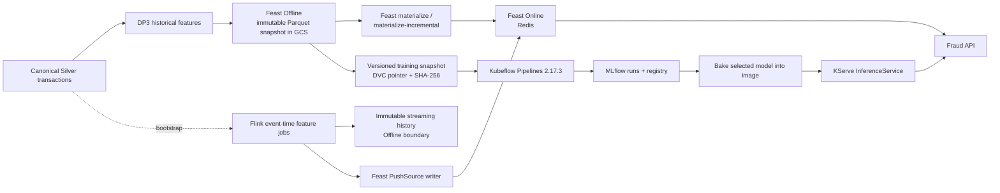
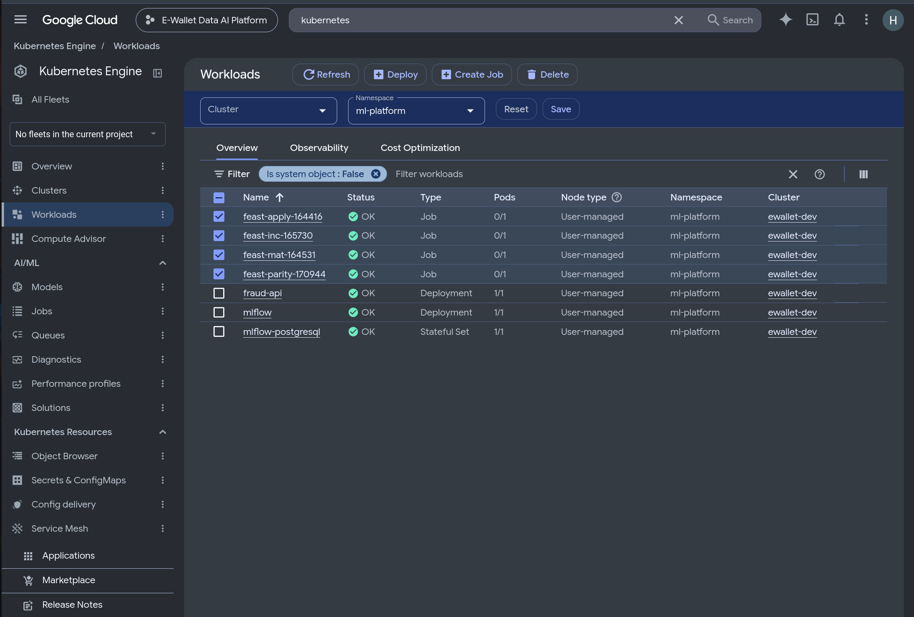
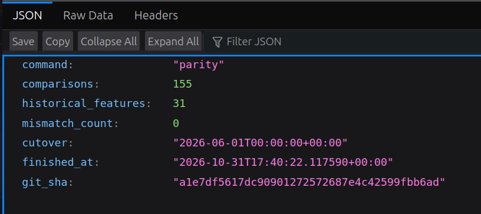
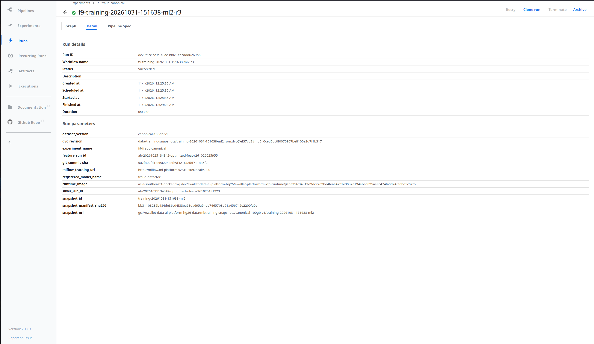
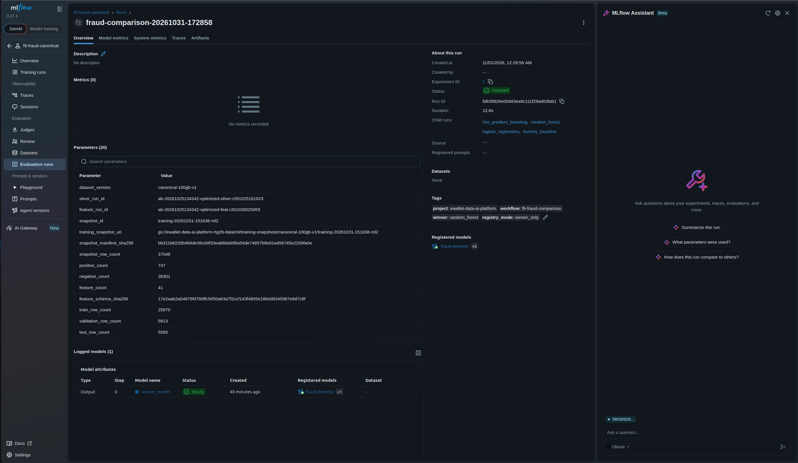
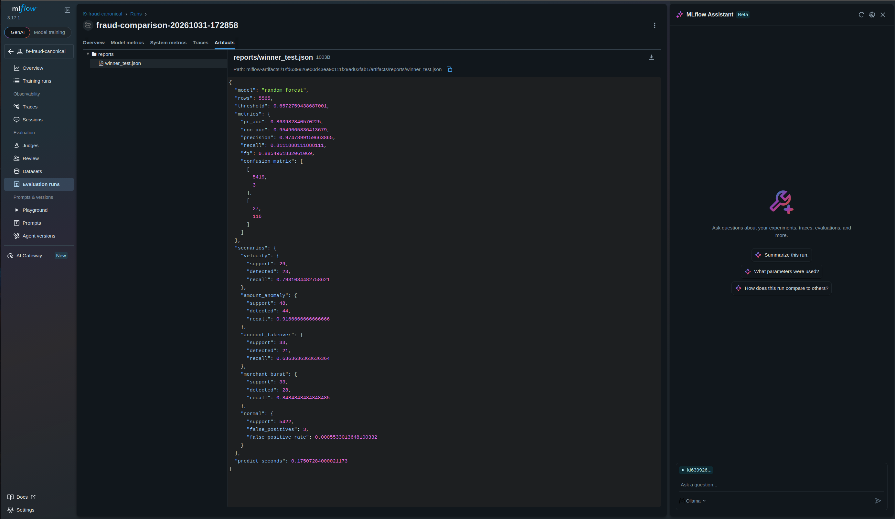
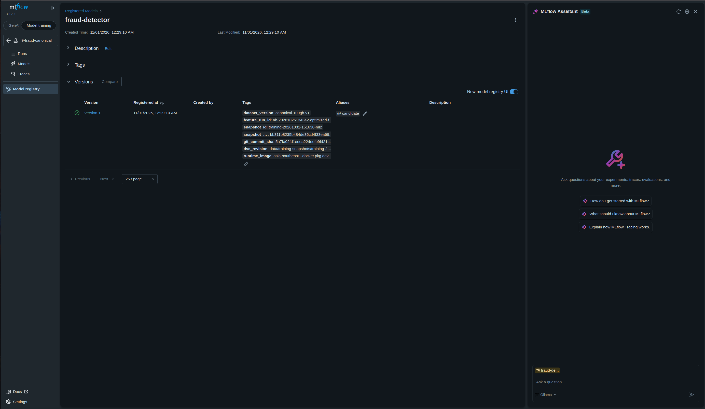
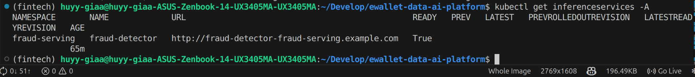
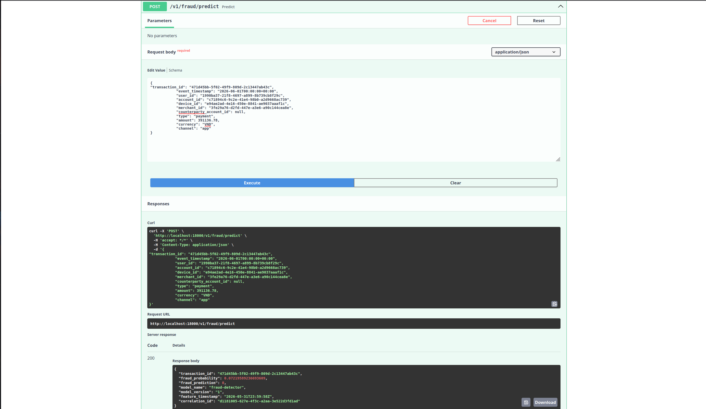

# EDAI-2 MLOps and Feature Store

## Scope, provenance, and status vocabulary

This report covers EDAI-2 rubric rows 11–15. It is grounded in the original
workbook, repository source, the bounded MLOps campaign executed on 31 October
2026, and immutable local copies of its runtime artifacts. It does not treat a
compiled pipeline, a running container, or an image in a registry as proof of
successful execution.

The documentation review was performed at canonical HEAD
`dedea5ed3db495dec7791745eaf0c4c8bfb86582`. The authoritative MLOps/Flink
source is the clean worktree
`.worktrees/codex-mlops-controlled-integration-20261101`, branch
`codex/mlops-controlled-integration-20261101`, at
`e7dbbc27436faef5b06ba4c40df66a1639f46a28`. Block A itself was introduced in
that lineage by `0466ba40e30d8e6a937ff66b47a20f1ab46559bd`; the original MLOps
runtime campaign was committed as `6913393`, and its individual artifacts
record the source SHAs used for each operation. Source that has not yet reached
the canonical branch is identified explicitly below.

Status terms have the following strict meanings:

| Status | Meaning |
| --- | --- |
| `SOURCE_READY` | Implementation and configuration exist and have reviewable contracts. |
| `TEST_PASS` | A bounded automated test result exists; this is not runtime proof. |
| `RUNTIME_VERIFIED` | A real execution artifact and/or genuine UI evidence proves the stated runtime behavior. |
| `BUSINESS_E2E_VERIFIED` | A real request traversed the business path and produced a valid response. |
| `NOT_EXECUTED` | The stated operation was not run. |
| `EVIDENCE_CAPTURE_REQUIRED` | The implementation may exist, but the rubric-specific screenshot or runtime proof is absent. |

## Exact rubric mapping

The authoritative workbook is `EDAI K11.xlsx`, sheet `edai-2 (50%)`, rows
11–15. The English rendering below preserves the workbook's meaning.

| Row | Requirement | Required proof | Points |
| ---: | --- | --- | ---: |
| 11 | Build a pipeline (for example Airflow) that incrementally materializes the latest data from the Offline Store to the Online Store. | Successful pipeline screenshot and source link. | 2 |
| 12 | Deploy jobs that push the streaming features from the mini-coursework into both Offline and Online Stores. | Successful jobs, data present in both stores, and source links. | 2 |
| 13 | Build a Kubeflow training pipeline with at least four steps: load data from the offline feature store, split data, train the model, and evaluate the model. | Successful Kubeflow Pipelines UI run and source link. | 2 |
| 14 | Store model, data, and related metadata for every training run in MLflow for versioning; automatically tag the model `latest` or `production` to automate deployment. | UI proof of model versions and corresponding versioned data. | 2 |
| 15 | Serve the trained model with KServe using the model-inside-image pattern. | KServe pod, KServe YAML, and successful invocation screenshot. | 2 |

## Architecture and motivation

The design separates historical computation, online freshness, training
orchestration, experiment lineage, and serving. Immutable identifiers and
digests connect the boundaries instead of mutable filenames or `latest` image
tags.



This topology prevents online storage from becoming the training source,
preserves point-in-time semantics, and binds each model to a specific dataset,
feature run, Git commit, runtime image, and manifest digest.

## Feast Offline and Online contracts

The Offline Store is an immutable Parquet projection of the four canonical
Gold feature tables. The FeatureViews expose 31 historical model features:
nine user, ten account, five device, and seven merchant features. Each source
retains UTC microsecond timestamps. Entity frames contain only join keys and
`event_timestamp`; labels enter after point-in-time retrieval.

The production campaign used:

| Contract | Value |
| --- | --- |
| Dataset | `canonical-100gb-v1` |
| Silver run | `ab-20261025134342-optimized-silver-r261025181923` |
| Feature run | `ab-20261025134342-optimized-feat-r261026025955` |
| Training snapshot | `training-20261031-151638-ml2` |
| Snapshot manifest SHA-256 | `bb311b8235b484de36cd4f33ea68da695a54de74657b8e91a456745e2200fa0e` |
| Snapshot rows | 37,048 (`25,870 / 5,613 / 5,565` train/validation/test) |
| Online runtime source SHA | `a1e7df5617dc90901272572687e4c42599fbb6ad` |

The online repository uses a GCS registry and Redis connection supplied by a
Kubernetes Secret. `apply`, bounded window materialization, incremental
materialization, and parity are separate fail-closed operator commands.
Registry generations are recorded before and after each mutation.

### Row 11 — incremental Offline to Online materialization

The bounded campaign first materialized `[22:00, 23:00)` UTC for all four
FeatureViews, then ran `materialize-incremental` for `[23:00, 00:00)` UTC.
The incremental job ran from `2026-10-31T16:57:41.243867Z` to
`2026-10-31T17:09:01.509976Z` and advanced the registry generation from
`1793465841581107` to `1793466541482990`. A later online/offline comparison
checked 155 values across all 31 features and returned `PASS` with zero
mismatches.



*Genuine Google Cloud/Kubernetes UI evidence. The bounded Feast operator jobs
for initial and incremental materialization completed; the timestamps and
operation JSON provide the authoritative intervals and registry generations.*



*Genuine runtime result. Five entities per FeatureView produced 155 comparisons
over 31 historical features, with `mismatch_count=0`; a deliberately missing
entity was also checked as all-null.*

Status: **`RUNTIME_VERIFIED`**. The implementation is in
`ai_platform/features/feast/online_operator.py` and
`scripts/mlops/feast_online_job.sh` at controlled-integration commit
`e7dbbc2`. These files are not yet present at canonical HEAD `dedea5e`, which
is an integration blocker but does not invalidate the preserved campaign.

## Streaming feature maintenance

### Row 12 — Flink to Offline and Online Stores

Implementation commit `0466ba4`, contained in controlled-integration HEAD
`e7dbbc2`, implements a deterministic Block A:

1. Redpanda supplies versioned transaction events.
2. Flink validates, deduplicates, applies event-time watermarks and allowed
   lateness, and maintains all 31 rolling historical features.
3. Every accepted event, including `TOO_LATE`, is sent to an immutable,
   run-scoped history topic and GCS writer (the Offline boundary).
4. Complete per-FeatureView updates are sent to an online topic; the decoupled
   writer invokes `FeatureStore.push(..., to=PushMode.ONLINE)` for Redis.
5. Retry, DLQ, late-reconciliation, checkpoint, and parity contracts are kept
   separate from business feature state.

Relevant controlled-integration source paths are:

- `data_platform/streaming/flink/job.py`
- `data_platform/streaming/flink/operators.py`
- `data_platform/streaming/sinks/historical_service.py`
- `data_platform/streaming/feast/service.py`
- `data_platform/streaming/sinks/online.py`
- `configs/streaming/block-a.yaml`
- `tests/streaming/`

The canonical branch still contains the earlier experimental
`data_platform/processing/flink/streaming_pipeline.py`. Its screenshots prove
`FEATURE`, `DUPLICATE`, `LATE`, and burst outputs only; its print sinks do not
prove writes to either feature store. The Feast batch materialization evidence
also cannot be substituted for Flink dual-store evidence.

Status: **`SOURCE_READY`** at `0466ba4` in clean integration HEAD `e7dbbc2`,
but deployment and dual-store write verification are **`NOT_EXECUTED`** and
**`EVIDENCE_CAPTURE_REQUIRED`**. Row 12 is therefore not accepted as runtime
complete. The detailed contracts, test evidence, legacy runtime screenshots,
and exact missing capture set are maintained in the
[Flink Streaming report](../../edai1/streaming/FLINK_STREAMING.md).

## Kubeflow training pipeline

### Row 13 — pipeline execution

The standalone KFP 2.17.3 workflow exceeds the four required logical steps:

1. validate and download the immutable offline snapshot;
2. verify chronological train/validation/test splits;
3. train four candidates in parallel (dummy, logistic regression, random
   forest, and histogram gradient boosting);
4. select the winner using validation PR-AUC then validation F1;
5. evaluate only the winner against the held-out test split;
6. publish the winner and lineage to MLflow.

The third submitted run succeeded:

| Field | Value |
| --- | --- |
| KFP run ID | `dc29f5cc-cc9e-49ae-b861-eacddd6269b5` |
| Run name | `f9-training-20261031-151638-ml2-r3` |
| Submitted | `2026-10-31T17:25:35.276014Z` |
| Finished | `2026-10-31T17:32:39.677577Z` |
| State | `SUCCEEDED` |
| Training source Git SHA | `5a7fa02fd1eeea224eefe9f421ca2f8f711a35f2` |
| Runtime image | `f9-kfp-runtime@sha256:34812d9dc7709be4feaa4791e3032a194ebcd895ae9c474fa0d245f0bd5c07fb` |



*Genuine Kubeflow Pipelines UI graph showing snapshot validation, split
verification, parallel candidate training, validation-only selection, test
evaluation, and MLflow publication.*



*Genuine KFP run details for the successful bounded run. The machine-readable
`kfp-run-3.json` is the authoritative source for the run ID, timestamps,
package digest, immutable image, and `SUCCEEDED` state.*

Canonical source references are
`ai_platform/ml/pipelines/pipeline.py`,
`ai_platform/ml/pipelines/runtime.py`, and
`ai_platform/ml/pipelines/compiled/f9_canonical_pipeline.yaml`.

Status: **`RUNTIME_VERIFIED`**. The first two historical submissions are
retained as attempts; only run `dc29f5cc-...` is claimed as successful.

## MLflow tracking and registry

### Row 14 — model, dataset, metadata, and deployment tag

MLflow recorded a parent training run and four child candidate runs. Every run
is linked to the immutable dataset version, Silver and feature run IDs,
snapshot ID, snapshot digest, DVC revision, Git commit, and digest-pinned
runtime image. Only the validation winner was evaluated on test and registered.

The random forest won with validation PR-AUC `0.8022`; its held-out test PR-AUC
was `0.863982840570225`. MLflow registered `fraud-detector` version `1`, parent
run `fd639926e00d43ea9c111f29ad03fab1`, and assigned alias `candidate`. The
source deliberately reports `production_promotion=NOT_PERFORMED`.



*Genuine MLflow UI evidence for the bounded training run, including parameters,
metrics, and immutable dataset/model lineage.*



*Genuine MLflow Model Registry evidence for `fraud-detector` version 1. The
campaign used the automatic `candidate` alias; it did not claim or perform a
production promotion.*

The implementation is in `ai_platform/ml/tracking/mlflow_tracker.py` and
`ai_platform/ml/pipelines/runtime.py`; the experiment contract is
`ai_platform/ml/config/f9_mlflow_experiment.yaml`.

Status: model/data lineage and registration are **`RUNTIME_VERIFIED`**. The
workbook specifically asks for automatic `latest` or `production` tagging;
the verified alias is `candidate`, so that narrow acceptance condition remains
**`NOT_EXECUTED`**. This is a real rubric blocker even though versioning itself
is complete.

## KServe model-inside-image inference

### Row 15 — serving and invocation

The serving builder resolved MLflow model version 1, downloaded and validated
the artifact, baked it into an immutable predictor image, and recorded its
lineage. The image is
`fraud-detector-predictor@sha256:cba90c22787c672559ceaeba26ad9f23faa6eae3fbbdb83cb7c2e48f10b5b896`.
The recorded model-tree digest is
`1f1331c3b1672ab42d19f074d8fb06e68f48e4690381b64324f442656936a545`.

KServe runs in Standard mode with one private predictor replica. The
`InferenceService` references the baked image directly and does not download a
model at startup; this is the required model-inside-image pattern.



*Genuine Kubernetes/KServe UI evidence showing the `fraud-detector`
InferenceService ready. Readiness is paired with the immutable image evidence,
not inferred from image existence alone.*



*Genuine runtime invocation through the fraud API. The preserved second smoke
artifact contains successful HTTP 200 responses with model version 1 and
feature timestamps; it proves the business inference path, not merely pod
health.*

Source references at controlled-integration commit `e7dbbc2` are
`ops/mlops/bake_serving_image.py`,
`infra/kubernetes/fraud-serving/inferenceservice.yaml.tmpl`, and
`ai_platform/inference/kserve.py`. The canonical branch already contains the
KServe client, but the bake operation and InferenceService template still
await canonical integration.

Status: **`RUNTIME_VERIFIED`** and **`BUSINESS_E2E_VERIFIED`** for the bounded
campaign. An earlier smoke artifact contains expected missing-feature failures;
the later `e2e-smoke-2.json` is the successful evidence and is not conflated
with that earlier attempt.

## Input and output contracts

| Boundary | Input | Output and invariant |
| --- | --- | --- |
| DP3 → Feast Offline | Four Gold feature tables, entity keys, UTC `event_timestamp` | Immutable Parquet snapshot; 31 features; no labels; manifest and row/key parity. |
| Offline → Online | Snapshot URI, registry URI, `[start,end)` or incremental cutover | Redis rows at FeatureView grain; registry generation and operation JSON recorded. |
| Flink → history | Valid unique versioned events, including too-late events | Immutable run/partition/offset-addressed JSONL objects; no overwrite. |
| Flink → Feast Online | Complete FeatureView update envelope | Entity key, feature timestamp, all values for one view; older updates cannot replace newer state. |
| Snapshot → KFP | GCS URI plus expected manifest SHA-256 | Validated chronological splits and candidate artifacts. |
| KFP → MLflow | Candidate metrics, winner, provenance | Parent/child runs, registered winner, dataset and image lineage. |
| MLflow → KServe | Explicit registered version/alias | Model tree baked into digest-pinned image; private V2 inference endpoint. |

## Verification inventory

No workloads were run for this documentation task. The following results are
preserved from the 2026-10-31 campaign:

| Evidence | Result |
| --- | --- |
| Feast initial materialization | Four FeatureViews completed for `[22:00,23:00)` UTC. |
| Feast incremental materialization | Four FeatureViews completed for `[23:00,00:00)` UTC. |
| Feast Online parity | `PASS`; 155 comparisons, 31 features, zero mismatches. |
| KFP training | Run `dc29f5cc-...` `SUCCEEDED`. |
| MLflow | Four candidates, one test-evaluated winner, model version 1, `candidate` alias. |
| KServe | InferenceService ready with digest-pinned model-inside-image. |
| Business smoke | Later smoke file contains successful HTTP 200 predictions for model version 1. |
| Flink dual-store | No deployment/run artifact proving writes to both stores. |

Relevant bounded source tests include `tests/unit/test_kfp_runtime_contract.py`,
`tests/test_mlflow_tracking.py`, `tests/inference/test_feast_online.py`,
`tests/inference/test_kserve.py`, and—on controlled integration—
`tests/streaming/`. A dedicated historical test transcript was not found in
the campaign evidence directory; this report therefore does not invent a test
count or claim `TEST_PASS` from source files alone.

### Raw evidence retained locally

The screenshots are presentation evidence; these machine-readable artifacts
remain the authoritative detail behind them:

- `~/ewallet-evidence/mlops-campaign-20261031/feast-online/materialize.json`
- `~/ewallet-evidence/mlops-campaign-20261031/feast-online/incremental.json`
- `~/ewallet-evidence/mlops-campaign-20261031/feast-online/parity.json`
- `~/ewallet-evidence/mlops-campaign-20261031/f9/kfp-run-3.json`
- `~/ewallet-evidence/mlops-campaign-20261031/f9/mlflow-summary.txt`
- `~/ewallet-evidence/mlops-campaign-20261031/ml2/source-manifest.json`
- `~/ewallet-evidence/mlops-campaign-20261031/ml2/publication-evidence.json`
- `~/ewallet-evidence/mlops-campaign-20261031/serving/serving-image-evidence.json`
- `~/ewallet-evidence/mlops-campaign-20261031/serving/e2e-smoke-2.json`

The earlier `e2e-smoke.json` is preserved as failed/partial historical
evidence; it is not used as the successful serving result.

## Screenshot transfer manifest

The images below already exist and are embedded from their verified repository
locations. They have **not** been copied, renamed, or modified. If the owner
wants a rubric-local evidence bundle, transfer them later to
`docs/evidence/edai2/mlops/` using this manifest and re-check each digest before
changing the links.

| Source | Proposed destination | SHA-256 | Caption purpose |
| --- | --- | --- | --- |
| `docs/evidence/cloud/mlops-campaign-20261031/screenshots/12c_feast_materialization_jobs.png` | `docs/evidence/edai2/mlops/11_feast_materialization_jobs.png` | `eeb4725f18a5a14e3eedfc5abdf8a6fc350ef4a1747025f8f758562d695965d1` | Initial and incremental Feast jobs. |
| `docs/evidence/cloud/mlops-campaign-20261031/screenshots/12d_feast_online_parity_result.png` | `docs/evidence/edai2/mlops/12_feast_online_parity.png` | `4e605abd52dfe5d1943dd0d1f93e5718ba0a3db77a8de2b571ecd06a89f6fc21` | 155 comparisons, zero mismatch. |
| `docs/evidence/cloud/mlops-campaign-20261031/screenshots/02_kfp_f9_pipeline_graph.png` | `docs/evidence/edai2/mlops/13_kfp_pipeline_graph.png` | `d3a8f122ec1f63b8c188d0187c647e6359ae8413d37e80b605f72448dc29d77d` | KFP DAG structure. |
| `docs/evidence/cloud/mlops-campaign-20261031/screenshots/03_kfp_f9_run_details.png` | `docs/evidence/edai2/mlops/14_kfp_run_succeeded.png` | `f8c4dc5e18a52d4cdee71580240a17164a070abcde49a31252ae7745443a9c83` | Successful KFP run details. |
| `docs/evidence/cloud/mlops-campaign-20261031/screenshots/04_mlflow_training_run.png` | `docs/evidence/edai2/mlops/15_mlflow_training_run.png` | `070479a412eb99f0a5999d7e3d1b47d8c2d9f7e62534f2b31f35e1b3eb4d3ea8` | MLflow run lineage and metrics. |
| `docs/evidence/cloud/mlops-campaign-20261031/screenshots/06_mlflow_model_registry.png` | `docs/evidence/edai2/mlops/16_mlflow_model_registry.png` | `831d5b10cd2f29706fb9e26977aa6da8c5669797089cdc756f365f95236a2201` | Registered version and alias. |
| `docs/evidence/cloud/mlops-campaign-20261031/screenshots/07_kserve_inferenceservice_ready.png` | `docs/evidence/edai2/mlops/17_kserve_ready.png` | `ceb525d050c45665e281f9483b0bc65c0b9dfe8f083df43abad8cbc5cd14c3b9` | KServe readiness. |
| `docs/evidence/cloud/mlops-campaign-20261031/screenshots/11_fraud_api_prediction.png` | `docs/evidence/edai2/mlops/18_fraud_prediction.png` | `197f59cddb849aeec387046bada19ed511b16ab5e68b2726408f2d42611e9397` | Successful inference invocation. |

Row 12 still needs new genuine UI evidence and therefore has no transfer row.

## Missing UI evidence and exact capture instructions

### Row 12: Flink dual-store runtime

Do not start a service merely to capture this evidence. During a future
authorized run:

1. Open the existing Flink Dashboard and select the canonical Block A job.
2. Capture the job overview with job ID, `RUNNING`/`FINISHED` state, start/end
   timestamps, checkpoint status, source and sink operators, and the online and
   history branches visible.
3. Capture the immutable GCS history prefix for the same run ID, including
   object paths and timestamps (Offline proof).
4. Capture Feast/Redis read-back for the same entity and feature timestamp,
   plus the parity result and writer consumer offsets (Online proof).
5. Preserve the job ID, Git SHA, image digest, dataset/run ID, cutover, topic
   offsets, and SHA-256 of every screenshot in a manifest.

Until all three views can be correlated to one run, retain
`EVIDENCE_CAPTURE_REQUIRED`.

### Row 14: required deployment alias

After model review, an authorized operator must assign the rubric-approved
`latest` or `production` alias through the existing guarded promotion step.
Capture the MLflow registered-model page showing model name, version, alias,
run ID, snapshot ID, Git SHA, and timestamp. The current `candidate` screenshot
must remain as historical evidence.

## Reproducibility (bounded, authorized execution only)

The following interfaces are the reproducible entry points; they are not
commands executed during this documentation task.

```bash
# Verify the immutable training boundary and local MLOps contracts.
scripts/mlops/preflight.sh

# Submit an already-compiled, digest-bound KFP package after reviewing inputs.
python -m ops.mlops.submit_f9_run --help

# Run a bounded Feast operator job only in an authorized cluster session.
scripts/mlops/feast_online_job.sh <run-id> --execute -- <operator-arguments>

# Build model-inside-image evidence from an explicitly reviewed model version.
python -m ops.mlops.bake_serving_image --help
```

Use the relevant locked project environment and immutable image digests. Never
reuse a published snapshot prefix, weaken checksum validation, infer success
from a compiled YAML, or promote a model without review.

## Known limitations and blockers

1. Row 12 lacks a deployed Flink dual-store run and correlated UI/read-back
   evidence. The earlier console-only screenshots are not sufficient.
2. The verified MLflow alias is `candidate`, not the workbook-required
   `latest` or `production`; automatic deployment tagging remains incomplete.
3. Feast Online operator, streaming Block A, serving-image builder, and KServe
   template are present in clean integration commit `e7dbbc2` but not yet in
   canonical HEAD `dedea5e`.
4. Campaign screenshots are stored under the shared cloud campaign path. The
   approved EDAI-2 evidence directory remains pending manual transfer.
5. The preserved Block A transcript records 45 streaming tests `OK` with one
   Feast-environment characterization test skipped, but it also records
   uncommitted Flink/test changes. It is historical dirty-worktree evidence,
   not an exact test run of `0466ba4` or `e7dbbc2`, and does not replace live
   dual-store evidence.
6. The bounded campaign validates one dataset/snapshot and does not establish
   long-running SLOs, disaster recovery, drift response, or repeated retraining.

## Five-row acceptance matrix

| Row | Implementation | Tests | Runtime / UI evidence | Business E2E | Acceptance and remaining action |
| ---: | --- | --- | --- | --- | --- |
| 11 | `SOURCE_READY` in integration commit | No campaign test count claimed | `RUNTIME_VERIFIED` initial + incremental jobs and parity | Not applicable | **Supported**; integrate source into canonical and optionally transfer screenshots. |
| 12 | `SOURCE_READY` at `0466ba4` in integration HEAD `e7dbbc2` | 45 historical dirty-worktree tests `OK` (1 skipped); exact-version rerun absent | `NOT_EXECUTED`; `EVIDENCE_CAPTURE_REQUIRED` | Not verified | **Not yet accepted**; first rerun focused tests at the clean source, then run one bounded canonical Flink job and prove both stores. See the [Flink report](../../edai1/streaming/FLINK_STREAMING.md). |
| 13 | `SOURCE_READY` in canonical source | No campaign test count claimed | `RUNTIME_VERIFIED`, KFP run `dc29f5cc-...` succeeded | Training pipeline verified | **Supported** with genuine KFP UI and run JSON. |
| 14 | `SOURCE_READY` in canonical source | No campaign test count claimed | Versioning/lineage `RUNTIME_VERIFIED`; `candidate` alias only | Not applicable | **Partial**; assign and capture reviewed `latest` or `production` alias. |
| 15 | `SOURCE_READY` in integration commit; client canonical | No campaign test count claimed | `RUNTIME_VERIFIED` KServe ready and baked digest | `BUSINESS_E2E_VERIFIED` | **Supported**; integrate bake/template source into canonical and optionally transfer screenshots. |
