# Feature Store, Training Pipeline, Model Registry and Model Serving

This report describes the machine-learning path of the platform:

1. the historical features produced by the data platform are published to Feast;
2. a Kubeflow pipeline trains and selects a fraud model from an immutable training snapshot;
3. MLflow records the model together with its data and code lineage;
4. KServe serves the selected model from a digest-pinned image;
5. the Fraud API combines online features and the model into a prediction service.

## 1. Overview and motivation

Fraud features are aggregates over a customer's history: transaction counts and amounts over 1 h, 24 h, 7 d and 30 d windows, failure rates, device age, and so on.

Two properties matter more than raw speed:

- **Point-in-time correctness.** A training example may only see the features that existed *before* its transaction. Otherwise the model learns from the future, and its offline metrics are meaningless in production.
- **Lineage.** For any prediction it must be possible to state which model version, training snapshot, feature run, source commit and image produced it.

The design therefore links every boundary with immutable identifiers and digests, instead of mutable file names or `latest` image tags.

## 2. Architecture

```mermaid
flowchart LR
    DP3["(1) DP3 historical features<br/>4 Gold feat_ tables"] -->|"(2) immutable Parquet snapshot"| OFFLINE["Feast Offline Store (GCS)"]
    OFFLINE -->|"(3) materialize / materialize-incremental"| REDIS["Feast Online Store (Redis)"]
    OFFLINE -->|"(4) versioned training snapshot + SHA-256"| KFP["Kubeflow Pipelines"]
    KFP -->|"(5) runs, metrics, model, lineage"| MLFLOW["MLflow tracking + registry"]
    MLFLOW -->|"(6) registered version"| BAKE["Serving image bake"]
    BAKE -->|"(7) digest-pinned predictor image"| KSERVE["KServe fraud-detector"]
    REDIS -->|"(8) online features"| API["Fraud API (FastAPI)"]
    API -->|"(9) V2 infer"| KSERVE
```

Training never reads from the online store, and serving never recomputes historical aggregates. The two paths share only the FeatureView definitions and the 41-input model contract:

- 31 historical features from Feast;
- 4 request fields;
- 6 features derived at request time.

## 3. Feature store

### 3.1 Offline store and feature definitions

The offline store is an immutable Parquet projection of the four Gold feature tables produced by DP3. Four FeatureViews expose **31 historical model features**:

| Entity | Features |
|---|---:|
| User | 9 |
| Account | 10 |
| Device | 5 |
| Merchant | 7 |

Every row keeps its UTC microsecond `event_timestamp`. Entity frames for training contain only join keys and timestamps. Labels are attached only after point-in-time retrieval, so they can never leak into a feature.

| Contract | Value |
|---|---|
| Source dataset | `canonical-100gb-v1` |
| Feature run | `ab-20261025134342-optimized-feat-r261026025955` |
| Training snapshot | `training-20261031-151638-ml2`, manifest SHA-256 `bb311b82…` |
| Snapshot rows | 37,048: train 25,870, validation 5,613, test 5,565, split chronologically |

Source: [`ai_platform/features/feast/`](../../../ai_platform/features/feast). The FeatureViews are in `feature_repo/`; point-in-time validation is in `validation/`.

### 3.2 Online store and materialization

The online repository uses a registry stored in GCS and a Redis online store. Its credentials come from a Kubernetes Secret.

The operator [`online_operator.py`](../../../ai_platform/features/feast/online_operator.py) exposes four separate, fail-closed commands:

- `apply`;
- bounded `materialize`;
- `materialize-incremental`;
- `parity`.

Each command runs as a Kubernetes Job ([`scripts/mlops/feast_online_job.sh`](../../../scripts/mlops/feast_online_job.sh)) and records the registry generation before and after it mutates anything.

**Execution:**

1. An initial materialization loaded the window `[22:00, 23:00)` UTC for all four FeatureViews.
2. `materialize-incremental` then loaded `[23:00, 00:00)`, from 16:57:41 to 17:09:01 UTC. It advanced the registry generation from `1793465841581107` to `1793466541482990`.
3. A parity job compared online values with the offline snapshot for 5 entities per FeatureView: **155 comparisons over 31 features, 0 mismatches**. A deliberately unknown entity was also checked to return all-null features.

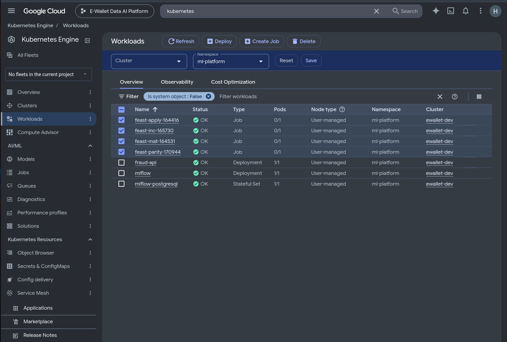

*Google Cloud console, Kubernetes Engine → Workloads, namespace `ml-platform`. The Feast Jobs `feast-apply`, `feast-mat`, `feast-inc` (incremental) and `feast-parity` all completed (OK). The serving Deployments `fraud-api` and `mlflow` run alongside them.*

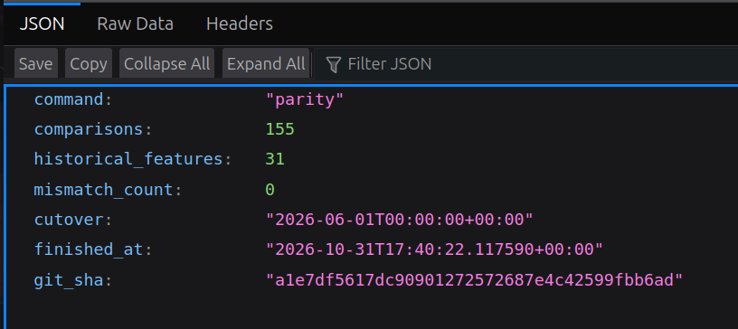

*The parity job's result (`command: parity`): 155 comparisons, 31 historical features, `mismatch_count: 0`, source commit `a1e7df56…`.*

## 4. Training pipeline (Kubeflow Pipelines)

The pipeline is defined in [`ai_platform/ml/pipelines/pipeline.py`](../../../ai_platform/ml/pipelines/pipeline.py); its step implementations are in [`runtime.py`](../../../ai_platform/ml/pipelines/runtime.py). It is compiled into a versioned package ([`compiled/`](../../../ai_platform/ml/pipelines/compiled)) and submitted to a standalone Kubeflow Pipelines 2.17.3 installation.

**Steps:**

1. **Load and validate** the immutable training snapshot from the offline store. The pipeline downloads it and checks its manifest SHA-256.
2. **Split.** Verify the chronological train / validation / test split.
3. **Train** four candidates in parallel: a dummy baseline, logistic regression, random forest and histogram gradient boosting.
4. **Select** the winner by validation PR-AUC, then F1. The test set is not used.
5. **Evaluate** only the winner on the held-out test set.
6. **Publish** the winner, its metrics and its lineage to MLflow.

Run `dc29f5cc-cc9e-49ae-b861-eacddd6269b5` (`f9-training-20261031-151638-ml2-r3`):

| Field | Value |
|---|---|
| Run time | 2026-10-31 17:25:35 – 17:32:39 UTC |
| Final state | `SUCCEEDED` |
| Training source | `5a7fa02f…` |
| Runtime image | `f9-kfp-runtime@sha256:34812d9d…` |

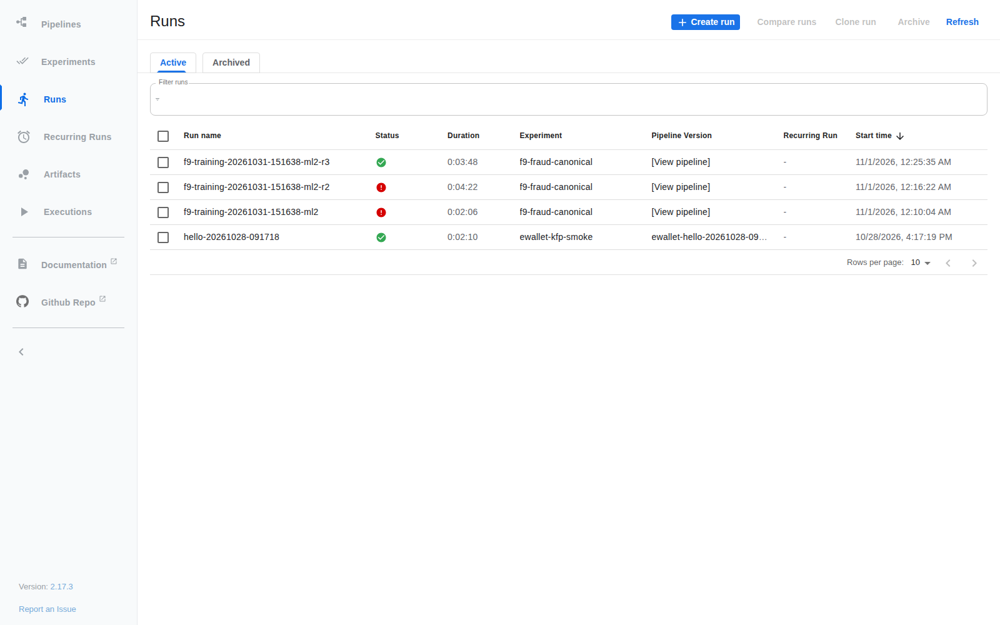

*Kubeflow Pipelines run list.*

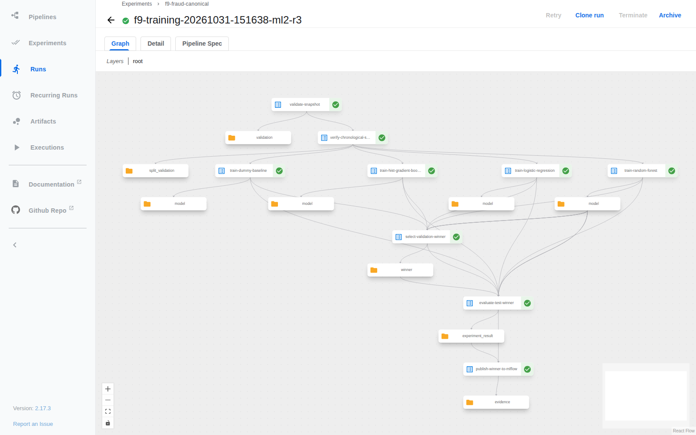

*Graph of run `dc29f5cc…`. Snapshot validation, split, four parallel candidates, selection, evaluation and publication all succeeded.*

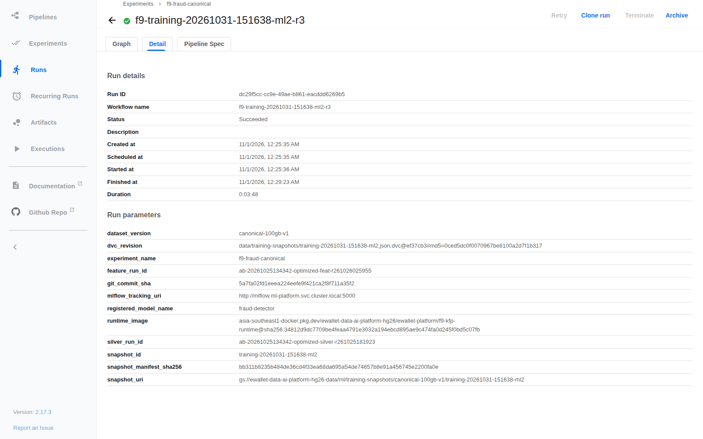

*Run details: inputs, state and duration.*

### Results

The random forest won the validation selection with **PR-AUC 0.802**. On the held-out test set it reached **PR-AUC 0.864**.

PR-AUC is used instead of accuracy because fraud labels are rare: a model that predicts "not fraud" for everything would have a high accuracy and be useless.

## 5. Experiment tracking and model registry (MLflow)

[`ai_platform/ml/tracking/mlflow_tracker.py`](../../../ai_platform/ml/tracking/mlflow_tracker.py) records one parent run per training execution and one child run per candidate.

**Every run is tagged with:**

- the dataset version;
- the Silver and feature run IDs;
- the training snapshot ID and digest;
- the DVC data revision;
- the Git commit;
- the runtime image digest.

The model and the data it was trained on are therefore versioned together.

**Registration.** The winner was registered as `fraud-detector` version 1, from parent run `fd639926e00d43ea9c111f29ad03fab1`, with the alias `candidate`. Promotion to a production alias is deliberately a separate, reviewed step.

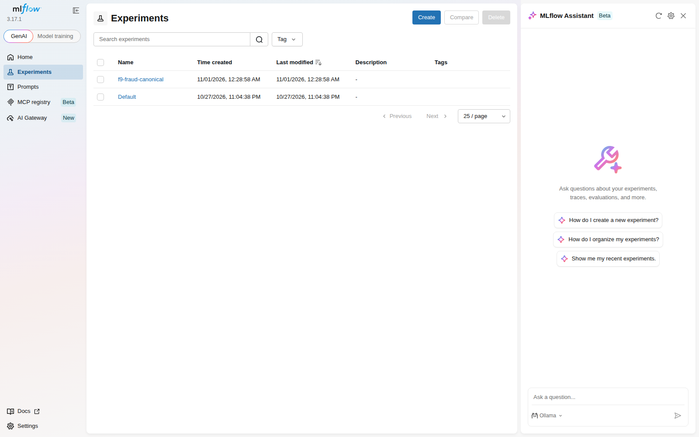

*MLflow experiments.*

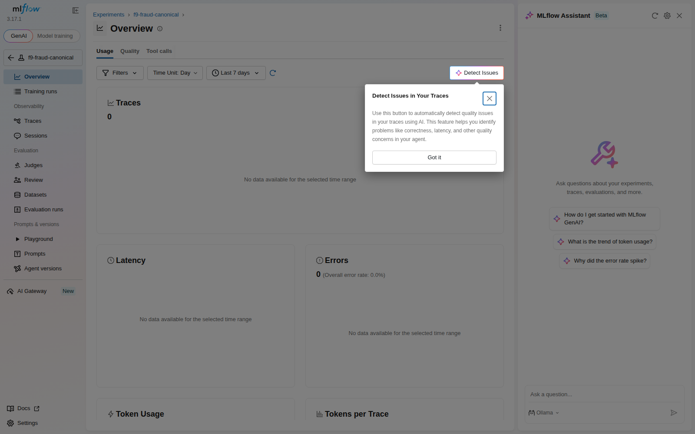

*Runs of the training experiment (parent and candidate runs).*

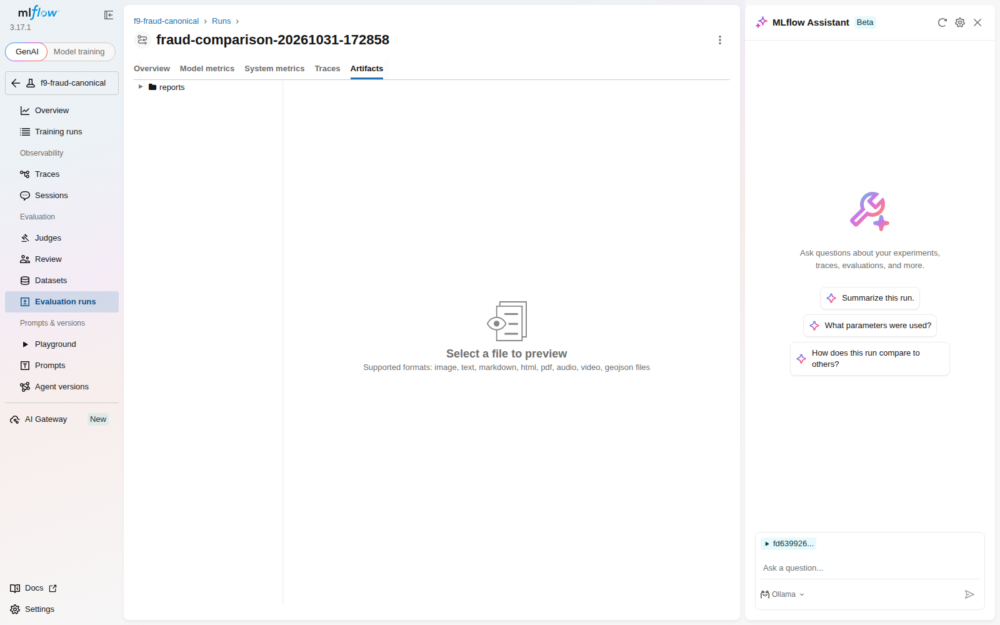

*Artifacts of run `fd639926`: evaluation reports and the logged model.*

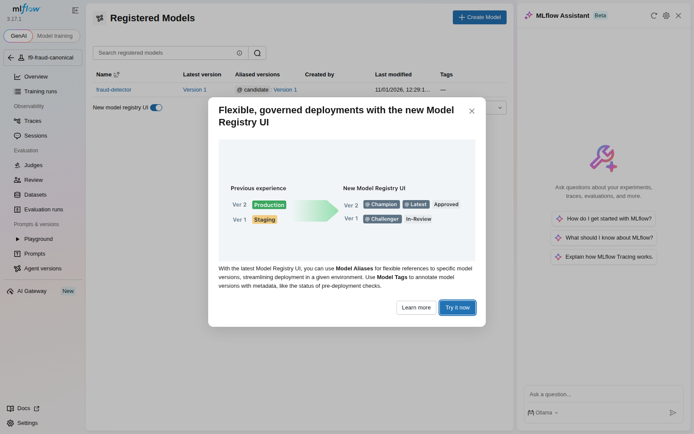

*Registered model `fraud-detector`.*

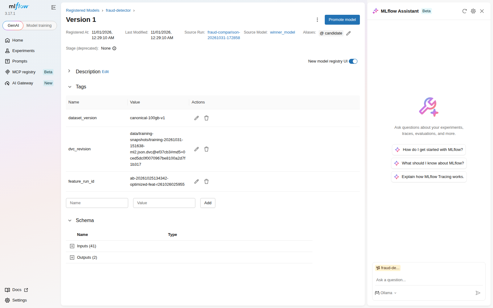

*Version 1, with its alias and its data-version and lineage tags.*

## 6. Model serving (KServe, model-inside-image)

[`ops/mlops/bake_serving_image.py`](../../../ops/mlops/bake_serving_image.py) builds the serving image:

1. resolves MLflow version 1;
2. downloads and validates the model;
3. bakes it into the predictor image `fraud-detector-predictor@sha256:cba90c22…`;
4. records the model-tree digest `1f1331c3…`.

The InferenceService ([`infra/kubernetes/fraud-serving/inferenceservice.yaml.tmpl`](../../../infra/kubernetes/fraud-serving/inferenceservice.yaml.tmpl)) references this image directly. It runs in KServe Standard mode with one private predictor replica, and **it downloads nothing at start-up**. This is the model-inside-image pattern: a pod always serves exactly the model in its image digest.

The Fraud API ([`ai_platform/inference/`](../../../ai_platform/inference)) serves each prediction in four steps:

1. reads the 31 online features from Feast;
2. adds the request fields and request-time derived features;
3. calls KServe with the V2 protocol;
4. returns the probability with the model version and the feature timestamp.

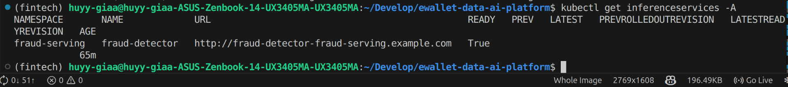

*The `fraud-detector` InferenceService is Ready.*

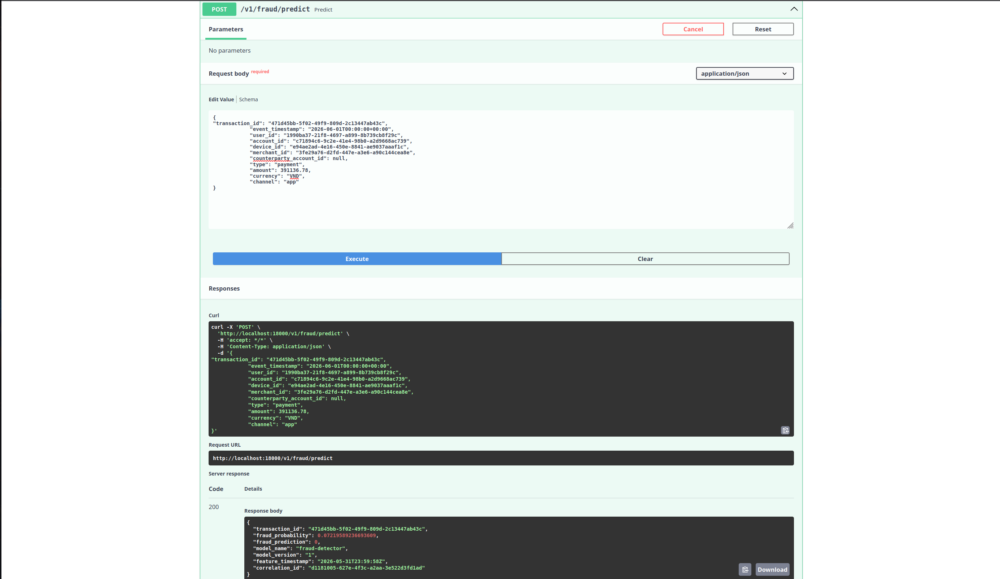

*A prediction through the Fraud API: HTTP 200, model version 1, with the feature timestamp.*

**Recorded N13 deployment state.** The preserved read-only command transcripts
are historical raw evidence, not screenshots and not a current cluster query:

- [KServe resources](../../evidence/edai2/screenshots/runtime/raw/05_kserve_isvc.txt):
  `fraud-detector` was `READY True`; predictor 1/1 Running, zero restarts,
  digest `cba90c22…`.
- [V2 readiness and metadata](../../evidence/edai2/screenshots/runtime/raw/06_kserve_v2_ready_metadata.txt):
  readiness HTTP 200, 41 inputs, outputs `fraud_probability` and
  `fraud_prediction`.
- [Prediction and correlated KServe log](../../evidence/edai2/screenshots/runtime/raw/07_fraud_api_predict_via_kserve.txt):
  request ID `n13-doc-20261104T093242Z`.

```text
InferenceService: fraud-detector READY=True
predictor: 1/1 Running, restarts=0
GET /v2/models/fraud-detector/ready -> HTTP 200
POST /v1/fraud/predict -> HTTP 200
fraud_probability: 0.0639895560144887
correlation_id: n13-doc-20261104T093242Z
```

*The recorded known transaction through the Fraud API showed:*

- *HTTP 200, `fraud_probability` 0.0639895560144887, equal to the value recorded when the model was first deployed;*
- *the KServe predictor log contains the same request ID (`n13-doc-20261104T093242Z`), which confirms that the request reached the model server.*

The genuine historical GKE and Fraud API captures above remain the qualifying
UI evidence for row 15. The N13 transcript is supporting evidence only.

### N15 genuine live runtime captures

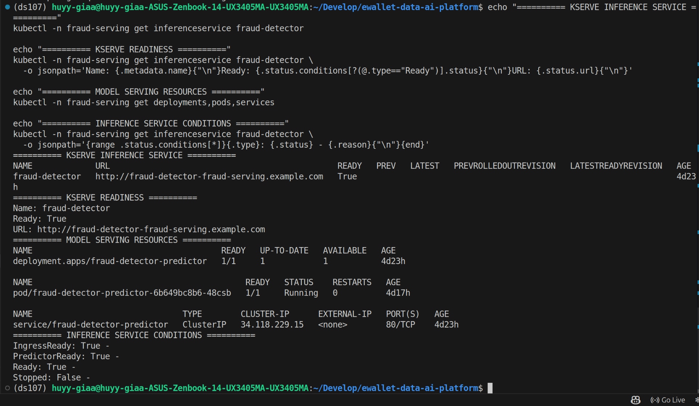

*Live Ubuntu terminal capture: `fraud-detector` is Ready=True and its predictor Pod is 1/1 Running with zero restarts.*

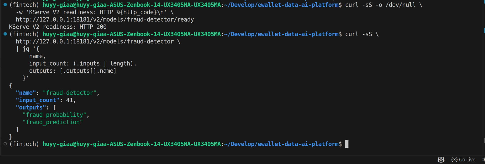

*Live Ubuntu terminal capture: V2 readiness returns HTTP 200; model metadata reports 41 inputs and the `fraud_probability` and `fraud_prediction` outputs.*

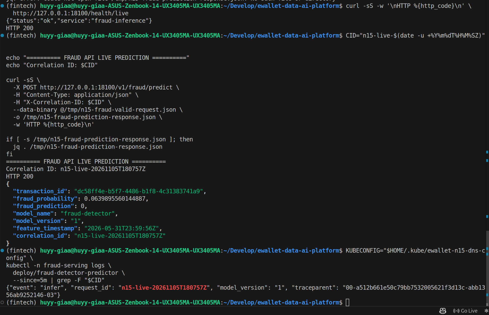

*Live Ubuntu terminal capture: the Fraud API returns HTTP 200 with probability `0.0639895560144887`, and the predictor log contains the same correlation ID `n15-live-20261105T180757Z`. This proves the request reached KServe; it does not establish offline/online feature parity.*

## 7. Limitations

- **Orchestration.** Offline-to-online materialization runs as Kubernetes Jobs started by an operator. It is not yet scheduled by an Airflow DAG.
- **Streaming features.** The streaming feature jobs that should push fresh features into both the offline history and the online store are implemented in the source but have not been run against the deployed stores (see [Flink streaming](../../edai1/streaming/FLINK_STREAMING.md)).
- **Model promotion.** The registry assigns the `candidate` alias automatically. A `latest` or `production` alias is not assigned automatically, because production promotion is designed as a reviewed step.
