# Serving autoscaling with KEDA (G5-B)

| Item | State |
|---|---|
| KEDA on GKE for the Feature API and Fraud API | **Deployed** (2026-11-07) |
| Owner-run autoscaling experiments | **Executed** (2026-11-08): both APIs scaled 1 → 2 → 1 under real load, with 0 failures |
| Throughput or latency gain over the fixed baseline | **Not shown**: see section 11 |

## 1. Which requirement this addresses

The EDAI-2 rubric names KEDA as its autoscaling tool. Rows 19 and 25 ask for it on the agents. Those rows stay with G5-C, which needs separate approval, and this page does not claim them.

G5-B applies KEDA to the two serving Web APIs measured for row 32 ([ROW_32_LOCUST_GKE.md](../testing/ROW_32_LOCUST_GKE.md)). It answers what happens to the row 32 throughput and latency when replicas follow load. It also proves the KEDA → Prometheus → HPA chain on GKE that G5-C will reuse.

## 2. How it works here

```text
Locust (in-cluster pod) ──► Feature API / Fraud API pods (ml-platform)
                                   │ /metrics (OpenTelemetry → Prometheus text)
Prometheus (ewallet-agents) ◄──────┘ per-pod scrape every 15 s, via headless *-metrics Services
        │ PromQL every 15 s
KEDA operator (keda) ──► external metric s0-prometheus ──► HPA keda-hpa-<api> ──► Deployment replicas
```

| Layer | What it does | Source |
|---|---|---|
| Request counters | Each lookup or prediction adds 1 to `feature_api_requests_total` or `fraud_inference_requests_total`, labelled by outcome. Health probes are not counted. | [feature_app.py (line 79)](../../../ai_platform/inference/feature_app.py#L79), [observability.py (line 163)](../../../ai_platform/inference/observability.py#L163) |
| Per-pod discovery | Headless Services `feature-api-metrics` and `fraud-api-metrics` return one address per pod | [metrics-discovery.yaml (line 17)](../../../infra/helm/ewallet-serving/templates/metrics-discovery.yaml#L17) |
| Scrape | Jobs `feature-api-pods` and `fraud-api-pods`: DNS discovery, 15 s interval (the global interval is 30 s) | [observability-stack.yaml (line 103)](../../../infra/helm/llm-agent-platform/templates/observability-stack.yaml#L103) |
| KEDA → Prometheus | The operator is enrolled in ambient, and one AuthorizationPolicy plus one NetworkPolicy admit only it to Prometheus on 9090 | [keda values (line 16)](../../../infra/helm/keda/values.yaml#L16), [keda-prometheus-access.yaml (line 16)](../../../infra/kubernetes/experiments/keda-prometheus-access.yaml#L16) |
| ScaledObject → HPA | One ScaledObject per API; KEDA generates `keda-hpa-<api>` | [scaledobjects.yaml (line 14)](../../../infra/helm/ewallet-serving/templates/scaledobjects.yaml#L14) |
| Guard | The chart refuses autoscaling without per-pod metrics, because a Service-level scrape samples one pod at a time | [scaledobjects.yaml (line 3)](../../../infra/helm/ewallet-serving/templates/scaledobjects.yaml#L3) |

## 3. Trigger, metric and thresholds

```promql
sum(rate(feature_api_requests_total{job="feature-api-pods"}[1m])) or vector(0)       # threshold 60
sum(rate(fraud_inference_requests_total{job="fraud-api-pods"}[1m])) or vector(0)    # threshold 17
```

| Question | Answer |
|---|---|
| Unit | Requests per second, summed over every pod of the API |
| Double counting | None. The `job` filter keeps one series per pod. The Fraud API is also scraped through its Service by the older `fraud-api` job; the filter excludes those series |
| Trigger type | `prometheus`, `metricType: AverageValue` ([line 50](../../../infra/helm/ewallet-serving/templates/scaledobjects.yaml#L50)) |
| HPA arithmetic | The HPA divides the query result by the current replica count and compares that with the threshold. So `desired = ceil(total req/s ÷ threshold)`, bounded to 1–3 |
| Why 60 and 17 | G5-A measured one-replica ceilings of about 86 req/s (Feature) and 24.5 req/s (Fraud), both CPU-bound at the 1-CPU limit. 70% of the ceiling scales out before a replica saturates ([values.yaml (line 45)](../../../infra/helm/ewallet-serving/values.yaml#L45)) |
| Latency trigger | Off ([line 72](../../../infra/helm/ewallet-serving/values.yaml#L72)). Under a closed load loop, latency rises with users even at matched capacity. For the Fraud API it is driven by the single KServe predictor, which more Fraud API replicas cannot relieve, so it would pin the API at 3 |
| Scale-up | No stabilization window; at most one pod per 30 s |
| Scale-down | 120 s stabilization window, then one pod per 60 s. `cooldownPeriod` applies only to scale-to-zero, which `minReplicas: 1` rules out |
| Metric failure | After 3 failed polls KEDA keeps the current count if it is higher than 1 (`currentReplicasIfHigher`) |

**Expected behaviour (reasoning, not measured):**
- **Feature API:** about 86 req/s at one replica gives `ceil(86/60) = 2`; with more capacity the rate can rise toward `ceil(170/60) = 3`.
- **Fraud API:** the singleton predictor caps total throughput near 29 req/s (34 ms per prediction), so `ceil(29/17) = 2`. A third Fraud API replica should rarely be justified, and **three Fraud API replicas will not triple throughput**.

The owner's experiment decides both.

## 4. Replica ownership

| API | Before | After |
|---|---|---|
| Feature API | Helm (`ewallet-serving`) set `replicas: 1` | The chart omits `replicas` when autoscaling is on ([feature-api.yaml (line 56)](../../../infra/helm/ewallet-serving/templates/feature-api.yaml#L56)). Revision 3 removed the field and the HPA owns it |
| Fraud API | Client-side `kubectl apply`; the last-applied annotation held `replicas: 1` | R1 handover ([fraud_api_keda_handover.sh (line 92)](../../../scripts/serving/fraud_api_keda_handover.sh#L92)): `set-last-applied` with the keda-mode manifest, a server dry run proving `replicas` stays 1, then apply. The live diff was empty: same image digest, SA, env and contracts |
| KServe predictor | 1 replica | Unchanged. No scaler (R3) |

`verify` confirmed that only `keda-hpa-fraud-api` targets the Fraud API and the annotation no longer carries `replicas`.

## 5. Deployment record (2026-11-07)

| Step | Result |
|---|---|
| KEDA 2.21.0 (`keda` release 1, chart digest verified) | 6 CRDs; operator, metrics API server and webhooks Ready; `v1beta1.external.metrics.k8s.io` Available |
| Access policies | AuthorizationPolicy and NetworkPolicy created in `ewallet-agents` |
| `ewallet-serving` r2 | `metricsDiscovery.enabled=true`: two headless Services plus Prometheus allow policies for the Feature API |
| `llm-agent` r42 | Two per-pod scrape jobs and the new `serving-keda` dashboard. Prometheus and Grafana restarted. Server dry run: no agent Deployment changed |
| Prometheus | Targets `feature-api-pods` and `fraud-api-pods` up at 15 s; both queries return 0 at idle |
| R1 | Handover and verify passed; same Fraud API pod, no restart |
| `ewallet-serving` r3 | `autoscaling.enabled=true`: ScaledObjects Ready; HPAs `ScalingActive=True (ValidMetricFound)` |
| Regression | One Feature lookup and one Fraud prediction: HTTP 200, the same values as Package 4. Valkey HEALTHY. A2A `completed` |

Evidence: [`docs/evidence/edai2/keda/g5b_20261107T204930Z`](../../evidence/edai2/keda/g5b_20261107T204930Z/README.md).

**Development check, not the owner's experiment:** Feature API, 10 users for 2 minutes.

| Time after the Locust start | Event |
|---|---|
| +63 s | The KEDA metric reached 77.2 req/s, so `desired = 2` |
| +110 s | The second pod was Ready (Feature API startup takes about 45 s) |
| After the load | The HPA scaled back to 1; event "New size: 1; reason: … below target" |

At 2 replicas the HPA showed 42.9 req/s per pod, which is 85.8 ÷ 2: the `AverageValue` arithmetic as expected. This proves the chain reacts; it is not a performance result.

## 6. Reproducing the experiments

The owner ran them on 2026-11-08 (sections 8–9); the procedure is in [G5_B_OWNER_EVIDENCE_GUIDE.md](../../runbooks/edai2/G5_B_OWNER_EVIDENCE_GUIDE.md). Each run uses the G5-A in-cluster Locust runner and fixture: 20 users, spawn rate 5/s, 5 minutes, the same as the G5-A "high" profile. The runner records replicas and HPA decisions every 5 s and computes the timings from those samples ([serving_autoscale_experiment.sh (line 52)](../../../scripts/experiments/serving_autoscale_experiment.sh#L52), [autoscale_summary.py](../../../ops/experiments/autoscale_summary.py)).

## 7. Runtime evidence: configuration and metrics

All screenshots in sections 7–9 were captured by the owner on 2026-11-08 and copied unchanged. Manifest and checksums: [EVIDENCE_MANIFEST.md](../../evidence/edai2/screenshots/keda/EVIDENCE_MANIFEST.md).

> **G5B-01: initial state.** Both ScaledObjects are `READY True` with min 1, max 3 and a `prometheus` trigger. The generated HPAs read `0/60 (avg)` and `0/17 (avg)` at one replica, and both Deployments are `1/1`. This shows KEDA owns scaling and the experiment starts from the minimum. It does not show scaling behaviour.

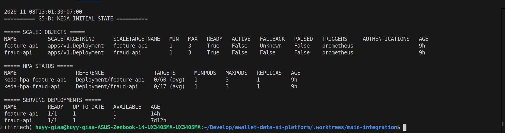

> **G5B-02: scaler configuration and HPA ownership.** It shows:
> - the exact PromQL for each API, with thresholds 60 and 17;
> - each HPA's owner, `ScaledObject/<api>`;
> - metric type `AverageValue`.
>
> This matches section 3 and [`scaledobjects.yaml`](../../../infra/helm/ewallet-serving/templates/scaledobjects.yaml#L50). No second controller targets the Deployments.

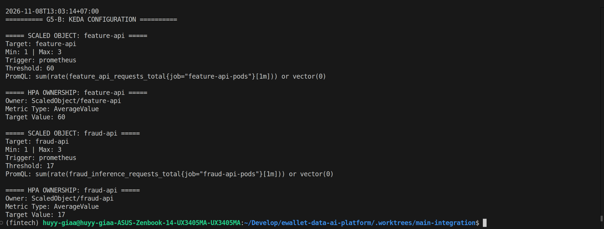

> **G5B-03a and G5B-03b: Prometheus.** The `feature-api-pods` and `fraud-api-pods` jobs scrape the pod IPs directly (`10.216.1.18:8080`, `10.216.1.19:8080`), and `up` = 1 for both. So KEDA's input is a per-pod series, not a Service-level sample. The older `fraud-api` Service job is also visible; the KEDA query excludes it through its `job` filter.

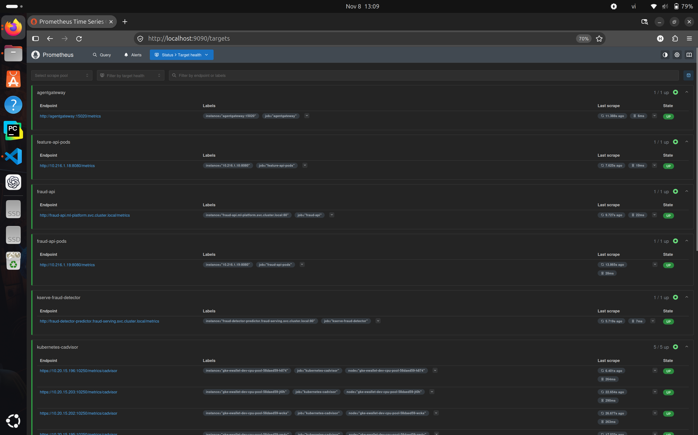

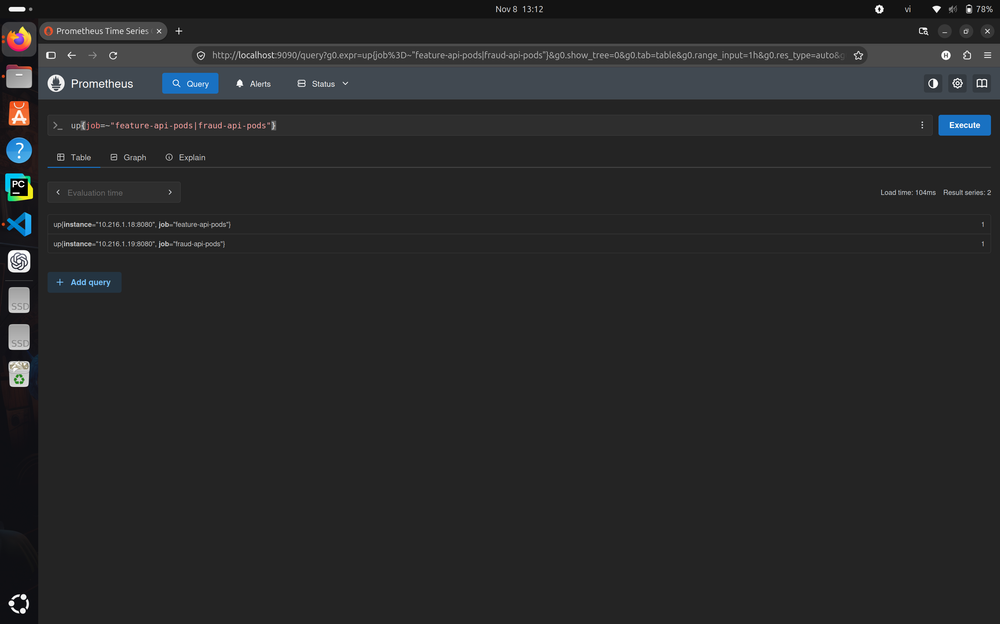

## 8. Feature API experiment (owner-run, 2026-11-08 06:39–06:47 UTC)

Run: `scripts/experiments/serving_autoscale_experiment.sh run feature-api`. Load: 20 users, spawn rate 5/s, 5 minutes, in-cluster. Artifacts: [`owner_20261108T062413Z/feature-api/`](../../evidence/edai2/keda/owner_20261108T062413Z/feature-api/autoscale-summary.json).

| Time from the Locust start | Event (from `replicas.jsonl` and HPA events) |
|---|---|
| −12 s | 1 Ready replica; the HPA desires 1 |
| +58 s | Trigger above 60 req/s per pod; the HPA desires 2 |
| +70 s | Second pod Ready (`first_scale_out_seconds` 69.5) |
| +295 s | Load ends |
| +432 s | Back to 1 replica (`scale_down_to_min_seconds` 137.0), consistent with the 120 s window plus polling and the 5 s sample interval |

The peak trigger value was 75.8 req/s per pod, with 2 peak Ready replicas. At one pod, `ceil(75.8/60) = 2`. With two pods the per-pod average fell to about 41 req/s, so `ceil(82/60) = 2` held; 3 was never justified.

> **G5B-04: before load.** One pod (`llcdv`, node h874), HPA `0/60`.

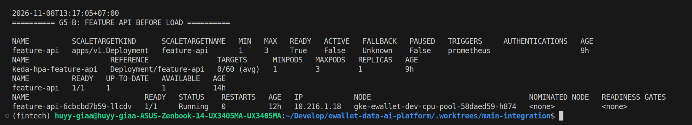

> **G5B-05: scale-out decision.** `describe hpa`: `40711m / 60` per pod at two pods (about 81 req/s in total), `2 current / 2 desired`, and event `New size: 2 … above target`. This is the HPA acting on the KEDA metric. The 40.7 req/s per pod is a division of the total; it is not a measured per-pod rate.

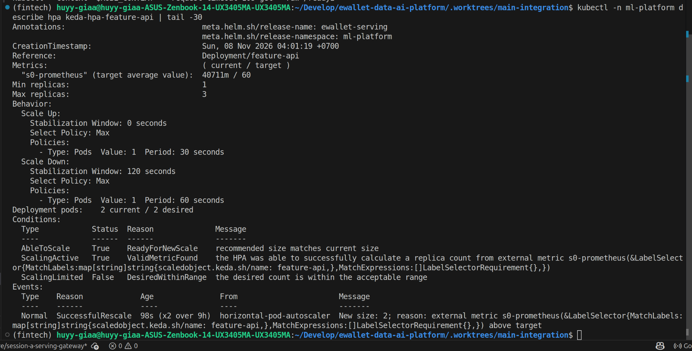

> **G5B-06: two replicas Ready.** The watcher at 06:41:37Z shows `2 2` and a new pod `l56kl` `1/1 Running`, 41 s old.

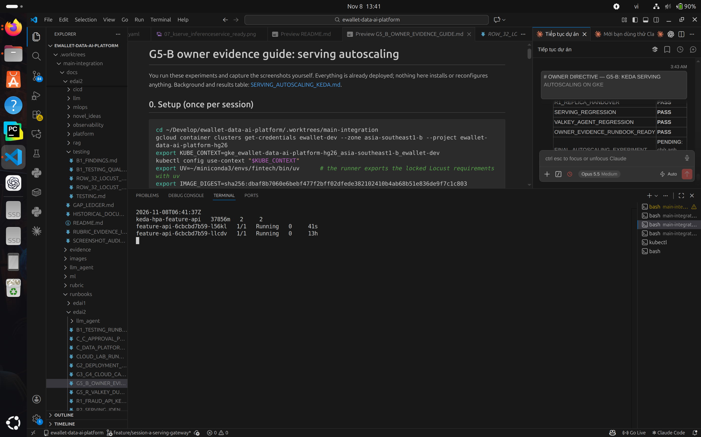

> **G5B-07a and G5B-07: scale-down.** At 06:47:14Z the metric reads 0 and one pod remains. The events list `New size: 2 … above target`, then `New size: 1 … below target`.

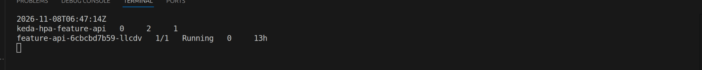

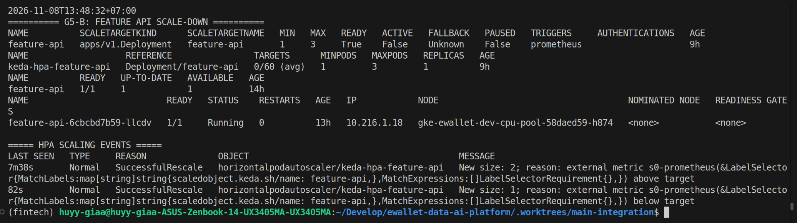

> **G5B-08a: the run itself.**
> - Locust: 24,270 requests and 0 failures.
> - The script then polls readiness until 1 replica remains.
> - It prints the autoscale summary computed from the samples.

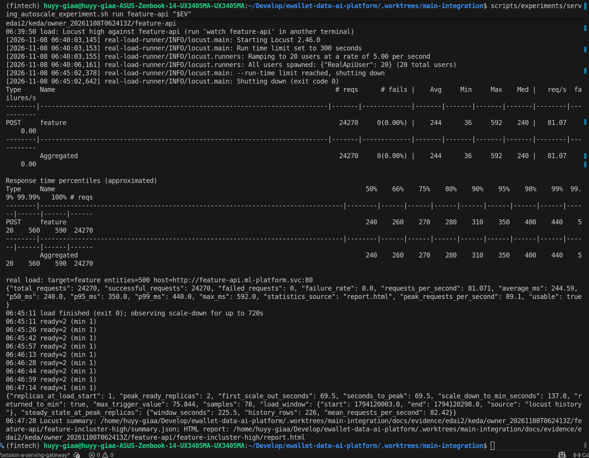

> **G5B-09a and G5B-09b: Grafana over the run (13:39–13:49 ICT).**
> - The request rate climbs to about 80 req/s and stays flat.
> - *Replicas scraped* steps 1 → 2 → 1.
> - *Serving CPU*: the original pod `llcdv` is pinned near 1 core, while the new pod `l56kl` stays near 0. Section 10 analyses this.
> - The p95 panels sit on a flat line near 4.75 s. That is the coarse-bucket artefact, not latency; see the limitations.

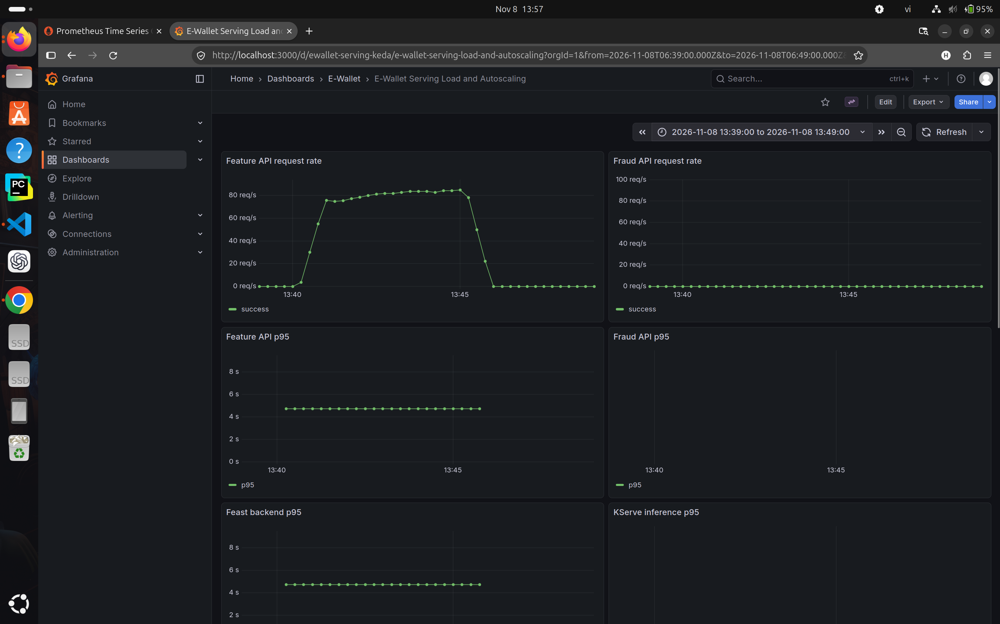

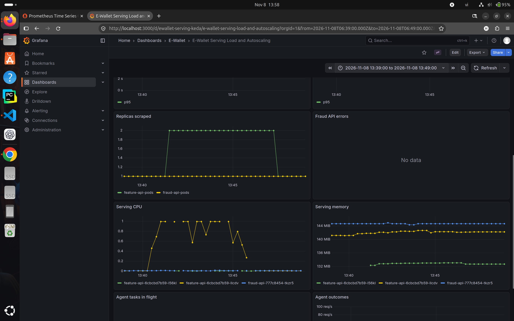

## 9. Fraud API experiment (owner-run, 2026-11-08 07:03–07:11 UTC)

Same procedure. Artifacts: [`owner_20261108T062413Z/fraud-api/`](../../evidence/edai2/keda/owner_20261108T062413Z/fraud-api/autoscale-summary.json).

| Time from the Locust start | Event |
|---|---|
| +70 s | Trigger 21.4 req/s per pod, above 17; the HPA desires 2 |
| +81 s | Second pod Ready (`first_scale_out_seconds` 81.4) |
| +296 s | Load ends |
| +449 s | Back to 1 replica (`scale_down_to_min_seconds` 152.5) |

`ceil(21.4/17) = 2`. After scale-out the per-pod average was about 11 req/s, so 3 replicas were never requested, as predicted in section 3.

> **G5B-10, G5B-11a, G5B-11, G5B-12: baseline, then scale-out.**
> - Before: one pod (`tkzr5`) with HPA `0/17`.
> - 07:04:46Z: `21444m`, desired 2, and the new pod `tpzxk` starting (`0/1`).
> - `describe hpa`: `21444m / 17`, `1 current / 2 desired`, `SucceededRescale`.
> - 07:05:46Z: both pods `1/1`.

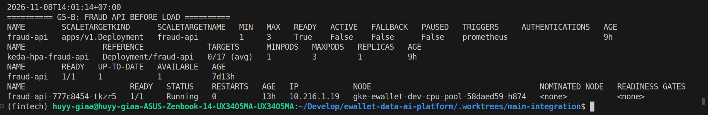

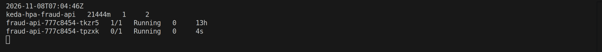

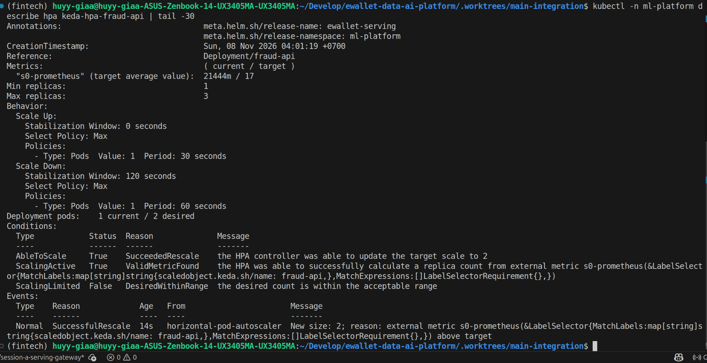

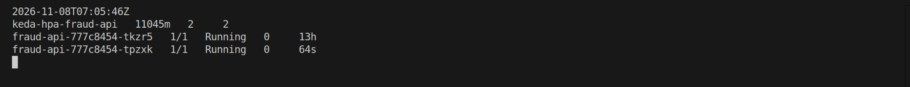

> **G5B-13a and G5B-13: scale-down.** At 07:11:16Z one pod remains; the events read above target, then below target.

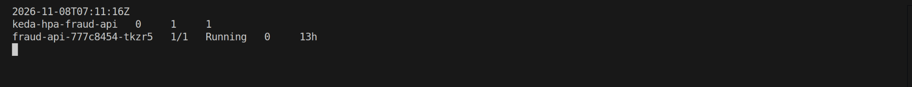

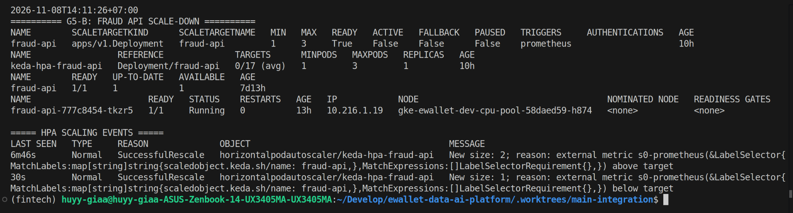

> **G5B-14a, G5B-15a, G5B-15b: the run and Grafana.**
> - 6,595 requests and 0 failures.
> - The request rate plateaus at about 21–23 req/s.
> - *Replicas scraped* steps 1 → 2 → 1.
> - *Serving CPU*: `tkzr5` stays near 1 core; `tpzxk` stays near 0 after start-up.

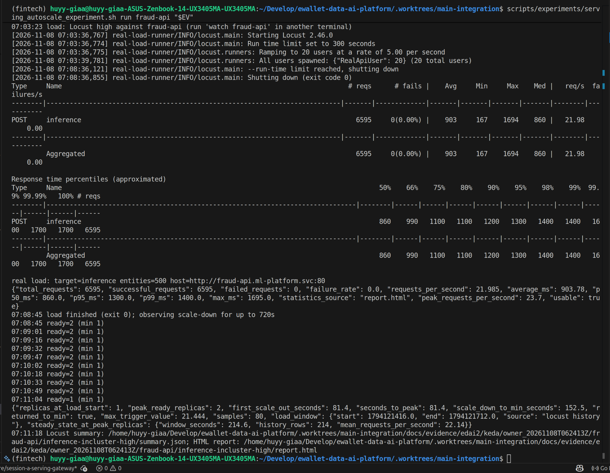

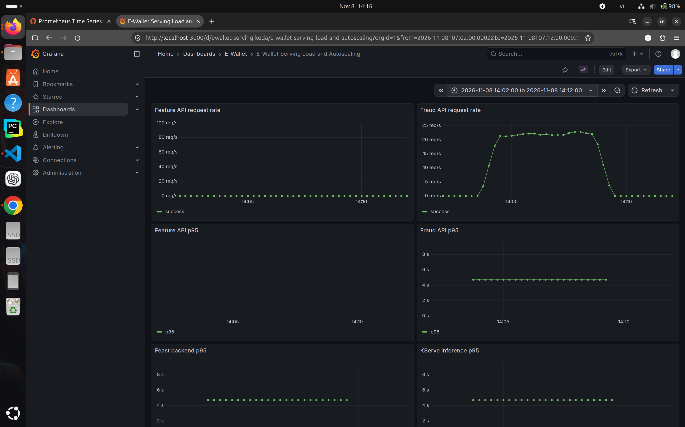

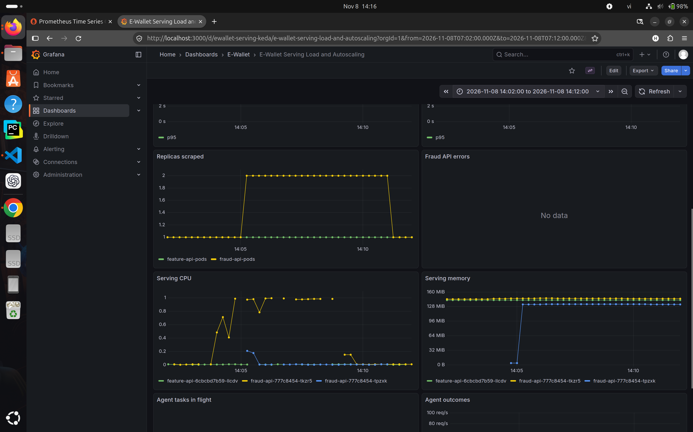

## 10. Baseline (G5-A) against KEDA (G5-B)

### 10.1 Results (from `summary.json` and `autoscale-summary.json`)

| Metric | Feature G5-A, fixed 1 | Feature G5-B, KEDA | Fraud G5-A, fixed 1 | Fraud G5-B, KEDA |
|---|---:|---:|---:|---:|
| Requests | 25,369 | 24,270 | 6,743 | 6,595 |
| Failures | 0 | 0 | 0 | 0 |
| Throughput (req/s) | 84.705 | 81.071 | 22.475 | 21.985 |
| Steady state at peak replicas (req/s) | n/a | 82.42 over 225.5 s | n/a | 22.14 over 214.6 s |
| Average (ms) | 234.03 | 244.59 | 883.95 | 903.78 |
| p50 / p95 / p99 (ms) | 230 / 330 / 400 | 240 / 350 / 440 | 840 / 1,300 / 1,400 | 860 / 1,300 / 1,400 |
| Max (ms) | 536 | 592 | 2,088 | 1,695 |
| Replicas | 1 | 1 → 2 → 1 | 1 | 1 → 2 → 1 |
| First scale-out / back to 1 | n/a | 69.5 s / 137.0 s | n/a | 81.4 s / 152.5 s |

### 10.2 Paired Locust reports

Feature API, 20 users for 5 minutes:

> **G5-A baseline, one fixed replica.** 25,369 requests, 84.7 req/s, p95 330 ms. [Original report](../../evidence/edai2/load/g5a_20261107T183037Z/feature-incluster-high/report.html). This image is the G5-A `report.html` rendered by headless Chrome during G5-A, not an owner screen capture (see the screenshot audit).

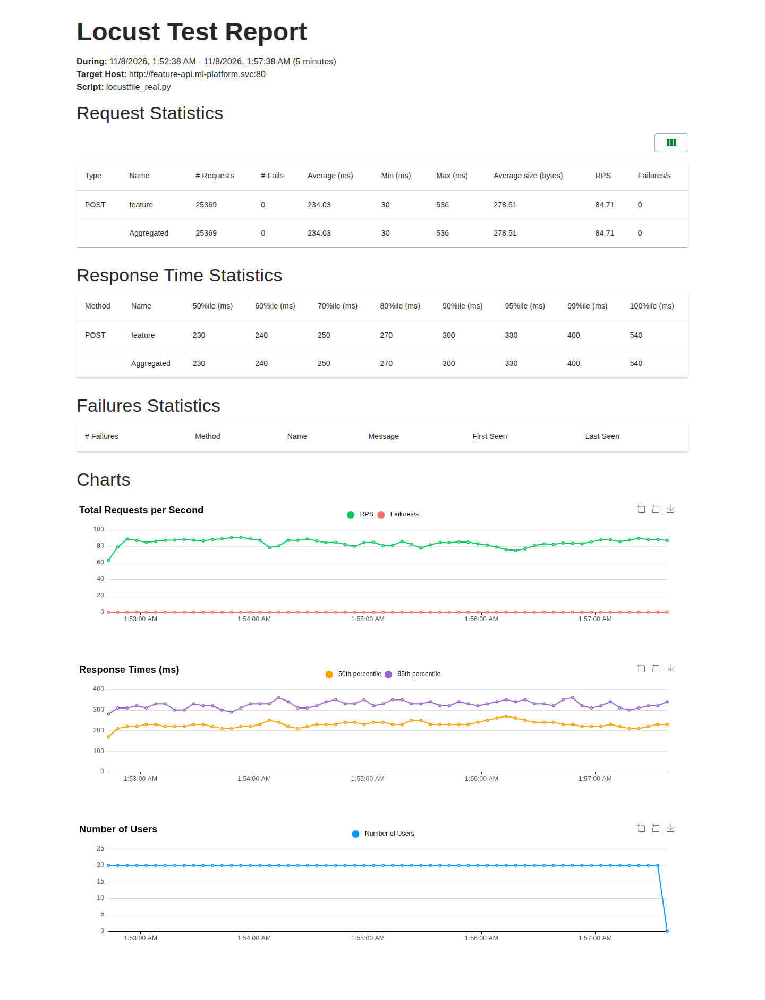

> **G5-B with KEDA.** 24,270 requests, 81.07 req/s, p95 350 ms; the owner's browser capture of the report. [Original report](../../evidence/edai2/keda/owner_20261108T062413Z/feature-api/feature-incluster-high/report.html).


Fraud API, 20 users for 5 minutes:

> **G5-A baseline, one fixed replica.** 6,743 requests, 22.5 req/s, p95 1,300 ms. [Original report](../../evidence/edai2/load/g5a_20261107T183037Z/inference-incluster-high/report.html).

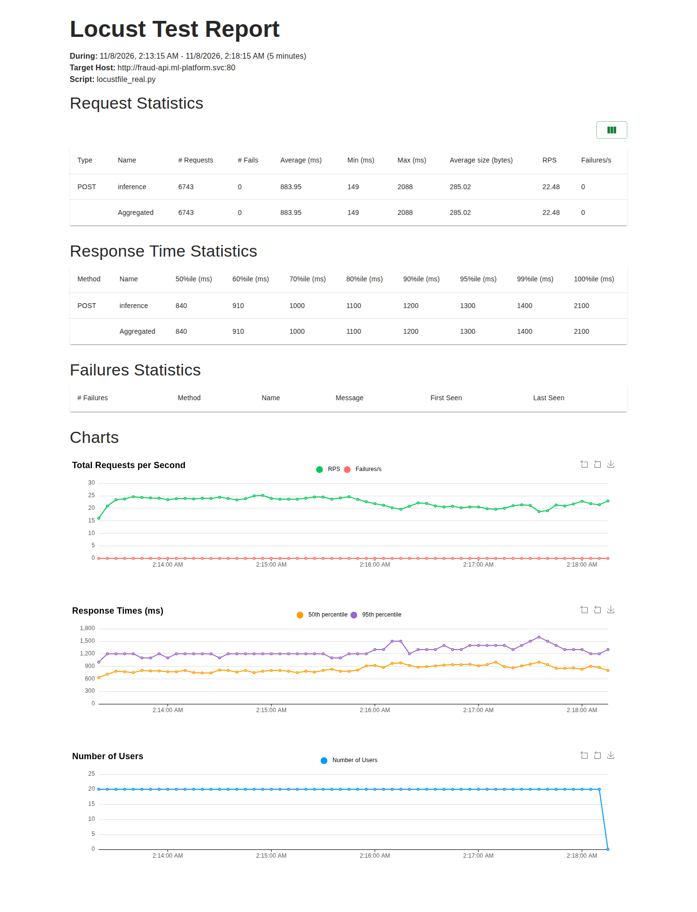

> **G5-B with KEDA.** 6,595 requests, 21.98 req/s, p95 1,300 ms. [Original report](../../evidence/edai2/keda/owner_20261108T062413Z/fraud-api/inference-incluster-high/report.html).

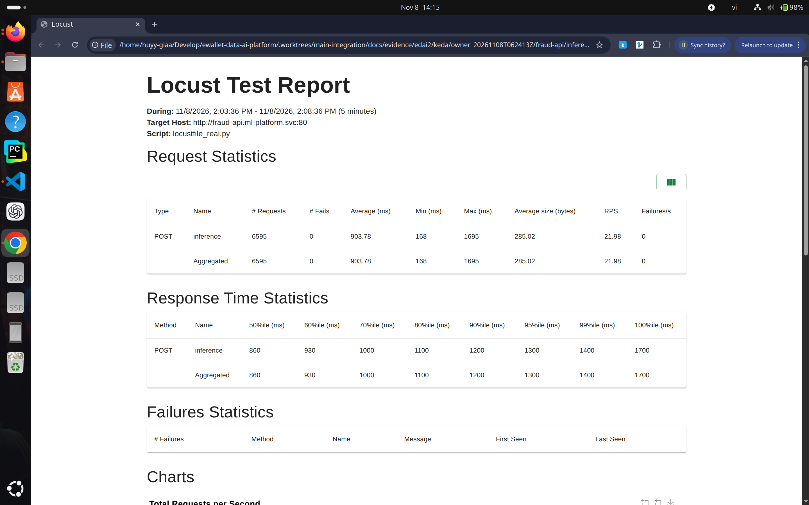

### 10.3 Was the comparison fair?

| Item | Same in both runs? | Evidence |
|---|---|---|
| Profile (20 users, spawn 5/s, 5 min, no think time, seed 20261107) | Yes | Both `run-manifest.json` |
| Fixture (500 rows, `sha256 0d17e4b3…`) and model version 1 | Yes | Manifests |
| Client: the same in-cluster runner on node zm4y, the same Service DNS | Yes | Manifests |
| Serving image `fraud-api@dbaf8b70…` | Yes | Manifests (`image_digest` is the serving image, not the runner) |
| Serving processes | **Yes, the same pod instances** | `state-before.txt`: `feature-api-…-llcdv`, `fraud-api-…-tkzr5`, predictor `…-8hc2x`, `redis-0`, the same nodes, 0 restarts in both runs |
| Application code (`ai_platform/inference`) | Yes | No diff between the recorded SHAs `49ea5b2` and `d388bd9` |
| Load code | Effectively yes | G5-A ran from the uncommitted working tree at `49ea5b2`, committed right after as `852f4d2`. From `852f4d2` to `d388bd9`, the only benchmark-path change is one added NetworkPolicy for the runner |
| Runtime configuration | **No** | G5-B adds: per-pod Prometheus scrapes every 15 s on both APIs; a Feature API ingress policy; KEDA queries (against Prometheus, not the APIs) |
| Time | **No** | About 12 hours apart, on a shared cluster |

Unresolved confounders: the extra scraping and ingress-policy enforcement in G5-B, and other load on the shared nodes. Each arm is **one run**, and no repeated run of the same profile exists. The 2–4% differences therefore cannot be separated from run-to-run variation.

## 11. Interpretation

**Verified observations**
1. KEDA scaled both APIs out on real load and back to the minimum, with 0 failed requests. Its decisions match the arithmetic in section 3: about 85 → 2 for Feature, and 21.4 → 2 for Fraud.
2. Scale-out took 69.5 s (Feature) and 81.4 s (Fraud) from the load start to a second Ready pod. Scale-down took 137.0 s and 152.5 s after the load ended.
3. Throughput and latency did not improve. The run averages were 4.3% (Feature) and 2.2% (Fraud) lower. The steady state at two replicas (82.4 and 22.1 req/s) was still at or below the one-replica baseline.
4. In both runs the original pod stayed at its 1-CPU limit (990–997m in `kubectl top`) for the whole load. The new pod used CPU only during start-up (363m Feature, 716m Fraud, for about 30 s), then 7–14m, which is idle.

**Evidence-supported explanation: the new replicas received almost no requests**

| Piece | What it shows |
|---|---|
| The client keeps its connections | Locust `HttpUser` uses `HttpSession`, a `requests.Session` with a connection pool. Every user keeps its connection while requests flow, because there is no think time ([locustfile_real.py (line 44)](../../../tests/load/locustfile_real.py#L44)) |
| The servers keep them too | Both APIs run a single `uvicorn` process with the default keep-alive ([feature_server.py (line 42)](../../../ai_platform/inference/feature_server.py#L42), [server.py (line 87)](../../../ai_platform/inference/server.py#L87)) |
| Balancing happens per connection | A Kubernetes ClusterIP Service picks a backend per connection, not per request, and the Services set no session affinity. All 20 connections were opened at the start, before the second pod existed |
| The data is consistent with this | In both runs the original pod was pinned at 1 core and the new pod idle. Throughput stayed at the one-pod ceiling. KServe predict time inside the predictor was unchanged (34.3 vs 35.3 ms mean, 49 ms p95) |

What is not established: per-pod request counts. Prometheus holds `feature_api_requests_total` per pod, but the cluster API was unreachable from this workstation during the closeout, so the series was not exported. Uneven distribution is therefore strongly indicated (CPU, plus the connection mechanism), not directly measured.

**Hypotheses, not tested here**
- **The predictor bottleneck was not exercised.** Because the new Fraud API pod got almost no traffic, G5-B neither confirms nor rules out the singleton KServe predictor as the Fraud ceiling. Predictor CPU (median 842m vs 816m) and predict time were the same as in G5-A.
- **The small loss may be overhead.** The 3–4% drop may come from the extra 15 s per-pod scrapes and the new pod's start-up on a shared node. One run per arm cannot show this.
- **Per-request balancing should let replicas add capacity.** For example: new Locust users after scale-out, a connection lifetime limit, or L7 balancing. Not tested.

**What G5-B therefore proves:** a working, correctly calibrated KEDA → Prometheus → HPA control loop, with measured reaction times on GKE. **It does not prove a throughput or latency gain**, and this page does not claim one.

## 12. Rollback (live revisions read 2026-11-07)

| Change | Command |
|---|---|
| Autoscaling | `helm rollback ewallet-serving 2 -n ml-platform` (removes the ScaledObjects and their HPAs, and Helm sets the Feature API back to `replicas: 1`), then the R1 rollback |
| R1 | `scripts/serving/fraud_api_keda_handover.sh rollback <dir> --execute` (refuses while a ScaledObject exists) |
| Metrics discovery | `helm rollback ewallet-serving 1 -n ml-platform` |
| Prometheus scrape | `helm rollback llm-agent 41 -n default` (Prometheus and Grafana restart) |
| KEDA access | `kubectl delete -f infra/kubernetes/experiments/keda-prometheus-access.yaml` |
| KEDA | Delete the ScaledObjects first, then `helm uninstall keda -n keda` and the `keda.sh` CRDs |

## 13. Limitations

- **Persistent connections defeat per-connection balancing.** The closed-loop Locust client keeps its keep-alive connections, so replicas added during a run receive little traffic (section 11). G5-B measures the control loop, not added capacity.
- **One run per arm.** No repeated runs, so no confidence interval. The differences against G5-A are observations, not established effects.
- **The comparison is not fully controlled.** G5-B had per-pod scraping, a Feature API ingress policy and a different time of day (section 10.3).
- **The predictor question is open.** The KServe predictor stays at one replica (R3). G5-B did not load a second Fraud API pod, so it neither confirms nor rules out the predictor as the Fraud ceiling.
- **Start-up time.** A new pod needed about 12 s from the HPA decision to Ready in the owner runs (+58 → +70 s and +70 → +81 s); it took about 45 s in the earlier development check. Both are sample-based, at 5 s resolution.
- **The `serving-keda` dashboard's p95 panels are unreliable.** The API histograms use OpenTelemetry's default bucket edges with seconds as the unit, so the panels show a flat line near 4.75 s (G5B-09a, G5B-15a). Use Locust's percentiles.
- **`server-metrics.json` comes from one pod.** The runner scrapes one pod through a port-forward.
- **Screenshot method differs between the arms.** The G5-A baseline report images were rendered by headless Chrome; the G5-B images are the owner's browser captures. Both show the original `report.html` files, which are linked.
- **The Feature API now admits only listed clients** (Prometheus, and the temporary runner while it exists), the same as the Fraud API.

## 14. Original artifacts

| Arm | Folder | Key files |
|---|---|---|
| G5-A Feature, 20 users | [`g5a_20261107T183037Z/feature-incluster-high`](../../evidence/edai2/load/g5a_20261107T183037Z/feature-incluster-high/summary.json) | `report.html`, `locust_stats*.csv`, `summary.json`, `resources-*.jsonl` |
| G5-A Fraud, 20 users | [`g5a_20261107T183037Z/inference-incluster-high`](../../evidence/edai2/load/g5a_20261107T183037Z/inference-incluster-high/summary.json) | Same, plus `kserve-metrics.json` |
| G5-B Feature | [`owner_20261108T062413Z/feature-api`](../../evidence/edai2/keda/owner_20261108T062413Z/feature-api/autoscale-summary.json) | `replicas.jsonl`, `autoscale-summary.json`, `hpa-*.yaml`, `hpa-events.txt`, `hpa-describe.txt`, `feature-incluster-high/` |
| G5-B Fraud | [`owner_20261108T062413Z/fraud-api`](../../evidence/edai2/keda/owner_20261108T062413Z/fraud-api/autoscale-summary.json) | Same, with `inference-incluster-high/` |
| Deployment and development check | [`g5b_20261107T204930Z`](../../evidence/edai2/keda/g5b_20261107T204930Z/README.md) | Install, scrape, R1, smoke |
| Screenshots | [`screenshots/keda`](../../evidence/edai2/screenshots/keda/EVIDENCE_MANIFEST.md) | 25 owner captures, `SHA256SUMS` |
