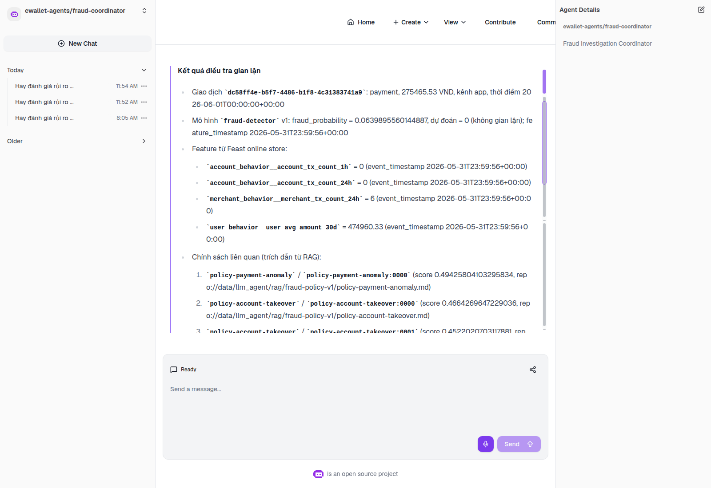
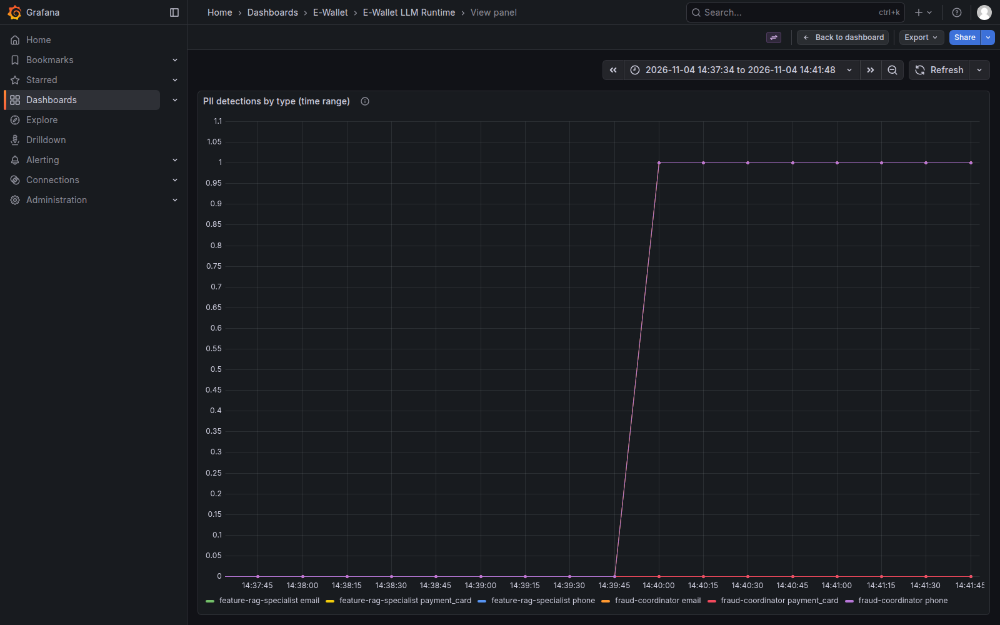
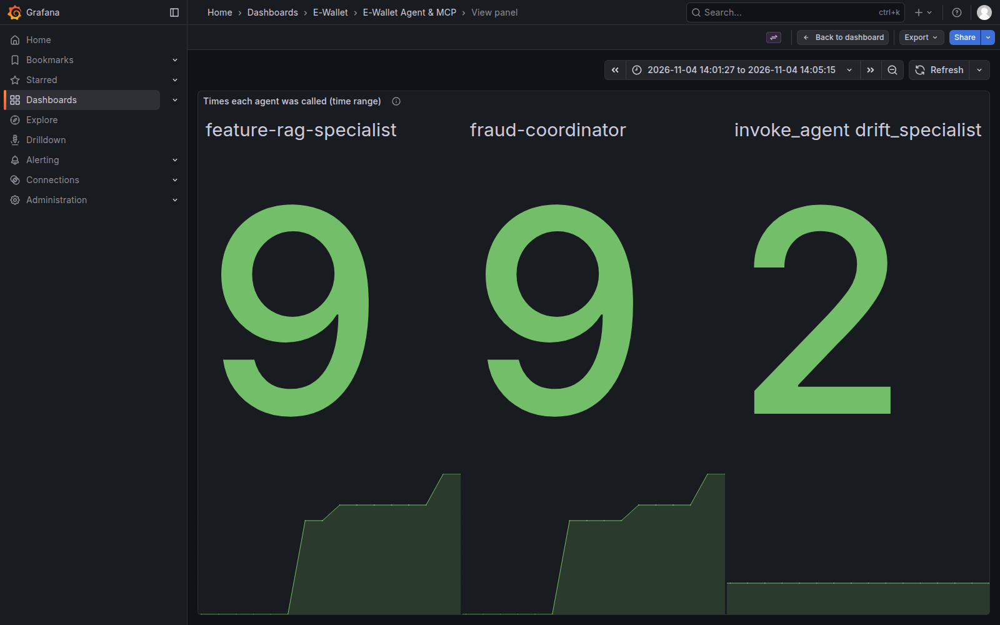

# Novel Ideas: Grounded Agent Intake and Exact Agent Telemetry

This document describes two design ideas developed for the agent layer. Each section gives:

- the problem;
- the idea;
- its implementation;
- the evidence that it works on the deployed system.

## Idea 1: grounded natural-language intake. The LLM selects a tool; it never produces a fraud score

### Problem

An analyst asks free-text questions. If an LLM writes the answer directly, it can:

- invent a fraud probability;
- misquote a feature value;
- cite a policy that does not exist.

In a fraud workflow a single fabricated number is worse than no answer. Analyst prompts can also contain customer contact details, which must not be sent to a model server or appear in logs.

### Idea

The Coordinator uses the LLM only as a **constrained planner**:

1. **Mask PII.** A deterministic PII screen masks e-mail addresses, Vietnamese mobile numbers and Luhn-valid card numbers *before* the prompt leaves the process. It counts detections by type and never exports the values.
2. **Select one tool.** The LLM may return exactly one tool call, `investigate_transaction`, with a typed argument schema.
3. **Validate the arguments.** Every argument must appear verbatim in the analyst's text. If a critical field is missing, for example the transaction time, the request is refused.
4. **Assemble from tool results only.** The answer is built exclusively from tool results: Feast features, the KServe probability, and RAG citations with checksums.

### Implementation

- [`nl_intake.py`](../../../ai_platform/llm_agent/nl_intake.py) (planner and argument validation)
- [`prompt_safety.py`](../../../ai_platform/llm_agent/prompt_safety.py) (PII screen)
- [`byo_coordinator.py`](../../../ai_platform/llm_agent/byo_coordinator.py)
- Tests: [`test_n12_agent_telemetry.py`](../../../tests/llm_agent/test_n12_agent_telemetry.py). A recording LLM double proves that PII never reaches the LLM; partition tests cover the PII boundaries (Luhn-valid versus invalid cards, mobile versus landline numbers).

### Evidence

All results are from real conversations in the kagent UI on GKE.

| Case | Result | Evidence |
|---|---|---|
| Valid question | Grounded answer: KServe probability 0.0639895560144887 (identical to the Fraud API value for the same transaction), real Feast features, 3 policy citations | [agents/08](../../evidence/edai2/screenshots/agents/08_kagent_coordinator_answer.png), trace `7e651a4f…` |
| Missing transaction time | Explicit refusal; no score | [agents/10](../../evidence/edai2/screenshots/agents/10_kagent_rejection_missing_timestamp.png) |
| Out-of-scope question | Explicit refusal | [agents/11](../../evidence/edai2/screenshots/agents/11_kagent_rejection_unsupported.png) |
| Prompt with a synthetic e-mail address and phone number | Masked before the LLM; email 1 and phone 1 counted; no PII in logs or the answer | [agents/12](../../evidence/edai2/screenshots/agents/12_kagent_pii_prompt_answer.png), [observability/50](../../evidence/edai2/screenshots/observability/50_pii_by_type.png) |

*The Coordinator's answer: every number and citation comes from a tool result.*

*Grafana: PII detections by type, as counted by the screen. The values themselves never leave the agent.*

## Idea 2: exact agent call counts across replicas and restarts

### Problem

The agents run with two replicas behind an autoscaler, and pods are replaced during upgrades. With straightforward OpenTelemetry counters, the per-agent call count on the dashboard was wrong in three ways:

- the two replicas exported identical series, which overwrote each other in the collector, so counts were too low;
- a new pod's first call was invisible to `increase()`, because the counter appeared already at 1;
- `increase()` extrapolates to the edges of the window, so totals were slightly too high.

In one test window the dashboard showed 4 Coordinator calls when the audit log showed 5.

### Idea

Three small changes make the count exact:

1. Each pod exports `service.instance.id = <pod name>`, so replicas produce distinct series.
2. Every series in the bounded label set (agent × mode × outcome) is created at zero when the process starts, and flushed.
3. Dashboards compute `max − min` of each series over the selected window and sum across pods. A pod restart neither loses nor double-counts calls.

Because every label value comes from a closed set, the number of series stays fixed.

### Implementation

- [`agent_metrics.py`](../../../ai_platform/llm_agent/agent_metrics.py): `initialize` and the bounded labels
- [`byo_runtime.py`](../../../ai_platform/llm_agent/byo_runtime.py): `configure_agent_metrics`, the per-pod resource
- Dashboard [`agent-mcp.json`](../../../infra/helm/llm-agent-platform/dashboards/agent-mcp.json)
- Tests:
  - `test_each_replica_exports_a_distinct_service_instance_id`
  - `test_initialize_exports_every_bounded_series_at_zero`
  - `test_labels_are_bounded`

### Evidence

The dashboard counts were compared with the agents' audit log over fixed windows on the deployed system:

| Window | Dashboard | Audit log |
|---|---:|---:|
| Two replicas serving | 6 | 6 |
| Across a pod replacement (old and new pod; the evicted pod's calls are kept) | 9 | 9 |
| Coordinator / specialist, separate window | 2 / 1 | 2 / 1 |

*Grafana `agent-mcp`: calls per agent over a window that includes a pod replacement. The counts equal the audit events.*
