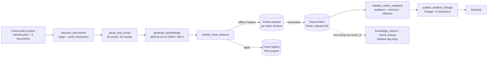

# RAG Knowledge Pipeline and Governance

This document describes how the platform turns internal fraud-policy documents
into knowledge that the fraud-investigation agents can retrieve and cite. It
covers the corpus, chunking, embeddings, publication through Feast, retrieval,
orchestration with Airflow, and governance in DataHub. The step-by-step
procedure is the [RAG runbook](../../runbooks/edai2/llm_agent/rag_runbook.md).

**Contents**

1. [Purpose](#1-purpose)
2. [Architecture](#2-architecture)
3. [Source corpus](#3-source-corpus)
4. [Parsing and chunking](#4-parsing-and-chunking)
5. [Embeddings](#5-embeddings)
6. [Publication through Feast](#6-publication-through-feast)
7. [Retrieval](#7-retrieval)
8. [Orchestration with Airflow](#8-orchestration-with-airflow)
9. [Governance in DataHub](#9-governance-in-datahub)
10. [Deployment and verification](#10-deployment-and-verification)
11. [Verification results](#11-verification-results)
12. [Limitations](#12-limitations)

## 1. Purpose

When an agent explains why a payment looks suspicious, it must cite the
internal policy that applies, such as the rule that an account-takeover alert
fails closed to manual review. Its citation must also be reproducible: it has to
name exactly which document, which chunk and which embedding produced it.

The pipeline therefore treats the knowledge base as a data product:

- the corpus is versioned, and every document has a checksum;
- chunk identities and embeddings are deterministic;
- publication goes to a named, isolated Feast target;
- a run is accepted only after the published rows have been read back and
  retrieval has been validated;
- lineage and quality results are recorded in DataHub.

This corpus has nothing to do with the 5 GB transaction dataset used by the
Feature Store. It is a small, separately versioned set of policy texts.

## 2. Architecture

The six boxes in the middle are the six tasks of one Airflow DAG,
[`rag_fraud_policy_ingestion`](../../../data_platform/orchestration/airflow/dags/rag_fraud_policy_ingestion.py).
Each task runs one stage of
[`ops/llm_agent/rag_ingest.py`](../../../ops/llm_agent/rag_ingest.py) and
writes one JSON artifact into the run's directory. The next task reads that
artifact. Query-time retrieval is not part of the DAG; the MCP tools read the
rows the DAG published.

## 3. Source corpus

The corpus lives in [`data/llm_agent/rag/fraud-policy-v1/`](../../../data/llm_agent/rag/fraud-policy-v1):

| Field | Value |
|---|---|
| Corpus | `ewallet-fraud-policy`, revision `fraud-policy-v1-20261030` |
| Documents | `policy-account-takeover`, `policy-payment-anomaly`, each with its SHA-256 in the manifest |
| Feature index revision | `fraud-policy-feast-v1` |
| Embedding model | `sentence-transformers/all-MiniLM-L6-v2` at revision `1110a243fdf4706b3f48f1d95db1a4f5529b4d41`, 384 dimensions |
| Chunking | 80 words, 16-word overlap |
| Evaluation | [`evaluation.json`](../../../data/llm_agent/rag/fraud-policy-v1/evaluation.json): 2 queries, each with its expected source document |

The manifest is the contract for every later stage. `discover_documents`
copies the manifest and the listed documents into the run directory. A
document whose checksum differs from the manifest stops the run. So does a path
that tries to leave the corpus folder. The source may also be a GCS prefix with
the same layout.

## 4. Parsing and chunking

[`pipeline.chunk_documents`](../../../ai_platform/llm_agent/rag/pipeline.py)
splits each document into windows of 80 words that advance by 64 words, so
consecutive chunks share 16 words. A chunk's ID is
`<document_id>:<ordinal>`, for example `policy-payment-anomaly:0001`. Each chunk
carries its document's source URI, checksum, corpus revision and event time.

`parse_and_chunk` builds the chunks twice from the staged corpus and fails if
the two results differ, so non-deterministic chunking cannot reach the store.
The two documents produce four chunks.

## 5. Embeddings

[`embedding.py`](../../../ai_platform/llm_agent/rag/embedding.py) runs the
pinned model with onnxruntime and the model's own `tokenizer.json`. It does
not need PyTorch or an embedding service. It reproduces the model's
sentence-transformers pipeline (transformer, mean pooling, L2 normalization).
At load time it checks the model's `modules.json` and pooling configuration and
refuses any other pipeline. The model files are downloaded once into
`HF_HOME` at the pinned revision, and their SHA-256 is recorded.

`generate_embeddings` rejects any vector that has the wrong dimension, holds a
non-finite value, or does not have unit length. It records the minimum and
maximum norm and the model file digest.

## 6. Publication through Feast

[`feast_publication.py`](../../../ai_platform/llm_agent/rag/feast_publication.py)
publishes the embedded chunks with Feast 0.66, using the definitions in
[`rag_feature_definitions.py`](../../../ai_platform/features/feast/feature_repo/rag_feature_definitions.py):

- **Entity** `rag_chunk`, join key `chunk_id`.
- **FeatureView** `fraud_policy_chunks` with `document_id`, `chunk_text`,
  `source_uri`, `source_checksum`, `corpus_revision`,
  `embedding_model_revision`, `feature_index_revision` and
  `embedding: Array(Float32)`.

`publish_feast_features` performs three steps:

1. **Offline.** It writes one Parquet file per feature index revision. The file
   is immutable: an identical rerun reuses it (`REUSED`), and different content
   under the same revision fails, because a new corpus needs a new revision.
2. **Registry.** It applies the entity and the FeatureView to the RAG project's
   own registry. This is a partial apply, so nothing else in the registry is
   touched. The registry of the historical fraud features is never written.
3. **Online.** It materializes the view into the Online Store.

The run records a publication identity. This is a SHA-256 over every row's
identity, text, provenance and revisions, which makes two publications
comparable.

### Online target and isolation

The Feast Online Redis is shared: DB 0 serves production, including the
`ewallet_rag` project that the MCP tool reads, and other databases belong to
Feature Store verification campaigns. A Redis connection string without a
database silently selects DB 0. The publication therefore goes through
[`online_target.py`](../../../ai_platform/llm_agent/rag/online_target.py):

| Mode (`EWALLET_RAG_ONLINE_TARGET`) | Redis database | Feast project | Before writing |
|---|---|---|---|
| `verification` (default) | 2–15, stated explicitly | `ewallet_rag_<suffix>`, never `ewallet_rag` | Claims the database |
| `production` (explicit only) | 0 | `ewallet_rag` | None, because DB 0 is never empty |

The claim reuses the Feature Store's ownership marker
([`redis_isolation.py`](../../../ai_platform/features/feast/redis_isolation.py)).
A Lua script stores a record naming the project, registry, corpus revision,
index revision, manifest digest and a fingerprint of the Redis server, but only
if the database is empty. A rerun with the identical identity is accepted
(`OWNED`). A non-empty unclaimed database or another owner stops the run before
anything is written. `validate_online_readback` checks the marker again. Nothing
ever flushes Redis or deletes keys, and no artifact contains the connection
string.

A local-development profile uses Feast's SQLite Online Store. It exists only
for fast tests and is labelled `local-dev` in every artifact. It is never
presented as the Redis integration.

## 7. Retrieval

Feast 0.66 stores the embedding in Redis but cannot search it: Redis is not
used as a vector index here
([`feast_contract.py`](../../../ai_platform/llm_agent/rag/feast_contract.py)
records this as `PUBLICATION_ONLY`). Retrieval is split into two steps:

- **Storage.**
  [`online_retriever.py`](../../../ai_platform/llm_agent/rag/online_retriever.py)
  reads the canonical chunk set from Feast Online by `chunk_id`, which is a key
  lookup. It rebuilds that set from the checksum-verified manifest, and every
  row must match its chunk, corpus, model and index revision, or the tool
  fails closed.
- **Search.** It embeds the query with the same pinned model and computes
  exact cosine similarity in process. Each hit becomes a citation with document
  ID, chunk ID, source URI, checksum and revisions.

`validate_online_readback` runs this retriever against the store the run just
wrote. It runs the evaluation queries and requires recall@k = 1.0, no empty
result and no citation error. The same classes serve the MCP tools
`knowledge_search` and `chunk_lookup`. Exact search costs O(chunks) per query;
that is adequate for this corpus, and a large corpus would need a vector-search
backend.

## 8. Orchestration with Airflow

| Task | Stage | Output | Timeout |
|---|---|---|---|
| `discover_documents` | stage the corpus, verify checksums | `documents.json` | 5 min |
| `parse_and_chunk` | deterministic chunks | `chunks.json` | 5 min |
| `generate_embeddings` | pinned ONNX embeddings | `embeddings.json` | 20 min |
| `publish_feast_features` | claim the target, Parquet, apply, materialize | `publication.json` | 15 min |
| `validate_online_readback` | ownership, readback, retrieval, citations | `validation.json` | 15 min |
| `publish_datahub_lineage` | lineage, assertions, readback, index visibility | `datahub.json` | 10 min |

How the DAG runs:

- **Triggering.** The DAG runs only when triggered manually
  (`schedule=None`), one run at a time, with two retries per task.
- **Parameters.** Four `Param`s, defined in
  [`rag_params.py`](../../../data_platform/orchestration/airflow/rag_params.py),
  are validated by Airflow: `source_location`, `online_store` (`redis` or
  `sqlite`), `datahub_mode` (`publish` or `plan_only`) and `run_label`. They
  reach the task only as environment values, so a parameter can never inject
  shell code.
- **Runtime.** Each task runs in the uv-locked runtime
  [`infra/docker/rag-ingestion`](../../../infra/docker/rag-ingestion) and
  fails at once if that runtime is not installed.
- **Settings.** Redis, registry and DataHub settings come from a private file
  (`EWALLET_RAG_ENV_FILE`, mode 600) with a fixed set of allowed keys.
- **Artifacts.** They are written once and atomically. A completed stage is
  never overwritten, and a retry starts clean. Run directories go to
  `EWALLET_RAG_EVIDENCE_ROOT`, outside the checkout.

There is exactly one RAG DAG. An earlier copy under the ID `rag_fraud_policy`
ran the same six tasks while some scripts, the DataHub URNs and Jenkins still
named it. It was removed, and a test now fails if a second RAG DAG appears or
any consumer names another ID
([`test_rag_dag_reconciliation.py`](../../../tests/llm_agent/test_rag_dag_reconciliation.py)).

For runs outside the shared Airflow,
[`rag_isolated_airflow.sh`](../../../scripts/llm_agent/rag_isolated_airflow.sh)
starts an Airflow 3 instance with its own home, database and UI (port 8095),
which sees only this DAG. It uses the same launcher,
[`isolated_airflow.sh`](../../../scripts/isolated_airflow.sh), as the Feature
Store DAG.

## 9. Governance in DataHub

[`governance.py`](../../../ai_platform/llm_agent/rag/governance.py) builds the
DataHub records from what the earlier tasks measured:

- **Datasets.**
  - The corpus, `urn:li:dataset:(urn:li:dataPlatform:file,fraud-policy/<corpus revision>,PROD)`,
    with its revision, document count and manifest digest.
  - The Feast dataset, `urn:li:dataset:(urn:li:dataPlatform:feast,<project>.fraud_policy_chunks/<index revision>,PROD)`,
    with its properties (model, dimensions, row count, publication identity,
    run ID, source commit) and its schema.
- **Lineage.** `upstreamLineage` from the corpus to the Feast dataset, type
  `TRANSFORMED`. No intermediate dataset is invented: chunks and embeddings
  exist only as run artifacts.
- **Airflow.** The DataFlow `urn:li:dataFlow:(airflow,rag_fraud_policy_ingestion,ewallet-gcp)`
  and one DataJob per task. The three preparation tasks read the corpus,
  `publish_feast_features` writes the Feast dataset,
  `validate_online_readback` reads it, and `publish_datahub_lineage` touches no
  dataset.
- **Quality.** Five custom assertions on the Feast dataset, each with a run
  result:

| Assertion | Passes when |
|---|---|
| `source_checksums_match_manifest` | at least one document and 0 checksum mismatches |
| `chunk_id_unique_and_deterministic` | chunk IDs are unique and rebuilt identically |
| `embedding_dimension_finite_nonzero` | every vector has 384 finite values and unit norm |
| `online_rows_match_offline_publication` | readback `MATCH` and Online rows = published rows |
| `retrieval_returns_cited_source` | no empty retrieval and no citation error |

A failed measurement is published as a `FAILURE` result, and the task then
fails; it is never reported as success.

**Publication versus visibility.** The task writes every aspect and reads it
back from GMS, which proves the write. The DataHub UI, however, draws search
results and lineage from its search and graph indices. A separate consumer
fills those indices asynchronously, and they can silently fall behind, for
example when OpenSearch turns read-only because its disk is full. After the
readback the task therefore queries the same GraphQL API the UI uses. It must
find the Feast dataset, the corpus and the DataFlow in search, and the corpus
and `publish_feast_features` upstream of the Feast dataset in lineage. If
they do not appear within about 90 seconds, the task fails
(`index_visibility: NOT_VISIBLE`).

`datahub_mode=plan_only` builds all records and publishes nothing. Its artifact
says `PLAN_ONLY_NOT_PUBLISHED` and is never evidence of governance.

## 10. Deployment and verification

[`rag_runtime_run.sh`](../../../scripts/llm_agent/rag_runtime_run.sh) is the
operator's entry point. Every command is labelled by what it may change:

| Command | Class | What it does |
|---|---|---|
| `preflight` | read-only | checkout, single DAG, lockfile, runtime, model cache, settings, Redis target (explicit, isolated, empty or owned), DataHub health and writable indices, Airflow health and DAG source, disk |
| `prepare` | local | locked runtime, model cache, settings file; for the local target also a Redis 7.4 container |
| `start` | local | DataHub quickstart if it is not healthy, then the isolated Airflow |
| `trigger LABEL` | writes to the target | preflight, a new DagRun, a bounded wait (30 min), then `collect` |
| `collect LABEL` | read-only | Airflow task states and logs, Feast registry view, Online readback, raw DataHub readback, summary, `SHA256SUMS` |
| `show feast\|online\|summary LABEL` | read-only | terminal views of the published registry, the Online rows and the whole run |
| `stop [--with-datahub]` | local | stops what `prepare` and `start` started; DataHub volumes are kept |

There are two targets:

- **`local`** (default) needs no cloud access. It uses a Redis 7.4 container on
  127.0.0.1:16381 (DB 3, `noeviction`), with the Feast registry and offline
  Parquet under `~/ewallet-evidence/rag/feast`. This is the real Feast Redis
  integration, not the SQLite profile.
- **`gke`** is the **Hybrid** integration target. Airflow, the embedding model
  and DataHub stay on the laptop. The Feast registry and offline Parquet are on
  GCS under the run's project, and the Feast Online Store is the GKE Redis
  `feature-store/redis`, reached through a port-forward owned by the runner.
  `dbs` lists the databases and their owners. `configure DB PROJECT` writes the
  settings from the Redis Secret without printing the password. Preflight
  checks the following before anything is written:
  - the cluster and the Redis are ready;
  - the port-forward is a single one owned by the runner;
  - the target is a verification database in 2–15 with a dedicated project;
  - the GCS paths are dedicated to the project;
  - the database is free or already owned by this exact publication;
  - the eviction policy is `noeviction`;
  - the ADC permissions on the bucket are sufficient.

  It requires a cluster the owner has woken; the runner never wakes it
  ([runbook §5](../../runbooks/edai2/llm_agent/rag_runbook.md#5-hybrid-target-gke-feast-online-redis-and-gcs-cloud)).

Jenkins builds the RAG ingestion image and smoke-tests it against an ephemeral
Redis in the CD namespace (explicit DB 2), before switching the CronJob to the
new digest ([CI/CD §4](../cicd/CICD.md#4-continuous-delivery-of-the-rag-ingestion-pipeline)).

## 11. Verification results

### 11.1 Local end-to-end run, 2026-11-14

The canonical DAG ran in a real Airflow 3.3.1 with the six tasks as Airflow
task instances. It used the real embedding model, Feast with Redis (local
container, DB 3) and the local DataHub quickstart, from source commit
`1e6a88a2`. Evidence:
[`local-e2e-20261114t083158/`](../../evidence/edai2/rag/local-e2e-20261114t083158/).

| Check | Result |
|---|---|
| DagRun `manual__rag-local-e2e-20261114t083158` | `success`, 6/6 tasks |
| Documents | 2, 0 checksum mismatches |
| Chunks | 4, deterministic |
| Embeddings | 4 × 384, 0 invalid, model revision `1110a243…` |
| Publication | 4 rows, identity `b85ae796221aa0b9e2adfd7ff19488f612dff18c8d60c3c44f0134b7266bf549`, project `ewallet_rag_verify`, Redis DB 3 `OWNED` |
| Online readback | `MATCH`, 4/4 rows with 384-d unit vectors; DB 3 holds 4 chunk keys and the owner marker |
| Retrieval | recall@k 1.0, MRR 1.0, 0 citation errors |
| DataHub | `PUBLISHED_AND_READ_BACK`: 27 aspects read back, 5/5 assertions `SUCCESS`, index visibility `VISIBLE` |

The publication identity equals that of the 2026-11-02 cloud run and of the
Jenkins release smoke test. The same corpus, model and code produce the same
knowledge base.

The run before it (`local-e2e-20261114t083029`) claimed the empty DB 3
(`CLAIMED`). This run reused the identical Parquet (`REUSED`) and found the
database already owned by the same project (`OWNED`). The following checks
were run against the same local Redis, and each one was refused before
anything was written:

- a connection string without a database;
- DB 0;
- a database holding a foreign key.

This is local evidence. It is not a GKE deployment and contains no
screenshots.

### 11.2 Earlier cloud run, 2026-11-02

DagRun `manual__2026-11-02T04:47:47.888480+00:00` (source `f265f2e7…`) ran
the same six tasks against the GKE Feast Redis and a run-scoped GCS registry.
It published the same identity `b85ae796…`, read back 4 rows, and published
25 DataHub records (before the sixth DataJob was added) with 5/5 assertions
passing
([`rag_g3-functional-rag-20261102t045700z/`](../../evidence/llm_agent/rag_g3-functional-rag-20261102t045700z)).
The published index was also queried through the real MCP server, and the
agents cite it in the kagent UI:

*The Coordinator's answer to an analyst question (trace `7e651a4f…`), with
three citations from corpus `fraud-policy-v1-20261030` retrieved by
`knowledge_search`.*

### 11.3 Runtime screenshots

The owner captures these from a fresh run with the runbook. They will be
added here once captured:

| Screenshot | Shows |
|---|---|
| `RAG-01_airflow_dag_success.png` | Airflow Grid of the run: 6/6 tasks successful |
| `RAG-02_airflow_pipeline_graph.png` | Airflow Graph of the six-task pipeline |
| `RAG-03_feast_publication.png` | `show feast`: entity, FeatureView, 4 offline rows, identity match |
| `RAG-04_redis_online_readback.png` | `show online`: 4/4 rows from Redis, owner marker |
| `RAG-05_datahub_lineage.png` | DataHub lineage: corpus → RAG ingestion → Feast dataset |
| `RAG-06_datahub_quality_assertions.png` | DataHub Quality tab: 5 assertions, all successful |
| `RAG-07_end_to_end_validation.png` | `show summary`: the whole run |

## 12. Limitations

- **Corpus size.** Two documents and four chunks show the mechanism, not
  retrieval quality at scale.
- **Exact search.** Similarity is computed in process over all chunks. A
  large corpus needs an approved vector-search backend; Redis is not used as
  one.
- **Local control plane.** Airflow and DataHub run on the operator's machine.
  The local target proves the Feast and Redis integration but not the GKE
  Redis.
- **Shared Redis on GKE.** Verification runs share the instance with
  production, separated by database and the ownership marker. Each Hybrid run
  needs a free database in 2–15. The marker includes the Redis server
  `run_id`, so after a sleep and wake the next run needs a new database and
  project.
- **Agents read production only.** The RAG MCP server reads project
  `ewallet_rag` in DB 0. A Hybrid verification run proves ingestion into the
  GKE Online Store, not a new revision served to the agents. Promoting one is
  a separate production change.
- **Hybrid not yet executed from this version.** The gke path was checked
  with tests, a preflight against the sleeping cluster and a GCS permission
  test. The last cloud run is from 2026-11-02 (§11.2).
- **Historical metadata.** The local DataHub still holds the DataFlow
  `rag_fraud_policy` and Feast datasets of earlier projects (`ewallet_rag`,
  `ewallet_rag_campaign`, `ewallet_rag_local`). They were kept. A screenshot
  should start from the run's own Feast dataset or from the
  `rag_fraud_policy_ingestion` DataFlow.
