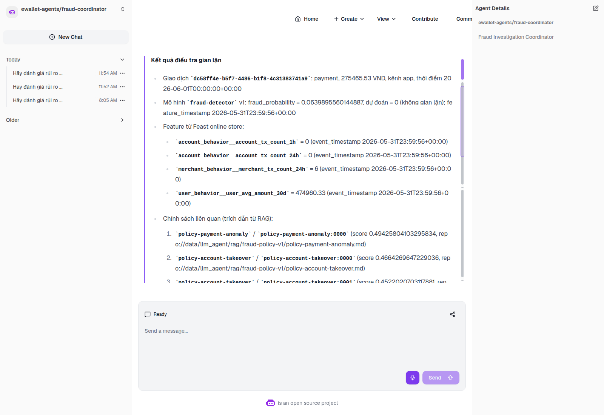
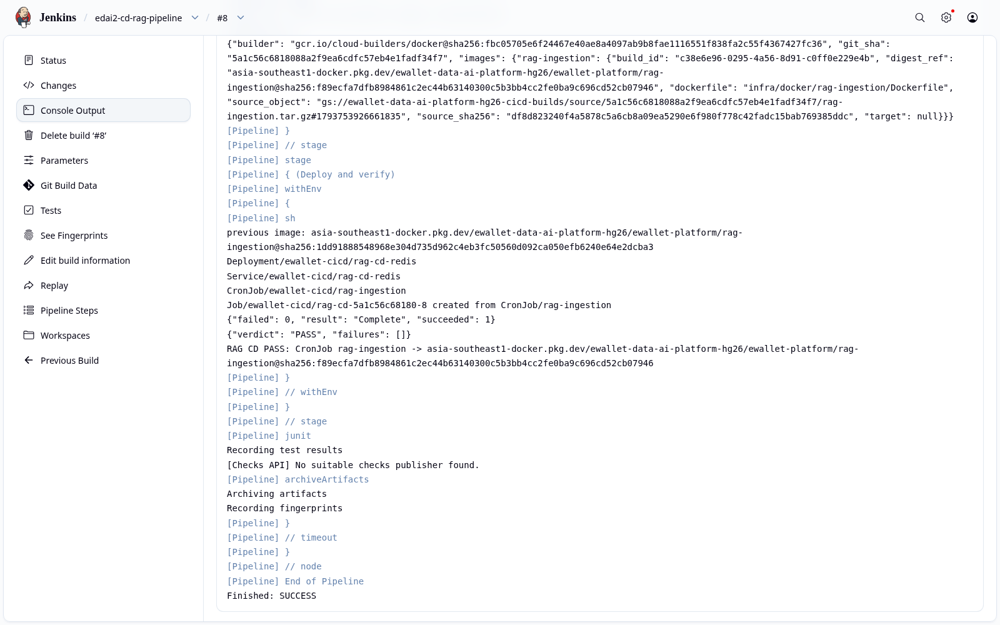

# RAG Knowledge Pipeline and Governance

This report describes how internal fraud-policy documents become searchable knowledge for the agents:

- an Airflow pipeline chunks and embeds the documents;
- it publishes the chunks to a Feast-backed online store;
- it registers the lineage and quality results in DataHub;
- the agents search the published chunks through an MCP tool, and cite them in their answers.

## 1. Overview and motivation

When the agent explains a suspicious transaction, it must cite the internal policy that applies, for example a step-up authentication rule for unusual payments. Its answer must also be reproducible: a citation has to identify exactly which document, which chunk and which embedding produced it.

The pipeline therefore treats the knowledge base like any other data product:

- the corpus is versioned;
- every run publishes to a new immutable location;
- chunk identity and embeddings are deterministic;
- a run is accepted only after the published data has been read back and validated.

## 2. Architecture

```text
(1) versioned policy corpus  ──▶  Airflow DAG rag_fraud_policy_ingestion
    fraud-policy-v1-20261030        discover_documents → parse_and_chunk → generate_embeddings
                                    → publish_feast_features → validate_online_readback → publish_datahub_lineage
                                         │ (2) chunks + 384-d embeddings + checksums
                                         ▼
                      Feast RAG FeatureView ──(3) online write──▶ Redis online store
                      (immutable registry in GCS per run)            │ (5) knowledge_search (MCP)
                                         │ (4) lineage + assertion results  ▼
                                         ▼                    feature-rag-mcp → Feature-RAG Specialist → cited answer
                                      DataHub
```

## 3. Implementation

| Stage (Airflow task) | What it does | Source |
|---|---|---|
| `discover_documents` | Reads the corpus manifest and loads the documents | [`rag/pipeline.py`](../../../ai_platform/llm_agent/rag/pipeline.py) |
| `parse_and_chunk` | Splits each document into 80-word chunks with a 16-word overlap. The chunk ID is derived from the content, so re-running gives identical IDs | `pipeline.py`, [`rag/contracts.py`](../../../ai_platform/llm_agent/rag/contracts.py) |
| `generate_embeddings` | Embeds each chunk with `sentence-transformers/all-MiniLM-L6-v2` at a pinned revision, producing 384 dimensions | [`rag/embedding.py`](../../../ai_platform/llm_agent/rag/embedding.py) |
| `publish_feast_features` | Writes the chunks, embeddings and metadata to the Feast RAG FeatureView, with a new immutable registry in GCS for each run | [`rag/feast_contract.py`](../../../ai_platform/llm_agent/rag/feast_contract.py), [`rag/feast_publication.py`](../../../ai_platform/llm_agent/rag/feast_publication.py) |
| `validate_online_readback` | Reads the published chunks back from the online store and checks count, IDs, checksums and vector dimensions | `feast_publication.py` |
| `publish_datahub_lineage` | Publishes the datasets, the Airflow DataFlow and DataJobs, the lineage, and the assertion results to DataHub | [`rag/governance.py`](../../../ai_platform/llm_agent/rag/governance.py) |

**DAG.**

- Definition: [`rag_fraud_policy_ingestion.py`](../../../data_platform/orchestration/airflow/dags/rag_fraud_policy_ingestion.py).
- Each task runs one stage in the locked `rag-ingestion` runtime, with retries and timeouts.
- Parameters are validated Airflow `Param`s.
- The DAG is triggered manually (`schedule=None`) and allows one active run at a time.

**Online retrieval.**

- [`rag/online_retriever.py`](../../../ai_platform/llm_agent/rag/online_retriever.py) embeds the query with the same model and revision.
- It refuses to search an index whose dimensions or model revision differ, then returns the top chunks.
- The MCP tool `knowledge_search` ([`tools/knowledge_search.py`](../../../ai_platform/llm_agent/tools/knowledge_search.py)) exposes this to the agents.

## 4. Execution and results

### 4.1 Pipeline run

DagRun `manual__2026-11-02T04:47:47.888480+00:00` of `rag_fraud_policy_ingestion` ran from source commit `f265f2e7…`. **All six tasks succeeded.**

The run's evidence is in [`rag_g3-functional-rag-20261102t045700z/`](../../evidence/llm_agent/rag_g3-functional-rag-20261102t045700z):

- `airflow/task_states.json`;
- `airflow/dag_runs.json`;
- the outputs of each stage.

| Output | Value |
|---|---|
| Corpus | `ewallet-fraud-policy`, revision `fraud-policy-v1-20261030` |
| Immutable Feast registry | `gs://…/features/registries/rag/runs/g3-functional-rag-20261102t045700z/registry.db`, sha256 `77aaae13…` |
| Publication identity (a hash of corpus, chunks, embeddings and index revision) | `b85ae796221aa0b9e2adfd7ff19488f612dff18c8d60c3c44f0134b7266bf549` |
| Online read-back | 4 chunk keys from 2 documents; IDs and checksums match |

### 4.2 Retrieval through MCP

The published index was queried through the real MCP server with production authentication.

- `knowledge_search` returned 4 citations.
- Each citation carried the document ID, chunk ID, checksum, and the corpus, embedding and index revisions.
- Requests with missing or wrong credentials were rejected with 401.

The same chunks appear in agent answers in the kagent UI:



*The Coordinator's answer to an analyst question (trace `7e651a4f…`). It includes three citations from corpus `fraud-policy-v1-20261030`, retrieved by `knowledge_search`.*

### 4.3 Reproducibility in delivery

The RAG ingestion image is released by Jenkins (see [CI/CD §4](../cicd/CICD.md#4-continuous-delivery-of-the-rag-ingestion-pipeline)). The release smoke test runs all six stages against an ephemeral Redis. It produced the same publication identity `b85ae796…`, which proves that the released image reproduces the published knowledge base exactly.



*Jenkins release build: the smoke Job completes with `{"verdict": "PASS"}` before the CronJob is switched to the new image digest.*

## 5. Governance

The final task publishes the run to DataHub (GMS 1.7.0.1). The publication contains 25 records, and all 25 were read back from GMS:

- the source corpus and the Feast dataset with its schema;
- upstream lineage from corpus to Feast;
- the Airflow DataFlow and its DataJobs, with their inputs and outputs;
- five assertion definitions and five assertion run results.

All five assertions passed:

| Assertion | Observed |
|---|---|
| `source_checksums_match_manifest` | 2 documents, 0 checksum mismatches |
| `chunk_id_unique_and_deterministic` | 4 chunks, 4 unique, rebuilt identically |
| `embedding_dimension_finite_nonzero` | 4 vectors of 384 dimensions, 0 invalid |
| `online_rows_match_offline_publication` | 4 offline rows = 4 online rows (`MATCH`) |
| `retrieval_returns_cited_source` | recall@k 1.0, 0 citation errors, 0 empty retrievals |

DataHub ran as a local Quickstart deployment during this run. Evidence: [`edai2_integration_20261102/datahub/publication-readback.json`](../../evidence/llm_agent/edai2_integration_20261102/datahub/publication-readback.json).

**Tests:**

- `tests.llm_agent.test_rag_airflow_ingestion`: 29 passed, 1 model-gated test skipped;
- the DataHub module tests: 19/19.

## 6. Limitations

- **No retained screenshots.** No Airflow UI or DataHub UI screenshot of this run was kept. The run is documented by the machine-readable task states and the GMS read-back.
- **DataHub is not permanent.** DataHub is not deployed permanently in the cloud; it ran as a local Quickstart for the run.
- **Small corpus.** The corpus is two policy documents (four chunks). This demonstrates the mechanism rather than retrieval quality at scale.

Operating instructions:
[`docs/runbooks/edai2/llm_agent/rag_runbook.md`](../../runbooks/edai2/llm_agent/rag_runbook.md).
