# RAG Knowledge Pipeline and Governance

This document describes how the platform turns internal fraud-policy documents
into knowledge that the fraud-investigation agents can retrieve and cite. It
covers the corpus, chunking, embeddings, publication through Feast,
retrieval, orchestration with Airflow and governance in DataHub. Each part is
followed by the evidence of the owner-run Hybrid campaign of 2026-11-14.
Operating instructions are in the
[RAG runbook](../../runbooks/edai2/llm_agent/rag_runbook.md).

**Contents**

1. [Purpose](#1-purpose)
2. [Architecture](#2-architecture)
3. [Source corpus](#3-source-corpus)
4. [Parsing and chunking](#4-parsing-and-chunking)
5. [Embeddings](#5-embeddings)
6. [Publication through Feast](#6-publication-through-feast)
7. [Retrieval and validation](#7-retrieval-and-validation)
8. [Orchestration with Airflow](#8-orchestration-with-airflow)
9. [Governance in DataHub](#9-governance-in-datahub)
10. [Running the pipeline](#10-running-the-pipeline)
11. [Verification results](#11-verification-results)
12. [Reproducibility and provenance](#12-reproducibility-and-provenance)
13. [Limitations](#13-limitations)

**Source references.** Links to code point at commit
[`9153a06a`](https://github.com/HuyyGiaa/ewallet-data-ai-platform/tree/9153a06af5e89edbb3a60b5c2fd95d73eb3d6c0a),
the commit the Hybrid campaign ran from. Later changes on `main` therefore do
not change what a link shows.

## 1. Purpose

When an agent explains why a payment looks suspicious, it must cite the
internal policy that applies, such as the rule that an account-takeover alert
fails closed to manual review. The citation must also be reproducible: it has
to name the document, the chunk, the corpus revision and the embedding model
that produced it.

The pipeline therefore treats the knowledge base as a data product:

- the corpus is versioned, and every document has a checksum;
- chunk identities and embeddings are deterministic;
- publication goes to a named, isolated Feast target;
- a run is accepted only after the published rows have been read back and
  retrieval has been validated;
- lineage and quality results are recorded in DataHub.

This corpus is unrelated to the 5 GB transaction dataset of the Feature Store.
It is a small, separately versioned set of policy texts.

## 2. Architecture

The integration target is a **Hybrid** deployment. The control plane and the
compute run on the operator's machine. The Feast storage is in Google Cloud:
the registry and the offline Parquet on GCS, and the Online Store in the Redis
on GKE that the RAG MCP server also uses.

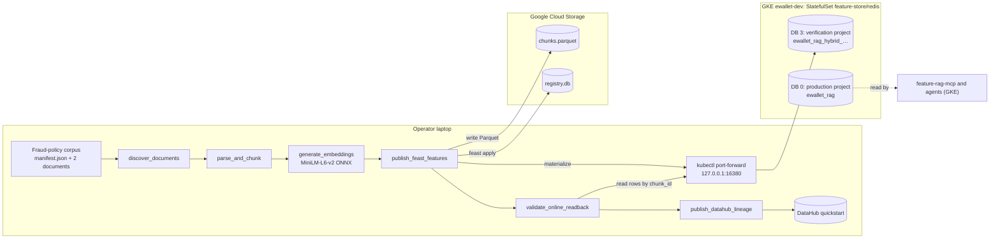

The six boxes on the laptop are the six tasks of one Airflow DAG,
[`rag_fraud_policy_ingestion`](https://github.com/HuyyGiaa/ewallet-data-ai-platform/blob/9153a06af5e89edbb3a60b5c2fd95d73eb3d6c0a/data_platform/orchestration/airflow/dags/rag_fraud_policy_ingestion.py).
Each task runs one stage of
[`ops/llm_agent/rag_ingest.py`](https://github.com/HuyyGiaa/ewallet-data-ai-platform/blob/9153a06af5e89edbb3a60b5c2fd95d73eb3d6c0a/ops/llm_agent/rag_ingest.py)
and writes one JSON artifact to the run's directory, and the next task reads
it.

Query-time retrieval is not part of the DAG. On GKE, the MCP tools read the
production project `ewallet_rag` in DB 0. A verification run such as the
2026-11-14 campaign writes its own project in its own database and does not
change what the agents read (§13).

| Component | Where it ran in the 2026-11-14 campaign |
|---|---|
| Airflow 3.3.1 and the six tasks | Laptop: isolated instance, UI 127.0.0.1:8095 |
| Document processing and ONNX inference | Laptop: uv-locked runtime `infra/docker/rag-ingestion` |
| DataHub v1.7 quickstart | Laptop: Docker, GMS 127.0.0.1:18080 |
| Feast registry and offline Parquet | GCS bucket `ewallet-data-ai-platform-hg26-data`, paths keyed by the project |
| Feast Online Store | GKE Redis `feature-store/redis`, DB 3, through the runner's port-forward |
| RAG MCP server and agents | GKE, production project and DB 0; not part of this run |

## 3. Source corpus

The corpus lives in
[`data/llm_agent/rag/fraud-policy-v1/`](../../../data/llm_agent/rag/fraud-policy-v1):

| Field | Value |
|---|---|
| Corpus | `ewallet-fraud-policy`, revision `fraud-policy-v1-20261030` |
| Documents | `policy-account-takeover` (116 words) and `policy-payment-anomaly` (108 words), each with its SHA-256 in the manifest |
| Feature index revision | `fraud-policy-feast-v1` |
| Embedding model | `sentence-transformers/all-MiniLM-L6-v2` at revision `1110a243fdf4706b3f48f1d95db1a4f5529b4d41`, 384 dimensions |
| Chunking | 80 words, 16-word overlap |
| Evaluation | [`evaluation.json`](../../../data/llm_agent/rag/fraud-policy-v1/evaluation.json): 2 queries, each with its expected source document; top-k 2 |

The manifest is the contract for every later stage. `discover_documents`
([`discover()`](https://github.com/HuyyGiaa/ewallet-data-ai-platform/blob/9153a06af5e89edbb3a60b5c2fd95d73eb3d6c0a/ops/llm_agent/rag_ingest.py#L193-L207))
copies the manifest and the listed documents into the run directory. It then
calls
[`ingest_documents()`](https://github.com/HuyyGiaa/ewallet-data-ai-platform/blob/9153a06af5e89edbb3a60b5c2fd95d73eb3d6c0a/ai_platform/llm_agent/rag/pipeline.py#L26-L53),
which recomputes each document's SHA-256 and stops the run on any mismatch.
It also stops on a duplicate document ID and on a path that would leave the
corpus folder. The source may also be a GCS prefix with the same layout.
`documents.json` records the manifest digest and the runtime identity:
commit, Python, package versions and `uv.lock` digest.

## 4. Parsing and chunking

[`chunk_documents()`](https://github.com/HuyyGiaa/ewallet-data-ai-platform/blob/9153a06af5e89edbb3a60b5c2fd95d73eb3d6c0a/ai_platform/llm_agent/rag/pipeline.py#L56-L81)
splits each document on whitespace into windows of 80 words that advance by
64 words, so consecutive chunks share 16 words. This is a fixed word window,
not semantic segmentation. A chunk's ID is `<document_id>:<ordinal>`, for
example `policy-payment-anomaly:0001`. Each chunk carries its document's
source URI, checksum, corpus revision and event time.

`parse_and_chunk`
([`chunk()`](https://github.com/HuyyGiaa/ewallet-data-ai-platform/blob/9153a06af5e89edbb3a60b5c2fd95d73eb3d6c0a/ops/llm_agent/rag_ingest.py#L218-L237))
builds the chunks twice from the staged corpus and fails if the two results
differ. Non-deterministic chunking therefore cannot reach the store. The two
documents produce four chunks, two per document.

## 5. Embeddings

[`OnnxSentenceEmbedder`](https://github.com/HuyyGiaa/ewallet-data-ai-platform/blob/9153a06af5e89edbb3a60b5c2fd95d73eb3d6c0a/ai_platform/llm_agent/rag/embedding.py#L68-L142)
runs the pinned model locally with onnxruntime on the CPU, using the model's
own `tokenizer.json`. No PyTorch and no hosted embedding API are involved.

- **Model files.** They are downloaded once from Hugging Face at the pinned
  40-character revision into `HF_HOME`. The digest of `onnx/model.onnx` is
  recorded.
- **Load-time check.** The embedder checks `modules.json` and the pooling
  configuration
  ([`check_sentence_transformer_layout()`](https://github.com/HuyyGiaa/ewallet-data-ai-platform/blob/9153a06af5e89edbb3a60b5c2fd95d73eb3d6c0a/ai_platform/llm_agent/rag/embedding.py#L44-L52))
  and refuses any other sentence-transformers pipeline.
- **Pooling.** Token embeddings are mean-pooled under the attention mask and
  L2-normalized
  ([`mean_pool_normalize()`](https://github.com/HuyyGiaa/ewallet-data-ai-platform/blob/9153a06af5e89edbb3a60b5c2fd95d73eb3d6c0a/ai_platform/llm_agent/rag/embedding.py#L55-L64)).
  This reproduces the sentence-transformers output of the model.

`generate_embeddings`
([`embed()`](https://github.com/HuyyGiaa/ewallet-data-ai-platform/blob/9153a06af5e89edbb3a60b5c2fd95d73eb3d6c0a/ops/llm_agent/rag_ingest.py#L249-L271))
counts as invalid any vector that has the wrong dimension, holds a non-finite
value, or has a norm more than 0.001 away from 1. It fails if any vector is
invalid, and records the minimum and maximum norm and the model file digest.
In the Hybrid campaign the four vectors had norms between 0.99999996 and
1.00000004, and model file digest `6fd5d72f…`.

## 6. Publication through Feast

Feast is the serving contract between the pipeline and the agents. The rows
have a declared entity and schema, the registry records which source and
project they belong to, and the Online Store is read by the same Feast client
code the MCP server uses.

[`feast_publication.py`](https://github.com/HuyyGiaa/ewallet-data-ai-platform/blob/9153a06af5e89edbb3a60b5c2fd95d73eb3d6c0a/ai_platform/llm_agent/rag/feast_publication.py)
publishes the embedded chunks with Feast 0.66. It uses the definitions in
[`build_rag_feature_objects()`](https://github.com/HuyyGiaa/ewallet-data-ai-platform/blob/9153a06af5e89edbb3a60b5c2fd95d73eb3d6c0a/ai_platform/features/feast/feature_repo/rag_feature_definitions.py#L20-L67):

- **Entity** `rag_chunk`, join key `chunk_id`.
- **FeatureView** `fraud_policy_chunks`. It has the fields `document_id`,
  `chunk_text`, `source_uri`, `source_checksum`, `corpus_revision`,
  `embedding_model_revision`, `feature_index_revision` and
  `embedding: Array(Float32)`. Its `FileSource` is the run's Parquet, and it
  is marked `online=True`.

[`resolve_target()`](https://github.com/HuyyGiaa/ewallet-data-ai-platform/blob/9153a06af5e89edbb3a60b5c2fd95d73eb3d6c0a/ai_platform/llm_agent/rag/feast_publication.py#L65-L84)
reads the project, the registry, the publication base and the Redis
connection from the run's settings. It refuses an unsafe target before
anything is written (§6.1). The registry path decides where Feast keeps its
metadata. In
[`repo_config()`](https://github.com/HuyyGiaa/ewallet-data-ai-platform/blob/9153a06af5e89edbb3a60b5c2fd95d73eb3d6c0a/ai_platform/llm_agent/rag/feast_publication.py#L87-L97),
a `gs://` registry selects the `gcp` provider.

`publish_feast_features`
([`publish()`](https://github.com/HuyyGiaa/ewallet-data-ai-platform/blob/9153a06af5e89edbb3a60b5c2fd95d73eb3d6c0a/ops/llm_agent/rag_ingest.py#L317-L339))
runs four steps in this order:

1. **Claim the Online target** (§6.1), before anything is written.
2. **Offline.**
   [`write_offline_source()`](https://github.com/HuyyGiaa/ewallet-data-ai-platform/blob/9153a06af5e89edbb3a60b5c2fd95d73eb3d6c0a/ai_platform/llm_agent/rag/feast_publication.py#L135-L158)
   writes one Parquet file, `<publication base>/<index revision>/chunks.parquet`.
   The file is immutable:
   - an identical rerun reuses it (`REUSED`);
   - different content under the same revision fails, because a new corpus
     needs a new revision.

   Before writing,
   [`publication_frame()`](https://github.com/HuyyGiaa/ewallet-data-ai-platform/blob/9153a06af5e89edbb3a60b5c2fd95d73eb3d6c0a/ai_platform/llm_agent/rag/feast_publication.py#L106-L122)
   rejects duplicate chunk IDs and any vector that is not a finite, non-zero
   384-d vector.
3. **Registry.**
   [`apply_and_materialize()`](https://github.com/HuyyGiaa/ewallet-data-ai-platform/blob/9153a06af5e89edbb3a60b5c2fd95d73eb3d6c0a/ai_platform/llm_agent/rag/feast_publication.py#L161-L175)
   applies the entity and the FeatureView to the project's registry. The
   registry holds definitions only; the feature rows are in the Parquet and
   in Redis.
4. **Online.** It materializes the view from one second before the earliest
   chunk event time up to now. Feast reads the Parquet and writes one row per
   `chunk_id` to Redis.

The run records a **publication identity**. This is a SHA-256 over every row's
chunk ID, document ID, text, source URI, checksum and revisions, but not the
floating-point vectors
([`publication_identity()`](https://github.com/HuyyGiaa/ewallet-data-ai-platform/blob/9153a06af5e89edbb3a60b5c2fd95d73eb3d6c0a/ai_platform/llm_agent/rag/feast_publication.py#L100-L103)).
It makes two publications comparable.

**Evidence from the Hybrid campaign.**
- `publication.json` records 4 rows, offline status `WRITTEN`, identity
  `b85ae796…bf549`, and the materialization window `2026-10-29T23:59:59Z` →
  `2026-11-14T15:11:28Z`.
- After the run, `collect` produced `feast_registry.json` with
  [`feast_view()`](https://github.com/HuyyGiaa/ewallet-data-ai-platform/blob/9153a06af5e89edbb3a60b5c2fd95d73eb3d6c0a/ops/llm_agent/rag_evidence.py#L49-L71).
  This is a separate read: it opens the registry on GCS and lists the
  entities and feature views. It then reads the Parquet back from GCS and
  recomputes the publication identity from those rows.

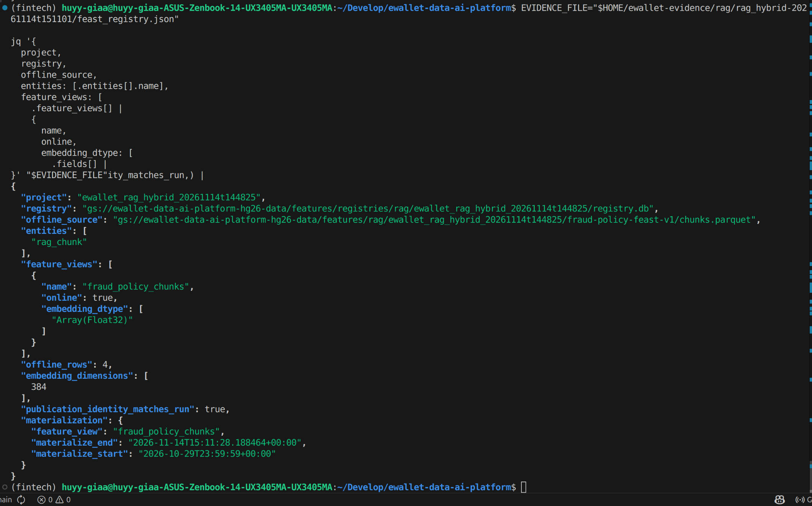

*RAG-03, owner terminal, campaign `hybrid-20261114t151101`: a `jq` selection
of `feast_registry.json`. Entity `rag_chunk` and FeatureView
`fraud_policy_chunks` are read from the registry on GCS. Four rows of 384
dimensions are read from the GCS Parquet, and the recomputed identity equals
the one the task recorded. The echoed `jq` command is partly overwritten by
the terminal; the output is the file's content.*

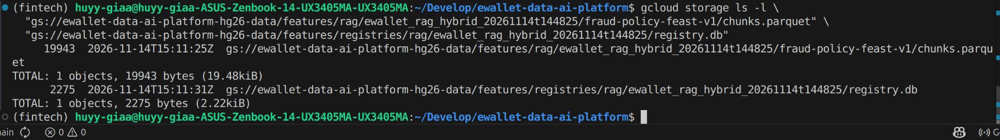

*RAG-09, owner terminal: `gcloud storage ls -l` lists the two objects the task
wrote, `chunks.parquet` (19,943 bytes, 15:11:25Z) and `registry.db` (2,275
bytes, 15:11:31Z), under the project's paths. `gcloud` only reads the bucket
metadata. It shows that the objects exist at the paths in `publication.json`;
it is not part of the pipeline.*

### 6.1 Online target and isolation

The Feast Online Redis on GKE is shared:

- DB 0 serves production, including the `ewallet_rag` project that the MCP
  tool reads.
- DB 1 is the canonical verification store.
- Other databases belong to Feature Store verification campaigns.

A Redis connection string without a database silently selects DB 0.
Publication therefore goes through
[`online_target.py`](https://github.com/HuyyGiaa/ewallet-data-ai-platform/blob/9153a06af5e89edbb3a60b5c2fd95d73eb3d6c0a/ai_platform/llm_agent/rag/online_target.py),
which
[`resolve()`](https://github.com/HuyyGiaa/ewallet-data-ai-platform/blob/9153a06af5e89edbb3a60b5c2fd95d73eb3d6c0a/ai_platform/llm_agent/rag/online_target.py#L100-L117)
enforces:

| Mode (`EWALLET_RAG_ONLINE_TARGET`) | Redis database | Feast project | GCS paths | Before writing |
|---|---|---|---|---|
| `verification` (default) | 2–15, stated explicitly | `ewallet_rag_<suffix>`, never `ewallet_rag` | Must contain `/<project>/` ([`check_storage_paths()`](https://github.com/HuyyGiaa/ewallet-data-ai-platform/blob/9153a06af5e89edbb3a60b5c2fd95d73eb3d6c0a/ai_platform/llm_agent/rag/online_target.py#L120-L134)) | Claims the database |
| `production` (explicit only) | 0 | `ewallet_rag` | Production paths | None, because DB 0 is never empty |

**Ownership marker.** The claim reuses the Feature Store's marker. Its record
([`owner_record()`](https://github.com/HuyyGiaa/ewallet-data-ai-platform/blob/9153a06af5e89edbb3a60b5c2fd95d73eb3d6c0a/ai_platform/llm_agent/rag/online_target.py#L144-L152))
names:

- the project;
- the corpus revision;
- the registry URI;
- the online-store ID `rag-verification`;
- the index revision;
- the manifest digest;
- a fingerprint of `host:port/db` plus the Redis server's `run_id`
  ([`target_fingerprint()`](https://github.com/HuyyGiaa/ewallet-data-ai-platform/blob/9153a06af5e89edbb3a60b5c2fd95d73eb3d6c0a/ai_platform/features/feast/redis_isolation.py#L18-L20)).

**Claim, check and preview.**
- [`ensure_ownership()`](https://github.com/HuyyGiaa/ewallet-data-ai-platform/blob/9153a06af5e89edbb3a60b5c2fd95d73eb3d6c0a/ai_platform/llm_agent/rag/online_target.py#L180-L192)
  calls the Lua script in
  [`claim()`](https://github.com/HuyyGiaa/ewallet-data-ai-platform/blob/9153a06af5e89edbb3a60b5c2fd95d73eb3d6c0a/ai_platform/features/feast/redis_isolation.py#L44-L63).
  The script writes the record only if the database is empty (`CLAIMED`), and
  accepts an identical existing record (`OWNED`). It refuses a non-empty
  database without a marker, and any other owner, before anything is written.
- `validate_online_readback` checks the marker again, read-only, with
  [`verify_ownership()`](https://github.com/HuyyGiaa/ewallet-data-ai-platform/blob/9153a06af5e89edbb3a60b5c2fd95d73eb3d6c0a/ai_platform/llm_agent/rag/online_target.py#L195-L204).
- The runner's preflight forecasts the claim without writing, using
  [`preview_ownership()`](https://github.com/HuyyGiaa/ewallet-data-ai-platform/blob/9153a06af5e89edbb3a60b5c2fd95d73eb3d6c0a/ai_platform/llm_agent/rag/online_target.py#L155-L177).

Nothing ever flushes Redis or deletes keys, and no artifact contains the
connection string or the password.

**Why DB 3.** The owner listed the databases with `rag_runtime_run.sh dbs`
before the run, and chose DB 3 because it was in 2–15 and held no keys:

- DB 0 holds production data and DB 1 is the canonical verification store;
- DB 2, 8 and 9 were owned by Feature Store campaigns;
- DB 3 was empty, so the task claimed it (`claim_status: CLAIMED`).

**Online readback.** After the run, `collect` called
[`online_view()`](https://github.com/HuyyGiaa/ewallet-data-ai-platform/blob/9153a06af5e89edbb3a60b5c2fd95d73eb3d6c0a/ops/llm_agent/rag_evidence.py#L74-L101).
It is separate from the task's own readback:

- It reads the four chunk IDs of `chunks.json` through Feast's
  `get_online_features`
  ([`online_readback()`](https://github.com/HuyyGiaa/ewallet-data-ai-platform/blob/9153a06af5e89edbb3a60b5c2fd95d73eb3d6c0a/ai_platform/llm_agent/rag/feast_publication.py#L178-L182)).
- `requested` is the number of chunk IDs asked for, and `returned` is the
  number of rows that came back with a document ID.
- It also reports the database size and the owner marker
  ([`read_owner()`](https://github.com/HuyyGiaa/ewallet-data-ai-platform/blob/9153a06af5e89edbb3a60b5c2fd95d73eb3d6c0a/ai_platform/features/feast/redis_isolation.py#L66-L78)).

DB 3 holds 5 keys. That is consistent with Feast's Redis layout, which keeps
one hash per entity key: four chunk entities plus the ownership marker.

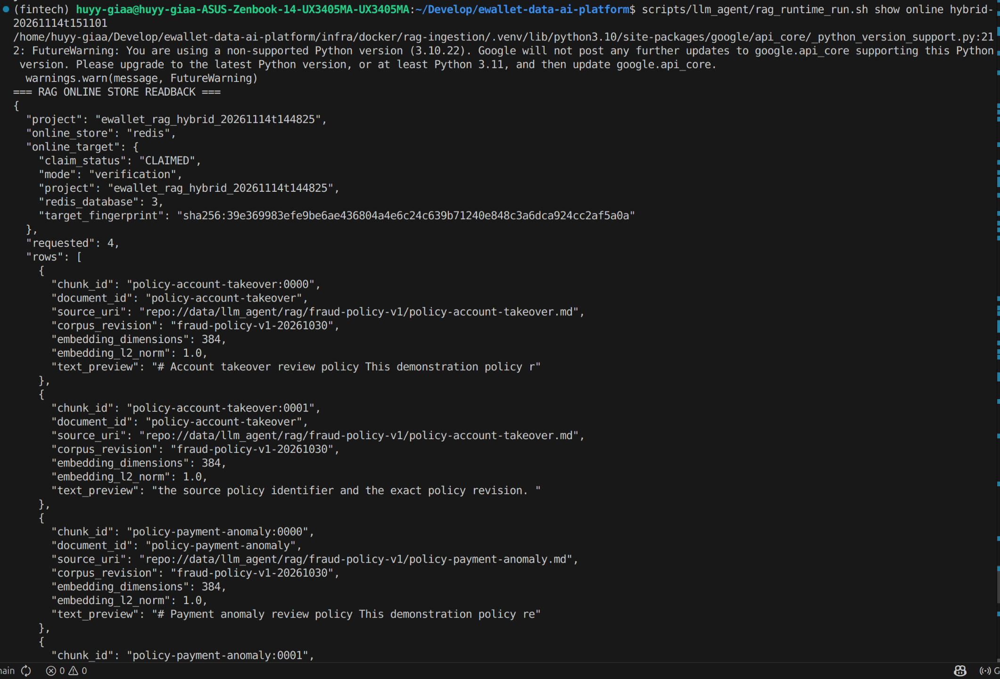

*RAG-04a, owner terminal: `rag_runtime_run.sh show online
hybrid-20261114t151101`, read through the runner's port-forward to the GKE
Redis. The output shows:*
- *target: verification, DB 3, `CLAIMED`;*
- *4 chunk IDs requested;*
- *rows read back from Feast Online with their source URI and corpus
  revision, and 384-d embeddings of norm 1.0.*

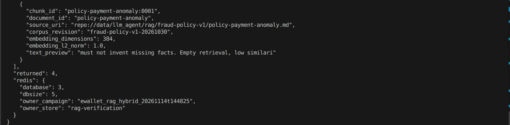

*RAG-04b: the end of the same output. All 4 rows were returned. DB 3 holds 5
keys, and the owner marker names the campaign project and the store
`rag-verification`.*

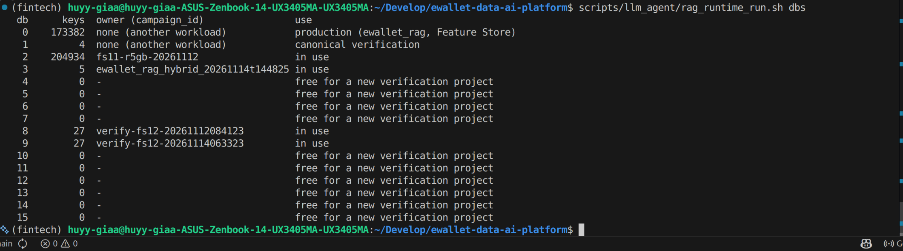

*RAG-08, owner terminal: `rag_runtime_run.sh dbs` after the run
([`dbs()`](https://github.com/HuyyGiaa/ewallet-data-ai-platform/blob/9153a06af5e89edbb3a60b5c2fd95d73eb3d6c0a/scripts/llm_agent/rag_runtime_run.sh#L334-L361)).
It shows the key count and the marker owner of each database. DB 3 holds 5
keys owned by `ewallet_rag_hybrid_20261114t144825`; DB 2, 8 and 9 keep their
Feature Store owners.*

**Key counts before and after the run.** These were observed by the owner with
the same command. Only the "after" state is in a screenshot (RAG-08).

| DB | Before | After |
|---:|---:|---:|
| 0 | 173,382 | 173,382 |
| 1 | 4 | 4 |
| 2 | 204,934 | 204,934 |
| 3 | 0 | 5 |
| 8 | 27 | 27 |
| 9 | 27 | 27 |

Only DB 3 changed. Unchanged key counts show that the run added no keys to
and removed none from the other databases. They do not prove that values in
those databases are unchanged, because no content comparison was made. That
the run's writes were confined to DB 3 follows from the code path above:
explicit database, claim before write, and Feast configured with that single
database.

A local-development profile uses Feast's SQLite Online Store. It exists for
fast tests only, is labelled `local-dev` in every artifact, and is never
presented as the Redis integration.

## 7. Retrieval and validation

Feast 0.66 stores the embedding in Redis but does not search it, so Redis is
not used as a vector index
([`feast_contract.py`](https://github.com/HuyyGiaa/ewallet-data-ai-platform/blob/9153a06af5e89edbb3a60b5c2fd95d73eb3d6c0a/ai_platform/llm_agent/rag/feast_contract.py)
records this as `PUBLICATION_ONLY`). The FeatureView declares
`vector_index=True`, but no Redis vector search is used. Retrieval is split
into two steps, both in
[`online_retriever.py`](https://github.com/HuyyGiaa/ewallet-data-ai-platform/blob/9153a06af5e89edbb3a60b5c2fd95d73eb3d6c0a/ai_platform/llm_agent/rag/online_retriever.py):

- **Storage.**
  [`FeastOnlineExactRetriever`](https://github.com/HuyyGiaa/ewallet-data-ai-platform/blob/9153a06af5e89edbb3a60b5c2fd95d73eb3d6c0a/ai_platform/llm_agent/rag/online_retriever.py#L141-L188)
  reads the canonical chunk set from Feast Online by `chunk_id`, which is a key
  lookup. It rebuilds that set from the checksum-verified manifest.
  [`verify_chunk_row()`](https://github.com/HuyyGiaa/ewallet-data-ai-platform/blob/9153a06af5e89edbb3a60b5c2fd95d73eb3d6c0a/ai_platform/llm_agent/rag/online_retriever.py#L106-L138)
  then requires every row to match:
  - its chunk's text, document, source URI and checksum;
  - the corpus, model and index revisions;
  - the embedding dimension.

  The set must be exactly the canonical chunk set. Otherwise the tool fails
  closed.
- **Search.** It embeds the query with the same pinned model and computes
  exact cosine similarity in process. Each hit becomes a citation with
  document ID, chunk ID, source URI, checksum and revisions.

`validate_online_readback`
([`validate()`](https://github.com/HuyyGiaa/ewallet-data-ai-platform/blob/9153a06af5e89edbb3a60b5c2fd95d73eb3d6c0a/ops/llm_agent/rag_ingest.py#L342-L408))
runs this retriever against the store the run just wrote, as follows:

1. It first checks that its target is the one in `publication.json`, and
   checks the ownership marker.
2. It loads and verifies the whole chunk set (`retriever.ready()`). The value
   `readback_status: "MATCH"` is written only after that verification has
   passed, so it records that every online row equalled its canonical chunk.
3. It runs the evaluation queries. A query is a hit when one of its top-k
   citations comes from the expected document.
4. It fails unless recall@k reaches 1.0 and there are no empty results and no
   citation errors.

The same classes serve the MCP tools `knowledge_search` and `chunk_lookup`.
Exact search costs O(chunks) per query. That is adequate for this corpus; a
large corpus would need a vector-search backend.

In the Hybrid campaign (`validation.json`, top-k 2, score threshold 0.0):

| Query | Expected document | Rank-1 citation | Score |
|---|---|---|---:|
| When must an account takeover alert fail closed to manual review? | `policy-account-takeover` | `policy-account-takeover:0000` | 0.663 |
| Which revisions and source fields must a payment anomaly citation preserve? | `policy-payment-anomaly` | `policy-payment-anomaly:0000` | 0.550 |

Both queries rank their expected document first, so recall@k and MRR are 1.0
on these **two** queries. This shows that the retrieval path works end to end
with correct citations. It is not a measurement of retrieval quality on a
realistic corpus or query set.

## 8. Orchestration with Airflow

The DAG
([`rag_fraud_policy_ingestion.py`](https://github.com/HuyyGiaa/ewallet-data-ai-platform/blob/9153a06af5e89edbb3a60b5c2fd95d73eb3d6c0a/data_platform/orchestration/airflow/dags/rag_fraud_policy_ingestion.py#L36-L67))
is a linear chain of six `BashOperator` tasks. Each one runs
`python -m ops.llm_agent.rag_ingest <stage>` in the locked runtime
([`rag_stage_command()`](https://github.com/HuyyGiaa/ewallet-data-ai-platform/blob/9153a06af5e89edbb3a60b5c2fd95d73eb3d6c0a/data_platform/orchestration/airflow/rag_params.py#L84-L93)).

| Task | Stage function | Reads | Writes | Timeout |
|---|---|---|---|---|
| `discover_documents` | `discover()` | corpus (repository or GCS) | `documents.json`, `source/` | 5 min |
| `parse_and_chunk` | `chunk()` | `documents.json`, `source/` | `chunks.json` | 5 min |
| `generate_embeddings` | `embed()` | `chunks.json`, `source/` | `embeddings.json` | 20 min |
| `publish_feast_features` | `publish()` | `embeddings.json` | `publication.json`; Parquet, registry, Redis | 15 min |
| `validate_online_readback` | `validate()` | `publication.json`; Redis | `validation.json` | 15 min |
| `publish_datahub_lineage` | `datahub()` | all five artifacts | `datahub.json`; DataHub | 10 min |

How the DAG runs:

- **Triggering.** The DAG runs only when triggered manually
  (`schedule=None`), one run at a time, with two retries per task.
- **Parameters.** Four `Param`s are validated by Airflow against JSON schemas:
  `source_location`, `online_store` (`redis` or `sqlite`), `datahub_mode`
  (`publish` or `plan_only`) and `run_label`. They reach the task only as
  environment values
  ([`rag_task_environment()`](https://github.com/HuyyGiaa/ewallet-data-ai-platform/blob/9153a06af5e89edbb3a60b5c2fd95d73eb3d6c0a/data_platform/orchestration/airflow/rag_params.py#L61-L73)),
  so a parameter can never inject shell code.
- **Runtime.** Each task fails at once if the uv-locked runtime
  [`infra/docker/rag-ingestion`](../../../infra/docker/rag-ingestion) is not
  installed.
- **Settings.** Redis, registry and DataHub settings come from a private file
  (`EWALLET_RAG_ENV_FILE`, mode 600) with a fixed set of allowed keys.
- **Artifacts.** They are written once and atomically
  ([`write_once()`](https://github.com/HuyyGiaa/ewallet-data-ai-platform/blob/9153a06af5e89edbb3a60b5c2fd95d73eb3d6c0a/ops/llm_agent/rag_ingest.py#L126-L133)).
  A completed stage is never overwritten. Run directories go to
  `EWALLET_RAG_EVIDENCE_ROOT`, outside the checkout.

There is exactly one RAG DAG. A test fails if a second one appears, or if any
consumer names another ID
([`test_rag_dag_reconciliation.py`](../../../tests/llm_agent/test_rag_dag_reconciliation.py)).
For runs outside a shared Airflow,
[`rag_isolated_airflow.sh`](../../../scripts/llm_agent/rag_isolated_airflow.sh)
starts an Airflow 3 instance with its own home, database and UI on port 8095.
That instance sees only this DAG.

In the Hybrid campaign the DagRun `manual__rag-hybrid-20261114t151101` ran
from 15:11:14.99 to 15:11:54.82 UTC. Every task succeeded on its first
attempt (`airflow/task_states.json`, `try_number` 1 in all six logs):

| Task | Duration |
|---|---:|
| `discover_documents` | 2.7 s |
| `parse_and_chunk` | 0.1 s |
| `generate_embeddings` | 0.5 s (inference of 4 chunks: 0.355 s in the task log) |
| `publish_feast_features` | 11.9 s (GCS writes, apply, materialization to GKE Redis) |
| `validate_online_readback` | 6.4 s |
| `publish_datahub_lineage` | 15.8 s |

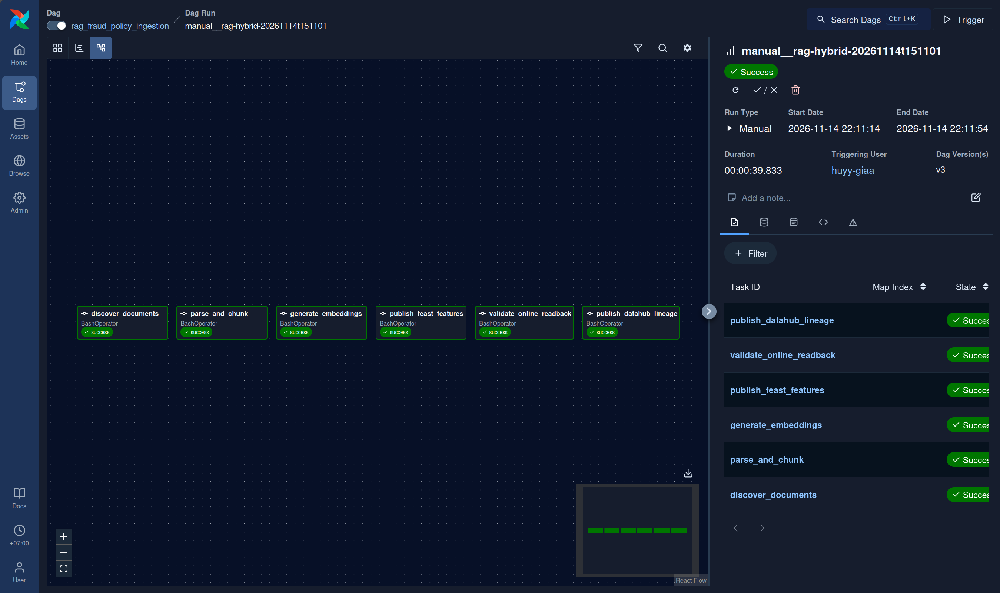

*RAG-01, Airflow 3 UI of the isolated instance on the owner's laptop. It shows
the Graph view of DagRun `manual__rag-hybrid-20261114t151101`: six
`BashOperator` tasks from `discover_documents` to `publish_datahub_lineage`,
each with state `success`. Next to it is the run's task list. The run state is
Success, the run was triggered manually, and the duration was 00:00:39.833.
The times are shown in the UI's +07:00 zone (22:11 = 15:11 UTC).*

## 9. Governance in DataHub

[`governance.py`](https://github.com/HuyyGiaa/ewallet-data-ai-platform/blob/9153a06af5e89edbb3a60b5c2fd95d73eb3d6c0a/ai_platform/llm_agent/rag/governance.py)
builds the DataHub records from what the earlier tasks measured. The records
are produced by
[`lineage_records()`](https://github.com/HuyyGiaa/ewallet-data-ai-platform/blob/9153a06af5e89edbb3a60b5c2fd95d73eb3d6c0a/ai_platform/llm_agent/rag/governance.py#L107-L162)
and
[`assertion_records()`](https://github.com/HuyyGiaa/ewallet-data-ai-platform/blob/9153a06af5e89edbb3a60b5c2fd95d73eb3d6c0a/ai_platform/llm_agent/rag/governance.py#L165-L179).

**Datasets.**

| Entity | URN in the Hybrid campaign | Aspects |
|---|---|---|
| Corpus dataset | `urn:li:dataset:(urn:li:dataPlatform:file,fraud-policy/fraud-policy-v1-20261030,PROD)` | `datasetProperties` (revision, document count, manifest digest) |
| Feast dataset | `urn:li:dataset:(urn:li:dataPlatform:feast,ewallet_rag_hybrid_20261114t144825.fraud_policy_chunks/fraud-policy-feast-v1,PROD)` | `datasetProperties` (model, dimensions, rows, identity, run label, commit), `schemaMetadata` (11 fields), `upstreamLineage` |

**Lineage and jobs.**
- **Lineage.** `upstreamLineage` runs from the corpus to the Feast dataset,
  with type `TRANSFORMED`. Chunks and embeddings exist only as run artifacts,
  so they are not registered as datasets, and no intermediate dataset is
  created.
- **DataFlow.** `urn:li:dataFlow:(airflow,rag_fraud_policy_ingestion,ewallet-gcp)`
  has a `dataFlowInfo` aspect. Its `airflow_run_id` property holds the run
  label `hybrid-20261114t151101`.
- **DataJobs.** There is one per task, each with `dataJobInfo` and
  `dataJobInputOutput`. The inputs and outputs follow `TASK_IO`:
  - the three preparation tasks read the corpus;
  - `publish_feast_features` writes the Feast dataset;
  - `validate_online_readback` reads it;
  - `publish_datahub_lineage` touches no dataset.

**Quality assertions.** There are five custom assertions on the Feast dataset,
computed by
[`quality_checks()`](https://github.com/HuyyGiaa/ewallet-data-ai-platform/blob/9153a06af5e89edbb3a60b5c2fd95d73eb3d6c0a/ai_platform/llm_agent/rag/governance.py#L72-L104).
Each has an `assertionInfo` aspect, of type `E-Wallet RAG Data Contract`, and
an `assertionRunEvent` with the observed values:

| Assertion | Passes when | Observed in the Hybrid campaign |
|---|---|---|
| `source_checksums_match_manifest` | at least one document and 0 checksum mismatches | 2 documents, 0 mismatches |
| `chunk_id_unique_and_deterministic` | chunk IDs are unique and rebuilt identically | 4 chunks, 4 unique, deterministic |
| `embedding_dimension_finite_nonzero` | 0 invalid vectors and one vector per chunk | 384 dimensions, 4 vectors, 0 invalid |
| `online_rows_match_offline_publication` | readback `MATCH` and Online rows = published rows | 4 offline, 4 online, `MATCH` |
| `retrieval_returns_cited_source` | no empty retrieval and no citation error | recall@k 1.0, empty 0.0, 0 citation errors |

The type string is a label chosen by this project. DataHub shows it as the
assertion category. The records are custom assertions. They are not a native
DataHub Data Contract entity, and none was created.

A failed measurement is published as a `FAILURE` result, and the task then
fails; it is never reported as success.

**Records.** The run writes 27 records:

| Records | Count |
|---|---:|
| Corpus dataset (1) and Feast dataset (3) | 4 |
| DataFlow | 1 |
| DataJobs: 6 jobs × 2 aspects | 12 |
| Assertions: 5 × (`assertionInfo` + `assertionRunEvent`) | 10 |
| **Total** | **27** |

[`publish_with_readback()`](https://github.com/HuyyGiaa/ewallet-data-ai-platform/blob/9153a06af5e89edbb3a60b5c2fd95d73eb3d6c0a/ai_platform/llm_agent/rag/governance.py#L187-L202)
writes each record to GMS and reads it back, and requires the stored aspect to
equal the payload. Time-series run events may need several attempts. In the
campaign all 27 were read back as `MATCH`, each on the first attempt.

**Publication versus visibility.** A GMS readback proves the write. The
DataHub UI, however, draws search results and lineage from its search and
graph indices. A separate consumer fills those indices asynchronously, and
they can fall behind, for example when OpenSearch turns read-only because its
disk is full.

After the readback, the task therefore queries the GraphQL API that the UI
uses
([`verify_index_visibility()`](https://github.com/HuyyGiaa/ewallet-data-ai-platform/blob/9153a06af5e89edbb3a60b5c2fd95d73eb3d6c0a/ai_platform/llm_agent/rag/governance.py#L231-L255)).
It must find:
- the Feast dataset, the corpus and the DataFlow in search;
- the corpus and `publish_feast_features` upstream of the Feast dataset in
  lineage.

If they do not appear within about 90 seconds, the task fails. In the
campaign all five checks were `FOUND` on the first attempt (`VISIBLE`). After
the run, `collect` also read the Feast dataset's `upstreamLineage` and the
DataFlow's `dataFlowInfo` straight from GMS (`datahub_raw_readback.json`).

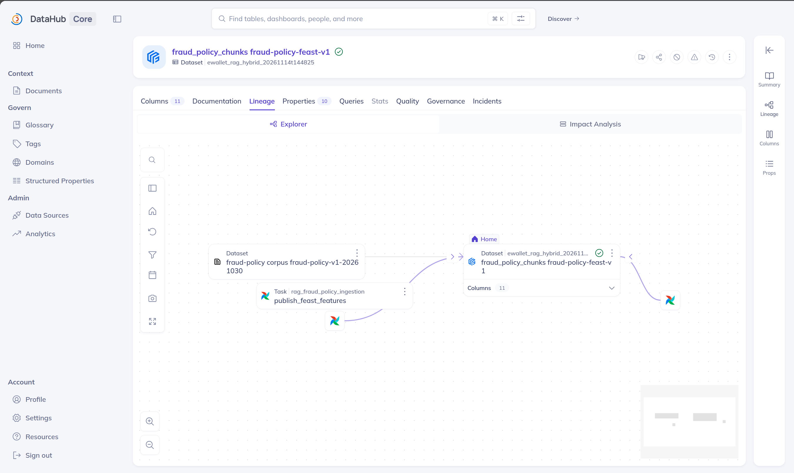

*RAG-05, DataHub UI on the owner's laptop: the Lineage tab of dataset
`fraud_policy_chunks fraud-policy-feast-v1` in project
`ewallet_rag_hybrid_20261114t144825`. The corpus dataset `fraud-policy corpus
fraud-policy-v1-20261030` and the Airflow task `publish_feast_features` (flow
`rag_fraud_policy_ingestion`) are upstream of it.*

*The view does not show all six DataJobs as separate nodes. It shows two
further Airflow nodes without labels. The code declares
`validate_online_readback` as the only job that reads the Feast dataset, and
the three preparation jobs as readers of the corpus.*

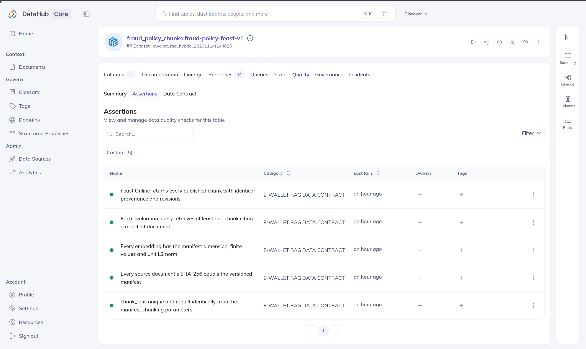

*RAG-06, DataHub UI: Quality → Assertions of the same dataset. It lists
`Custom (5)`, the five assertions above, each with its description, the
category `E-WALLET RAG DATA CONTRACT` (the custom type string) and a green
latest result. The separate "Data Contract" tab of the page is not used by
this pipeline.*

`datahub_mode=plan_only` builds all records and publishes nothing. Its
artifact says `PLAN_ONLY_NOT_PUBLISHED`, and it is never evidence of
governance.

## 10. Running the pipeline

[`rag_runtime_run.sh`](https://github.com/HuyyGiaa/ewallet-data-ai-platform/blob/9153a06af5e89edbb3a60b5c2fd95d73eb3d6c0a/scripts/llm_agent/rag_runtime_run.sh)
is the operator's entry point. Every command is labelled by what it may
change:

| Command | Class | What it does |
|---|---|---|
| `preflight` | read-only | checkout, single DAG, lockfile, runtime, model cache, settings, Redis target and ownership forecast, eviction policy, dedicated paths, DataHub health and writable indices, Airflow health and DAG source, disk; for `gke` also cluster readiness, the port-forward and the GCS permissions of the ADC account |
| `prepare` | local | locked runtime, model cache; for the local target also its settings and a Redis 7.4 container |
| `start` | local | DataHub quickstart if it is not healthy, then the isolated Airflow |
| `trigger LABEL` | writes to the target | preflight, a new DagRun, a bounded wait (30 min), then `collect` |
| `collect LABEL` | read-only | Airflow task states and logs, Feast registry view, Online readback, raw DataHub readback, summary, `SHA256SUMS` |
| `show feast\|online\|summary LABEL` | read-only | terminal views of the registry, the Online rows and the whole run |
| `dbs`, `configure DB PROJECT`, `forward` | gke only | list databases and owners; write the gke settings from the Redis Secret without printing the password; hold the port-forward |
| `stop [--with-datahub]` | local | stops what was started, including a runner port-forward; DataHub volumes are kept |

There are two targets:

- **`gke`** is the Hybrid integration target (§2). The Redis is reached
  through a `kubectl port-forward` owned by the runner
  ([`start_forward()`](https://github.com/HuyyGiaa/ewallet-data-ai-platform/blob/9153a06af5e89edbb3a60b5c2fd95d73eb3d6c0a/scripts/llm_agent/rag_runtime_run.sh#L100-L131)).
  - One forward serves preflight, the whole DagRun and `collect`.
  - A dropped forward is reopened within 5 seconds.
  - Each command closes the forward it opened when it exits.
  - The runner never wakes the cluster.
- **`local`** needs no cloud access. It uses a Redis 7.4 container on
  127.0.0.1:16381 (DB 3, `noeviction`), with the registry and the Parquet
  under `~/ewallet-evidence/rag/feast`. It is the development and test profile
  of the same code.

Jenkins builds the RAG ingestion image and smoke-tests it against an ephemeral
Redis in the CD namespace (explicit DB 2), before switching the CronJob to the
new digest ([CI/CD architecture §9.3](../cicd/CICD_ARCHITECTURE.md#93-rag-rehearsal-rag-ingestion)).

## 11. Verification results

### 11.1 Hybrid campaign, 2026-11-14

This is the primary runtime evidence of the pipeline. The owner ran it from
commit `9153a06a` against the GKE Redis and GCS, then put the cluster back to
sleep. The raw artifacts are in
[`hybrid-20261114t151101/`](../../evidence/edai2/rag/hybrid-20261114t151101/README.md)
and the screenshots in
[`screenshots/`](../../evidence/edai2/rag/screenshots/README.md).

| Item | Value |
|---|---|
| Run label | `hybrid-20261114t151101` |
| DagRun | `manual__rag-hybrid-20261114t151101` |
| Source commit | `9153a06af5e89edbb3a60b5c2fd95d73eb3d6c0a` |
| Feast project | `ewallet_rag_hybrid_20261114t144825` |
| Online Store | GKE `feature-store/redis`, DB 3, verification, `CLAIMED` |
| Registry, Parquet | `gs://ewallet-data-ai-platform-hg26-data/features/registries/rag/ewallet_rag_hybrid_20261114t144825/registry.db`, `gs://ewallet-data-ai-platform-hg26-data/features/rag/ewallet_rag_hybrid_20261114t144825/fraud-policy-feast-v1/chunks.parquet` |

| Check | Result | Raw evidence |
|---|---|---|
| Airflow | 6/6 tasks `success`, first attempt; DagRun 39.8 s | `airflow/task_states.json`, `airflow/dag_runs.json` |
| Documents | 2, 0 checksum mismatches | `documents.json` |
| Chunks | 4, deterministic | `chunks.json` |
| Embeddings | 4 × 384, L2-normalized, 0 invalid, model revision `1110a243…` | `embeddings.json` |
| Feast publication | 4 rows, identity `b85ae796221aa0b9e2adfd7ff19488f612dff18c8d60c3c44f0134b7266bf549`; registry and Parquet on GCS; identity recomputed from the GCS Parquet matches | `publication.json`, `feast_registry.json` |
| Online Store | requested 4, returned 4; readback `MATCH`; ownership `MATCH`; DB 3 `dbsize` 5 | `validation.json`, `online_readback.json` |
| Retrieval | 2 queries: recall@k 1.0, MRR 1.0, 0 citation errors | `validation.json` |
| DataHub | `PUBLISHED_AND_READ_BACK`, 27 aspects read back, 5/5 assertions passed, index `VISIBLE` | `datahub.json`, `datahub_raw_readback.json` |
| Redis isolation | only DB 3 changed key count (owner's before/after counts, §6.1) | RAG-08 (after state) |

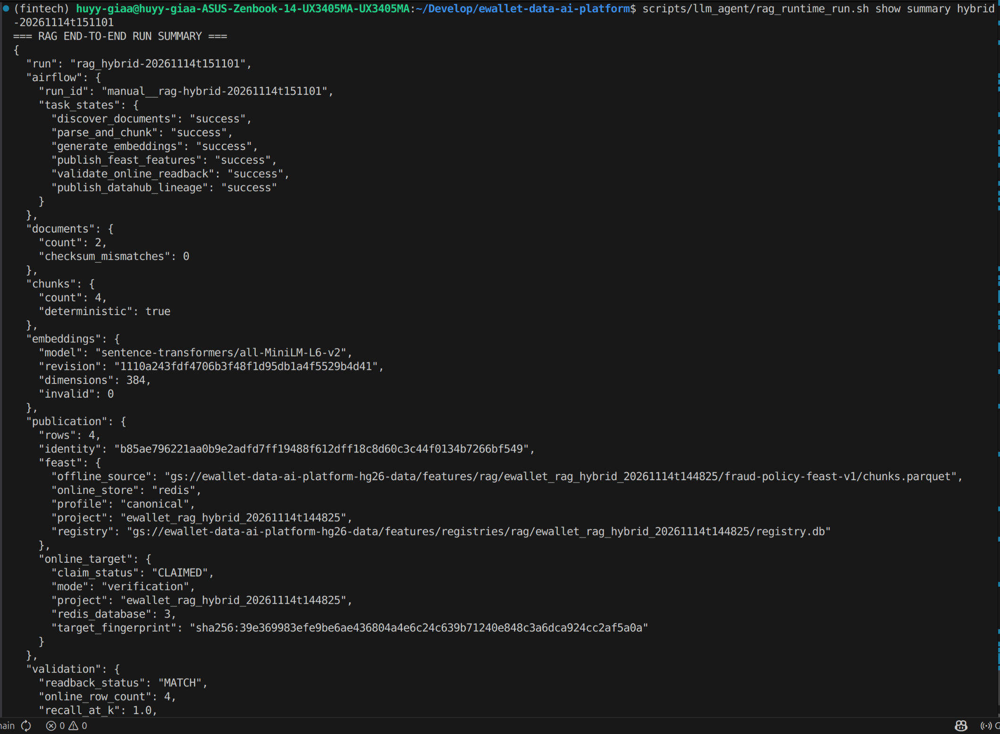

*RAG-07a, owner terminal: `rag_runtime_run.sh show summary
hybrid-20261114t151101`
([`summary_view()`](https://github.com/HuyyGiaa/ewallet-data-ai-platform/blob/9153a06af5e89edbb3a60b5c2fd95d73eb3d6c0a/ops/llm_agent/rag_evidence.py#L104-L128)).
It shows the DagRun and its six task states, then the document, chunk,
embedding and publication results with the GCS paths and the Redis target.*

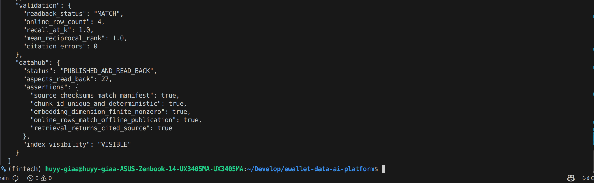

*RAG-07b: the end of the same output. Validation shows `MATCH`, 4 online rows,
recall@k and MRR 1.0 and 0 citation errors. DataHub shows
`PUBLISHED_AND_READ_BACK`, 27 aspects, five assertions `true` and index
`VISIBLE`.*

**Where each result comes from.** The summary only gathers values from the
run's artifacts. The table separates three kinds of evidence:

- results the tasks measured and enforced;
- results that `collect` read again on its own after the run;
- checks the owner made with external commands.

| Result | Measured by the task (fails the run if wrong) | Re-read after the run by `collect` | External check by the owner |
|---|---|---|---|
| Checksums, chunks, embeddings | `discover()`, `chunk()`, `embed()` | — | — |
| Parquet and registry on GCS | `publish()` | `feast_view()`: registry and Parquet read from GCS, identity recomputed | `gcloud storage ls -l` (RAG-09) |
| Rows in Redis DB 3 | `validate()`: full canonical set verified, marker `MATCH` | `online_view()`: 4/4 rows, `dbsize`, marker | `dbs` before and after (RAG-08) |
| Retrieval | `validate()`: 2 queries, recall gate | — | — |
| DataHub | `datahub()`: GMS readback, index visibility | raw GMS readback of 2 aspects | DataHub UI (RAG-05, RAG-06) |

`jq` in RAG-03 only selects fields from `feast_registry.json`. `gcloud`
and `dbs` only read state. None of these commands produce the results they
show.

### 11.2 Local end-to-end run, 2026-11-14 (development profile)

Before the Hybrid campaign, the same DAG ran with the local target. It used
the real embedding model, Feast with a local Redis container (DB 3, project
`ewallet_rag_verify`) and the local DataHub, from source commit `1e6a88a2`.
Evidence:
[`local-e2e-20261114t083158/`](../../evidence/edai2/rag/local-e2e-20261114t083158/).

| Check | Result |
|---|---|
| DagRun `manual__rag-local-e2e-20261114t083158` | `success`, 6/6 tasks |
| Publication | 4 rows, identity `b85ae796…`, offline `REUSED`, Redis DB 3 `OWNED` (claimed by the run before it) |
| Online readback and retrieval | `MATCH`; recall@k 1.0, MRR 1.0, 0 citation errors |
| DataHub | `PUBLISHED_AND_READ_BACK`: 27 aspects, 5/5 assertions, `VISIBLE` |

Against the same local Redis, three targets were each refused before anything
was written:

- a connection string without a database;
- DB 0;
- a database holding a foreign key.

This run involved no cloud component and has no screenshots.

### 11.3 Earlier cloud run, 2026-11-02

DagRun `manual__2026-11-02T04:47:47.888480+00:00`, from source `f265f2e7…`,
ran the then-current version of the six tasks against the GKE Feast Redis and
a run-scoped GCS registry. It published the same identity `b85ae796…`, read
back 4 rows, and published 25 DataHub records with 5/5 assertions passing.
The sixth DataJob had not yet been added
([`rag_g3-functional-rag-20261102t045700z/`](../../evidence/llm_agent/rag_g3-functional-rag-20261102t045700z)).

That publication was also queried through the real MCP server, and the agents
cited it in the kagent UI:

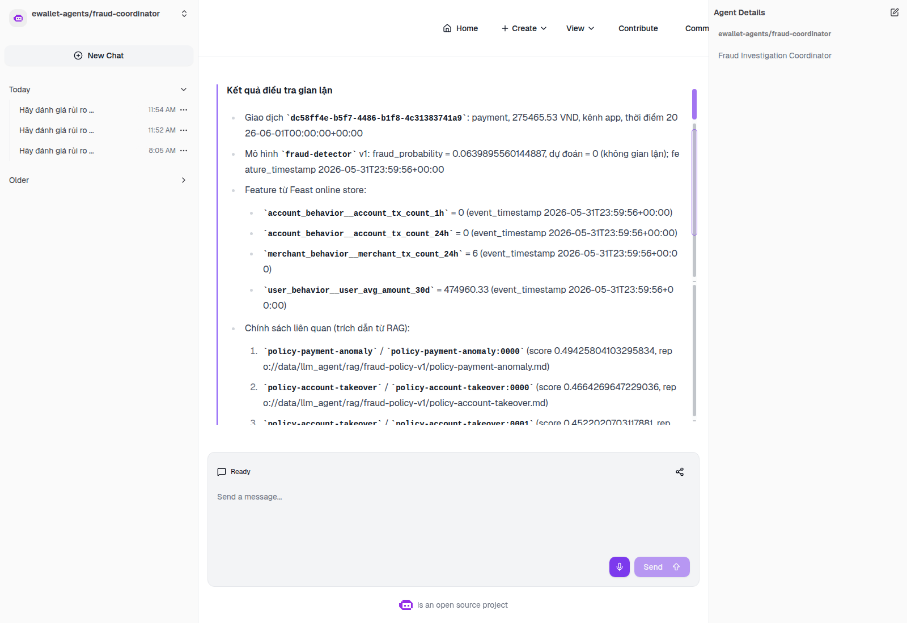

*Historical, 2026-11-04: the Coordinator's answer to an analyst question
(trace `7e651a4f…`). It carries three citations from corpus
`fraud-policy-v1-20261030`, retrieved by `knowledge_search` from the
production publication. It does not involve the 2026-11-14 Hybrid
publication.*

The identical publication identity across the three runs shows that the same
corpus, model and chunking produce the same knowledge base.

## 12. Reproducibility and provenance

**Inputs.**

| Input | Value |
|---|---|
| Code | commit `9153a06af5e89edbb3a60b5c2fd95d73eb3d6c0a` (`release_sha` in every artifact) |
| Corpus | `fraud-policy-v1-20261030`, manifest SHA-256 `e5a282c6…24b9` |
| Model | `all-MiniLM-L6-v2` at `1110a243fdf4706b3f48f1d95db1a4f5529b4d41`, ONNX file SHA-256 `6fd5d72f…6452` |
| Runtime | Python 3.10.22, Feast 0.66.0, onnxruntime 1.23.2, acryl-datahub 1.7.0.5, `uv.lock` SHA-256 `20c00145…` |
| Control plane | Airflow 3.3.1 (isolated, laptop), DataHub v1.7 quickstart (laptop) |

**Procedure.** The campaign followed runbook
[§5](../../runbooks/edai2/llm_agent/rag_runbook.md#5-hybrid-target-gke-feast-online-redis-and-gcs-cloud)
with `RAG_TARGET=gke`. In that sequence:

1. `dbs` chooses the database.
2. `configure` writes the settings.
3. `start` starts DataHub and Airflow, and `preflight` checks the target.
4. `trigger` runs the DagRun and collects the evidence.
5. `show` and `dbs` give the read-only views.

These commands of the campaign are recorded in its evidence:

```bash
scripts/llm_agent/rag_runtime_run.sh trigger hybrid-20261114t151101       # run_id.txt, dag_runs.json
scripts/llm_agent/rag_runtime_run.sh show online hybrid-20261114t151101   # RAG-04a
scripts/llm_agent/rag_runtime_run.sh show summary hybrid-20261114t151101  # RAG-07a
scripts/llm_agent/rag_runtime_run.sh dbs                                  # RAG-08
gcloud storage ls -l "gs://ewallet-data-ai-platform-hg26-data/features/rag/ewallet_rag_hybrid_20261114t144825/fraud-policy-feast-v1/chunks.parquet" \
  "gs://ewallet-data-ai-platform-hg26-data/features/registries/rag/ewallet_rag_hybrid_20261114t144825/registry.db"   # RAG-09
```

**Checksums.**

- **Raw artifacts.** The 20 files in
  [`hybrid-20261114t151101/`](../../evidence/edai2/rag/hybrid-20261114t151101/README.md)
  are byte-identical to the run directory. The runner's own `SHA256SUMS`
  verifies them unchanged. The staged corpus copy `source/` is omitted,
  because it is identical to the repository corpus.
- **Screenshots.** The 10 files in
  [`screenshots/`](../../evidence/edai2/rag/screenshots/README.md) are
  byte-identical to the owner's originals, and their `SHA256SUMS` was checked
  against them.

To check both:

```bash
(cd docs/evidence/edai2/rag/hybrid-20261114t151101 && sha256sum -c SHA256SUMS)
(cd docs/evidence/edai2/rag/screenshots && sha256sum -c SHA256SUMS)
```

A new run needs an awake cluster, an empty database in 2–15 and a new project
name. Redis has a new server `run_id` after every wake, which changes the
ownership fingerprint. The runbook gives the full sequence, including the
port-forward lifecycle and the cleanup.

## 13. Limitations

What the Hybrid campaign shows:

- the six-task pipeline running under Airflow;
- local ONNX embeddings;
- a Feast registry and offline Parquet on GCS;
- materialization into an isolated database of the GKE Redis, with an
  independent readback;
- retrieval with correct citations on the evaluation queries;
- DataHub lineage and five custom assertions, read back and visible in the
  UI.

What it does not show:

- **Agents consuming this publication.** The RAG MCP server and the agents
  read project `ewallet_rag` in DB 0, from a registry snapshot in the
  ConfigMap `feast-registry-rag`. The campaign wrote project
  `ewallet_rag_hybrid_20261114t144825` in DB 3, so it does not show agents
  reading the new rows. Agent use of RAG is shown only by the historical
  production publication (§11.3). Promoting a revision to production
  (`EWALLET_RAG_ONLINE_TARGET=production`, DB 0, `ewallet_rag`) is a separate
  change that needs explicit approval.
- **Retrieval quality.** The corpus has 2 documents and 4 chunks. The
  metrics come from 2 predefined queries, so recall@k = 1.0 does not measure
  accuracy on realistic queries or a larger corpus.
- **Vector search.** Similarity is computed exactly, in process, over all
  chunks. Redis stores the vectors but is not used as a vector index. A large
  corpus would need an approved vector-search backend.
- **A production control plane.** Airflow and DataHub ran on the operator's
  laptop. Only the Feast storage was in the cloud.
- **Content-level isolation.** The Redis instance is shared with production
  and the Feature Store. The run's write path was confined to DB 3 by code,
  and the other databases' key counts were unchanged. Their values were not
  compared.
- **A native DataHub Data Contract.** The five assertions are custom
  assertions. Their category label contains "Data Contract", but no DataHub
  Data Contract entity was created.

Other notes:

- **Reruns after a wake.** The ownership fingerprint includes the Redis
  server `run_id`. After a sleep and wake, the next run therefore needs a new
  database and project.
- **Historical metadata.** The local DataHub still holds the DataFlow
  `rag_fraud_policy` and the Feast datasets of earlier projects
  (`ewallet_rag`, `ewallet_rag_campaign`, `ewallet_rag_local`,
  `ewallet_rag_verify`). They were kept. The Hybrid screenshots start from the
  campaign's own Feast dataset.
