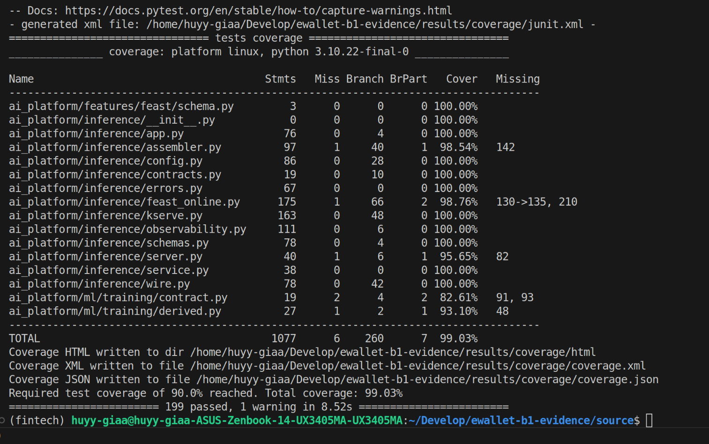
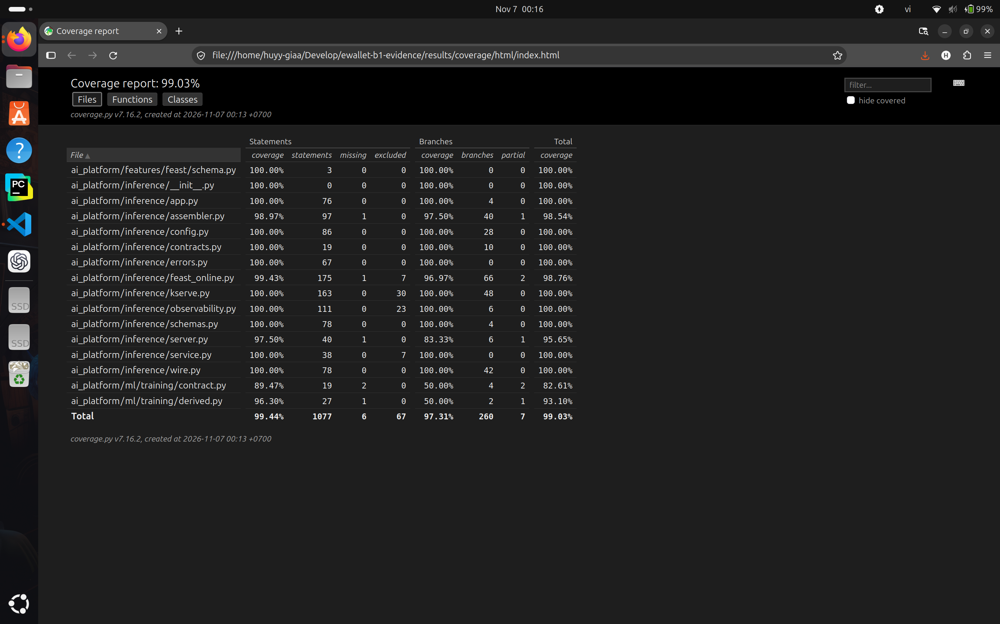

# Row 28: unit tests with coverage above 90%

| Rubric row 28 (1 point) | Status |
|---|---|
| "Unit test với Test Coverage > 90% (với proof bằng screenshot thể hiện khả năng test Web API, và sử dụng fixture, mock)". Proof: a document showing the test results, with a link to a code file that uses these techniques | **Met.** 99.03% on the B1 commit (screenshots) and 91.90% on the current integration HEAD; both above 90% |

## 1. What is tested

The Fraud API request path: the FastAPI Web API, request schemas, the feature assembler, the Feast online adapter, the KServe V2 client and wire contract, and the telemetry. Also measured: the three modules it imports to build the 41-input vector.

Scope and rules: [`tests/quality/coverage.ini`](../../../tests/quality/coverage.ini#L10).
- Statement and branch coverage.
- `fail_under = 90` ([line 19](../../../tests/quality/coverage.ini#L19)).
- No lines, branches or modules are excluded inside the scope; the only `omit` is the project's virtualenv.

Property suites are not counted, so the figure comes from deterministic tests only.

## 2. Web API tests, fixtures and mocks

| Technique | Where |
|---|---|
| **Web API.** Requests go through the real ASGI app built by `create_app`. Each test checks status, headers and body: dependency failures, sanitized 500, malformed JSON, correlation ids | [`test_app_error_paths.py`](../../../tests/inference/test_app_error_paths.py#L58) |
| **Fixtures.** Shared deterministic test doubles:<br>- an in-memory Feast store (`EntityFeatureStore`);<br>- a V2 model transport (`DeterministicModelTransport`);<br>- a factory that wires the real service around them (`build_fraud_service`) | [`support.py` (line 123)](../../../tests/inference/support.py#L123), [line 174](../../../tests/inference/support.py#L174), [line 256](../../../tests/inference/support.py#L256) |
| **Mocks.** `unittest.mock.patch` (for example removing `opentelemetry` from `sys.modules`). Stub and raising services and recording telemetry stand in for collaborators | [`test_app_error_paths.py` (line 16)](../../../tests/inference/test_app_error_paths.py#L16), [line 34](../../../tests/inference/test_app_error_paths.py#L34) |

The test catalogue by file is in [B1_TESTING_QUALITY.md §2](B1_TESTING_QUALITY.md#2-coverage-b11-row-28).

## 3. Results

| Run | Code | Tests | Statements / branches | Coverage | Evidence |
|---|---|---|---|---|---|
| B1 session, 2026-11-06 | `281db72` (B1 branch, merged into the integration) | 199 passed | 1,077 / 260 | **99.03%** | [raw](../../evidence/edai2/testing/b1_281db72_20261106/coverage/terminal.txt), screenshots below |
| Integration HEAD, 2026-11-08 | `d388bd9` | 256 passed | 1,643 / 358 | **91.90%** | [raw](../../evidence/edai2/testing/head_coverage_20261108T082044Z/terminal.txt) |

**Why the two figures differ.** The configuration and test command are the same, but the measured package grew after B1. Session A added the Feature API (`feature_app.py` 78.57%, `feature_server.py` 0%, a process entrypoint) and C-C added the Vault loader (`vault.py` 80.31%). The 91.90% is the figure for the code being submitted. The 99.03% is the B1 commit the screenshots show. Both are above the threshold.

> **28_01: coverage run (B1 commit).** `pytest-cov` over `tests/inference`: per-file statements, branches and missing lines; `Required test coverage of 90.0% reached. Total coverage: 99.03%`; `199 passed`. It does not show the current HEAD figure (see the table).



> **28_02: HTML report.** The same run in `coverage.py` 7.16.2: 99.03% total, 1,077 statements, 260 branches, with excluded counts per file. The excluded counts come from coverage.py's built-in defaults: method stubs whose body is only `...` (for example the `Protocol` transports in `kserve.py`) and `if TYPE_CHECKING:` blocks. `coverage.ini` adds no exclusions of its own.



## 4. Limitations

- **The scope is the Fraud API request path,** not the whole repository. `ai_platform/serving/` (the KServe predictor image) uses its own interpreter and is outside it.
- **New modules on HEAD are less covered:** `feature_server.py` has no unit test (it is an entrypoint), and `feature_app.py` and `vault.py` are near 80%. The total stays above 90%, but these are the first gaps to close.
- **No screenshot of the HEAD run exists;** its raw output is committed.

## 5. Reproduce

```bash
export PATH="$HOME/miniconda3/envs/fintech/bin:$PATH"     # uv
scripts/testing/run_coverage.sh docs/evidence/edai2/testing/<run-id>
```
