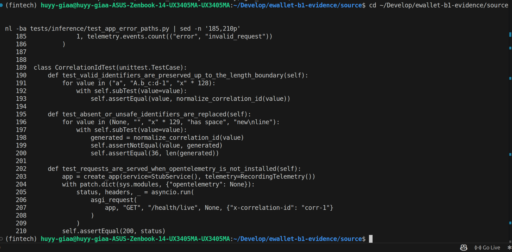
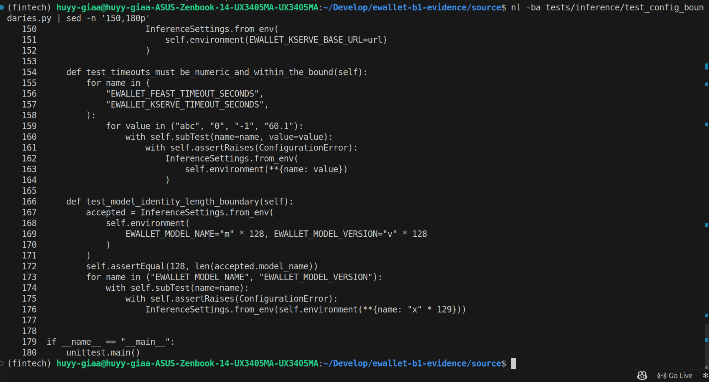
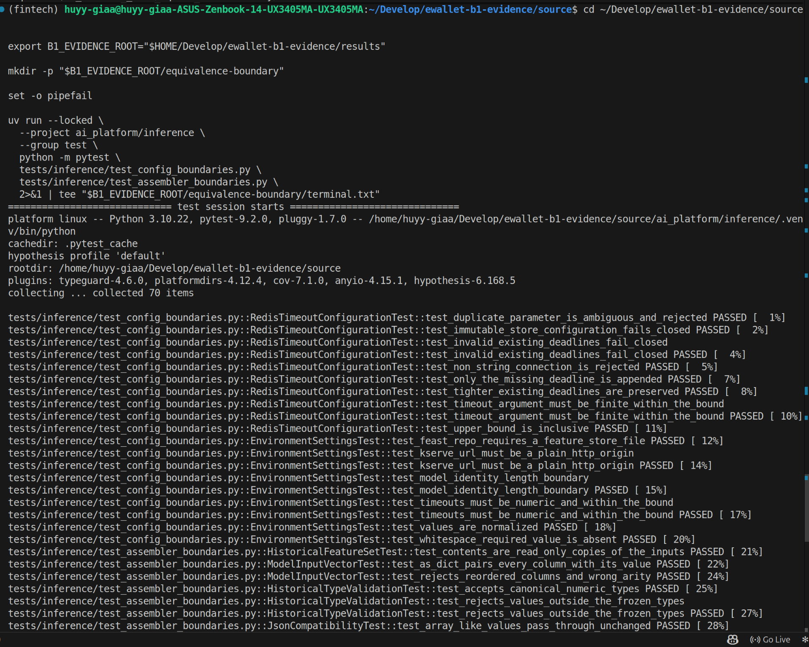
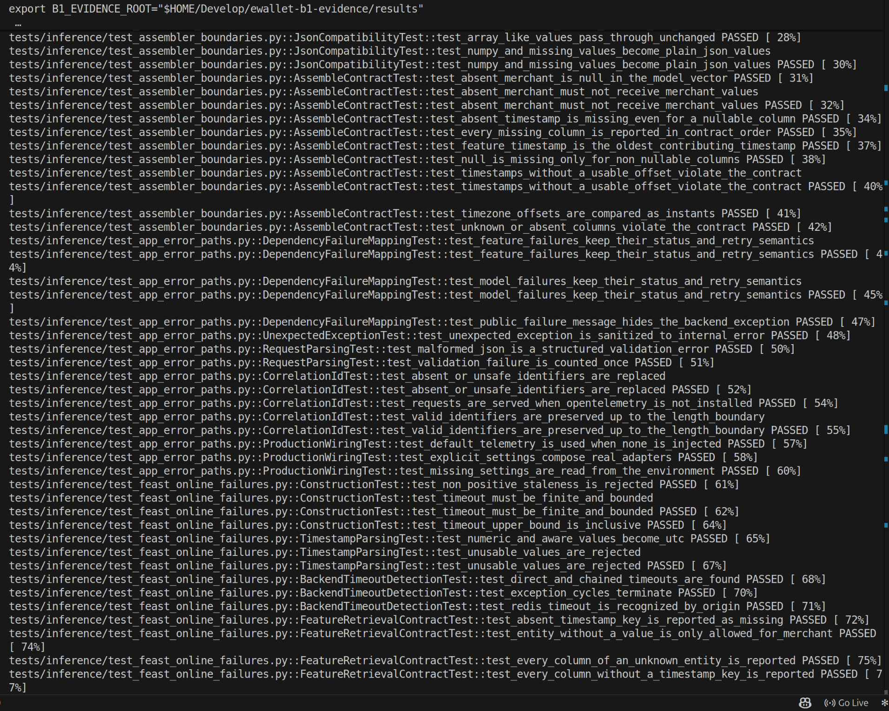
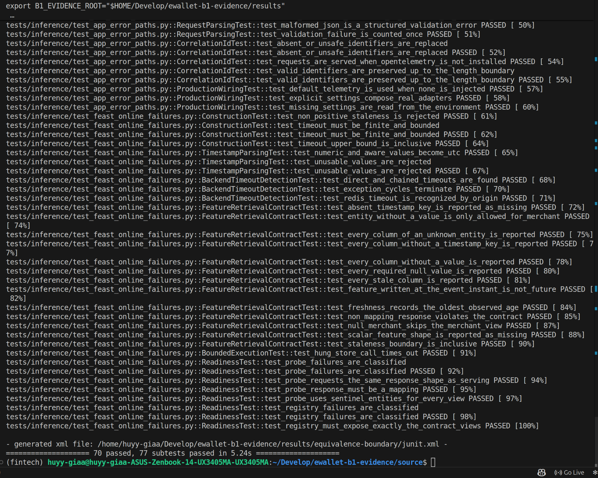

# Row 29: equivalence partitioning and boundary value analysis

| Rubric row 29 (2 points) | Status |
|---|---|
| "Có sử dụng kỹ thuật equivalence partitioning vs boundary value analysis khi thiết kế test cases để parametrize" | **Met:** 70 test cases (77 parametrized subtests) designed from partitions and boundaries; passing on the B1 commit and on HEAD |

## 1. Technique

Each input is split into **equivalence classes**: one representative per class is enough, because the code treats every member alike. Tests are then added at the **edges** of each valid class: the last valid value and the first invalid one. Cases are parametrized with `unittest`'s `subTest`, so one test method runs every class or edge value and reports each one separately. That is where the 77 subtests come from.

Where the classes come from: the API contract and the configuration rules. For example: a correlation id of up to 128 safe characters, timeouts that must be finite and within a bound, model identities of up to 128 characters, and the freshness limit.

## 2. Where it is applied

| Input | Classes and boundaries | Source |
|---|---|---|
| Correlation id | Valid: `"a"`, a mixed safe id, exactly 128 characters. Invalid: `None`, empty, 129 characters, whitespace, newline (replaced by a generated 36-character id) | [`test_app_error_paths.py`](../../../tests/inference/test_app_error_paths.py) (`CorrelationIdTest`) |
| Timeouts (`EWALLET_FEAST_TIMEOUT_SECONDS`, `EWALLET_KSERVE_TIMEOUT_SECONDS`) | Non-numeric `"abc"`; zero `"0"`; negative `"-1"`; just above the bound `"60.1"`; the upper bound itself is inclusive | [`test_config_boundaries.py` (line 154)](../../../tests/inference/test_config_boundaries.py#L154), [line 43](../../../tests/inference/test_config_boundaries.py#L43) |
| Model name and version | 128 characters accepted; 129 rejected | [`test_config_boundaries.py` (line 166)](../../../tests/inference/test_config_boundaries.py#L166) |
| Feature freshness | The staleness limit is inclusive; one unit beyond it is stale | [`test_feast_online_failures.py` (line 220)](../../../tests/inference/test_feast_online_failures.py#L220) |
| Feast timeout | Finite and bounded; the upper bound is inclusive | [`test_feast_online_failures.py` (line 78)](../../../tests/inference/test_feast_online_failures.py#L78) |
| Feature vector values | Accepted numeric types against values outside the frozen types; null only for nullable columns; merchant present against absent | [`test_assembler_boundaries.py`](../../../tests/inference/test_assembler_boundaries.py) |

The Hypothesis suites (row 31) cover 18 further invalid request partitions with generated inputs. They are a separate technique and are not counted here.

## 3. Results

| Run | Code | Result | Evidence |
|---|---|---|---|
| B1 session, 2026-11-06 | `281db72` | 70 passed, 77 subtests passed in 5.24 s | [raw](../../evidence/edai2/testing/b1_281db72_20261106/equivalence-boundary/terminal.txt), screenshots below |
| Integration HEAD, 2026-11-08 | `d388bd9` | 70 passed, 77 subtests passed in 3.69 s | [raw](../../evidence/edai2/testing/head_eq_boundary_20261108T082124Z/terminal.txt) |

> **29_01: equivalence classes in the source.** One test holds the valid class up to the 128-character boundary; another holds the invalid classes. Each value runs as a `subTest`.



> **29_02: boundary values in the source.** Timeouts `"abc"`, `"0"`, `"-1"` and `"60.1"` are rejected; a model identity of 128 characters is accepted and 129 is rejected.



> **29_03, 29_04, 29_05: execution.** The run under `uv run --locked` collects 70 items, and the result is `70 passed, 77 subtests passed`. **Note:** the command visible in 29_03 lists only `test_config_boundaries.py` and `test_assembler_boundaries.py`. The collected and passing tests also include `test_app_error_paths.py` and `test_feast_online_failures.py` (29_04, 29_05 and [`junit.xml`](../../evidence/edai2/testing/b1_281db72_20261106/equivalence-boundary/junit.xml): 28 + 16 + 14 + 12 cases), so the screenshot does not show the full command line. The HEAD rerun above used all four files explicitly.







## 4. Limitations

- **Parametrization uses `unittest.subTest`, not `pytest.mark.parametrize`.** This keeps the suites runnable by `unittest discover` in CI. The effect is the same, one reported case per value.
- **The classes are designed by hand from the contract.** No tool derives them.

## 5. Reproduce

```bash
uv run --locked --project ai_platform/inference --group test python -m pytest -v \
  tests/inference/test_config_boundaries.py tests/inference/test_assembler_boundaries.py \
  tests/inference/test_feast_online_failures.py tests/inference/test_app_error_paths.py
```
