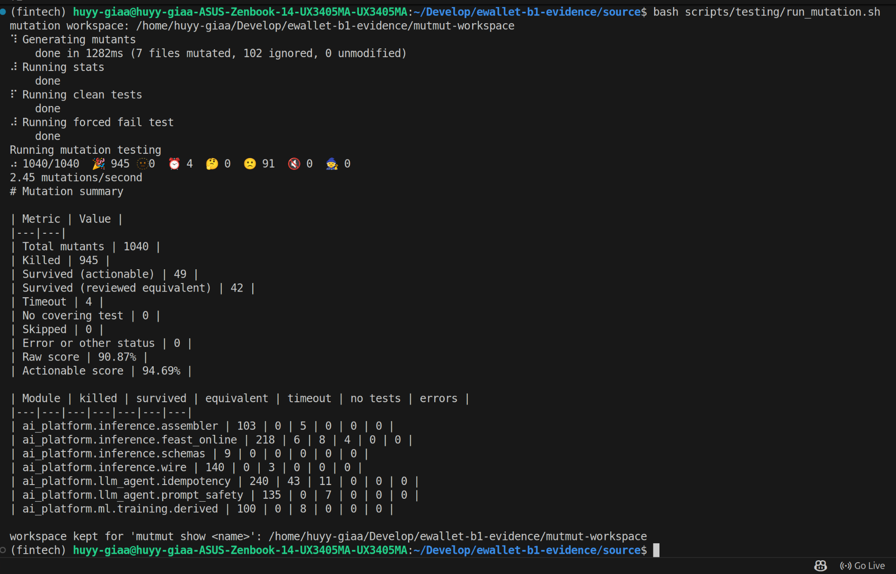
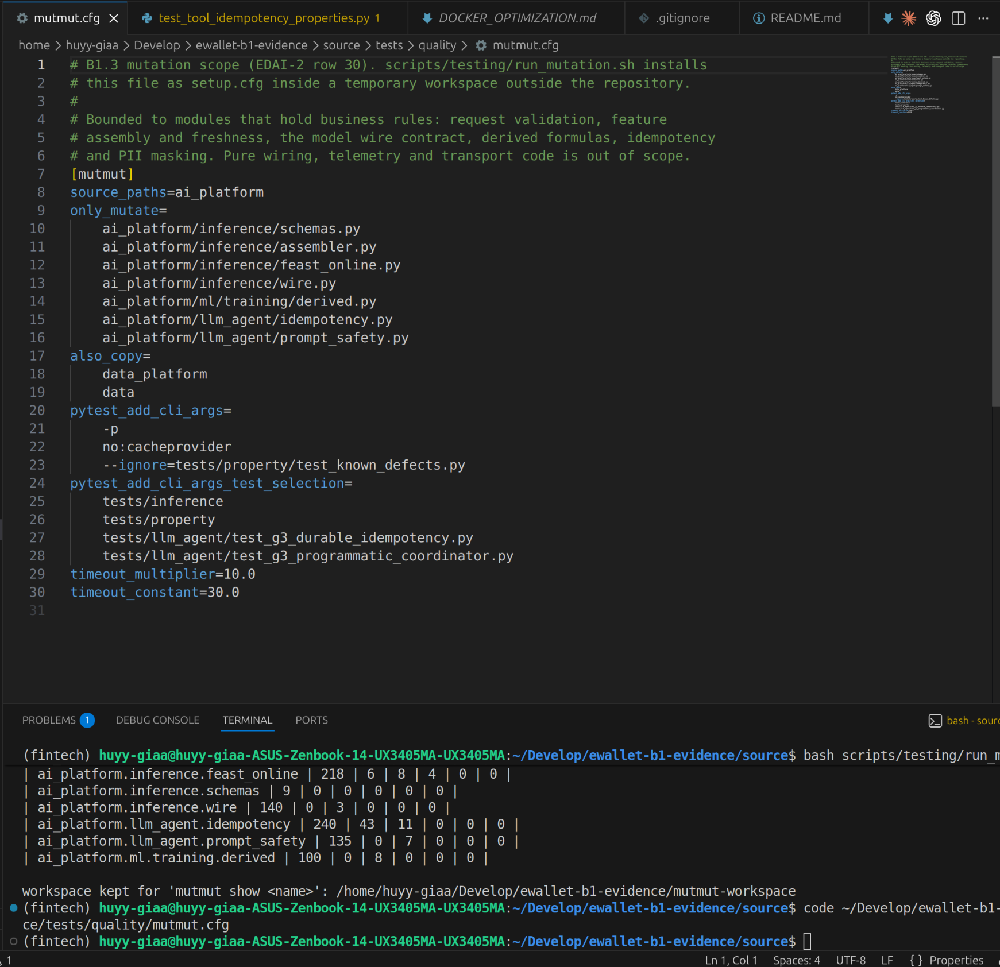

# Row 30: mutation testing

| Rubric row 30 (2 points) | Status |
|---|---|
| "Có sử dụng mutation testing để đánh giá hiệu quả của các test (mutmut). Note that you mutate only code changed, not the whole code base everytime you push your commit! Mutation score > 80%." | **Score met** (raw 90.87% and actionable 94.69% on the B1 commit; actionable 91.44% on the integrated code). **"Only changed code" is met as a reviewed, bounded scope, not as an automatic per-push selection** (see the limitations) |

## 1. Method

- **Tool:** mutmut 3, run by [`scripts/testing/run_mutation.sh`](../../../scripts/testing/run_mutation.sh).
- **Isolated workspace:** the runner copies tracked and new files into a temporary workspace outside the repository and installs [`tests/quality/mutmut.cfg`](../../../tests/quality/mutmut.cfg) there as `setup.cfg`. `mutants/` never appears in the repository.
- **What is mutated** ([`only_mutate`](../../../tests/quality/mutmut.cfg#L9)): the seven modules B1 changed that hold business rules.
  - `inference/schemas.py`, `assembler.py`, `feast_online.py`, `wire.py`;
  - `ml/training/derived.py`;
  - `llm_agent/idempotency.py`, `prompt_safety.py`.

  Wiring, telemetry and transport code is left out, so the whole code base is not mutated on each run.
- **Tests run against each mutant** ([`pytest_add_cli_args_test_selection`](../../../tests/quality/mutmut.cfg#L25)): `tests/inference`, `tests/property` and the two Coordinator suites. `test_known_defects.py` is excluded because its strict xfails would count as kills.
- **Scoring** ([`mutation_report.py`](../../../scripts/testing/mutation_report.py#L45)):
  - raw score = killed ÷ exercised mutants;
  - actionable score also removes reviewed equivalent mutants from the denominator;
  - timeouts stay in both denominators and are not counted as killed;
  - only a survivor can be marked equivalent, with a written reason ([`equivalent_mutants.txt`](../../../tests/quality/equivalent_mutants.txt)).

## 2. Results

| Run | Code | Mutants | Killed | Survived (actionable) | Equivalent | Timeout | No test | Raw | Actionable |
|---|---|---:|---:|---:|---:|---:|---:|---:|---:|
| B1 session, 2026-11-06 | `281db72` | 1,040 | 945 | 49 | 42 | 4 | 0 | **90.87%** | **94.69%** |
| G2, first run, 2026-11-07 | `cceb274` (integration) | 1,107 | 964 | 58 | 42 | 4 | 39 | 87.08% | 90.52% |
| G2, after review, 2026-11-07 | `cceb274` | 1,107 | 972 | 49 | 44 | 3 | 39 | **87.80%** | **91.44%** |

Evidence:
- B1: [`summary.md`](../../evidence/edai2/testing/b1_281db72_20261106/mutation/summary.md) and screenshots below;
- G2: [`g2_mutation_20261107T102329Z`](../../evidence/edai2/testing/g2_mutation_20261107T102329Z/summary.md).

**Why the runs differ.** The integrated `feast_online.py` gained `_view_timestamps` from Session A. Its 39 mutants have no covering test in the selection (`No test`), and the module count grew from 1,040 to 1,107 mutants. All three runs are above 80%. The B1 figures belong to the B1 commit; the G2 figures belong to the integrated code No mutation run exists on the exact HEAD `d388bd9`, but none of the seven mutated modules changed between `cceb274` and `d388bd9` (`git diff --stat` is empty)..

Largest survivor group: `llm_agent/idempotency.py`, with 43 actionable survivors in B1. These mostly change exception messages, which are observable and therefore not marked equivalent.

> **30_01: mutmut results (B1 commit).** 1,040 mutants in total; killed 945, actionable survivors 49, equivalent 42, timeouts 4; raw 90.87%, actionable 94.69%; one line per module.



> **30_02: configuration.** `mutmut.cfg` with the seven `only_mutate` modules, the test selection, the ignored known-defect suite, and the timeout settings.



## 3. Limitations

- **"Only changed code" is a fixed list, not a diff.** The scope is the reviewed list of modules B1 changed. It is not computed from `git diff` on each push, and mutation is not a CI stage. A diff-based selection in CI would satisfy the rubric's wording literally; that is a follow-up.
- **mutmut 3 mutates function bodies only.** Class-level declarations such as `Field(gt=0)` are not mutated; the property tests cover those constraints.
- **Equivalence is a human review.** Every entry states its reason.
- **No screenshot of the G2 run exists;** its raw output is committed.

## 4. Reproduce

```bash
export PATH="$HOME/miniconda3/envs/fintech/bin:$PATH"
scripts/testing/run_mutation.sh docs/evidence/edai2/testing/<run-id>     # about 7 minutes
```
