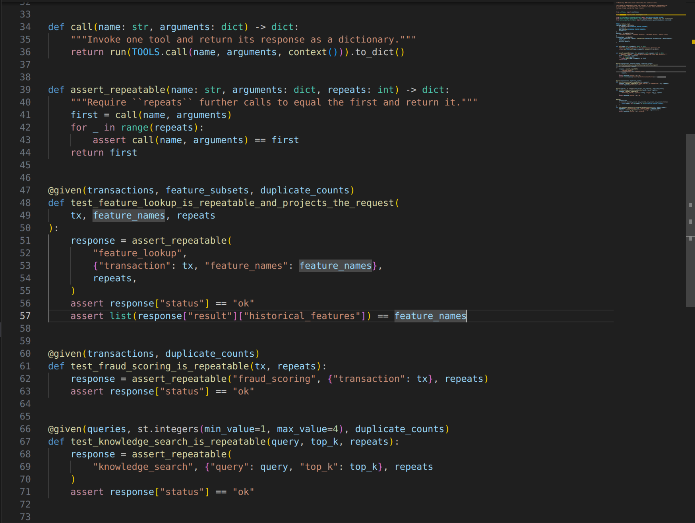
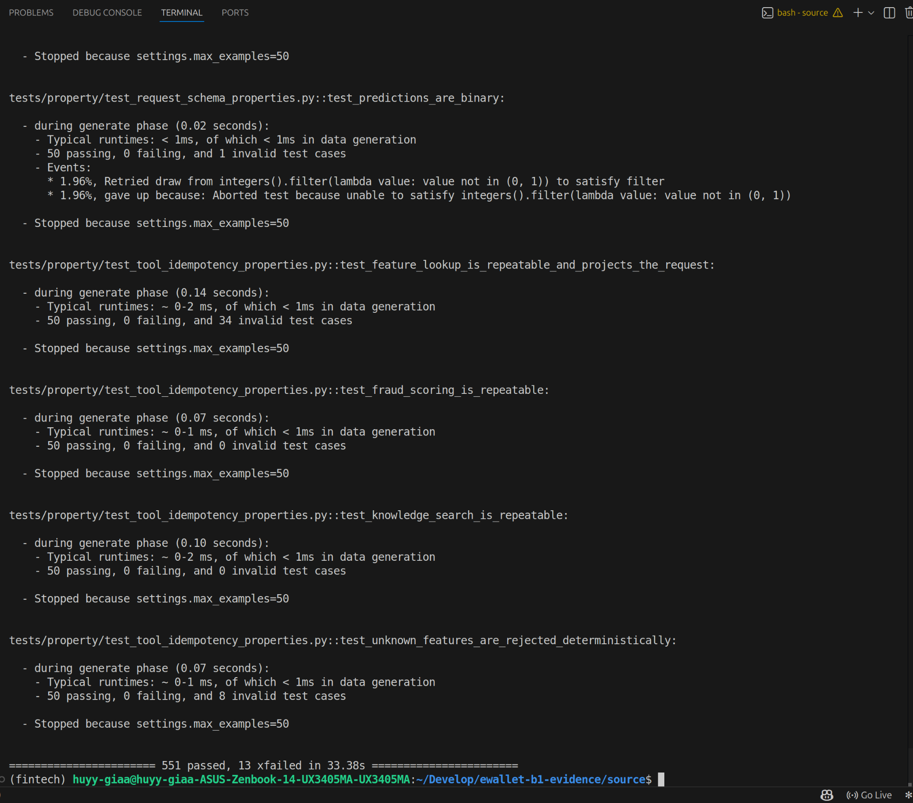
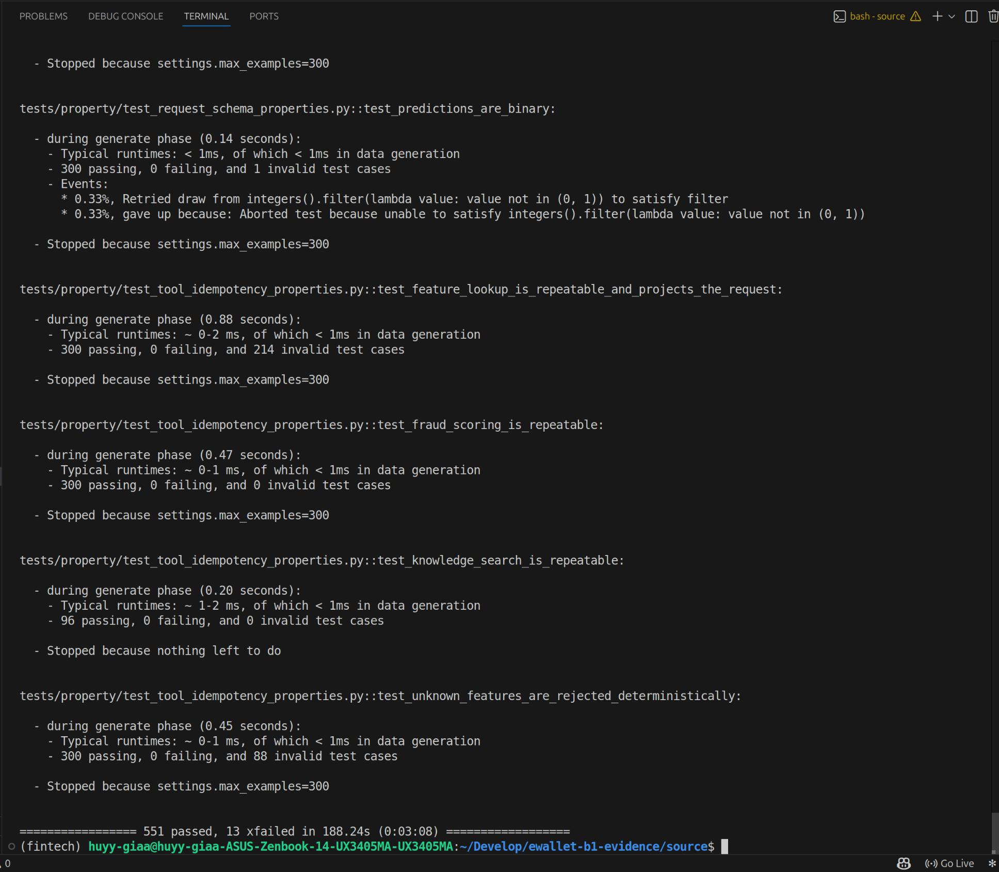

# Row 31: property-based idempotency testing

| Rubric row 31 (2 points) | Status |
|---|---|
| "Idempotency testing sử dụng property-based testing … ví dụ kiểm tra xem model prediction có generate ra kết quả consistent sau nhiều lần chạy không. You can use the library hypothesis … combine with crosshair backend" | **Met with Hypothesis:** 551 passed on the B1 commit (50 and 300 examples per property) and 566 passed on HEAD. CrossHair, which the rubric lists as optional, is not used |

## 1. Why property-based

A parameterized test checks the cases someone wrote down. A **property** states a rule that must hold for *every* input, and [Hypothesis](https://hypothesis.readthedocs.io/) generates the inputs, including edge cases and shrunk counter-examples. For idempotency the rule is *repeat the call and nothing changes*, which is exactly the kind of rule a few hand-picked cases would miss.

Configuration ([`conftest.py` (line 28)](../../../tests/property/conftest.py#L28)):
- `b1-ci`: 50 derandomized examples per property, identical on every run;
- `b1-thorough`: 300 randomized examples per property;
- `b1-mutation`: 15 examples, used inside the mutation run.

Hypothesis is pinned at `6.168.5` in the inference project's lockfile.

## 2. Properties

| Property | Where |
|---|---|
| **Model prediction is consistent:** repeating a request returns an identical response; the same instant written with another UTC offset scores identically; concurrent identical requests agree and keep their own correlation id | [`test_prediction_properties.py` (line 61)](../../../tests/property/test_prediction_properties.py#L61), [line 75](../../../tests/property/test_prediction_properties.py#L75), [line 96](../../../tests/property/test_prediction_properties.py#L96) |
| **Agent tools are repeatable:** `feature_lookup`, `fraud_scoring` and `knowledge_search` return the same response on every repeat for a generated transaction or query; unknown features are rejected every time | [`test_tool_idempotency_properties.py` (line 47)](../../../tests/property/test_tool_idempotency_properties.py#L47) |
| **Idempotency store:** stable, collision-free keys; one active owner; replay until TTL; one winner under concurrent claims. A Hypothesis **state machine** compares the store with an independent reference model | [`test_idempotency_store_properties.py` (line 343)](../../../tests/property/test_idempotency_store_properties.py#L343) |
| **Coordinator:** duplicates replay without a new delegation; a changed payload is a conflict; concurrent duplicates delegate once | [`test_coordinator_idempotency_properties.py`](../../../tests/property/test_coordinator_idempotency_properties.py) |
| Supporting invariants: schema, 41-input vector, derived formulas, failure mapping, masking idempotency | [B1_TESTING_QUALITY.md §3](B1_TESTING_QUALITY.md#3-property-based-testing-b12-row-31) |

What "idempotent" means differs per component: the Fraud API is stateless, so it guarantees functional repeatability only, not deduplication. The guarantee per component is stated in [B1_TESTING_QUALITY.md §3](B1_TESTING_QUALITY.md#3-property-based-testing-b12-row-31).

## 3. Results

| Run | Code | Profile | Result | Evidence |
|---|---|---|---|---|
| B1 session, 2026-11-06 | `281db72` | `b1-ci` (50) | 551 passed, 13 xfailed, 33 s | [raw](../../evidence/edai2/testing/b1_281db72_20261106/property/ci/terminal-b1-ci.txt) |
| B1 session, 2026-11-06 | `281db72` | `b1-thorough` (300) | 551 passed, 13 xfailed, 188 s | [raw](../../evidence/edai2/testing/b1_281db72_20261106/property/thorough/terminal-b1-thorough.txt) |
| Integration HEAD, 2026-11-08 | `d388bd9` | `b1-ci` (50) | 566 passed, 9 xfailed, 36 s | [raw](../../evidence/edai2/testing/head_property_20261108T082124Z/terminal-b1-ci.txt) |

The **xfails are known defects**, pinned as strict expected failures in [`test_known_defects.py`](../../../tests/property/test_known_defects.py), so a fix shows up as an unexpected pass. G2 fixed B1-F7 (phone and email masking at digit boundaries, four parametrized cases) in commit `8fe0f98`; it is now a regular regression test, which takes the count from 13 to 9. The remaining xfails are B1-F1 to B1-F5. R8-P1 (raw prompts persisted by the kagent task store) is pinned separately in `tests/llm_agent/test_r8_pii_screen.py` and is not part of this count.

> **31_03: an idempotency property.** `@given(transactions, feature_subsets, duplicate_counts)` generates a transaction, a feature subset and a repeat count. `assert_repeatable` calls the tool that many extra times and requires each response to equal the first. This is what separates it from a parameterized test: the inputs are generated, not listed.



> **31_01: CI profile statistics.** Hypothesis reports per property, for example: `50 passing, 0 failing`, with invalid (filtered) examples counted separately and `Stopped because settings.max_examples=50`. Final line: `551 passed, 13 xfailed`.



> **31_02: thorough profile.** The same properties with 300 examples each; `knowledge_search` stops early because Hypothesis exhausted its input space. `551 passed, 13 xfailed in 188 s`.



## 4. Limitations

- **CrossHair is not used.** The rubric suggests it ("can"). Symbolic search could find inputs that random generation misses.
- **No screenshot of the HEAD run exists;** its raw output is committed. No thorough-profile run exists for HEAD.
- **The properties run against in-process fakes** (`tests/property/fraud_api_harness.py`), not the deployed services. Live repeatability was observed separately in the GKE runs (row 32).

## 5. Reproduce

```bash
scripts/testing/run_property_tests.sh docs/evidence/edai2/testing/<run-id>                         # b1-ci
HYPOTHESIS_PROFILE=b1-thorough scripts/testing/run_property_tests.sh docs/evidence/edai2/testing/<run-id>
```
