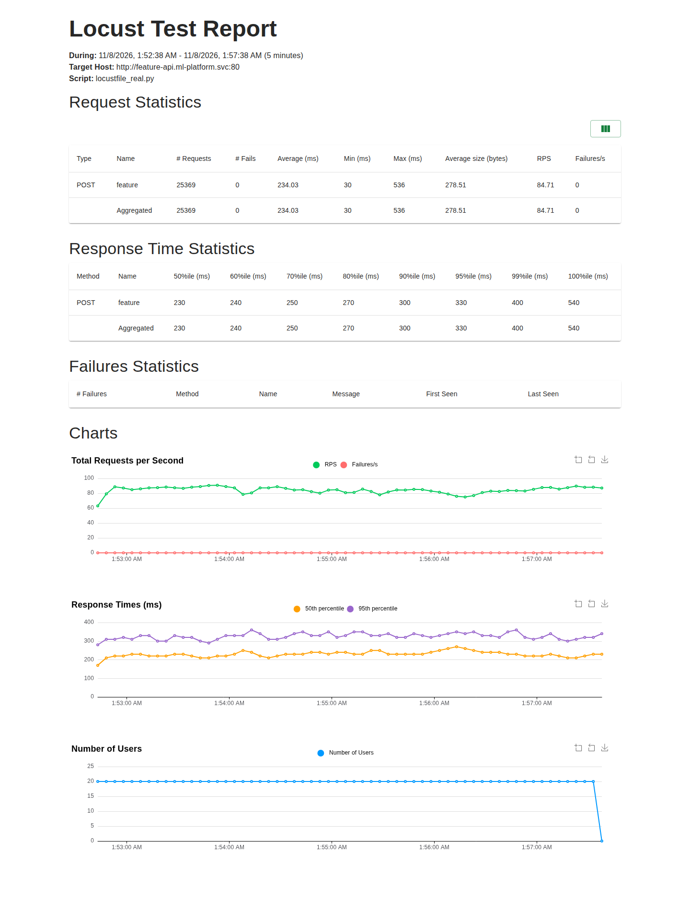
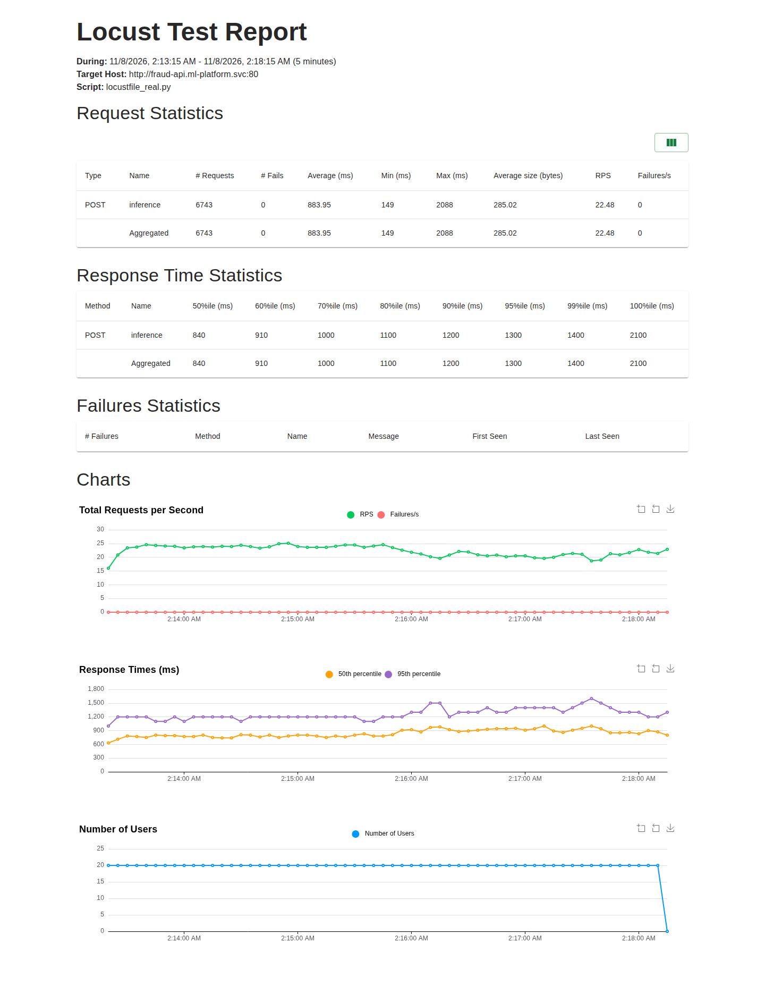

# Row 32: Locust load test of the Web API on GKE

| Rubric row 32 | Status |
|---|---|
| Load test the Web API to understand throughput and latency; Locust HTML report as the SLA deliverable | **CLOUD_VERIFIED** (G5-A, 2026-11-07) |

The Feature API is the data-retrieval Web API, so it is the primary target. The Fraud API (prediction) is measured as a second target. Both ran on the `ewallet-dev` GKE cluster, against the real services: nothing was mocked.

| Target | Runtime path |
|---|---|
| Feature API, `POST /v1/features/lookup` | Locust → Feature API → Feast SDK → Redis online store |
| Fraud API, `POST /v1/fraud/predict` | Locust → Fraud API → Feast/Redis → 41-feature assembly → KServe `fraud-detector` v1 |

The rubric gives no numeric SLA, so this page reports observed performance and its limits; it does not invent a threshold.

## 1. Implementation

### 1.1 Workload definitions

The two workloads are kept separate. Each one has its own request builder and its own response contract. A request counts as a success only if it returns HTTP 200 **and** honours that contract.

- [real_targets.py (line 44)](../../../tests/load/real_targets.py#L44): the Feature request, built from the entity's own IDs and `event_timestamp`.
- [real_targets.py (line 51)](../../../tests/load/real_targets.py#L51): the Fraud request, with a new `transaction_id` per call.
- [real_targets.py (line 56)](../../../tests/load/real_targets.py#L56): the Feature contract. The response must return exactly the requested feature names, a timestamp and a correlation ID.
- [real_targets.py (line 66)](../../../tests/load/real_targets.py#L66): the Fraud contract. The response must carry the same transaction, a probability in [0, 1], a prediction of 0 or 1, and `model_version` 1.
- [real_targets.py (line 87)](../../../tests/load/real_targets.py#L87): deterministic entity order. One seeded permutation of the fixture, repeated, so every entity is used equally and a rerun sends the same sequence.

### 1.2 Locust user

- [locustfile_real.py (line 23)](../../../tests/load/locustfile_real.py#L23): validates the target and the fixture before any user starts.
- [locustfile_real.py (line 44)](../../../tests/load/locustfile_real.py#L44): one `HttpUser`. Think time comes from `EWALLET_LOAD_WAIT_SECONDS` and is 0 in every run: a closed loop, so each run measures the highest rate that many users can drive.
- [load_profiles.sh (line 5)](../../../scripts/testing/load_profiles.sh#L5): the profiles, shared by the laptop runner and the in-cluster runner.
- Locust 2.46.0 is pinned in [infra/load-test](../../../infra/load-test/pyproject.toml) and its `uv.lock`. Inside the cluster it is installed hash-checked from that lockfile ([real-load-runner.yaml (line 53)](../../../infra/kubernetes/load-test/real-load-runner.yaml#L53)).

### 1.3 Load generator inside the cluster

The Locust client runs in a temporary pod inside the cluster and calls the Service DNS names. Neither the laptop link nor a port-forward is in the measured path.

- [run_incluster_load.sh (line 21)](../../../scripts/testing/run_incluster_load.sh#L21): `up` creates the pod and ConfigMaps holding the code, the fixture and the locked requirements. `down` removes everything the package created.
- [run_incluster_load.sh (line 50)](../../../scripts/testing/run_incluster_load.sh#L50): `run` records:
  - a manifest with source SHA, image digest, model version and fixture hash;
  - dependency state and restart counts before and after;
  - resource samples every 10 s;
  - server metrics before and after;
  - the Locust HTML and CSV output.
- [real-load-runner.yaml (line 26)](../../../infra/kubernetes/load-test/real-load-runner.yaml#L26): required anti-affinity keeps the client off the nodes running the APIs, the predictor and Redis.
- [real-load-runner.yaml (line 103)](../../../infra/kubernetes/load-test/real-load-runner.yaml#L103): a temporary additive NetworkPolicy admits only this pod to the Fraud API.

### 1.4 Server-side metrics

Client latency, server latency and KServe latency are measured separately and never mixed.

- [service.py (line 69)](../../../ai_platform/inference/service.py#L69): the Fraud API times `feature_retrieval`, `feature_assembly`, `model_inference` and the whole `request`.
- [server_metrics.py (line 67)](../../../ops/experiments/server_metrics.py#L67): computes the difference between the before and after snapshots, so only the run's own traffic counts.
- **Limit:** the API histograms use OpenTelemetry's default bucket edges with seconds as the unit (≤ 5 s is the first bucket). Server-side, only the exact **mean** can be reported for the APIs. The KServe predictor's `request_predict_seconds` has fine buckets, so it also gets p50, p95 and p99.
- [real_load_report.py (line 55)](../../../scripts/testing/real_load_report.py#L55): totals come from the final statistics in the HTML report. `locust_stats.csv` is Locust's last periodic write and can miss the final second.

## 2. Test environment

| Item | Value |
|---|---|
| Cluster | GKE `ewallet-dev`, `asia-southeast1-b`, 5 × `e2-standard-4`, `1.36.4-gke.2377000`; no GKE operation during the runs |
| Client | Pod `real-load-runner` on node `zm4y`, 500m–1 CPU. None of the system under test runs on that node |
| Feature API | 1 replica (fixed, no HPA or KEDA), 250m request / **1 CPU limit**, node `h874` |
| Fraud API | 1 replica (fixed), 250m / **1 CPU limit**, node `h874` |
| Image | `fraud-api@sha256:dbaf8b7060e6…`, used by both APIs |
| KServe predictor | `fraud-detector` v1, 1 replica, 1 process, 250m / **1 CPU limit**, node `wcka` |
| Online store | Feast Redis `redis-0`, node `jt0h` |
| Fixture | Package 4 `verified.jsonl`: 500 synthetic-safe canonical entities, all verified against the materialized online window (`sha256 0d17e4b3…`) |
| Source | `integration/g0-20261107`. Every run manifest records the SHA |

| Profile | Users | Spawn rate | Duration | Think time |
|---|---:|---:|---:|---:|
| Smoke | 1 | 1/s | 1 min | 0 |
| Low | 5 | 5/s | 5 min | 0 |
| Medium | 10 | 5/s | 5 min | 0 |
| High | 20 | 5/s | 5 min | 0 |

The two APIs ran one after the other, never together, with 90 s between runs.

## 3. Reproduction

```bash
export KUBE_CONTEXT=gke_ewallet-data-ai-platform-hg26_asia-southeast1-b_ewallet-dev
export IMAGE_DIGEST=sha256:dbaf8b7060e6bebf477f2bff02dfede382102410b4ab68b51e836de9f7c1c803 EWALLET_LOAD_MODEL_VERSION=1
EV=docs/evidence/edai2/load/g5a_<run-id>
scripts/testing/run_incluster_load.sh up docs/evidence/edai2/serving/pkg4_20261107T155413Z/fixture/verified.jsonl
for target in feature inference; do
  for profile in smoke low medium high; do
    scripts/testing/run_incluster_load.sh run "$target" "$profile" "$EV"; sleep 90
  done
done
scripts/testing/run_incluster_load.sh down
```

## 4. Results

All eight runs completed: **0 failed requests out of 103,977**, no restarts of the APIs, KServe or Redis, and no GKE operation. Evidence: [`docs/evidence/edai2/load/g5a_20261107T183037Z`](../../evidence/edai2/load/g5a_20261107T183037Z/README.md). Each run directory has `report.html`, the CSVs, `summary.json`, `server-metrics.json` and resource samples.

### 4.1 Client-observed (Locust)

| API | Users | Requests | Failed | Error rate | Avg req/s | Peak req/s | p50 ms | p95 ms | p99 ms | Max ms |
|---|---:|---:|---:|---:|---:|---:|---:|---:|---:|---:|
| Feature | 1 | 4,346 | 0 | 0% | 73.2 | 74.6 | 13 | 16 | 20 | 59 |
| Feature | 5 | 25,654 | 0 | 0% | 85.7 | 89.6 | 56 | 82 | 100 | 348 |
| Feature | 10 | 26,522 | 0 | 0% | 88.6 | 91.9 | 110 | 160 | 240 | 384 |
| Feature | 20 | 25,369 | 0 | 0% | 84.7 | 92.0 | 230 | 330 | 400 | 536 |
| Fraud | 1 | 769 | 0 | 0% | 13.0 | 13.3 | 74 | 89 | 110 | 237 |
| Fraud | 5 | 7,362 | 0 | 0% | 24.6 | 25.6 | 190 | 290 | 340 | 470 |
| Fraud | 10 | 7,212 | 0 | 0% | 24.1 | 25.1 | 410 | 550 | 630 | 1,005 |
| Fraud | 20 | 6,743 | 0 | 0% | 22.5 | 25.1 | 840 | 1,300 | 1,400 | 2,088 |

Peak req/s is the highest value in Locust's per-second history, which Locust smooths over a short window.

### 4.2 Server side and KServe (means from Prometheus histograms; predictor percentiles from its own buckets)

| API | Users | API request mean | Feast read mean | Assembly mean | KServe call, seen by the API | Inside the predictor: mean / p95 |
|---|---:|---:|---:|---:|---:|---:|
| Feature | 1 / 5 / 10 / 20 | 7.5 / 43.1 / 83.1 / 157.4 ms | 7.3 / 42.9 / 82.9 / 157.1 ms | n/a | n/a | n/a |
| Fraud | 1 | 69.0 ms | 7.5 ms | 16.8 ms | 43.2 ms | 33.8 / 49.2 ms |
| Fraud | 5 | 184.8 ms | 28.5 ms | 19.3 ms | 135.4 ms | 34.3 / 49.2 ms |
| Fraud | 10 | 345.9 ms | 99.2 ms | 23.0 ms | 221.7 ms | 34.2 / 49.2 ms |
| Fraud | 20 | 672.6 ms | 282.6 ms | 27.6 ms | 360.2 ms | 34.3 / 49.2 ms |

### 4.3 Resource use at peak (`kubectl top`, 10 s samples)

| Run | Feature API CPU | Fraud API CPU | Predictor CPU | Redis CPU | Locust client CPU |
|---|---:|---:|---:|---:|---:|
| Feature, 5–20 users | **998–999m of 1,000m** | idle | idle | 78–83m | ≤ 226m |
| Fraud, 5–20 users | idle | **971–998m of 1,000m** | **922–966m of 1,000m** | 50–52m | ≤ 117m |

The first 10 s sample of the Feature 5-user run still shows the end of the Fraud smoke run on the Fraud API and the predictor, because metrics-server averages over a window. Memory stayed under 150 MiB for each API and 180 MiB for the predictor.

## 5. Findings

1. **Feature API: about 86 req/s per replica, limited by its own CPU.** Throughput is flat from 5 to 20 users while the pod sits at its 1-CPU limit. Latency grows almost linearly with users: p95 goes 82 → 160 → 330 ms. Redis uses under 100m CPU, so the store is not the bottleneck.
2. **Fraud API: about 24.5 req/s, limited by the single KServe predictor and the API's CPU together.** Time inside the predictor stays at 34 ms (p95 49 ms) at every load, but the KServe call seen by the API grows from 43 to 360 ms. Requests queue in front of a single-process predictor capped at 1 CPU. At 34 ms per prediction that caps one process near 29 req/s. The Fraud API is also at its CPU limit, which explains why its own Feast read grows from 7 to 283 ms while Redis stays idle.
3. **Client vs. server.** At 1 user the client sees 13.4 ms for the Feature API against a 7.5 ms server mean. The difference is the in-cluster network, HTTP and JSON handling, about 6 ms. For Fraud it is 76.8 against 69.0 ms.
4. **No errors at saturation.** Overload showed up as latency, never as failures. Fraud max latency reached 2.1 s at 20 users.

**Limits of these results:** one replica of everything, no autoscaling, a closed loop with no think time, and 5-minute runs. The Fraud API's p95 and p99 are client-side only, because of the coarse server buckets.

## 6. Genuine Locust reports

Both images are the actual `report.html` files written by Locust 2.46.0 in these runs, rendered by headless Google Chrome with no editing. Times are in local time (UTC+7). The other six reports are in the evidence folder.

> **Proof note — Feature API, 20 users:** 25,369 requests, 0 failures, 84.7 req/s. The flat throughput line against the 5- and 10-user runs shows the per-replica ceiling.



> **Proof note — Fraud API, 20 users:** 6,743 requests, 0 failures, 22.5 req/s, p95 1,300 ms. Throughput stays near 22–25 req/s while latency climbs: the queueing in front of the predictor.



## 7. Next: autoscaling (G5-B)

These baselines calibrate the serving KEDA experiment. See [G3_G4_CLOUD_CAMPAIGN.md](../../runbooks/edai2/G3_G4_CLOUD_CAMPAIGN.md#g5-b-serving-keda-calibrated-from-g5-a).
