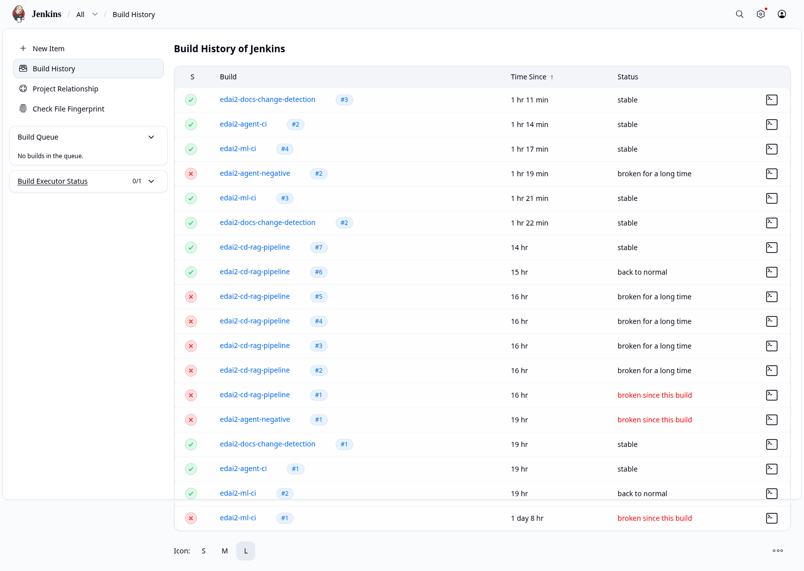
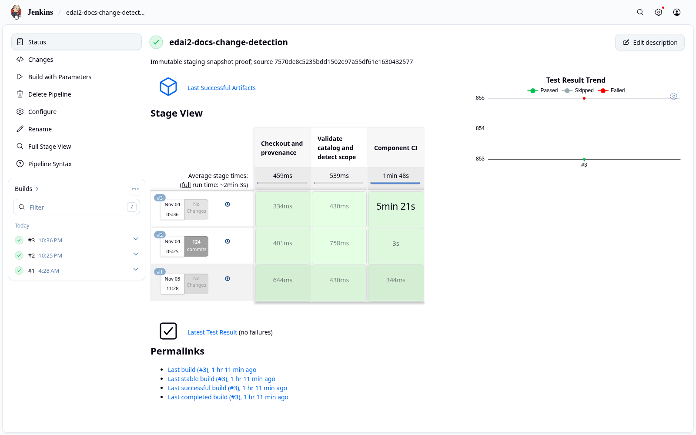
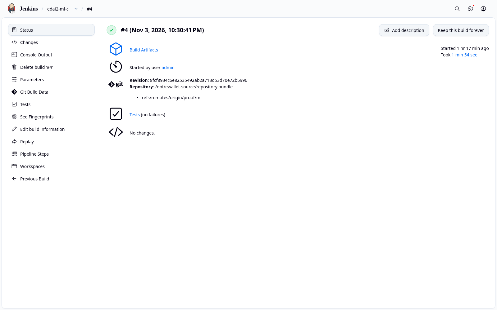
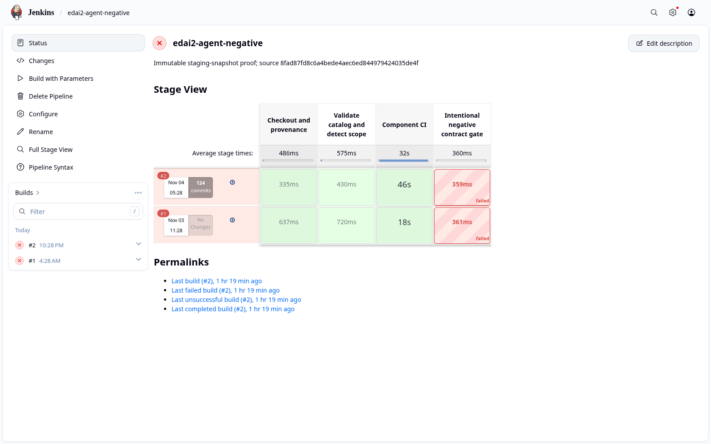

# Testing and Continuous Verification

This report describes how the platform is tested:

- which components are covered;
- how the tests are designed and organized;
- how they run in Jenkins;
- what the recorded executions show.

## Rubric rows 28–32

Each row has its own document with the evidence, results and limitations. This page keeps the overall strategy and the Jenkins execution.

| Row | Technique | Document | Headline result |
|---|---|---|---|
| 28 | Unit tests, coverage > 90 %, Web API, fixtures, mocks | [ROW_28_UNIT_TEST_COVERAGE.md](ROW_28_UNIT_TEST_COVERAGE.md) | 99.03 % at `281db72`; 91.90 % at HEAD |
| 29 | Equivalence partitioning and boundary values | [ROW_29_EQUIVALENCE_BOUNDARY.md](ROW_29_EQUIVALENCE_BOUNDARY.md) | 70 tests, 77 subtests, green |
| 30 | Mutation testing (mutmut) | [ROW_30_MUTATION_TESTING.md](ROW_30_MUTATION_TESTING.md) | Actionable 94.69 % (B1), 91.44 % (integrated) |
| 31 | Property-based idempotency (Hypothesis) | [ROW_31_PROPERTY_BASED_IDEMPOTENCY.md](ROW_31_PROPERTY_BASED_IDEMPOTENCY.md) | 551 passed (B1), 566 passed (HEAD) |
| 32 | Locust load test of the Web API | [ROW_32_LOCUST_GKE.md](ROW_32_LOCUST_GKE.md) | GKE in-cluster, 103,977 requests, 0 failures |

## 1. Testing strategy

The repository is split by domain. Each domain is a separately locked Python project:

- data generation;
- Feast;
- ML training;
- the Fraud API;
- MCP tools;
- agents;
- RAG ingestion;
- streaming.

Tests follow the same boundaries. Every component declares, in one catalog, which source paths it owns and which test commands verify it. CI selects components from the files a change touches. Unrelated, slow environments therefore do not run for every change, while a change to shared code still triggers every dependent component.

The tests fall into five groups:

| Layer | Purpose | Typical technique |
|---|---|---|
| Unit and contract tests | Validate a module's behaviour and its input/output contracts (feature names, request schemas, metric labels) | `unittest` with `subTest` partitions; stdlib and in-memory doubles |
| Web API tests | Exercise the FastAPI applications through their ASGI interface without network or cloud dependencies | `create_app(...)` with fake Feast and KServe clients; Starlette `TestClient` for the agents' A2A endpoints |
| Helm chart tests | Render the Kubernetes manifests and assert on security-relevant structure (RBAC verbs, NetworkPolicy peers, probes, image pinning) | `helm template`, parsed with PyYAML |
| Integration tests | Check wire compatibility between components, for example the KServe V2 request built by the Fraud API | Recorded payloads and local servers |
| Pipeline gates | Prove that the release path blocks on a failing contract | A dedicated Jenkins job with an intentional failing gate |

Each component runs with `uv run --locked`, so the tests use exactly the dependency versions that ship in the component's image.

## 2. Test organization

| Item | Location |
|---|---|
| Component catalog (source paths, test commands, build artifact, deploy handler) | [`jenkins/catalog/components.json`](../../../jenkins/catalog/components.json) |
| Change detection | [`scripts/ci/change_detection.py`](../../../scripts/ci/change_detection.py) |
| JUnit reporting for stdlib `unittest` | [`scripts/ci/junit_unittest.py`](../../../scripts/ci/junit_unittest.py) |
| Shared Jenkins pipeline | [`jenkins/pipeline/componentPipeline.groovy`](../../../jenkins/pipeline/componentPipeline.groovy), entry points [`Jenkinsfile`](../../../Jenkinsfile), [`Jenkinsfile.ml`](../../../Jenkinsfile.ml), [`Jenkinsfile.llm-agent`](../../../Jenkinsfile.llm-agent) |
| Test suites | [`tests/`](../../../tests): `inference/`, `llm_agent/`, `streaming/`, `observability/`, `ci/`, `unit/`, `integration/` |

Most suites use the standard-library `unittest` framework, which runs in every locked environment without extra dependencies. `junit_unittest.py` converts the results to JUnit XML, and Jenkins publishes that XML as its *Tests* report. The data-platform and data-governance components use `pytest`.

## 3. Test design

### 3.1 Equivalence partitioning and boundary values

Inputs with a bounded domain are tested by partition. The most important example is the MCP `feature_lookup` tool, which accepts an optional list of feature names. Its domain is the 31 historical model features.

From [`tests/llm_agent/test_phase_d_tools.py`](../../../tests/llm_agent/test_phase_d_tools.py):

```python
def test_feature_name_partitions_and_boundaries(self):
    names = list(HISTORICAL_FEATURE_COLUMNS)
    tools = feature_rag()
    for valid in (names[:1], names):
        with self.subTest(count=len(valid)):
            response = run(tools.call("feature_lookup", {"transaction": transaction(), "feature_names": valid}, context()))
            self.assertEqual(list(response.result["historical_features"]), valid)
    for invalid in ([], names[:1] * 2, ["user_behavior__ssn"], names + ["amount"], "user_behavior__x"):
        with self.subTest(invalid=invalid):
            response = run(tools.call("feature_lookup", {"transaction": transaction(), "feature_names": invalid}, context()))
            self.assertEqual(response.status, "rejected")
```

**Valid class.** Both boundaries are tested: a single feature and all 31 features.

**Invalid classes.** Each is a separate sub-test:

- an empty list (below the lower boundary);
- a duplicated name;
- a name outside the contract;
- 31 names plus one extra (above the upper boundary);
- a value of the wrong type.

The same approach is used for:

- the PII screen: a card number with a valid Luhn digit versus one that is off by one; mobile versus landline prefixes ([`test_n12_agent_telemetry.py`](../../../tests/llm_agent/test_n12_agent_telemetry.py));
- the drift tool's window limits ([`test_phase_d_tools.py`](../../../tests/llm_agent/test_phase_d_tools.py)).

### 3.2 Web API tests with test doubles

[`tests/inference/test_service_and_app.py`](../../../tests/inference/test_service_and_app.py) builds the Fraud API with `create_app(...)` against in-memory Feast and KServe doubles. It then drives the ASGI application directly and checks:

- a valid prediction returns 200 (line 415);
- an invalid payload returns 422 from Pydantic validation (line 427);
- `/health/live` and `/health/ready` return `ok` and `ready`, and readiness fails when a dependency fails (lines 436–449).

The agent tests use a `RecordingLLM` double. It records exactly what the agent sends to the LLM, so the tests can assert that a PII value never leaves the process and that only the masked prompt is sent ([`test_n12_agent_telemetry.py`](../../../tests/llm_agent/test_n12_agent_telemetry.py)).

### 3.3 Idempotency

Two behaviours are tested:

- Read-only tools must return identical results for identical requests (`test_read_only_tools_are_idempotent`).
- The coordinator must return the stored result for a repeated request ID and reject a conflicting duplicate (`test_duplicate_request_is_idempotent_and_conflict_is_rejected` in [`test_g3_programmatic_coordinator.py`](../../../tests/llm_agent/test_g3_programmatic_coordinator.py)).

Both are example-based tests.

### 3.4 Chart and security contracts

Chart tests render the Helm chart and assert security properties directly. For example, [`tests/llm_agent/test_n12_chart.py`](../../../tests/llm_agent/test_n12_chart.py) checks that:

- the metrics ClusterRole grants only `nodes` and `nodes/metrics`, never `nodes/proxy`;
- kubelet scraping uses verified TLS;
- the log forwarder has no host access and requires a digest-pinned image.

A configuration change that weakens one of these properties fails CI before it reaches the cluster.

## 4. Execution in Jenkins

All builds below ran on the Jenkins controller deployed in the GKE namespace `ewallet-ci`.

**Source snapshot.** The source is an immutable snapshot image built from the repository bundle:

- source commit `084c8de1`;
- snapshot image `jenkins-source-snapshot@sha256:76d9aaa8…`.

**No deployment.** Every build ran with `DEPLOY_APPROVED=false`, so the pipelines tested but did not deploy.

Each pipeline has three stages:

1. **Checkout and provenance:** HEAD must equal the expected commit.
2. **Validate catalog and detect scope.**
3. **Component CI:** the selected components run in parallel, and JUnit results are published.



*Jenkins build history. The verification builds are `edai2-docs-change-detection` #3, `edai2-agent-ci` #2, `edai2-ml-ci` #4 and #3, and `edai2-agent-negative` #2. Earlier entries are previous runs of the same jobs.*

### 4.1 Results

JUnit results as published by Jenkins:

| Job and build | Scope selected by change detection | Passed | Skipped | Failed | Duration |
|---|---|---:|---:|---:|---:|
| `edai2-docs-change-detection` #3 | 14 component suites (shared path changed) | 853 | 2 | 0 | 325 s |
| `edai2-agent-ci` #2 | llm-serving, observability, rag-pipeline, mcp-agents, llm-d-routing, agents, prompt-management | 537 | 1 | 0 | 132 s |
| `edai2-ml-ci` #4 | feast, ml-training, mlflow, fraud-serving, fraud-api | 99 | 0 | 0 | 115 s |
| `edai2-ml-ci` #3 | fraud-api only (change limited to the Fraud API) | 56 | 0 | 0 | 43 s |
| `edai2-agent-negative` #2 | agents, mcp-agents, then an intentional failing gate | 255 | 0 | 0 | 69 s |

Breakdown of the largest build, `edai2-docs-change-detection` #3, by component suite:

| Component | Tests | Component | Tests |
|---|---:|---|---:|
| mcp-agents | 146 | fraud-api | 56 |
| ci-platform | 108 | rag-pipeline | 61 (1 skipped) |
| agents | 109 | feast | 20 |
| streaming | 103 (1 skipped) | data-platform | 19 |
| observability | 82 | ml-training | 16 |
| prompt-management | 67 | fraud-serving | 4 |
| llm-serving | 61 | mlflow | 3 |

**The three skipped tests are environment-gated, not failing:**

- one RAG test needs the embedding model, enabled with `EWALLET_RAG_MODEL_TESTS=1`;
- one streaming test needs the Feast environment;
- the agent build skips the same RAG model test.



*Jenkins stage view of `edai2-docs-change-detection`. In build #3 the Component CI stage ran all selected component suites in 5 min 21 s. The test-result trend reports 855 tests with no failures; 2 of them are skipped.*



*`edai2-ml-ci` #4: built from revision `8fcf8934…`, tests reported with no failures.*

### 4.2 Intentional negative gate

`edai2-agent-negative` checks that the pipeline *stops* when a release contract is violated:

1. It first runs the full agent and MCP test suites; all 255 tests pass.
2. It then enters the stage "Intentional negative contract gate", which deliberately exits with code 42 and records `intentional_negative_gate=blocked_before_release`.

The red build is the expected result. It shows that a failing gate prevents any release stage from running. It is not a defect in the code under test.



*`edai2-agent-negative`. Checkout, scope detection and Component CI succeed (green); only the intentional gate fails (red), and no release stage follows.*

## 5. Interpretation

- **All component suites pass on the same source.** Every catalogued component, from data generation to the agents, passes its locked test suite against one immutable source snapshot, and nothing fails.
- **Change detection works in both directions.** A change confined to the Fraud API runs only its 56 tests, while a change to shared code runs all 14 affected component suites.
- **Contracts that protect deployed systems are enforced in CI:** chart security properties, the feature contract and metric label bounds.
- **The release path is fail-closed,** as the negative gate shows.

## 6. Limitations

- The suites do not measure code coverage. They are not yet complemented by mutation testing (beyond the targeted, hand-written mutation smoke in [`scripts/validation/targeted_mutation_smoke.py`](../../../scripts/validation/targeted_mutation_smoke.py)), by property-based tests, or by a load test of the Web API.
- The idempotency tests are example-based rather than generated.
- These additions are tracked in the [EDAI-2 gap ledger](../GAP_LEDGER.md).
