# DP2 Method 2 — Spark A/B evidence (`ab-20261031035745`)

- DagRun: `dp2_bronze_to_curated / dp2-method2-ab-20261031035745` (Airflow 3.3.1, local stack 8084)
- Git SHA: `e58a5006296839730e7ecf96ec2eb5fe4d76889b`
- Dataset: `canonical-100gb-v1`, Dataproc Serverless 2.2.89, `asia-southeast1`
- Run time: 2026-10-31 10:58:37 → 17:54:21 (+07:00), 06:55:43

Ảnh 01–07 chụp trực tiếp Airflow UI. Ảnh 08–12 là output nguyên văn của lệnh `gcloud` / đọc file evidence do DAG sinh ra
(lệnh hiện ở dòng `$` màu xanh; bản text trong `raw/command-output/`).

## Kết quả tổng quát

| Hạng mục | Kết quả |
|---|---|
| DagRun | 24/25 task `success`; `validate_and_select_gold_winner` `failed` |
| Silver A/B | Cả hai batch SUCCEEDED; 8/8 bảng tương đương; winner = **baseline** |
| Gold A/B | Cả hai batch SUCCEEDED; optimized nhanh hơn **23.1%** (7,810 → 6,005 s application runtime) |
| Gold equivalence | 11/13 bảng khớp hoàn toàn; 2 bảng chỉ lệch cột `double` ở mức sai số máy (≤ 2.6e-15 tương đối) |

**Trạng thái cuối cùng:** transformation baseline và optimized đã tạo đủ Gold output, nhưng semantic-equivalence gate cuối cùng **FAILED**. DagRun lịch sử vẫn `FAILED`; không có Gold winner được chọn và không được diễn giải số runtime quan sát được như một optimized winner đã được xác nhận.

## Airflow UI

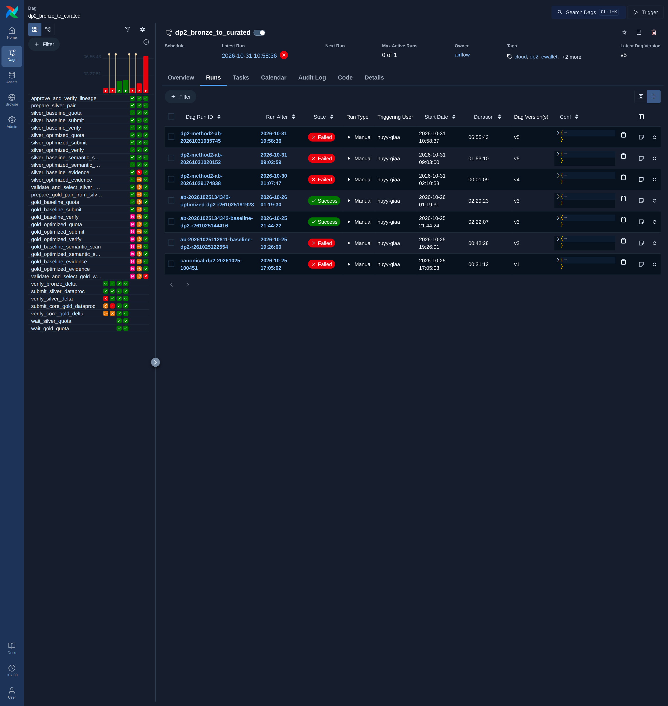
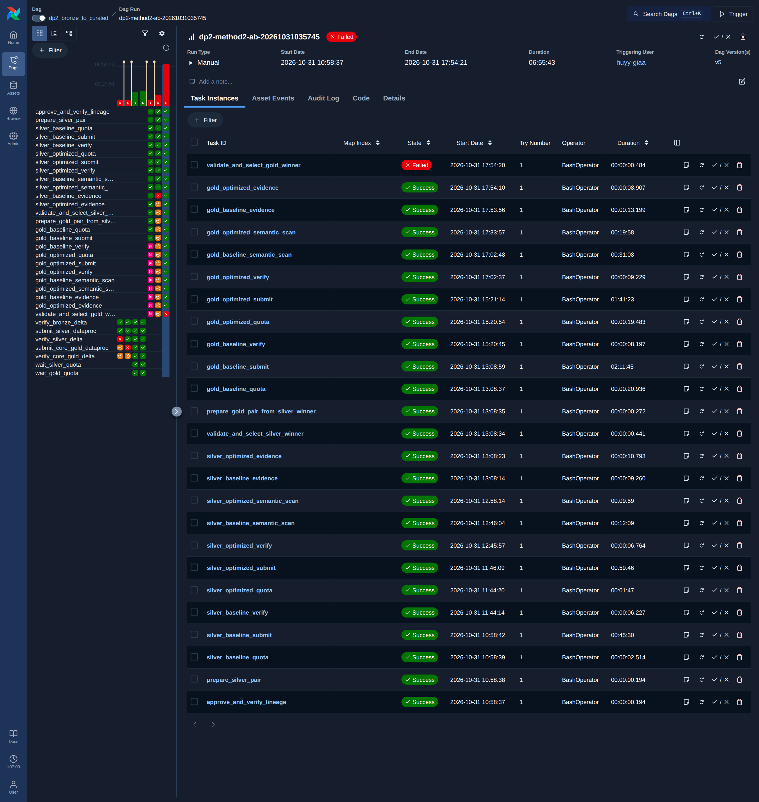
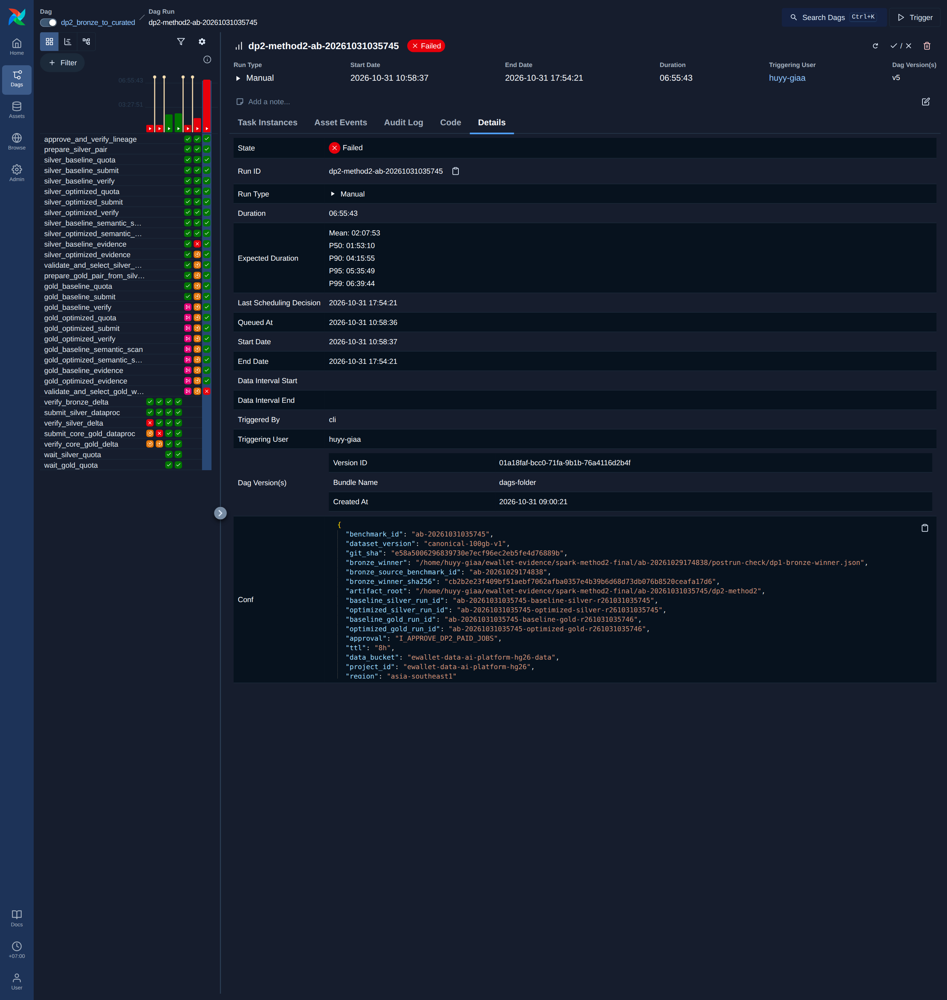
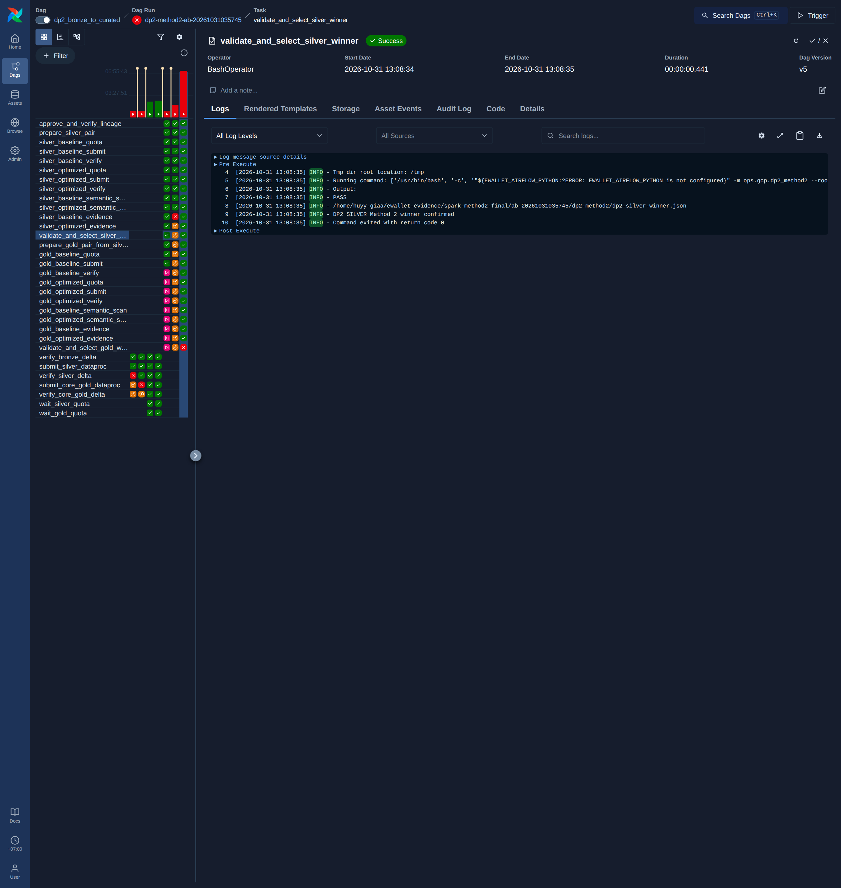
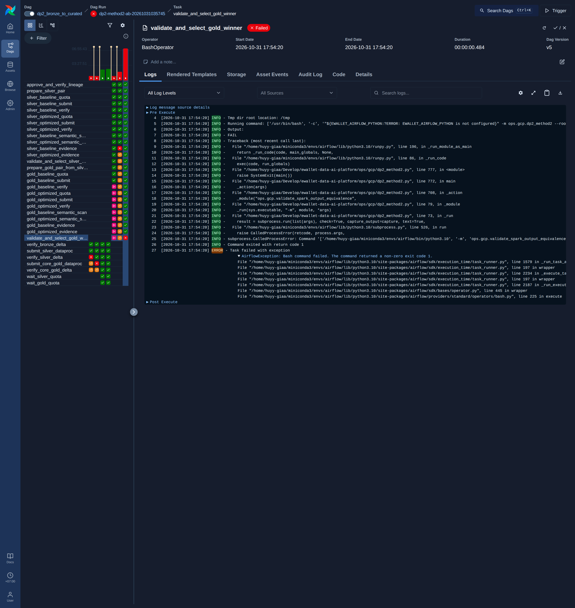
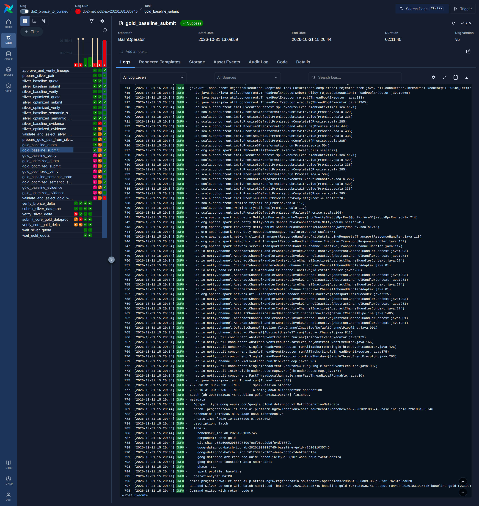
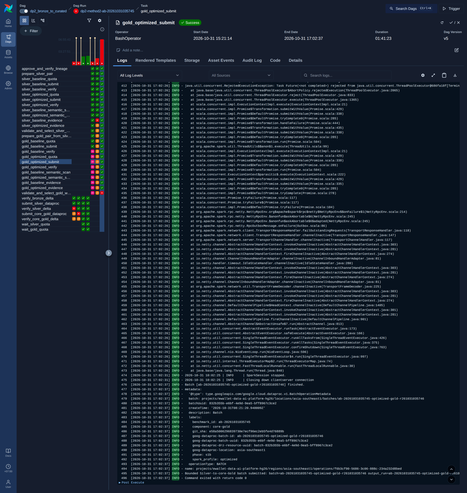

## Silver

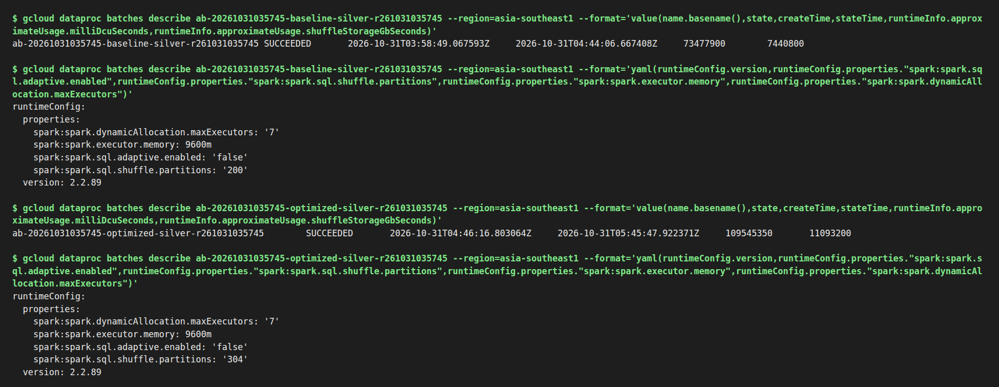
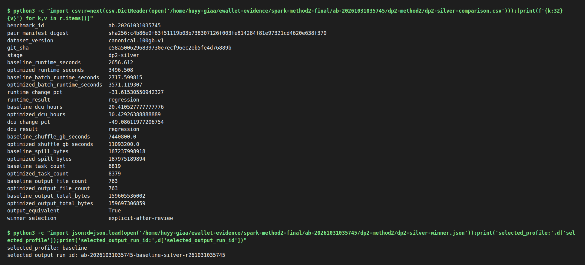

Ở lần chạy này baseline nhanh hơn (2,656.6 s so với 3,496.5 s application runtime), nên pipeline chọn baseline làm Silver winner.
Run lịch sử `ab-20261029174838` dùng cùng cấu hình lại cho kết quả ngược lại: optimized 2,630.6 s so với baseline
3,495.7 s (nhanh hơn 24.7%). Vì vậy chênh lệch Silver giữa `shuffle.partitions=304` và `200` (AQE tắt ở cả hai)
**không ổn định**; nó nhỏ hơn mức dao động giữa các lần chạy. Chúng tôi không claim Silver được tối ưu.

## Gold

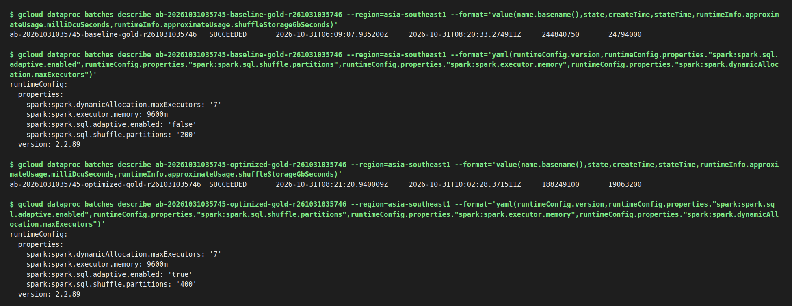
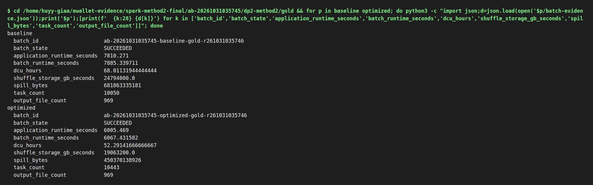

Optimized (AQE bật, 400 shuffle partitions) giảm 23.1% runtime và DCU-hours (68.01 → 52.29), giảm 34% spill.
Hạn chế: batch Gold baseline mất một executor lúc 14:45 (+07:00) (`FetchFailedException` trong log task
`gold_baseline_submit`; ảnh 06 chụp phần cuối log, batch kết thúc `finished`, exit code 0; Spark tự tính lại), nên một phần chênh lệch có thể đến từ sự cố này. Đây là một cặp chạy duy nhất.

## Vì sao `validate_and_select_gold_winner` fail

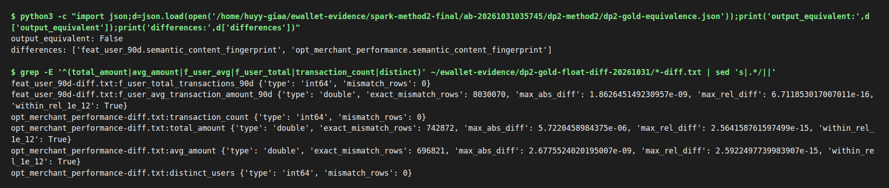

Validator so sánh fingerprint (hash) nội dung từng bảng và yêu cầu khớp tuyệt đối từng bit. `opt_merchant_performance`
và `feat_user_90d` khớp số dòng, schema và null count nhưng fingerprint lệch. Đọc trực tiếp Delta table của cả hai run
từ GCS (chỉ đọc) và so từng dòng theo khóa (`raw/float_diff.py`):

- Mọi cột số nguyên, chuỗi, timestamp và khóa khớp tuyệt đối.
- Chỉ các cột `double` sinh từ `sum`/`avg` trên `amount` (Silver ép `amount` sang `double`,
  `data_platform/processing/spark/silver/transactions.py:80`) lệch, sai số tương đối tối đa 2.6e-15.
- Nguyên nhân: phép cộng số thực dấu phẩy động không có tính kết hợp; baseline (200 partition, AQE tắt) và optimized
  (400 partition, AQE bật) cộng theo thứ tự khác nhau.

Chẩn đoán cho thấy khác biệt đến từ thứ tự reduction IEEE-754, nhưng contract semantic-equivalence của lần chạy lịch sử vẫn không đạt. Vì task fail nên DagRun không tự ghi `dp2-gold-winner.json`; **không có optimized winner được chọn**. Run `ab-20261031035745-optimized-gold-r261031035746` có runtime quan sát được thấp hơn trong đúng cặp chạy này, nhưng đó không phải kết quả winner đã qua gate.

Validator đã được sửa theo chính sách canonicalization có giới hạn cho fingerprint số thực và 18 regression test cục bộ đã pass. Cloud validation-only recovery là `NOT_EXECUTED`; không chạy lại DagRun, không ghi winner artifact và trạng thái lịch sử không thay đổi. DataHub assertion `fact_transactions.row_level_integrity` cho DP2 Gold cũng vẫn `NOT_EXECUTED`; đây là khoảng trống độc lập, không phải cùng lỗi với task Airflow này.

## Output trên GCS

| Run | Output root |
|---|---|
| Silver baseline (winner) | `gs://ewallet-data-ai-platform-hg26-data/lakehouse/runs/ab-20261031035745-baseline-silver-r261031035745/silver` |
| Silver optimized | `gs://ewallet-data-ai-platform-hg26-data/lakehouse/runs/ab-20261031035745-optimized-silver-r261031035745/silver` |
| Gold baseline | `gs://ewallet-data-ai-platform-hg26-data/lakehouse/runs/ab-20261031035745-baseline-gold-r261031035746/gold` |
| Gold optimized | `gs://ewallet-data-ai-platform-hg26-data/lakehouse/runs/ab-20261031035745-optimized-gold-r261031035746/gold` |

## Thư mục `raw/`

- `command-output/`: text nguyên văn của ảnh 08–12
- `*-batch-evidence.json`: metric từ Spark event log + Dataproc batch description
- `*-summary.json`: kết quả semantic scan từng bảng
- `dp2-*-pair.json`, `dp2-silver-winner.json`, `dp2-*-equivalence.json`, `dp2-silver-comparison.csv`: artifact do DAG sinh ra
- `dagrun-tasks.txt`: trạng thái task đọc từ Airflow metadata DB
- `opt_merchant_performance-diff.txt`, `feat_user_90d-diff.txt`, `float_diff.py`: so sánh từng cột
