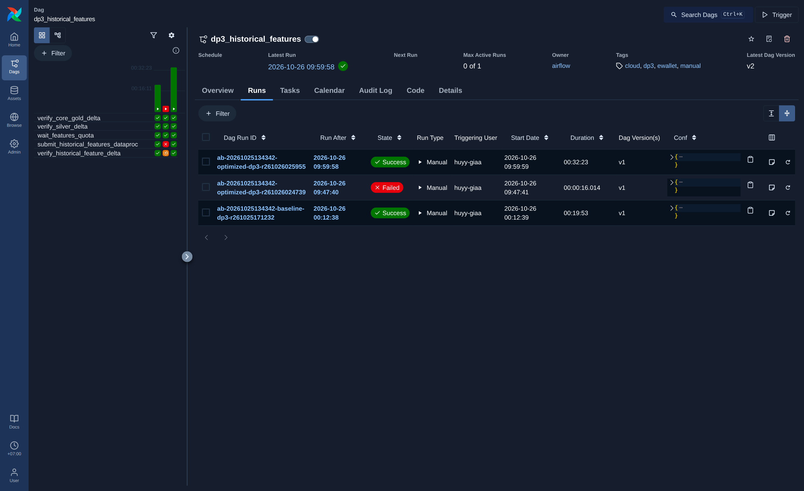
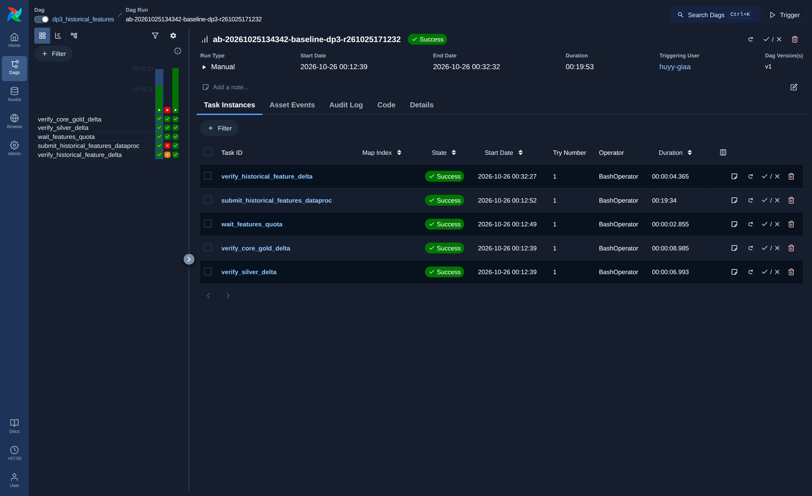
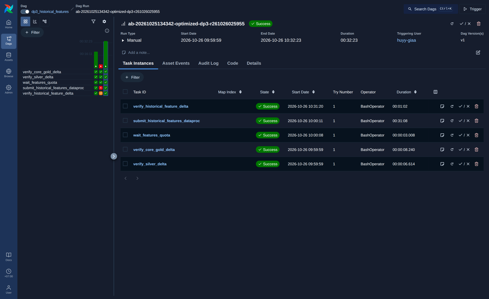

# DP3 Historical Features — evidence (`ab-20261025134342`)

DAG `dp3_historical_features` (Airflow 3.3.1, local stack 8084), 5 task:
`verify_silver_delta`, `verify_core_gold_delta` → `wait_features_quota` → `submit_historical_features_dataproc`
→ `verify_historical_feature_delta`. DP3 không được chạy lại; tài liệu này lấy từ các DagRun đã chạy ngày 2026-10-25/26.

**Phạm vi kết luận:** toàn bộ số đo dưới đây là evidence của cấu hình lịch sử tại Git SHA `bbae48c`. Cấu hình optimized mới là `NOT_EXECUTED`; tài liệu không claim gain, regression hay runtime verification cho cấu hình chưa chạy đó.

## DagRun

| DagRun | State | Bắt đầu (+07:00) | Thời lượng |
|---|---|---|---|
| `ab-20261025134342-baseline-dp3-r261025171232` | success | 2026-10-26 00:12:39 | 00:19:53 |
| `ab-20261025134342-optimized-dp3-r261026024739` | failed | 2026-10-26 09:47:41 | 00:00:16 |
| `ab-20261025134342-optimized-dp3-r261026025955` | success | 2026-10-26 09:59:59 | 00:32:23 |

Run `...-r261026024739` fail ngay ở bước kiểm tra trước khi submit
(`ValueError: feat run 'ab-20261025134342-optimized-features-r261026024739' is not bound to benchmark ... and profile 'optimized'`,
run ID dùng hậu tố `features` thay vì `feat`). Không có batch Dataproc nào được tạo cho run này; run được làm lại
với ID đúng (`...-r261026025955`) và thành công.

## Spark batch (Dataproc Serverless 2.2.89)

| | Baseline | Optimized |
|---|---:|---:|
| Batch | `ab-20261025134342-baseline-feat-r261025171232` | `ab-20261025134342-optimized-feat-r261026025955` |
| State | SUCCEEDED | SUCCEEDED |
| Batch runtime (create → end) | 18.7 phút | 30.8 phút |
| DCU-hours | 9.20 | 15.39 |
| Shuffle storage GB-seconds | 3,352,400 | 5,610,400 |
| `spark.sql.adaptive.enabled` | false | true |
| `spark.sql.shuffle.partitions` | 200 | 400 |
| `spark.dynamicAllocation.profile` | (default) | performance |
| Executor | 4 cores, 9600m, 6→7 | 4 cores, 9600m, 6→7 |
| Git SHA | `bbae48c` | `bbae48c` |

Kết quả lịch sử: profile mang nhãn `optimized` tại `bbae48c` **chậm hơn** baseline (30.8 so với 18.7 phút, DCU nhiều hơn 67%) trong cặp run nêu trên. Với cấu hình lịch sử này, bảng feature DP3 khá nhỏ và AQE/400 partition tạo thêm overhead. Đây không phải đánh giá cấu hình optimized mới; cấu hình mới chưa chạy nên không có optimization-gain claim nào được đưa ra.

## Output

`verify_historical_feature_delta` báo `PASS: exact Delta table set` cho cả hai run, đúng 4 bảng:
`feat_user_behavior`, `feat_account_behavior`, `feat_device_behavior`, `feat_merchant_behavior`.

- `gs://ewallet-data-ai-platform-hg26-data/lakehouse/runs/ab-20261025134342-baseline-feat-r261025171232/gold`
- `gs://ewallet-data-ai-platform-hg26-data/lakehouse/runs/ab-20261025134342-optimized-feat-r261026025955/gold`

## Giới hạn

- DP3 này đọc Silver/Gold của benchmark DP2 cũ `ab-20261025134342`
  (`ab-20261025134342-{baseline,optimized}-{silver,gold}-r...`), không phải DP2 `ab-20261031035745`.
  Cùng dataset `canonical-100gb-v1`, nhưng lineage là của run DP2 cũ.
- DP3 tại `bbae48c` chưa có Method 2 (pair manifest, semantic scan, chọn winner tự động); so sánh ở trên
  lấy từ Dataproc batch description.
- Cấu hình optimized mới không có DagRun hoặc batch measurement trong evidence hiện có (`NOT_EXECUTED`).

## Thư mục `raw/`

- `*-batch.json`: `gcloud dataproc batches describe` của hai batch
- `airflow-logs/<run_id>/<task>/attempt=1.log`: log task Airflow của cả 3 DagRun
- `*-quota.json`: quota handoff trước khi submit
