# Random Forest fraud baseline

F8 trains one active model, `random_forest_full`, on the bounded,
point-in-time-correct dataset produced by F7. Earlier F8 experiments compared
six estimator/representation combinations. Random Forest achieved the best
contracted selection metric, validation PR-AUC, so the losing implementations
were retired from active source and configuration.

## Active data flow

```mermaid
flowchart LR
    DATA["F7 trainable dataset<br/>50 columns"]
    CHECK["Contract validation<br/>three temporal splits"]
    X["41 model features"]
    PREP["Median + missing indicators<br/>categorical one-hot"]
    RF["Random Forest<br/>200 trees"]
    VALIDATION["Validation threshold<br/>maximum F1"]
    TEST["One test evaluation"]
    ARTIFACTS["Five ignored runtime artifacts"]

    DATA --> CHECK --> X --> PREP --> RF --> VALIDATION --> TEST --> ARTIFACTS
```



The loader preserves the three chronological F7 partitions:

| Split | Rows | Normal | Fraud | Fraud rate |
|---|---:|---:|---:|---:|
| Train | 27,979 | 27,446 | 533 | 1.905000% |
| Validation | 6,205 | 6,064 | 141 | 2.272361% |
| Test | 5,964 | 5,832 | 132 | 2.213280% |

The 41 model inputs contain four request-time values, 31 historical Feast
features, and six shared derived features. IDs, `label`, `fraud_type`, `split`,
outcomes, balances, and ingestion timestamps never enter the estimator.
`fraud_type` remains available only for post-prediction scenario reporting.

Preprocessing is fitted on train. Numeric nulls use train medians and explicit
missing indicators. `type` and `channel` use most-frequent imputation and
one-hot encoding with unknown categories ignored at inference. Constant
transformed columns are removed. Random Forest does not require numeric
standardization, L1 selection, or PCA.

The model is fitted once on train. Validation chooses its classification
threshold by maximum F1, then greater recall, then lower threshold. The test
partition is evaluated once after the threshold is fixed.

## Why Random Forest is the active model

The following is **historical selection evidence**, not the current runtime
matrix:

| Historical experiment | Representation | Output features | Validation PR-AUC | F1 | Fit time |
|---|---|---:|---:|---:|---:|
| Dummy | Full | 68 | 0.022724 | 0.044437 | 0.214 s |
| Logistic Regression | Full | 68 | 0.581003 | 0.565737 | 2.182 s |
| Logistic Regression | L1 selected | 49 | 0.582334 | 0.570248 | 5.687 s |
| Logistic Regression | PCA | 28 | 0.598909 | 0.582192 | 0.934 s |
| **Random Forest** | **Full** | **68** | **0.759029** | 0.773663 | 5.466 s |
| Histogram Gradient Boosting | Full | 68 | 0.734261 | **0.793522** | 0.658 s |

Random Forest won because validation PR-AUC was declared as the primary metric
before results were read. Histogram Gradient Boosting had higher validation
F1, but F1 was secondary. The machine-readable historical comparison is in
[`../evidence/f8_multi_model_experiment.json`](../evidence/f8_multi_model_experiment.json).
The retired PCA-tree follow-up remains in
[`../evidence/f8_pca_tree_experiment.json`](../evidence/f8_pca_tree_experiment.json).

## Active measured result

The refactored baseline reproduced the former champion exactly at validation
threshold `0.6194620499907534`:

| Population | PR-AUC | ROC-AUC | Precision | Recall | F1 |
|---|---:|---:|---:|---:|---:|
| Validation | 0.759029 | 0.940632 | 0.921569 | 0.666667 | 0.773663 |
| Test | 0.760162 | 0.945271 | 0.888889 | 0.666667 | 0.761905 |

Test scenario recall remains:

| Scenario | Detected / support | Recall |
|---|---:|---:|
| `velocity` | 29 / 34 | 0.852941 |
| `amount_anomaly` | 31 / 33 | 0.939394 |
| `account_takeover` | 14 / 37 | 0.378378 |
| `merchant_burst` | 14 / 28 | 0.500000 |

Account takeover and merchant burst remain the weakest scenarios. Improving
them later must use train/validation evidence without tuning against test.

## Runtime and artifacts

Run from the repository root:

```bash
PYTHONPATH=. ai_platform/ml/.venv/bin/python \
  -m ai_platform.ml.modeling.run \
  --config ai_platform/ml/config/f8_baseline.yaml
```

The measured refactored command completed in 6.51 seconds wall time, reached
467,432 KiB peak RSS, used no swap, and wrote 5,654,339 bytes. The old
six-pipeline run took 22.67 seconds. These are bounded local measurements, not
full-scale throughput claims.

Generated output is ignored under
`ai_platform/ml/artifacts/f8_local_baseline/`:

```text
model.joblib
validation_report.json
test_report.json
feature_summary.json
run_manifest.json
```

The publisher writes to a temporary sibling directory, parses every JSON,
reloads the model, and atomically promotes the complete set. The manifest
stores the input fingerprint, split statistics, seed, Random Forest parameters,
dependency versions, and exact artifact inventory. Re-running F8 replaces only
this ignored artifact directory and never modifies the F7 dataset.

Machine-readable active evidence is stored in
[`../evidence/f8_local_model_baseline.json`](../evidence/f8_local_model_baseline.json).

## Deferred platform integration

MLflow Tracking and Model Registry come next. They will record this single
active model's configuration, validation/test metrics, data fingerprint, and
artifacts without changing training semantics. Feast Online, API serving,
Kubernetes, and Kubeflow remain separate later stages.
