# Local fraud model comparison

F8 provides a reproducible local training and comparison pipeline for the
bounded point-in-time-correct dataset produced by F7. Its purpose is to prove
the complete feature-to-model workflow before experiment tracking or cluster
orchestration is introduced. MLflow, Kubeflow, Kubernetes, online Feast, and
model serving are not part of this baseline.

## Data flow and leakage boundary

```mermaid
flowchart LR
    DATA["F7 trainable dataset<br/>50 columns"]
    CHECK["Contract validation<br/>three temporal splits"]
    X["41 model features"]
    FEATURE["Full / L1 selection / PCA"]
    MODELS["Eight candidate experiments"]
    VALIDATION["Validation PR-AUC<br/>threshold by max F1"]
    TEST["One champion<br/>one test evaluation"]
    ARTIFACTS["Ignored local artifacts"]

    DATA --> CHECK --> X --> FEATURE --> MODELS
    MODELS --> VALIDATION --> TEST --> ARTIFACTS
```



The loader reads the existing F7 partitions without recomputing their temporal
boundaries:

| Split | Rows | Normal | Fraud | Fraud rate |
|---|---:|---:|---:|---:|
| Train | 27,979 | 27,446 | 533 | 1.905000% |
| Validation | 6,205 | 6,064 | 141 | 2.272361% |
| Test | 5,964 | 5,832 | 132 | 2.213280% |

The 41 raw inputs are the four request-time values, 31 historical Feast
features, and six shared derived features defined by the F7 contract. IDs,
`label`, `fraud_type`, `split`, outcomes, balances, and ingestion timestamps do
not enter any estimator. `fraud_type` is retained only to report scenario
recall after prediction.

All preprocessing is fitted on train. Validation selects each candidate's
threshold by maximum F1 and ranks candidates by PR-AUC. Test is not consulted
until the validation champion is fixed.

## Feature processing experiments

Numeric values use median imputation with missing indicators so cold-history
nulls remain observable. Logistic paths standardize numeric values. `type` and
`channel` use most-frequent imputation and one-hot encoding with unknown values
ignored at transform time.

Three representations are exercised:

- **Full:** preprocessed contract plus removal of constant transformed columns.
- **Selected:** train-only L1 logistic `SelectFromModel` after preprocessing.
- **PCA:** train-only numeric PCA retaining at least 95% variance while
  categorical one-hot signals remain outside PCA.

Selection and PCA demonstrate reproducible feature-pipeline capabilities. They
are not accuracy optimization claims.

PCA is paired with Logistic Regression, Random Forest, and Histogram Gradient
Boosting. The two tree comparisons use the same estimator hyperparameters as
their full-feature counterparts, isolating the effect of the representation.

The selected-feature artifact records both sides of the L1 decision: 49
retained transformed features and 19 removed transformed features. This makes
the reduction reviewable without refitting the selector.

## Measured local baseline

The run used Python 3.10.20, Pandas 2.3.3, PyArrow 25.0.1,
scikit-learn 1.7.2, PyYAML 6.0.3, and seed 42.

| Experiment | Representation | Output features | Validation PR-AUC | Precision | Recall | F1 | Fit time |
|---|---|---:|---:|---:|---:|---:|---:|
| Dummy | Full | 68 | 0.022724 | 0.022724 | 1.000000 | 0.044437 | 0.224 s |
| Logistic Regression | Full | 68 | 0.581003 | 0.645455 | 0.503546 | 0.565737 | 1.957 s |
| Logistic Regression | L1 selected | 49 | 0.582334 | 0.683168 | 0.489362 | 0.570248 | 5.327 s |
| Logistic Regression | PCA | 28 | 0.598909 | 0.562914 | 0.602837 | 0.582192 | 1.120 s |
| Random Forest | Full | 68 | **0.759029** | 0.921569 | 0.666667 | 0.773663 | 5.127 s |
| Random Forest | PCA | 28 | 0.695045 | 0.767241 | 0.631206 | 0.692607 | 15.047 s |
| Histogram Gradient Boosting | Full | 68 | 0.734261 | 0.924528 | 0.695035 | **0.793522** | 0.552 s |
| Histogram Gradient Boosting | PCA | 28 | 0.697866 | 0.818182 | 0.638298 | 0.717131 | 0.690 s |

Random Forest is the champion because the contracted ranking metric is
validation PR-AUC. Histogram Gradient Boosting has the best validation F1, but
F1 is the secondary ordering metric. This difference illustrates why a
pipeline must declare its selection rule before reading results.

PCA did not improve either tree model. Random Forest validation PR-AUC fell
from 0.759029 to 0.695045 and its fit time rose from 5.127 to 15.047 seconds.
Histogram Gradient Boosting fell from 0.734261 to 0.697866. The measured
baseline therefore keeps full transformed features for the tree champion.

At the validation-selected Random Forest threshold `0.6194620499907534`, the
untouched test partition produced:

| Metric | Test value |
|---|---:|
| PR-AUC | 0.760162 |
| ROC-AUC | 0.945271 |
| Precision | 0.888889 |
| Recall | 0.666667 |
| F1 | 0.761905 |
| True negatives | 5,821 |
| False positives | 11 |
| False negatives | 44 |
| True positives | 88 |

Scenario recall exposes behavior hidden by aggregate metrics:

| Scenario | Detected / support | Recall |
|---|---:|---:|
| `velocity` | 29 / 34 | 0.852941 |
| `amount_anomaly` | 31 / 33 | 0.939394 |
| `account_takeover` | 14 / 37 | 0.378378 |
| `merchant_burst` | 14 / 28 | 0.500000 |

The model performs much less strongly on account takeover and merchant burst.
F8 records this rather than tuning against the test partition. Any later model
or feature improvement must choose parameters on train/validation and preserve
this test isolation.

## Runtime and artifacts

The measured command completed in 38.21 seconds wall time, reached 511,072 KiB
peak RSS (about 499 MiB), used no swap, and wrote 5,711,781 bytes of artifacts.
This is a bounded local baseline, not an optimized-throughput claim.

Run from the repository root:

```bash
PYTHONPATH=. ai_platform/ml/.venv/bin/python \
  -m ai_platform.ml.modeling.run \
  --config ai_platform/ml/config/f8_baseline.yaml
```

Generated output is ignored under
`ai_platform/ml/artifacts/f8_local_baseline/`:

```text
comparison.json
comparison.csv
champion.joblib
selected_features.json
test_report.json
run_manifest.json
```

The publisher writes to a temporary sibling directory, verifies every JSON,
CSV, and model artifact, then promotes the complete set. Reloading
`champion.joblib` reproduced the recorded test metrics exactly. Re-running F8
replaces only this artifact directory and never modifies the F7 dataset.
`comparison.json` stores each estimator, representation, and hyperparameters;
`run_manifest.json` embeds the validated seed, transformation settings, and
full candidate configuration so a prior run remains interpretable if the
tracked YAML later changes.

Machine-readable measured evidence is stored in
[`../evidence/f8_local_model_baseline.json`](../evidence/f8_local_model_baseline.json).

## Deferred platform integration

MLflow comes next after this baseline is reviewed. It will track the same
candidate parameters, metrics, feature summaries, and artifacts without
changing training semantics. Kubeflow follows only after the local and MLflow
paths are stable; its components will package the already proven validation,
training, evaluation, and publication steps for Kubernetes execution.
