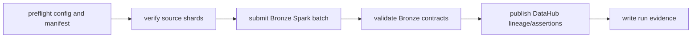
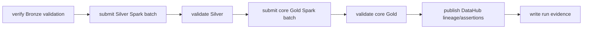
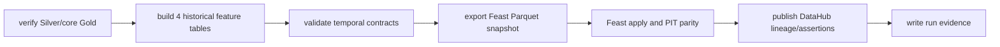
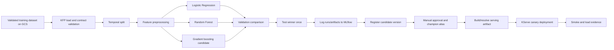

# Cloud Platform Refactor Design

> **Historical plan/spec — not current source of truth.**

## Trạng thái và mục tiêu

Trạng thái: **Approved for implementation planning**

Ngày: **2026-10-21**

Project GCP: **`ewallet-data-ai-platform-hg26`**

Region mặc định: **`asia-southeast1`**

Zone mặc định: **`asia-southeast1-b`**

Thiết kế này chuyển E-Wallet Data & AI Platform từ một lakehouse chạy chủ yếu
trên laptop với Docker, MinIO và BashOperator sang một kiến trúc cloud có thể
tái tạo bằng code. Mục tiêu của refactor là đáp ứng rubric khóa học bằng một
pipeline end-to-end có thể chứng minh được: dữ liệu quy mô lớn trên cloud,
orchestration, lineage, feature store, ML pipeline, experiment tracking, model
registry, serving trên Kubernetes, CI/CD, versioning, monitoring và evidence.

Project ưu tiên kiến trúc chạy đúng, reproducible và dễ giải thích. CPU được
ưu tiên; accuracy tối đa và GPU không phải mục tiêu. Mọi tài nguyên phải có
giới hạn chi phí, cách scale down và runbook dọn dẹp vì project dùng Free Trial.

Spec này chỉ khóa kiến trúc. Nó không tạo tài nguyên GCP, không sửa pipeline,
không sinh 100 GB dữ liệu, không chạy Spark và không deploy Kubernetes.

## Những gì được giữ lại

Refactor giữ nguyên các tài sản đã được kiểm chứng từ Phase 1 và F1-F8:

- generator có multi-account, legitimate device churn và bốn fraud scenarios;
- schema evolution V1/V2, duplicate semantics và balance semantics;
- Spark transformations Bronze, Silver, Gold hiện tại;
- bốn Gold historical feature tables và luật thời gian `[T-window, T)`;
- DataHub lineage theo dependency thực tế;
- Feast point-in-time retrieval và timestamp microsecond;
- F7 training contract gồm 41 model features và temporal split;
- F8 modeling, evaluation và Random Forest baseline;
- data contracts, validation rules và các evidence lịch sử.

Refactor thay cách cấu hình, lưu trữ, đóng gói và thực thi. Nó không tự ý đổi
fraud semantics, feature formulas, Gold grain hoặc label definition.

## Ngoài phạm vi của refactor nền tảng

- Không đổi Delta Lake sang Iceberg chỉ để giống repository tham khảo.
- Không đưa MinIO lên GKE làm canonical storage.
- Không chạy full 100 GB trong pull request hoặc CI.
- Không tự động promote model thành production.
- Không triển khai GPU.
- Không đưa secret, service-account key hoặc credential vào Git.
- Không xây toàn bộ LLM/RAG/Agent trong cùng changeset refactor data platform.
- Không cố giữ mọi service chạy 24/7 trong Free Trial.

## Bài học áp dụng từ repository tham khảo

Repository `itsmekhoathekid/RecSys-MLops` được dùng làm tài liệu tham khảo về
cách tổ chức MLOps, không được copy nguyên kiến trúc lưu trữ. Những pattern được
áp dụng gồm:

1. tách deployable application khỏi reusable platform code;
2. có cấu hình theo môi trường;
3. có image catalog và build image theo component;
4. Terraform chia module, Helm chia release unit;
5. CI phát hiện component thay đổi và dùng immutable image tag;
6. tách data pipeline, feature pipeline, materialization và retraining;
7. có test taxonomy và evidence mapping theo rubric;
8. có runbook vận hành, rollback và cleanup.

Khác biệt có chủ đích:

- E-Wallet dùng **GCS + Delta Lake** làm canonical storage;
- E-Wallet dùng **Ansible** để cấu hình Jenkins VM;
- E-Wallet giữ `data_platform/` và `ai_platform/` vì đây là domain boundaries
  đã ổn định, thay vì di chuyển toàn bộ source sang một layout mới.

## Kiến trúc đích

```mermaid
flowchart LR
    GEN[Generator jobs] --> RAW[GCS source/raw]
    RAW --> DP1[Airflow DP1: raw to Bronze]
    DP1 --> BRONZE[GCS Delta Bronze]
    BRONZE --> DP2[Airflow DP2: Bronze to Silver and core Gold]
    DP2 --> SILVER[GCS Delta Silver]
    DP2 --> GOLD[GCS Delta core Gold]
    SILVER --> DP3[Airflow DP3: historical features]
    GOLD --> DP3
    DP3 --> FEATURE_GOLD[GCS Delta feature Gold]
    FEATURE_GOLD --> FEAST_OFFLINE[Feast Offline snapshot on GCS]
    FEAST_OFFLINE --> KFP[Kubeflow training pipeline]
    KFP --> MLFLOW[MLflow Tracking and Registry]
    MLFLOW --> APPROVAL[Manual champion approval]
    APPROVAL --> KSERVE[KServe model endpoint]
    FEATURE_GOLD --> MATERIALIZE[Feast materialization job]
    MATERIALIZE --> REDIS[Feast Online Store]
    KSERVE --> API[Fraud inference API]
    REDIS --> API
    DP1 --> DATAHUB[DataHub lineage and assertions]
    DP2 --> DATAHUB
    DP3 --> DATAHUB
```



### Nền tảng thực thi

| Workload | Runtime đích | Lý do |
|---|---|---|
| Generator theo shard | GKE Job hoặc batch VM | idempotent, parallel, có thể resume |
| Spark 100 GB | Dataproc Serverless | không giữ cluster khi idle, phù hợp batch |
| Spark fallback | Spark Operator trên GKE | dùng nếu Delta dependency không tương thích Dataproc |
| Airflow | Helm trên GKE | UI, scheduler và DAG orchestration |
| Feature materialization | Kubernetes Job/Airflow | job ngắn, có parity validation |
| Kubeflow Pipelines | GKE | rubric ML pipeline và component visualization |
| MLflow | Helm trên GKE | tracking UI và model registry |
| PostgreSQL | GKE stateful dev deployment hoặc Cloud SQL nếu ngân sách cho phép | MLflow metadata |
| Redis | GKE dev deployment | Feast Online Store |
| KServe | GKE | model serving chuẩn Kubernetes |
| Jenkins | Compute Engine VM | CI/CD controller do Ansible quản lý |
| DataHub | GKE khi cần evidence, có thể scale down | metadata, lineage và assertions |

Dataproc Serverless phải vượt qua smoke test Delta Lake trước khi được chọn
chính thức. Nếu connector/package không tương thích, Spark Operator là fallback
đã định trước chứ không phải thay đổi kiến trúc khẩn cấp.

## Cấu trúc repository đích

```text
ewallet-data-ai-platform/
├── apps/
│   ├── fraud_inference_api/
│   ├── feature_gateway/
│   └── agent_gateway/                  # giai đoạn Agent
├── ai_platform/
│   ├── features/feast/
│   ├── ml/
│   ├── llm/                            # giai đoạn LLM
│   └── agents/                         # giai đoạn Agent
├── configs/
│   ├── environments/
│   │   ├── local/
│   │   ├── dev/
│   │   └── gcp/
│   └── schemas/
├── data_platform/
│   ├── generation/
│   ├── ingestion/
│   ├── processing/
│   ├── quality/
│   ├── contracts/
│   ├── metadata/
│   ├── orchestration/
│   └── storage/
├── images/
│   ├── catalog.yaml
│   ├── data/
│   ├── ml/
│   ├── serving/
│   └── agentic/
├── infra/
│   ├── docker/                         # local development only
│   ├── terraform/gcp/
│   ├── ansible/
│   └── helm/
├── jenkins/
│   ├── Jenkinsfile
│   └── scripts/
├── ops/
│   ├── gcp/
│   ├── validation/
│   └── runbooks/
├── pipelines/
│   └── kubeflow/
├── tests/
│   ├── unit/
│   ├── contract/
│   ├── integration/
│   ├── e2e/
│   └── load/
└── docs/
    ├── architecture/
    ├── evidence/
    └── runbooks/
```

`apps/` chỉ chứa process có thể deploy và nhận traffic. Transformation,
feature computation và training library vẫn nằm trong `data_platform/` hoặc
`ai_platform/`; điều này tránh copy logic vào API image.

## Cấu hình theo môi trường

### Quy tắc

Một biến `EWALLET_ENV` chọn profile `local`, `dev` hoặc `gcp`. Code tải một
runtime settings object đã validate. Business code nhận URI và endpoint qua
settings hoặc dependency injection; không tự ghép `s3a://`, `gs://` hay
`localhost` ở nhiều file.

Ví dụ cấu hình:

```yaml
environment: gcp
project_id: ewallet-data-ai-platform-hg26
region: asia-southeast1

storage:
  scheme: gs
  canonical_bucket: ${EWALLET_DATA_BUCKET}
  source_root: gs://${EWALLET_DATA_BUCKET}/source
  bronze_root: gs://${EWALLET_DATA_BUCKET}/lakehouse/bronze
  silver_root: gs://${EWALLET_DATA_BUCKET}/lakehouse/silver
  gold_root: gs://${EWALLET_DATA_BUCKET}/lakehouse/gold
  feast_root: gs://${EWALLET_DATA_BUCKET}/features/offline

metadata:
  datahub_gms_url: ${DATAHUB_GMS_URL}

feature_store:
  online_store: redis
  redis_connection_string: ${FEAST_REDIS_CONNECTION_STRING}
```

`${...}` phải được resolve từ environment, Kubernetes Secret hoặc workload
identity. Thiếu required value phải fail ở preflight, trước khi Spark/job bắt
đầu.

### Local profile

Local profile tiếp tục hỗ trợ Docker Compose và dataset nhỏ. MinIO chỉ là một
adapter local, không phải canonical cloud lake. Local references được giữ nếu
được đặt trong `configs/environments/local/`; reference rải trong source code
phải được loại bỏ.

### GCP profile

GCP profile dùng GCS URI, Workload Identity và service endpoints trong cluster.
Không lưu absolute developer path. Project ID, bucket name và registry location
là Terraform outputs hoặc environment values.

## Storage và versioning

### GCS là canonical truth

```text
gs://<data-bucket>/
├── source/
│   └── ewallet/<dataset_version>/<table>/part-*.parquet
├── manifests/
│   └── ewallet/<dataset_version>/manifest.json
├── lakehouse/
│   ├── bronze/<dataset_version>/<table>/_delta_log/
│   ├── silver/<dataset_version>/<table>/_delta_log/
│   └── gold/<dataset_version>/<table>/_delta_log/
├── features/
│   ├── offline/<dataset_version>/<feature_view>/
│   └── materialization/<dataset_version>/
├── training/<dataset_version>/<training_version>/
├── mlflow-artifacts/
├── pipeline-artifacts/
└── evidence/<run_id>/
```

`dataset_version` là immutable, ví dụ `fraud-v2-20261021`. Một manifest chứa:

- generator config checksum;
- source Git SHA;
- seed và shard plan;
- row count, byte count và checksum theo table/shard;
- schema version;
- thời gian tạo;
- trạng thái `IN_PROGRESS`, `VALIDATED` hoặc `FAILED`.

Alias `current` chỉ được cập nhật sau validation. Pipeline không ghi đè một
dataset version đã validated. Lifecycle rule được dùng cho temporary objects;
canonical version không tự hết hạn trong thời gian chấm bài.

### Delta Lake trên GCS

Bronze, Silver và Gold tiếp tục là Delta Lake. Writer phải dùng GCS connector
và GCP identity. Không xóa file Delta trực tiếp. Retention/VACUUM chỉ chạy bằng
runbook có dry-run, snapshot/version evidence và giới hạn dataset rõ ràng.

### Feast snapshot

Parquet cho Feast Offline là generated artifact được export từ Gold Delta. Nó
phải giữ `timestamp[us, UTC]`, row/key parity và source dataset version. Khi
Gold version đổi, snapshot cũ không được dùng cho retrieval mới.

## Sinh dataset 100 GB

Generator hiện tại được giữ semantics nhưng entrypoint phải hỗ trợ sharding:

```text
dataset_version + global_seed + shard_id + shard_count
    -> deterministic rows for one shard
    -> write temporary shard
    -> validate schema/count/checksum
    -> atomically mark shard complete in manifest
```

Yêu cầu:

- cùng config, seed và shard plan tạo cùng logical data;
- mỗi shard có bounded memory;
- retry không tạo duplicate logical records;
- job có thể resume các shard chưa hoàn tất;
- không collect toàn dataset trên driver;
- output file có kích thước hợp lý cho Spark, tránh hàng nghìn small files;
- labels, transaction/user/account/device consistency giữ nguyên;
- có estimate trước khi chạy về rows, bytes, runtime và chi phí.

Các cổng quy mô:

1. unit/fraud-dev;
2. local hoặc cloud smoke khoảng 1 GB;
3. cloud pilot khoảng 10 GB;
4. canonical ít nhất 100 GB khi ba tầng đầu PASS.

Không được nhảy thẳng lên 100 GB. Mỗi cổng phải ghi evidence và xác nhận dung
lượng GCS trước/sau chạy.

## Spark 100 GB phải chứng minh giá trị engineering

100 GB không chỉ là con số dung lượng để hoàn thành rubric. Dataset lớn phải
được dùng để tái hiện các vấn đề Spark mà generator đã cố ý tạo ra, áp dụng kỹ
thuật phù hợp, đo tác động và giải thích kết quả. Đây là một acceptance gate của
canonical run và là nguồn evidence để thuyết trình, viết CV và trả lời phỏng
vấn.

### Các mục đích tối ưu bắt buộc

| Vấn đề có chủ đích | Workload/đặc điểm dữ liệu | Kỹ thuật cần đánh giá | Điều cần chứng minh |
|---|---|---|---|
| Merchant-key skew | 5% merchant nhận khoảng 80% payment traffic | AQE skew handling, pre-aggregation, salting nếu plan thực sự cần | phân phối key, skewed partitions, shuffle/spill và runtime |
| High-cardinality | `transaction_id` gần như unique | exact `count_distinct` so với `approx_count_distinct` | sai số, runtime, shuffle và tài nguyên |
| Fact-to-dimension joins | fact transaction lớn, dimensions nhỏ hơn | broadcast join so với sort-merge join | physical plan, network shuffle và runtime |
| Time-range reads | transaction trải trên nhiều ngày/tháng | partition pruning, predicate pushdown và column projection | số file/bytes scan trước và sau |
| Large Delta writes | Bronze/Silver/Gold tạo nhiều output files | repartition/coalesce có kiểm soát, target file size và compaction | file count/size distribution và downstream scan time |
| Shuffle-heavy transforms | dedup, window và aggregation | shuffle partition sizing và AQE partition coalescing | task distribution, spill, stage duration |
| Reused intermediates | một DataFrame được dùng nhiều action trong cùng job | cache/persist có chọn lọc và `unpersist` | recomputation tránh được so với memory pressure |
| Incremental rerun | retry/reprocess cùng dataset version | idempotent write và partition-scoped processing | không duplicate, không rewrite phần không liên quan |

Không áp dụng salting, broadcast, cache hay repartition theo thói quen. Mỗi kỹ
thuật cần một dấu hiệu trong profile/physical plan và một giả thuyết có thể đo.
Nếu baseline đã tốt hoặc kỹ thuật làm chậm workload, kết quả đó vẫn là evidence
hợp lệ và kỹ thuật không được đưa vào production config.

### Protocol benchmark

Mỗi experiment phải giữ cố định:

- cùng immutable dataset version và cùng input rows;
- cùng business query và output contract;
- cùng runtime class/region khi so sánh;
- correctness checksum hoặc aggregate parity;
- cold/warm-run policy được ghi rõ;
- Spark version, Delta version, worker shape và toàn bộ config thay đổi.

10 GB chỉ là pilot để xác minh correctness, kiểm tra event-log/metrics capture
và loại sớm các cấu hình sai hoặc quá tốn kém. Kết quả 10 GB không được dùng làm
claim tối ưu cuối cùng vì workload này có thể chưa tạo đủ shuffle pressure,
spill, long-tail task hoặc small-file amplification.

Benchmark authoritative chạy trên full canonical 100 GB và cùng immutable
dataset version:

1. chạy end-to-end baseline bằng safe defaults, ghi vào run path riêng;
2. profile Spark UI/event log để chọn các vấn đề thực sự xuất hiện;
3. chạy targeted baseline/optimized experiments trên full relevant 100 GB
   input cho merchant skew, high-cardinality, join, scan và write workloads;
4. chạy end-to-end optimized pipeline vào một run path khác;
5. so sánh output checksum/count trước khi chọn optimized output làm canonical.

Targeted experiment cần ít nhất ba lần đo cho mỗi cấu hình nếu cost estimate
nằm trong experiment budget; median là số chính và min/max/variance được lưu.
End-to-end baseline và optimized chạy ít nhất một lần thành công mỗi bên. Chạy
thêm một confirmation pair khi variance, retry hoặc noisy-neighbor signal làm
kết luận chưa đáng tin. Không lặp lại 100 GB chỉ để chọn con số đẹp.

### Metrics và evidence cần thu

- end-to-end và stage/task runtime;
- input/output rows và correctness checksum;
- input bytes, output bytes và file count/size distribution;
- shuffle read/write, spill memory/disk và skewed task distribution;
- executor CPU time, peak memory và failed/retried tasks;
- physical plan trước/sau, gồm join strategy và partition pruning;
- Spark event log và screenshot Spark UI thật khi có thể;
- Dataproc/GKE resource shape và estimated/actual cloud cost;
- giải thích vì sao kết quả nhanh hơn, không đổi hoặc chậm hơn.

Machine-readable result được lưu dưới
`docs/evidence/cloud/spark/<dataset_version>/<experiment_id>.json`. Hình ảnh
được lưu dưới `docs/assets/spark/cloud/`. Bản giải thích dành cho người đọc nằm
trong `docs/cloud/spark_100gb_optimization.md`; bảng tổng hợp current truth cập
nhật vào `docs/07_performance_benchmarks.md`.

### Tiêu chuẩn claim trên CV

Chỉ ghi con số đã đo và có evidence trong repository. Câu claim cần nêu rõ:

- scale dữ liệu;
- workload được tối ưu;
- kỹ thuật được áp dụng;
- baseline và kết quả sau tối ưu;
- môi trường chạy;
- trade-off về accuracy, cost hoặc complexity nếu có.

Ví dụ cấu trúc claim sau khi có số liệu thật:

```text
Processed a measured 100+ GB Delta Lake workload on GCP and reduced
<measured stage/runtime/shuffle metric> by <measured value> using
<validated technique>, while preserving row-count and checksum parity.
```

Placeholder trên không được đưa vào CV cho tới khi số liệu canonical tồn tại.

## Ba Airflow DAG chính

### DP1 — Source to Bronze

File đích: `data_platform/orchestration/airflow/dags/dp1_source_to_bronze.py`



Input: immutable source Parquet version trên GCS.

Output: Bronze Delta version và validation evidence.

DP1 không gọi generator ngầm; generation là một explicit upstream job.

### DP2 — Bronze to Silver and core Gold

File đích:
`data_platform/orchestration/airflow/dags/dp2_bronze_to_curated.py`



Core Gold gồm dimensions, facts, analytics và OBT. Historical feature tables
được tách khỏi DP2 để feature pipeline có lifecycle độc lập.

### DP3 — Historical feature tables and Feast Offline

File đích:
`data_platform/orchestration/airflow/dags/dp3_historical_features.py`



DP3 phải giữ bốn entity levels user/account/device/merchant, luật
`[T-window, T)`, same-timestamp semantics và không dùng `fraud_labels` để tính
feature.

### Chính sách chung cho DAG

- `max_active_runs=1` với canonical dataset;
- task retry chỉ dùng cho operation idempotent;
- timeout, CPU/memory request và batch ID được cấu hình;
- run ID và dataset version truyền rõ giữa tasks;
- manual trigger là mặc định trong giai đoạn coursework;
- task không phụ thuộc absolute local path hoặc local Conda interpreter;
- Spark chạy trong Dataproc/Spark Operator, không chạy trong scheduler process;
- failure phải lưu log/evidence đủ để debug;
- success chỉ được đánh dấu sau validation và metadata read-back.

Các DAG riêng về sau:

- `feast_materialize_online.py`;
- `fraud_drift_and_retrain.py`;
- `rag_index_refresh.py`.

Chúng không bị nhét vào ba DAG dữ liệu chính.

## DataHub

Lineage được derive từ implementation thực tế và dataset URI thực tế. Mỗi DAG
publish pipeline/job lineage, dataset lineage và assertion result. Read-back
phải xác nhận edge vừa publish.

Dependency tối thiểu hiện tại:

```text
silver.transactions -> gold.feat_user_behavior
silver.transactions -> gold.feat_account_behavior
silver.transactions -> gold.feat_device_behavior
silver.devices      -> gold.feat_device_behavior
silver.transactions -> gold.feat_merchant_behavior
```

Nếu implementation dùng thêm bảng, lineage phải phản ánh thêm dependency đó.
Không tạo edge `fraud_labels -> feature table`, Feast/ML edge hoặc stale MinIO
URN khi computation không dùng chúng. Existing core lineage phải được giữ.

DataHub screenshot chỉ được dùng nếu capture từ UI thật. Mermaid và API
read-back evidence luôn bắt buộc để tài liệu có thể kiểm tra không phụ thuộc UI.

## Feast Offline và Online

### Offline Store

Feast Offline tiếp tục dùng microsecond-safe Parquet snapshot từ Gold. GCP
profile đọc GCS; local profile có thể đọc local filesystem. Retrieval phải giữ:

- four entities and four FeatureViews;
- exact feature schema;
- point-in-time correctness;
- same-timestamp exclusion;
- merchant null/non-payment handling;
- Gold-to-Feast parity;
- không đưa fraud label vào FeatureView.

### Online Store

Redis là Feast Online Store trên GKE. Một DAG/job riêng materialize từ một
validated offline snapshot. Sau materialization phải kiểm tra:

- số entity keys expected/actual;
- sample parity Offline versus Online;
- freshness timestamp;
- null/default semantics;
- latency smoke test.

Online Store phục vụ inference API. Training tiếp tục dùng Offline Store để
tránh training-serving skew.

## MLflow, Kubeflow và model serving

F9 local design tại
`docs/superpowers/specs/2026-10-16-f9-mlflow-experiment-registry-design.md`
được giữ như historical design nhưng **không được triển khai nguyên trạng**.
Các phần localhost/MinIO/local process được thay bằng thiết kế cloud sau:



Candidate set là cấu hình, không hardcode trong KFP component. Test set chỉ
được dùng một lần cho validation winner. Metric selection và threshold policy
được version cùng config.

MLflow dùng PostgreSQL cho backend store và GCS cho artifact store. MLflow
client/server version phải pin. Registry promotion cần manual approval vì đây
là coursework có operator learning objective.

KServe deploy model bằng immutable model version/image digest. Fraud inference
API nhận request, lấy feature online từ Feast, gọi predictor, trả probability,
decision, model version và trace ID. API không nhận label hoặc historical
aggregate do client tự tính.

## LLM, RAG và Agent boundaries

Cloud refactor chuẩn bị chỗ cho workload rubric còn lại nhưng không triển khai
chúng trong data refactor:

- `ai_platform/llm/`: document ingestion, chunking, embedding, vector retrieval;
- `ai_platform/agents/`: tools, MCP client/server và A2A workflow;
- `apps/agent_gateway/`: authenticated external API/gateway;
- `pipelines/kubeflow/`: RAG index/evaluation pipeline nếu phù hợp;
- `infra/helm/agentic/`: deployment unit riêng.

LLM/Agent dùng outputs đã kiểm soát của platform và không truy cập trực tiếp
credential hoặc raw storage bằng hardcoded key.

## Infrastructure as Code

### Terraform

`infra/terraform/gcp` có cấu trúc:

```text
infra/terraform/gcp/
├── bootstrap/                         # remote state bucket bootstrap
├── environments/dev/
├── modules/
│   ├── project_services/
│   ├── network/
│   ├── storage/
│   ├── iam/
│   ├── artifact_registry/
│   ├── gke/
│   ├── dataproc/
│   └── jenkins_vm/
└── versions.tf
```

Terraform quản lý:

- required APIs;
- VPC/subnets/firewall tối thiểu;
- GCS buckets, lifecycle và versioning;
- Artifact Registry repositories;
- service accounts, Workload Identity và least-privilege IAM;
- GKE cluster/node pools;
- Dataproc Serverless prerequisites;
- Jenkins VM, disk và network tags;
- remote Terraform state.

Terraform không cài application Helm release. Output cung cấp cluster name,
bucket names, registry paths, service accounts và Jenkins IP cho bước sau.

State bootstrap là hai bước có tài liệu rõ ràng: tạo state bucket một lần, sau
đó chuyển backend sang GCS. `terraform.tfstate`, plan binary và credentials
không được commit.

### Ansible

`infra/ansible` cấu hình Jenkins VM qua SSH:

```text
roles/
├── common/
├── docker/
├── gcloud/
├── kubectl/
├── helm/
└── jenkins/
```

Inventory lấy từ Terraform output. Playbook phải idempotent và xác minh version.
SSH private key không vào repo. Jenkins dùng Workload Identity Federation hoặc
service account phù hợp; tránh long-lived JSON key nếu có thể.

### Helm

Helm release units:

- `ewallet-airflow`;
- `ewallet-feature-store`;
- `ewallet-mlflow`;
- `ewallet-ml-platform`;
- `ewallet-serving`;
- `ewallet-datahub`;
- `ewallet-observability`;
- `ewallet-agentic` ở giai đoạn sau.

Mỗi chart có dev values, resource requests/limits, probes, service account,
config/secret references và persistence policy. Không copy secret vào
`values.yaml`.

## Container image catalog

`images/catalog.yaml` là danh sách nguồn sự thật cho build/deploy:

| Image | Nội dung | Consumer |
|---|---|---|
| `generator` | generator + config loader | GKE batch Job |
| `spark-data` | Spark jobs + GCS/Delta deps | Dataproc/Spark Operator |
| `airflow` | DAGs + providers | Airflow Helm |
| `feast` | Feast repo/materialization/validation | DP3 and materialization |
| `ml-training` | F7/F8 library + KFP component deps | Kubeflow |
| `fraud-inference` | serving contract/API | KServe/API |
| `datahub-publisher` | lineage/assertion publisher | Airflow tasks |
| `agent-gateway` | future Agent API | agentic release |

Images dùng multi-stage build, non-root user, pinned base/dependencies và
`.dockerignore`. CI tag bằng Git SHA; deployment dùng digest hoặc immutable
SHA tag, không dùng `latest`.

## Jenkins CI/CD

Pipeline chính:

```text
checkout
  -> detect changed components
  -> lint/static validation
  -> unit + contract tests
  -> integration tests phù hợp
  -> build affected images
  -> vulnerability/dependency scan
  -> push Git-SHA images to Artifact Registry
  -> terraform validate/plan when infra changes
  -> helm lint/template
  -> manual approval for dev deployment
  -> deploy in dependency order
  -> smoke tests and evidence capture
  -> rollback on failed health gate
```

Dependency order:

```text
base cluster/config
  -> observability and shared stores
  -> Airflow/DataHub/Feast/MLflow/Kubeflow
  -> serving APIs
  -> agent gateway
```

PR CI không sinh 100 GB, không chạy full Spark pipeline và không promote model.
Nó dùng fraud-dev hoặc fixture. Canonical data run, model promotion và serving
rollout cần manual approval.

## Test taxonomy

| Loại | Ví dụ | Khi chạy |
|---|---|---|
| Unit | config parsing, fraud rules, feature formulas | mọi PR |
| Contract | schema, 41/50 columns, DAG config, Helm schema | mọi PR |
| Integration | GCS adapter, Delta smoke, Feast/Redis, MLflow | affected PR/dev |
| E2E | 1 GB raw-to-serving pipeline | release gate |
| Load | Spark 10/100 GB, API latency, Feast lookup | scheduled/manual |

Các historical tests được di chuyển theo taxonomy mà không đổi assertion. Mọi
test dùng explicit fixture/profile; test không dựa vào developer home directory.

## Documentation và evidence lifecycle

Mỗi changeset phải cập nhật tài liệu trong cùng bước triển khai, không để dồn
toàn bộ documentation đến cuối project. Một task chỉ được xem là hoàn thành khi
code, validation, current documentation và machine-readable evidence đồng bộ.

### Khi nào ghi đè tài liệu hiện tại

Tài liệu mô tả **current truth** được sửa trực tiếp khi implementation tương
ứng đã chạy và PASS:

| Tài liệu | Cập nhật khi |
|---|---|
| `README.md` | command chính, architecture hoặc deployment state thay đổi |
| `docs/00_system_architecture.md` | cloud component/data flow trở thành current |
| `docs/01_data_generator.md` | sharding, manifest hoặc canonical scale thay đổi |
| `docs/03_batch_pipeline.md` | GCS/Delta DP1-DP3 trở thành operational |
| `docs/06_airflow_orchestration.md` | DAG/task/runtime/trigger thay đổi |
| `docs/07_performance_benchmarks.md` | có baseline/optimized measurement mới |
| `docs/08_datahub_lineage.md` | cloud URN/edge/assertion đã publish và read-back |
| `docs/ml/*.md` | Feast/training/MLflow/serving contract trở thành current |
| `docs/README.md` | thêm hoặc thay link tới tài liệu active |

Không được viết tài liệu current như thể một bước đã hoàn thành trước khi run
evidence PASS. Historical result được giữ và gắn nhãn rõ, không sửa số đo cũ để
khớp kiến trúc mới.

### Khi nào tạo tài liệu mới

Tạo file mới cho một capability, runbook hoặc decision độc lập:

```text
docs/cloud/gcp_foundation.md
docs/cloud/gcs_delta_lake.md
docs/cloud/spark_100gb_optimization.md
docs/cloud/jenkins_cicd.md
docs/cloud/kubernetes_operations.md
docs/ml/kubeflow_mlflow_pipeline.md
docs/ml/feast_online_serving.md
docs/ml/kserve_inference.md
docs/llm/<capability>.md
docs/agents/<capability>.md
docs/runbooks/<operation>.md
```

Design decision lớn được giữ thành spec/ADR riêng để người review thấy lý do
chọn và rejected alternatives. Run-specific JSON, screenshots và logs tóm tắt
được tạo mới; không ghi đè evidence lịch sử.

### Template bắt buộc cho mỗi checkpoint

Mỗi checkpoint document phải trả lời được:

1. Mục tiêu và lý do cần bước này.
2. Code/config nằm ở đâu.
3. Input, output và data contract thực tế.
4. Command hoặc UI path người vận hành đã dùng.
5. Baseline/current behavior trước thay đổi.
6. Thay đổi implementation và lý do chọn.
7. Validation, số đo và evidence.
8. Cách đọc log và ít nhất một failure mode thường gặp.
9. Chi phí/tài nguyên và cách stop/cleanup.
10. Kết quả nào có thể trình bày với thầy hoặc đưa vào CV.

Mỗi tài liệu kỹ thuật phải liên kết tới source file và evidence tương ứng. Mục
tiêu là người sở hữu project có thể review lại, chạy lệnh, đọc log và giải thích
quyết định mà không phụ thuộc vào lịch sử chat.

## Mapping thay đổi theo file/module

| Hiện tại | Refactor dự kiến | Invariant phải giữ |
|---|---|---|
| `data_platform/generation/config/settings.yaml` | tách dataset semantics khỏi output location; thêm version/shard config | fraud distribution và canonical semantics |
| `data_platform/generation/src/offline/offline_generator.py` | thêm deterministic shard entrypoint/writer interface | schema và ID consistency |
| `data_platform/generation/src/offline/fraud.py` | chỉ thay wiring nếu cần | bốn scenarios và PRE-T semantics |
| `data_platform/processing/spark/common/spark_session.py` | build Spark session từ runtime storage profile | transformation results |
| `data_platform/processing/spark/silver/delta_silver_io.py` | nhận Bronze/Silver URI từ config | Silver schema/quality |
| `data_platform/processing/spark/gold/delta_gold_io.py` | nhận Silver/Gold URI từ config | Gold grain/features |
| `data_platform/quality/validate_bronze.py` | URI/config adapter và machine-readable result | validation rules |
| `data_platform/quality/validate_silver.py` | URI/config adapter và evidence | validation rules |
| `data_platform/quality/validate_gold.py` | URI/config adapter và evidence | validation rules |
| `data_platform/contracts/*.yml` | storage URI template hoặc logical asset name | schema contracts |
| `data_platform/orchestration/airflow/dags/ewallet_batch_pipeline.py` | supersede bằng DP1/DP2/DP3; giữ làm historical reference trước khi remove | task ordering/validation gates |
| `data_platform/metadata/datahub/lineage/create_lineage.py` | environment-aware URNs/endpoints; DAG run metadata | actual dependency graph |
| `data_platform/metadata/datahub/assertions/publish_assertions.py` | publish from structured validation evidence | assertion meaning |
| `data_platform/storage/scripts/minio_client.py` | local adapter only | local dev support |
| `data_platform/storage/scripts/init_storage.py` | local bootstrap; GCP bootstrap chuyển sang Terraform | no destructive default |
| `data_platform/storage/scripts/register_trino_tables.py` | local/optional query integration | không block canonical pipeline |
| `ai_platform/features/feast/feature_repo/feature_store.yaml` | profile-rendered offline/online config | four entities/views |
| `ai_platform/features/feast/sources/export_gold_to_parquet.py` | GCS Delta source + versioned GCS snapshot | timestamp/parity |
| `ai_platform/ml/training/*` | GCS input/output and KFP-compatible entrypoints | F7 temporal contract |
| `ai_platform/ml/modeling/*` | component-safe pure library | F8 evaluation behavior |
| F9 local spec | historical/superseded by cloud F9 design | model comparison principles |
| `infra/docker/*` | local dev only | small local integration environment |
| new `configs/environments/*` | central environment settings | no scattered endpoint literals |
| new `infra/terraform/gcp/*` | provision cloud primitives | reproducibility |
| new `infra/ansible/*` | configure Jenkins host | idempotency |
| new `infra/helm/*` | deploy cluster workloads | versioned release/rollback |
| new `pipelines/kubeflow/*` | train/evaluate/register workflow | temporal split and leakage guard |
| new `jenkins/*` | CI/CD orchestration | immutable build/deploy |

## Security và secret management

- Dùng user ADC chỉ cho local Terraform/development.
- Workload trên GKE dùng Workload Identity.
- Jenkins dùng identity riêng với quyền build/deploy tối thiểu.
- Không dùng owner credential trong pipeline.
- Secret runtime dùng Secret Manager hoặc Kubernetes Secret được tạo ngoài Git.
- Bucket IAM tách data writer, data reader, training, serving và CI roles.
- Public IP/service chỉ mở khi cần demo; firewall source range được giới hạn.
- MLflow, Airflow, DataHub và Kubeflow UI không public vô điều kiện.
- Log phải redact credential, token, card/billing data và connection password.
- Git/CI có secret scan trước push image/deploy.

## Cost guardrails

1. Budget alerts đã được tạo; Terraform không được xóa hoặc nới chúng.
2. GKE dùng node pool CPU nhỏ, autoscaling và scale-to-zero nơi hỗ trợ.
3. Dataproc batch tồn tại theo job, không tạo cluster thường trực mặc định.
4. DataHub/Kubeflow/MLflow có runbook scale down khi không demo.
5. Không dùng GPU.
6. GCS temporary/staging có lifecycle cleanup.
7. Trước 10 GB/100 GB run phải estimate storage, compute và expected duration.
8. Mỗi run canonical có cleanup ownership; không xóa dataset validated ngoài ý muốn.
9. CI không chạy workload tốn kém nếu chỉ sửa docs hoặc unit code.
10. Daily cost check và anomaly alert là bước vận hành bắt buộc trong 11 ngày.

## Trình tự triển khai

### R0 — Khóa baseline và evidence

- xác nhận Git sạch, tag/commit baseline đã push;
- inventory local source, ignored runtime artifacts và historical evidence;
- mapping rubric mới sang implementation/evidence;
- không đưa generated data trở lại Git.

### R1 — Config và storage abstraction

- tạo environment config loader;
- chuyển hardcoded path/endpoint sang profile;
- giữ local smoke tests;
- thêm GCS adapter tests;
- chưa đổi business transformations.

### R2 — Terraform foundation

- bootstrap remote state;
- provision APIs, GCS, IAM, Artifact Registry, VPC;
- provision cost-bounded GKE/Dataproc prerequisites;
- provision Jenkins VM;
- ghi outputs và destroy/scale-down runbook.

### R3 — Containerization, Ansible và Helm foundation

- build image catalog;
- configure Jenkins VM bằng Ansible;
- deploy shared cluster prerequisites bằng Helm;
- smoke identity, GCS access và image pull.

### R4 — Generator cloud pilot

- implement deterministic shards;
- run fraud-dev/unit;
- run 1 GB smoke rồi 10 GB pilot;
- validate manifest, resume, schema và fraud invariants.
- tạo `docs/cloud/gcs_delta_lake.md` và cập nhật generator current docs.

### R5 — Airflow DP1/DP2/DP3

- tách DAG;
- submit Spark batch thay local BashOperator;
- publish validation evidence và DataHub read-back;
- run end-to-end 1 GB before scale.
- cập nhật architecture, batch, Airflow và DataHub current docs.

### R6 — Canonical 100 GB

- estimate and approve run;
- dùng 10 GB pilot để kiểm tra correctness, instrumentation và thu hẹp candidate config;
- generate source shards to GCS;
- chạy full 100 GB end-to-end baseline vào isolated run path;
- profile baseline và chạy targeted baseline/optimized experiments trên full 100 GB input;
- chạy full 100 GB optimized DP1, DP2, DP3 vào isolated run path;
- validate counts/contracts/lineage và baseline/optimized output parity;
- capture physical plans, Spark metrics, cost, runtime, storage and UI evidence;
- tạo Spark optimization narrative và cập nhật performance benchmark current truth.

### R7 — Feast Online

- deploy Redis;
- materialize validated feature version;
- prove offline/online parity, freshness và lookup latency.

### R8 — Kubeflow + MLflow

- compile/run multi-model KFP pipeline;
- record child/parent MLflow runs;
- compare validation candidates;
- register winner; operator manually approves champion.

### R9 — KServe và API

- deploy champion canary;
- integrate Feast Online lookup;
- smoke, load test, logs, metrics và rollback evidence.

### R10 — LLM/RAG/Agent và gateway

- implement rubric-specific RAG, MCP/A2A, evaluation và gateway;
- reuse CI/CD, observability, secret and deployment patterns.

### R11 — Final evidence and demo

- one reproducible demo path;
- architecture, logs, UI screenshots, lineage, MLflow/KFP/KServe evidence;
- cost/cleanup report;
- final rubric checklist và interview/debug runbook.

## Rollback strategy

- Data: immutable dataset versions; reset `current` alias to last validated.
- Spark: rerun idempotent batch against same input version into a new run path.
- Images: Helm rollback to previous Git-SHA image.
- Model: move champion alias back and rollback KServe revision.
- Infrastructure: Terraform plan before apply; destructive changes require review.
- Config: environment profile versioned with Git SHA and deployment evidence.

Rollback không xóa evidence của failed run; failed manifest/log được giữ để
debug.

## Acceptance criteria cho cloud refactor

- [ ] Local fraud-dev path vẫn chạy với profile `local`.
- [ ] GCP resources được Terraform tạo từ clean checkout.
- [ ] Jenkins VM được Ansible cấu hình idempotently.
- [ ] Helm render/lint và deployment smoke PASS.
- [ ] Không có developer absolute path hoặc committed secret.
- [ ] GCS là canonical source/Bronze/Silver/Gold storage.
- [ ] Delta Lake đọc/ghi trên GCS PASS.
- [ ] Generator deterministic shards/resume PASS.
- [ ] DP1, DP2 và DP3 chạy độc lập và end-to-end.
- [ ] Data contracts và DataHub read-back PASS.
- [ ] 100 GB source volume được đo, không chỉ extrapolate.
- [ ] Spark 10 GB pilot chỉ dùng cho correctness/instrumentation/config narrowing.
- [ ] Spark 100 GB end-to-end baseline và optimized outputs có checksum/count parity.
- [ ] Targeted Spark baseline/optimized experiments dùng full relevant 100 GB input.
- [ ] Spark 100 GB runs ghi physical plan, shuffle/spill, partition/file và cost metrics.
- [ ] Mọi Spark optimization claim có baseline, số đo và evidence; negative result được giải thích.
- [ ] Feast Offline PIT/parity PASS.
- [ ] Feast Online materialization/parity PASS.
- [ ] Kubeflow multi-model pipeline PASS.
- [ ] MLflow tracking, artifacts, registry và manual champion PASS.
- [ ] KServe endpoint và inference API PASS.
- [ ] CI build/push/deploy dùng immutable Git SHA.
- [ ] Monitoring, logs, rollback và cleanup có evidence.
- [ ] LLM/RAG/Agent/gateway đáp ứng phần rubric tương ứng.
- [ ] Final demo có runbook cho người vận hành tự chạy và debug.
- [ ] Mỗi implementation checkpoint đã cập nhật current docs hoặc tạo tài liệu mới phù hợp.

## Cổng quyết định còn lại

Ba quyết định được đo bằng smoke test, không đoán trước:

1. **Dataproc Serverless hay Spark Operator:** chọn sau Delta-on-GCS smoke.
2. **GKE node sizing:** chọn sau đo peak CPU/RAM của 1 GB và service baseline.
3. **Cloud SQL hay PostgreSQL trên GKE:** chọn theo Free Trial cost estimate;
   coursework dev có thể dùng PostgreSQL trên GKE nếu backup/restore được chứng
   minh.

Các cổng này không thay đổi domain architecture hoặc contract dữ liệu.

## Bước tiếp theo sau khi spec được duyệt

Sau khi người dùng review spec này, tạo implementation plan theo changeset nhỏ,
bắt đầu từ R0/R1. Changeset đầu tiên chỉ thêm config model và tests, rồi chuyển
từng I/O boundary sang profile. Không provision cloud và refactor source trong
cùng commit.
