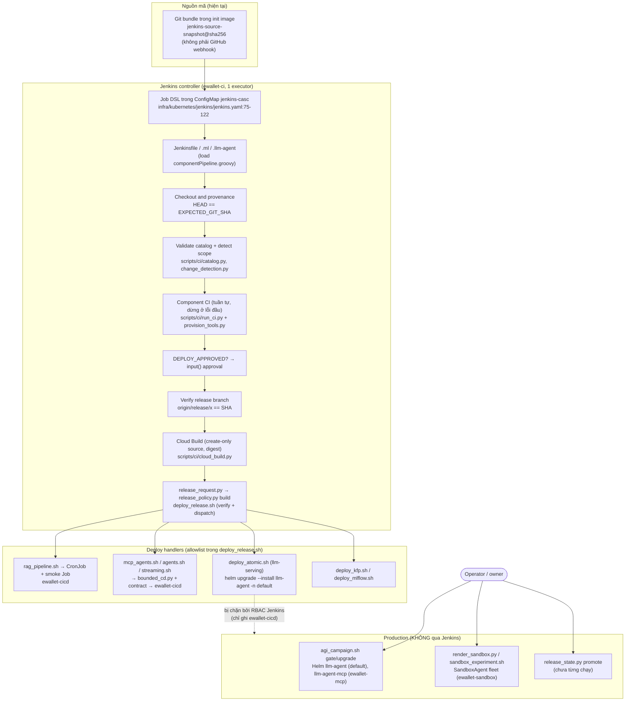
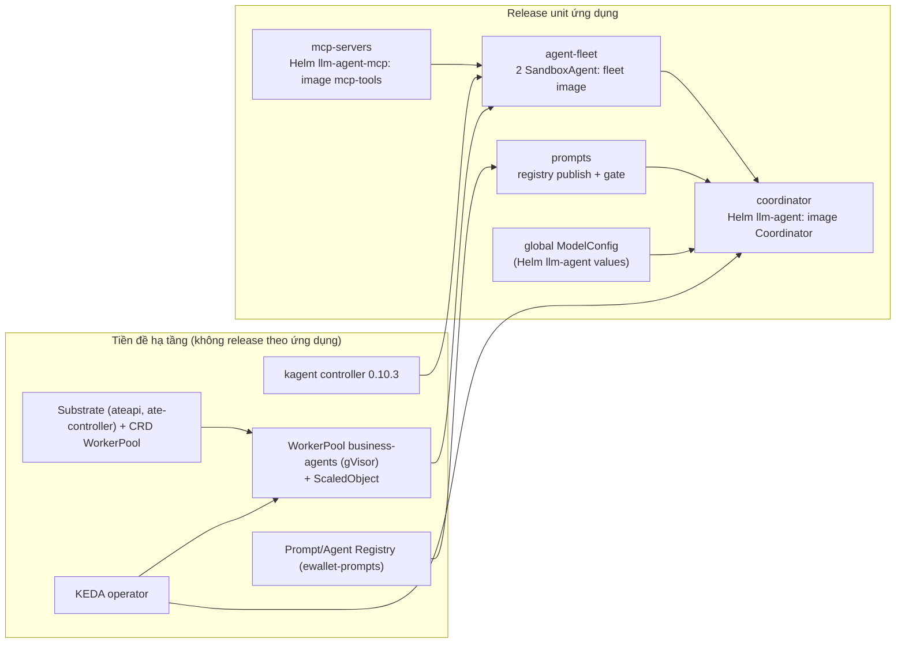
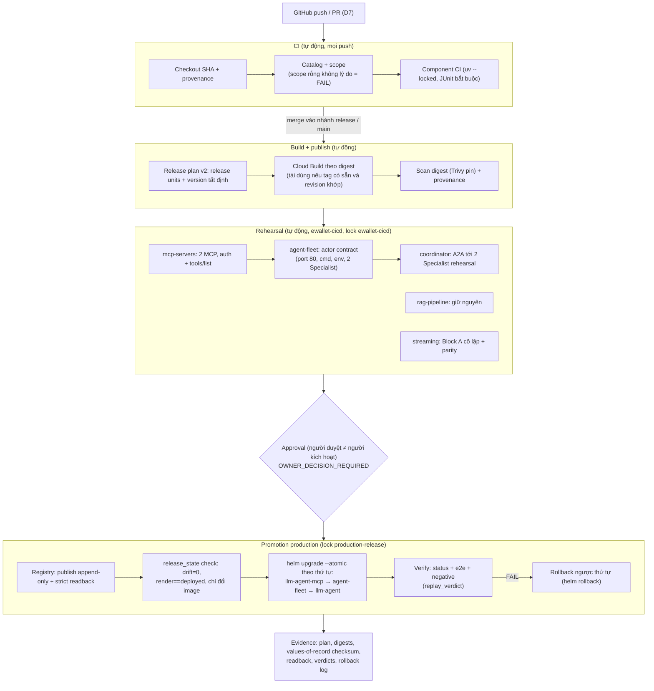

# CI/CD P0 Audit — EDAI-2 (Jenkins, Agent Platform, Streaming, RAG)

| Mục | Giá trị |
|---|---|
| Phạm vi | Audit-only (P0). Không triển khai P1–P4. |
| Nhánh | `feature/edai2-cicd-rebuild`, tạo từ `98b71e30e51914f25ad17974debffadbdaca2487` |
| Ngày | 2026-11-17 |
| Tác động tới hệ thống | Không liên hệ GKE, không chạy Jenkins, không Cloud Build, không ghi Artifact Registry/Agent Registry, không đổi IAM/RBAC/Terraform |
| Nguồn rubric | Không đọc được Google Sheet chính thức (connector Google Drive chưa được cấp quyền trong phiên này). Dùng yêu cầu rows 33–36 do owner cung cấp trong đề bài, và `docs/edai2/RUBRIC_EVIDENCE_INDEX.md` làm nguồn phụ. Không tự thêm yêu cầu. |
| Repo tham chiếu TA | `itsmekhoathekid/RecSys-MLops` @ `6bd6e99` (clone read-only vào scratchpad; chỉ đọc tài liệu và cấu trúc, không sao chép code) |

Quy ước trạng thái kiểm chứng: `SOURCE_IMPLEMENTED`, `OFFLINE_TESTED`, `JENKINS_CI_VERIFIED`, `STAGING_CD_VERIFIED`,
`PRODUCTION_CD_VERIFIED`, `LIVE_VERIFICATION_PENDING`, `NOT_IMPLEMENTED`, `OBSOLETE`. Quy ước xử lý source:
`KEEP`, `REFACTOR`, `REPLACE`, `REMOVE`.

---

## 1. Executive Summary

**Kiến trúc hiện tại, một câu:** Jenkins (một controller trong `ewallet-ci`) chạy một shared pipeline
(`jenkins/pipeline/componentPipeline.groovy`) điều khiển bằng dữ liệu (`jenkins/catalog/components.json`): xác định
component thay đổi → chạy test trong môi trường `uv --locked` → (nếu được duyệt) build image bằng Cloud Build theo
Git SHA → lập release plan chỉ dùng digest → chạy *deploy handler* của component. Tuy nhiên, mọi handler
CD hiện tại chỉ ghi được vào namespace cô lập `ewallet-cicd` (rehearsal), còn **production Agent Platform được release
thủ công** bằng `scripts/llm_agent/agi_campaign.sh` (Helm `--atomic` có gate) và bằng các script experiment cho
SandboxAgent fleet.

**Những gì thực sự hoạt động (có bằng chứng):**
- Khung CI: catalog validation, merge-base change detection, dependency closure, `uv lock --check` + `uv sync --locked`,
  JUnit, evidence trên mọi kết quả. `tests/ci` 235/235 pass offline hôm nay; 16/16 `uv.lock` khớp `pyproject.toml`.
  Đã chạy thật trên Jenkins trước đây (N9, 2026-11-04) → `JENKINS_CI_VERIFIED` ở commit cũ, chưa chạy lại ở `98b71e30`.
- Build provenance: `scripts/ci/cloud_build.py` dựng `git archive <sha>`, upload create-only, Cloud Build với builder
  pin digest, `requestedVerifyOption: VERIFIED`, Artifact Registry `immutable_tags = true`, manifest ghi digest.
- RAG CD (row 33): build `edai2-cd-rag-pipeline` #8 đã chạy thật (Cloud Build `c38e6e96`, `rag-ingestion@sha256:f89ecfa7…`,
  CronJob trong `ewallet-cicd` cập nhật digest, smoke Job PASS, production không đổi) → `STAGING_CD_VERIFIED`.
- Release policy fail-closed: thiếu approval, branch, SHA, digest, hoặc kế hoạch sai thứ tự → từ chối
  (`scripts/ci/release_policy.py`).

**Chỉ hoàn thành một phần:**
- MCP/Agent/Coordinator CD (rows 34–35): handler và contract có, test offline có, nhưng **chưa từng chạy trên
  Jenkins** và **kiểm chứng một topology đã lỗi thời** (BYO Specialist Deployment), không phải SandboxAgent fleet hiện
  tại.
- Prompt Management (row 34): registry + gate kiểm tra registry khớp Git, nhưng **runtime không đọc prompt từ registry**:
  Coordinator dùng `SYSTEM_PROMPT` hard-code (`ai_platform/llm_agent/nl_intake.py:66`).
- Streaming CD (row 36): chỉ là smoke Job kiểm tra job plan / event semantics từ image `flink-benchmark`, không Kafka,
  không Flink cluster, không ghi Offline/Online Store.

**Lỗi thời (OBSOLETE):** `jenkins/cd/agents.contract.json` + `infra/kubernetes/cicd-runtime/agents/agents-cd.yaml`
(BYO Specialist), mapping `feature-rag-specialist` trong `scripts/ci/release_state.py:41-45`, ma trận
`jenkins/cd/production-rbac-matrix.json` (nhắc Agent CR `feature-rag-specialist`, "Declarative" `drift-specialist`).

**Rủi ro chính:**
1. `llm-serving` có deploy handler `scripts/llm_agent/deploy_atomic.sh` chạy
   `helm upgrade --install llm-agent … --namespace default` chỉ với `values-<env>.yaml` — đúng tên/namespace của
   release production — và sẽ **ghi đè live values** nếu được thực thi với quyền production. Hiện chỉ RBAC của Jenkins
   chặn nó (CICD-P0-F01, Critical).
2. Không có cơ chế release nào (Jenkins hay Helm) quản lý SandboxAgent fleet; promotion Feature-RAG trong
   `release_state.py` là no-op im lặng (đã chứng minh offline: 0 thay đổi render).
3. CI có thể "xanh" khi không chạy test nào (diff rỗng + `junit allowEmptyResults: true`).

**Chiến lược đề xuất:** giữ khung CI/catalog/build/policy (đã đúng và đã được kiểm thử), **thêm một lớp "release unit"
tách khỏi CI component**, thay các contract Agent/Streaming lỗi thời bằng rehearsal phản ánh đúng runtime, và đưa
production promotion về một đường duy nhất dựa trên Helm (tái dùng kiểm tra của `release_state.py` và gate của
`agi_campaign.sh`) sau một approval gate. Không viết framework thứ hai.

---

## 2. Current CI/CD Architecture

### 2.1 Luồng thực thi thực tế

- Đường liền: đã cài đặt và (một phần) đã chạy. `H1` đã chạy thật (#6, #8). `H2` chưa chạy trên Jenkins.
  `H3`/`H4` có trong code nhưng không thể thành công với RBAC hiện tại.
- `PROD` là nơi production thực sự thay đổi: thủ công, ngoài Jenkins.

### 2.2 Các cơ chế cụ thể

| Câu hỏi | Trả lời (bằng chứng) |
|---|---|
| Job được định nghĩa thế nào | Job DSL trong `infra/kubernetes/jenkins/jenkins.yaml:75-122`: 4 job CI-proof (`edai2-ml-ci`, `edai2-agent-ci`, `edai2-docs-change-detection`, `edai2-agent-negative`) và 5 job release (`edai2-cd-mcp-agents`, `edai2-cd-agents`, `edai2-cd-rag-pipeline`, `edai2-cd-prompt-management`, `edai2-cd-streaming`). |
| Commit được chọn thế nào | Tham số `EXPECTED_GIT_SHA`; stage đầu thất bại nếu `git rev-parse HEAD` khác (`componentPipeline.groovy:30-38`). Nguồn là Git bundle `/opt/ewallet-source/repository.bundle` từ init image có digest; init container kiểm tra sha256 của bundle (`jenkins.yaml:157-165`). |
| CI/CD được kích hoạt thế nào | Thủ công, có tham số. Không có SCM trigger, webhook hay polling. `DEPLOY_APPROVED=false` mặc định. |
| Chọn component | `change_detection.resolve_git_scope`: `git merge-base HEAD TARGET_BRANCH`, `git diff --name-only`, khớp tiền tố dài nhất trong `source_paths`, rồi reverse dependency closure (`scripts/ci/change_detection.py:36-110`). `shared_paths` hoặc file không có owner → chạy toàn bộ. Profile lọc theo `profiles` (`run_ci.py:195-203`). |
| Stage chạy thế nào | `run_ci.execute_components`: với mỗi Python project được chọn `uv lock --check` và `uv sync --locked`, rồi các `commands` của component; **tuần tự**, dừng ở lệnh lỗi đầu tiên (`run_ci.py:96-145`). |
| Công bố test | Mỗi lệnh `-m unittest`/`-m pytest` được bọc để sinh JUnit (`run_ci.py:53-72`); Jenkins `junit allowEmptyResults: true` (`componentPipeline.groovy:157`). |
| Build artifact | Chỉ khi `DEPLOY_APPROVED` và không có `IMAGE_MANIFEST`: `cloud_build.release_image_specs` lấy các component có `release_artifact_selector` dạng `images/<name>` (`cloud_build.py:202-223`). |
| Approval | `input(... submitterParameter: 'APPROVED_BY')` (`componentPipeline.groovy:85-90`); authz `loggedInUsersCanDoAnything` với một user admin (`jenkins.yaml:59-67`). Build #8 ghi `approved_by: admin`. |
| Release thành công khi nào | `release_policy verify` PASS rồi từng handler exit 0 (`deploy_release.sh:27-79`). Với `bounded_cd.py`: Deployment Ready, image đọc lại đúng digest, smoke Job thành công và summary khớp contract (`bounded_cd.py:284-341`). |
| Lỗi và rollback | `bounded_cd.py` khôi phục Deployment trước đó (replicas 0) hoặc xoá lần deploy đầu (`bounded_cd.py:326-332`); `rag_pipeline.sh` áp lại CronJob trước đó (`rag_pipeline.sh:67-85`). Tự động rollback **chưa từng được kích hoạt** bởi lỗi thật hay lỗi chủ động. |

### 2.3 Logic trùng lặp, không dùng tới, hoặc phức tạp thừa

| Mục | Vấn đề |
|---|---|
| `Jenkinsfile.rag` | Không có job Job DSL nào trỏ tới nó; `edai2-cd-rag-pipeline` dùng `Jenkinsfile.llm-agent` (`jenkins.yaml:120`). Đây là pipeline song song, không reachable, nhưng vẫn được tài liệu (`docs/edai2/cicd/CICD.md:53`) mô tả như pipeline RAG. Nó chứa hai gate có giá trị (Trivy, DAG parse trong Airflow thật) mà shared pipeline không có. |
| `legacy_path_components` | Được validate bắt buộc khác rỗng (`catalog.py:61-62`) nhưng không được change detection hay release dùng. |
| `declareParameters` | Nhánh `properties([...disableConcurrentBuilds()...])` chỉ chạy khi `declareParameters: true` (`componentPipeline.groovy:6-20`); không Jenkinsfile nào truyền giá trị này → `disableConcurrentBuilds` không áp dụng cho job seed. |
| Handler `deploy_kfp.sh`, `deploy_mlflow.sh`, `deploy_atomic.sh` | Allowlist trong `deploy_release.sh:56-73` nhưng không thể thành công với RBAC Jenkins; `deploy_atomic.sh` còn nguy hiểm (F01). |
| `ci-platform` component | Chứa cả `ops/gcp/cloud_lab.py`, `ops/experiments`, `scripts/experiments` → thay đổi tooling experiment kéo theo test CI framework (gộp trách nhiệm). |

---

## 3. Component Inventory

Chỉ liệt kê các phần có vai trò CI/CD. "Trạng thái" theo quy ước ở đầu tài liệu.

| Đường dẫn | Trách nhiệm | Phụ thuộc | Entrypoint | Đích deploy | Trạng thái | Xử lý | Bằng chứng / lý do |
|---|---|---|---|---|---|---|---|
| `Jenkinsfile`, `Jenkinsfile.ml`, `Jenkinsfile.llm-agent` | 5 dòng: load shared pipeline với profile | `componentPipeline.groovy` | Job DSL | — | `JENKINS_CI_VERIFIED` (N9, commit cũ) | KEEP | Mỏng, đúng mục đích. |
| `Jenkinsfile.rag` | Pipeline RAG độc lập (Trivy, DAG parse, trigger DAG) | `infra/docker/rag-ingestion` | không có job | Airflow API | `OBSOLETE` (không reachable) | REMOVE (sau khi chuyển Trivy + DAG parse vào catalog) | `jenkins.yaml:112-122` không seed nó. |
| `jenkins/pipeline/componentPipeline.groovy` | Stage chung, approval, build, deploy, JUnit, archive | `scripts/ci/*` | `run(profile)` | — | `JENKINS_CI_VERIFIED`; CD: `STAGING_CD_VERIFIED` (RAG) | REFACTOR | Thêm lock, fail khi scope rỗng, release unit; giữ cấu trúc. |
| `jenkins/catalog/components.json` | Nguồn sự thật cho component/test/build/handler | — | đọc bởi `catalog.py` | — | `OFFLINE_TESTED` | REFACTOR | Lệch kiến trúc Sandbox-only (F08), `llm-serving` handler (F01). |
| `scripts/ci/catalog.py` | Load + validate (duplicate key, path tồn tại, acyclic, `|| true` bị cấm) | — | `python -m scripts.ci.catalog validate` | — | `OFFLINE_TESTED` (PASS hôm nay) | KEEP | Validator tốt; cần mở rộng schema cho release unit ở P1. |
| `scripts/ci/change_detection.py` | Merge-base diff, longest-prefix ownership, reverse closure | catalog | `--head --target-ref` | — | `OFFLINE_TESTED` | KEEP | Fail-safe (unmapped → chạy toàn bộ). Lỗ hổng scope rỗng xử lý ở pipeline (F07). |
| `scripts/ci/run_ci.py`, `junit_unittest.py`, `evidence.py` | Chạy lệnh, JUnit, evidence + lock hash | uv | `--scope --evidence-dir` | — | `JENKINS_CI_VERIFIED` (commit cũ) | KEEP | Dừng ở lỗi đầu; evidence ghi cả khi lỗi. |
| `scripts/ci/provision_tools.py`, `jenkins/ci-tools.json` | Tải helm v3.22.0 theo URL + sha256 archive + sha256 binary | — | stage Component CI | — | `OFFLINE_TESTED` | KEEP | Fail-closed khi checksum lệch. |
| `scripts/ci/cloud_build.py` | `git archive` + create-only source + Cloud Build + digest | Workload Identity, buckets | stage Build | Artifact Registry | `STAGING_CD_VERIFIED` (RAG #6, #8) | REFACTOR (nhỏ) | Không có đường tái dùng image khi chạy lại cùng SHA (AR immutable tags) (F11). |
| `scripts/ci/release_request.py`, `release_policy.py` | Request → plan có thứ tự phụ thuộc, digest-only | catalog | stage Deploy | — | `STAGING_CD_VERIFIED` (RAG) | REFACTOR | Thiếu khái niệm release unit ghép MCP→Agent (F05). |
| `scripts/ci/deploy_release.sh` | Verify plan, dispatch handler allowlist | plan | stage Deploy | — | `STAGING_CD_VERIFIED` (RAG) | REFACTOR | Bỏ nhánh `deploy_atomic.sh` (F01). |
| `scripts/ci/bounded_cd.py`, `k8s_api.py`, `cd_smoke.py` | Rehearsal theo contract trong `ewallet-cicd`, rollback, park | in-cluster SA token | handler | `ewallet-cicd` | `OFFLINE_TESTED` | KEEP (`bounded_cd.py`, `k8s_api.py`); REFACTOR (`cd_smoke.py`) | Cơ chế tốt; nội dung contract lỗi thời. |
| `scripts/ci/deploy/rag_pipeline.sh`, `jenkins/cd/rag-pipeline.contract.json`, `scripts/ci/verify_rag_smoke.py`, `infra/kubernetes/cicd-runtime/rag/` | RAG CD: CronJob + smoke Job + verdict + rollback | Cloud Build image | handler | `ewallet-cicd` | `STAGING_CD_VERIFIED` (#8) | KEEP | Đã chạy thật; xem §8. |
| `scripts/ci/deploy/mcp_agents.sh`, `jenkins/cd/mcp-agents.contract.json`, `cicd-runtime/mcp/mcp-cd.yaml` | Rehearsal MCP (chỉ `mcp-cd-drift`) | image `mcp-tools` | handler | `ewallet-cicd` | `SOURCE_IMPLEMENTED`, `OFFLINE_TESTED` | REFACTOR | Chỉ một trong hai MCP server (F05). |
| `scripts/ci/deploy/agents.sh`, `jenkins/cd/agents.contract.json`, `cicd-runtime/agents/agents-cd.yaml` | Rehearsal Coordinator + BYO Feature-RAG Deployment | image `g3-byo-coordinator`, prompt registry | handler | `ewallet-cicd` | `OBSOLETE` | REPLACE | Topology BYO, không có Drift, không có SandboxAgent (F02). |
| `scripts/ci/deploy/streaming.sh`, `jenkins/cd/streaming.contract.json`, `cicd-runtime/streaming/streaming-cd.yaml` | Smoke job plan / event semantics | image `flink-block-a` | handler | `ewallet-cicd` | `OFFLINE_TESTED` (Docker local) | REPLACE | Không Flink, không Kafka, không sink (F09). |
| `scripts/llm_agent/deploy_atomic.sh` (vai trò handler `llm-serving`) | `helm upgrade --install llm-agent -n default -f values-<env>.yaml` | — | handler | **release production** | `SOURCE_IMPLEMENTED` | REMOVE (khỏi catalog CD) | F01. |
| `scripts/ci/release_state.py` | drift / check (render bằng live values, chỉ đổi image) / promote (`helm upgrade --atomic`) | helm, kubectl | thủ công | `llm-agent`, `llm-agent-mcp` | `OFFLINE_TESTED`; drift/check đã chạy read-only trên production (2026-11-06, theo `PRODUCTION_ROLLOUT_RBAC.md`); promote chưa từng chạy | REFACTOR | Thiết kế đúng (Helm là writer duy nhất); mapping lỗi thời (F04). |
| `scripts/llm_agent/agi_campaign.sh` | Production gate (render, identity diff, server dry-run) + `helm upgrade --atomic` theo package, approval theo campaign | helm, kubectl | thủ công | production | Đã dùng cho mọi release production gần đây (thủ công) | KEEP (làm cơ sở cho promotion) | Gate mạnh nhất repo; không thuộc Jenkins. |
| `scripts/experiments/render_sandbox.py`, `infra/kubernetes/agent-sandbox/fleet.yaml.tmpl` | Render 2 SandboxAgent + ServiceAccount, image digest | — | thủ công | `ewallet-sandbox` | Production fleet do đây tạo, ngoài Helm | REFACTOR (đưa vào release unit) | F03. |
| `ops/llm_agent/prompt_registry.py`, `registry_catalog.py`, `infra/helm/llm-agent-platform/prompts/manifest.json` | Resolve/gate prompt theo sha256; readback registry | agentregistry | thủ công / `bounded_cd` | `ewallet-prompts` | `OFFLINE_TESTED`; registry runtime đã kiểm chứng (2026-11-03) | KEEP | Thiếu tiêu thụ ở runtime (F02-b). |
| `infra/kubernetes/jenkins/jenkins.yaml`, `infra/docker/jenkins-controller/` | Controller, CasC, Job DSL, NetworkPolicy, Workload Identity | — | `render_jenkins_runtime.py` | `ewallet-ci` | Đã chạy (gen 13, 2026-11-04) | REFACTOR | Nguồn bundle, authz, lock plugin (F06, F11, F12). |
| `infra/kubernetes/jenkins/rbac/batch-b-isolated.yaml` | Role ghi `ewallet-cicd` + `ewallet-prompts` | — | thủ công | `ewallet-cicd` | Đã áp dụng (theo `CICD.md §4.4`) | KEEP | Least privilege đúng. `cd-rbac.yaml` được nhắc tới nhưng không tồn tại (F13). |
| `jenkins/cd/production-rbac-matrix.json`, `production-rollout-rbac.proposed.yaml`, `rbac/batch-d*`, `scripts/ci/rbac_matrix.py` | Đề xuất cũ: Jenkins patch trực tiếp Deployment production | — | test | — | `OBSOLETE` (đã bị owner bác) | REMOVE (archive) | F13. |
| `infra/terraform/gcp/modules/cicd_build`, `artifact_registry` | GSA Jenkins/Cloud Build, custom role, buckets, AR immutable tags | — | Terraform | GCP | Đã áp dụng (Batch A) | KEEP | Thiết kế IAM hẹp, tách runner. |

---

## 4. Rubric Compliance Matrix

Rubric chính thức không đọc được (xem đầu tài liệu). Cột "Yêu cầu" dùng nội dung owner cung cấp. Trạng thái tự báo cáo
trong `docs/edai2/RUBRIC_EVIDENCE_INDEX.md:80-83` (33 COMPLETE, 34–36 PARTIAL) **không** được coi là bằng chứng.

| Row | Yêu cầu | Cài đặt hiện có | Source | Test hiện có | Artifact | Cơ chế deploy | Bằng chứng thực tế | Thiếu chứng minh | Gap | Khắc phục đề xuất | Tiêu chí chấp nhận |
|---|---|---|---|---|---|---|---|---|---|---|---|
| 33 RAG | CI/CD (test + build + auto-deploy), Jenkins execution, giải thích stage, link Jenkinsfile | Job `edai2-cd-rag-pipeline` → `Jenkinsfile.llm-agent` → shared pipeline → handler `rag_pipeline.sh` | `jenkins.yaml:120`, `components.json:218`, `scripts/ci/deploy/rag_pipeline.sh` | `tests/ci/test_verify_rag_smoke.py`, RAG suites trong catalog | `rag-ingestion@sha256:f89ecfa7…` (Cloud Build `c38e6e96`) | CronJob suspended + smoke Job trong `ewallet-cicd`, Redis tạm | Build #8 SUCCESS 347.8 s, 246 test pass / 62 skip, verdict PASS, production 127 object không đổi; rollback thủ công sau đó về `1dd91888…` (`~/ewallet-evidence/n10-final-cloud-e2e-20261104/E2-cd/`, screenshot `cicd/07–09`) | Raw log #8 nằm ngoài repo; auto-rollback chưa kích hoạt; DAG Airflow thật không được cập nhật/kích hoạt; trigger thủ công | Nhỏ: tài liệu mâu thuẫn (F10); Jenkinsfile được link (`Jenkinsfile.rag`) không phải pipeline đã chạy | Giữ nguyên CD; sửa tài liệu và đưa evidence #8 (đã sanitize) vào repo; chuyển Trivy + DAG parse vào catalog | Tài liệu link đúng `Jenkinsfile.llm-agent` + shared pipeline; evidence #8 có checksum trong repo; một lần auto-rollback có lỗi chủ động trong `ewallet-cicd` (cần approval cloud) |
| 34 MCP + Data Agent | Build/package MCP trước khi deploy Agent phụ thuộc; system prompt từ Prompt Management; Jenkins execution | Job `edai2-cd-mcp-agents`/`edai2-cd-agents`; handler `bounded_cd` với contract MCP (drift) và Agent (BYO) | `jenkins/cd/mcp-agents.contract.json`, `agents.contract.json`, `cicd-runtime/{mcp,agents}` | `tests/ci/test_bounded_cd.py`; suite `mcp-agents`/`agents` | `mcp-tools`, `g3-byo-coordinator` (chưa từng build qua Jenkins) | Rehearsal `ewallet-cicd` | **Không có** Jenkins CD run. CI có (N9 `edai2-agent-ci`). | Toàn bộ CD; prompt từ registry ở runtime | (a) `release/agents` không kèm MCP (F05); (b) contract Agent lỗi thời (F02); (c) runtime không đọc prompt registry (F02-b); (d) chỉ một MCP (F05) | Release unit ghép `mcp-servers → agent-fleet`; rehearsal Sandbox-aware; Coordinator đọc prompt managed ConfigMap; production promotion qua Helm | Một Jenkins run: build MCP image → rehearsal 2 MCP → build fleet image → rehearsal 2 Specialist theo actor contract → verify prompt sha registry == sha runtime → (approved) promotion; tất cả trong cùng commit |
| 35 Coordinator | CI/CD Coordinator + build/deploy/verify phụ thuộc; Jenkins execution | Như row 34 (`agents` gom Coordinator + Feature-RAG) | như trên | `agents` suite | `g3-byo-coordinator` | Rehearsal `ewallet-cicd` | **Không có** CD run | Toàn bộ CD; verify phụ thuộc | Coordinator không có release unit riêng; verify hiện chỉ là agent card + malformed task | Release unit `coordinator` phụ thuộc `mcp-servers`, `agent-fleet`, `prompts`, ModelConfig; verify business E2E sau promotion (tái dùng `agent_replay.sh e2e`) | Jenkins run: plan liệt kê phụ thuộc; promotion `llm-agent` chỉ đổi image Coordinator (release_state check); E2E fraud/drift/combined COMPLETE |
| 36 Streaming | CI/CD streaming feature jobs ghi Offline + Online Store; Jenkins execution | Job `edai2-cd-streaming` → handler `streaming.sh` → smoke Job | `jenkins/cd/streaming.contract.json`, `cicd-runtime/streaming/streaming-cd.yaml` | `tests/streaming` (unittest), Docker local | `flink-block-a` (từ `infra/docker/flink-benchmark/Dockerfile`); image sinks **không** được build | Smoke Job, không Flink cluster | **Không có** Jenkins CD run; Block A thật chạy thủ công bởi `scripts/streaming/block_a_cloud.sh` | Deploy job thật, ghi Offline/Online, parity | F09 | Handler streaming v2: dựng Block A thật (Redpanda + Flink JM/TM + `flink run -d` + sink Jobs) trong namespace cô lập với store riêng, kiểm tra parity, teardown | Jenkins run: Flink job RUNNING với digest đã build; offline prefix và online store cô lập có bản ghi; parity PASS; teardown sạch |

---

## 5. Detailed Findings

Tóm tắt mức độ: **Critical 2 · High 6 · Medium 9 · Low 3** (20 finding).

### CICD-P0-F01 — Handler `llm-serving` có thể ghi đè release production `llm-agent` (Critical)
- **File:** `jenkins/catalog/components.json:187-197`; `scripts/ci/deploy_release.sh:63-66`; `scripts/llm_agent/deploy_atomic.sh:17-55`.
- **Vấn đề:** component `llm-serving` có `deploy_handler: scripts/llm_agent/deploy_atomic.sh` và selector `images/*`. Handler
  chạy `helm upgrade --install llm-agent <chart> -f values-<env>.yaml [EXTRA_VALUES] --namespace default --atomic`. Đây là
  đúng release production (`llm-agent`, namespace `default`). Lệnh không dùng live values, nên nếu thành công sẽ thay
  toàn bộ cấu hình production (overlay `g3`, `agi`, `specialists-sandbox-only`, digest đang chạy) bằng chart default +
  values môi trường.
- **Đường tới được:** `llm-serving` có `source_paths` rất rộng (`infra/helm/llm-agent-platform`, `scripts/llm_agent`,
  `tests/llm_agent`), nên đa số thay đổi agent đều chọn nó. Với release branch không trùng tên component
  (`catalog.release_components`, `catalog.py:134-145`) cả scope được giữ, và `release_policy` sẽ xếp `llm-serving` vào
  plan nếu manifest có image (`images/*` lấy mọi image).
- **Vì sao quan trọng:** thứ duy nhất ngăn thảm hoạ là RBAC hiện tại của Jenkins (chỉ ghi `ewallet-cicd`) và việc
  `KUBE_CONTEXT=in-cluster` không có trong kubeconfig. Bất kỳ việc mở quyền production nào (Option A/C ở §9) sẽ biến
  đây thành đường ghi đè production.
- **Sửa:** chuyển `llm-serving` thành không có deploy handler (hoặc `extension-only`) ở P1; xoá nhánh
  `deploy_atomic.sh` khỏi allowlist; production chỉ đi qua đường promotion Helm có kiểm tra live values (§11).
- **Kiểm thử:** test catalog khẳng định không handler nào có thể nhắm namespace production; test `deploy_release.sh`
  từ chối `scripts/llm_agent/deploy_atomic.sh`.
- **Rubric:** 34, 35 (an toàn release).

### CICD-P0-F02 — Agent CD kiểm chứng topology BYO lỗi thời; prompt registry không nằm trên đường runtime (Critical)
- **File:** `jenkins/cd/agents.contract.json`; `infra/kubernetes/cicd-runtime/agents/agents-cd.yaml:1-4,85-192`;
  `ai_platform/llm_agent/nl_intake.py:66`; `infra/helm/llm-agent-platform/templates/agents.yaml:43-60`;
  `infra/kubernetes/agent-sandbox/fleet.yaml.tmpl:1-8`.
- **(a) Topology:** rehearsal chạy `agent-cd-coordinator` và `agent-cd-specialist` (module
  `byo_feature_rag_specialist`) là Deployment cổng 8080 trong `ewallet-cicd`. Production Specialist là **SandboxAgent**
  trên WorkerPool `business-agents` (actor cổng 80, `cmd: /opt/venv/bin/python`, `PATH`/`PYTHONPATH` đặt tay, gVisor,
  route `/api/a2a-sandboxes/ewallet-sandbox/<agent>/`). Drift Specialist không có trong rehearsal. Chính file manifest
  nói smoke "reach no LLM or MCP… proves the A2A surface and request validation" (dòng 1-3). Contract chỉ đòi
  `card_status`, `card_name_matches`, `malformed_task_rejected`.
  Hậu quả: một fleet image hỏng theo các quy tắc actor của kagent (`infra/kubernetes/agent-sandbox/README.md`, bảng
  "What kagent requires") vẫn qua CD.
- **(b) Prompt:** contract đòi `requires_prompt_registry` và chạy `prompt_registry verify-all` (registry khớp
  `prompts/manifest.json`). Nhưng runtime không tiêu thụ prompt đó:
  - Coordinator gửi `SYSTEM_PROMPT` hard-code (`nl_intake.py:66`, dùng ở dòng 259);
  - Specialist chỉ có hằng `PROMPT_REVISION` (`byo_feature_rag_specialist.py:85`, `byo_drift_specialist.py:82`);
  - chart vẫn render ConfigMap `<agent>-prompt-<version>` có annotation sha256 (`agents.yaml:48-60`) nhưng BYO Agent
    không mount `systemMessageFrom`;
  - SandboxAgent fleet là "Typed path only" (`fleet.yaml.tmpl:8`), không có prompt.
  Kết luận "drift specialist deployed prompt byte-identical to registry v2" trong `docs/edai2/cicd/CICD.md:153` thuộc
  thời Declarative agent, nay `OBSOLETE`.
- **Vì sao quan trọng:** row 34 yêu cầu rõ "Agent system prompts must originate from a Prompt Management tool". CD
  hiện tại có thể PASS mà không chứng minh điều đó.
- **Sửa:** REPLACE contract/manifest Agent bằng rehearsal Sandbox-aware (F02a). Đưa prompt registry vào đường runtime
  của Coordinator (`promptSource: registry` + đọc file prompt khi khởi động + báo `prompt_sha256` trong agent card hay
  `/version`) — đây là thay đổi production, cần owner (D4).
- **Kiểm thử:** offline: render chart với `promptSource: registry` và xác nhận Coordinator mount ConfigMap managed;
  unit test Coordinator đọc prompt từ file và từ chối sha lệch. Live (`LIVE_VERIFICATION_PENDING`): sha prompt Coordinator
  báo ra == sha registry version.
- **Rubric:** 34, 35.

### CICD-P0-F03 — SandboxAgent fleet không thuộc bất kỳ cơ chế release nào (High)
- **File:** `infra/kubernetes/agent-sandbox/fleet.yaml.tmpl`; `scripts/experiments/render_sandbox.py:21-41`;
  `scripts/experiments/sandbox_experiment.sh:109`; `docs/edai2/agents/AGENT_PLATFORM_COMPLETION.md:193-195` ("The fleet
  is not Helm-managed: it is 2 SandboxAgents, image only, approved separately").
- **Vấn đề:** hai SandboxAgent production được tạo bởi công cụ experiment, không qua Helm, không qua Jenkins.
  `release_state.declared_images` chỉ biết `Agent`, `Deployment`, `StatefulSet` (`release_state.py:83-91`), nên drift
  của fleet không được phát hiện.
- **Vì sao quan trọng:** đây là release unit trung tâm của row 34 (Data Agent) mà không có đường CD, rollback hay drift
  check nào.
- **Sửa:** quyết định chủ sở hữu (D3): đưa fleet thành Helm release riêng (khuyến nghị: chart nhỏ cho
  `ewallet-sandbox`: 2 SandboxAgent + ServiceAccount, WorkerPool vẫn thuộc Substrate) hoặc một promoter riêng có drift
  check. Mở rộng `declared_images` cho `SandboxAgent`.
- **Kiểm thử:** offline render equality với manifest đang chạy (live: `LIVE_VERIFICATION_PENDING`); test drift với
  SandboxAgent giả.
- **Rubric:** 34.

### CICD-P0-F04 — `release_state.py` promotion Feature-RAG là no-op im lặng (High)
- **File:** `scripts/ci/release_state.py:41-45,147-150,216-227`.
- **Vấn đề:** `PROMOTABLE["llm-agent"]` có `feature-rag-specialist → agents.specialists.feature-rag-specialist.byo.image`.
  Với `agi/specialists-sandbox-only.yaml` (runtime: sandbox), chart không render object nào dùng giá trị đó.
- **Chứng minh offline (P0):** render chart bằng bộ overlay của `tests/llm_agent/test_agi_chart.py` (AGENTS + AGI_AGENTS
  + SANDBOX_ROUTES + `specialists-sandbox-only.yaml`), áp promotion Feature-RAG: **0 thay đổi**; Agent CR duy nhất là
  `fraud-coordinator`. Promotion Coordinator: 1 thay đổi, 0 thay đổi ngoài image (đúng).
  `check_promotion` vì vậy báo 0 problem, `promote` chạy `helm upgrade` không đổi gì, và drift check sau đó PASS → báo
  thành công giả. Drift Specialist không promotable.
- **Sửa:** bỏ entry Feature-RAG; thêm "promotion phải tạo ít nhất một thay đổi image cho mỗi image được yêu cầu"
  (fail nếu 0); promotion fleet đi qua release unit của F03.
- **Kiểm thử:** test render thật (đã có helm cục bộ) khẳng định promotion không tạo thay đổi → exit khác 0.
- **Rubric:** 34.

### CICD-P0-F05 — Không có release unit ghép MCP → Agent; MCP rehearsal chỉ một server (High)
- **File:** `scripts/ci/catalog.py:134-145`; `scripts/ci/release_policy.py:47-70,140-143`;
  `jenkins/cd/mcp-agents.contract.json`; `infra/kubernetes/cicd-runtime/mcp/mcp-cd.yaml:1-4,28-51`.
- **Vấn đề:**
  - `release_components` thu hẹp `release/agents` thành `["agents"]` và `release/mcp-agents` thành
    `["mcp-agents"]`. Đã chứng minh offline: scope `[mcp-agents, agents]` + `release/agents` → plan chỉ `agents`.
    Thứ tự MCP-trước-Agent chỉ tồn tại trong một plan, nên chỉ có với release branch không trùng tên component (và lúc đó
    kéo theo cả scope, kể cả F01).
  - Rehearsal MCP chỉ chạy `mcp-cd-drift` với backend "unavailable"; `feature-rag-mcp` không được rehearsal.
  - Production MCP là release `llm-agent-mcp` (`ewallet-mcp`, 2 replica, PDB) nhưng CD không có bước nào chạm tới hay
    so sánh với nó.
- **Vì sao quan trọng:** row 34 đòi "Build and package MCP Servers before deploying the dependent Agent".
- **Sửa:** release unit tường minh (ví dụ `data-agent = [mcp-servers, agent-fleet]`, `coordinator = [mcp-servers,
  agent-fleet, prompts, coordinator]`) độc lập với CI component; rehearsal cả hai MCP server.
- **Kiểm thử:** test plan: `release/data-agent` → `mcp-servers` trước `agent-fleet`; thiếu digest MCP → từ chối.
- **Rubric:** 34, 35.

### CICD-P0-F06 — Không có trigger tự động và nguồn GitHub (High)
- **File:** `infra/kubernetes/jenkins/jenkins.yaml:75-122,157-165`; `infra/kubernetes/jenkins/README.md`.
- **Vấn đề:**
  - Job đọc Git bundle đóng gói trong init image. README thừa nhận đây là "staging-only substitute for a Git webhook".
  - Không job nào có trigger.
  - Mọi CD đều do người chạy với tham số và `input`.
  - Sau khi deploy thành công, rehearsal để workload ở 0 replica (`bounded_cd._parked`, `bounded_cd.py:248-249,333-337`)
    hoặc CronJob suspended; không có môi trường nào chạy bản mới một cách bền vững.
- **Vì sao quan trọng:** rubric định nghĩa "CI/CD = test + build + auto-deploy". Hiện tại có test + build + *rehearsal
  có duyệt*, chưa có auto-deploy tới runtime thật.
- **Sửa:** Jenkins đọc GitHub (multibranch hoặc webhook, cần owner/cloud: D7), CI tự động trên push/PR, CD tự động tới
  staging rehearsal khi merge, production promotion sau approval (§11).
- **Kiểm thử:** Job DSL test (đã có `tests/ci/test_jenkins_runtime_contract.py`) cho trigger; live:
  `LIVE_VERIFICATION_PENDING`.
- **Rubric:** 33–36.

### CICD-P0-F07 — CI có thể PASS khi không chạy test nào (High)
- **File:** `scripts/ci/change_detection.py:64-110`; `scripts/ci/run_ci.py:195-203`;
  `jenkins/pipeline/componentPipeline.groovy:37,157`.
- **Vấn đề:**
  - Diff rỗng cho `components=[]` và `full_validation_reason=None` (đã chứng minh offline). `run_ci` chạy 0 lệnh, exit 0;
    Jenkins `junit allowEmptyResults: true` → build xanh.
  - Profile filter cũng có thể loại hết component (ví dụ job `llm-agent` khi chỉ đổi `streaming`).
  - Dòng `jenkins_runtime_verified=false` được ghi cố định, không phản ánh gì.
- **Vì sao quan trọng:** một build xanh không có test có thể bị dùng làm bằng chứng CI. Với CD,
  `release_policy` đã fail-closed ("no deployable components"), nên rủi ro chủ yếu ở CI.
- **Sửa:** scope rỗng mà không có lý do `non_runtime_paths_only` → FAIL; khi có component được chọn thì
  `allowEmptyResults: false`; ghi `selected_components` và số test vào verdict.
- **Kiểm thử:** unit test `detect_scope([])` + test pipeline contract.
- **Rubric:** 33–36.

### CICD-P0-F08 — Catalog lệch kiến trúc Sandbox-only (Medium)
- **File:** `jenkins/catalog/components.json:66-87,117-130,229-290`.
- **Vấn đề:**
  - `agents.source_paths` có `byo_feature_rag_specialist.py` nhưng không có `byo_drift_specialist.py`. Đổi Drift
    Specialist rơi vào `unmapped_changed_paths` → chạy toàn bộ 16 component (an toàn nhưng tốn và che lỗi ownership).
  - `runtime_units`: `feature_rag_specialist → agents` nhưng `drift_specialist → mcp-agents`, `agent_substrate →
    mcp-agents`, `kagent_platform → mcp-agents` (không nhất quán).
  - Source `infra/kubernetes/kagent-pilot` (pilot) vẫn gắn với Agent.
  - `streaming` chỉ build `flink-benchmark`; `infra/docker/streaming-sinks` (image ghi Offline/Online) không có
    `build_artifact`.
  - `prompt-management` không có artifact hay handler.
- **Sửa:** cập nhật catalog theo đồ thị ở §6; thêm test "mọi file `ai_platform/llm_agent/byo_*.py` có owner".
- **Rubric:** 34–36.

### CICD-P0-F09 — Streaming CD không triển khai streaming job thật (High)
- **File:** `infra/kubernetes/cicd-runtime/streaming/streaming-cd.yaml:1-3,38-39`; `scripts/ci/cd_smoke.py:149-176`;
  `scripts/streaming/block_a_cloud.sh:1-40,355-364`; `infra/kubernetes/streaming-block-a/block-a.yaml.tmpl:66-147`.
- **Vấn đề:** xem §7. Smoke Job chạy `build_job_plan` và `BlockAProcessor` trên dữ liệu tất định. Runtime thật (Block A)
  gồm Redpanda, Flink JobManager/TaskManager, `flink run -d`, các sink Job (image `streaming-sinks`) ghi GCS offline và
  Redis online. Runtime này chỉ được dựng bởi script thủ công. Checkpoint `file:///flink-data/checkpoints` (ephemeral),
  không có savepoint.
- **Rubric:** 36.

### CICD-P0-F10 — RAG CD: tài liệu mâu thuẫn, raw evidence #8 ngoài repo, pipeline được link không phải pipeline đã chạy (Medium)
- **File:** `docs/edai2/cicd/CICD.md:53,93-133`; `archive/legacy-docs/docs/edai2/cicd_rubric_evidence_20261103.md:15-21`;
  `docs/evidence/edai2/cicd_runtime_20261103/jenkins/jobs/` (chỉ #1–#7).
- **Vấn đề:**
  - Archive nói "CD là run #6, GKE rollback NOT_VERIFIED".
  - `CICD.md` nói build #8 và rollback "exercised" (thực ra là rollback thủ công sau khi build thành công, file
    `rollback-apply.txt`).
  - Raw console/stages/tests của #8 chỉ có ở `~/ewallet-evidence/n10-final-cloud-e2e-20261104/E2-cd/`, không trong repo.
  - `CICD.md` liệt kê `Jenkinsfile.rag` như pipeline RAG, nhưng job đã chạy dùng `Jenkinsfile.llm-agent`.
- **Sửa:** tài liệu ghi rõ: #6 và #8 là staging CD, rollback #8 là thủ công, auto-rollback chưa kích hoạt; commit bản
  sanitize của raw evidence #8 kèm SHA256.
- **Rubric:** 33.

### CICD-P0-F11 — Đồng thời và chạy lại: không có lock liên job; chạy lại cùng SHA thất bại ở AR (Medium)
- **File:** `infra/kubernetes/jenkins/jenkins.yaml:56`; `infra/docker/jenkins-controller/plugins.txt`;
  `scripts/ci/cloud_build.py:120-137,140-198`; `infra/terraform/gcp/modules/artifact_registry/main.tf:8-10`.
- **Vấn đề:**
  - An toàn đồng thời hiện chỉ nhờ `numExecutors: 1`. Không có plugin Lockable Resources, không có
    `disableConcurrentBuilds` cho job seed (xem §2.3), không có lock cho `ewallet-cicd` hay release production.
  - Artifact Registry dùng tag bất biến. `cloud_build` luôn build và push tag `<name>:<sha>`, nên chạy lại cùng SHA sẽ
    lỗi ở bước push. Không có đường "tái dùng digest đã có", trừ khi người vận hành tự cung cấp `IMAGE_MANIFEST`.
- **Sửa:** pin plugin lock, lock `ewallet-cicd` và `production-release`; `cloud_build` tra tag hiện có, kiểm label
  revision, tái dùng digest.
- **Rubric:** 33–36.

### CICD-P0-F12 — Mô hình approval và authz yếu (Medium)
- **File:** `infra/kubernetes/jenkins/jenkins.yaml:59-67,303-307`; `componentPipeline.groovy:85-90`.
- **Vấn đề:**
  - `loggedInUsersCanDoAnything` với một tài khoản admin chung: người chạy build cũng là người duyệt
    (`approved_by: admin` trong #8), không tách vai trò.
  - Egress `0.0.0.0/0:443` cho controller (cần cho Google API và helm download, nhưng rộng).
- **Sửa:** user riêng cho approver, `input submitter`; ma trận quyền (Matrix Authorization); giữ egress nhưng ghi rõ
  phạm vi (owner D2).
- **Rubric:** 33–36 (an toàn).

### CICD-P0-F13 — Tài liệu và đề xuất RBAC lỗi thời; file được tham chiếu không tồn tại (Medium)
- **File:** `jenkins/cd/production-rbac-matrix.json`; `infra/kubernetes/jenkins/production-rollout-rbac.proposed.yaml`;
  `infra/kubernetes/jenkins/rbac/batch-d*.yaml`; `infra/terraform/gcp/modules/cicd_build/main.tf:9`;
  `infra/kubernetes/jenkins/jenkins.yaml:230`; `infra/kubernetes/jenkins/README.md`.
- **Vấn đề:**
  - Ma trận đề xuất `patch agents.kagent.dev feature-rag-specialist`, coi `drift-specialist` là "Declarative agent" và
    `ewallet-sandbox` "out of scope", trái với runtime hiện tại và với chính sách "Helm là writer duy nhất"
    (`docs/edai2/cicd/PRODUCTION_ROLLOUT_RBAC.md`).
  - `cd-rbac.yaml` được nhắc ở Terraform và `jenkins.yaml` nhưng không tồn tại; Role thực tế ở
    `rbac/batch-b-isolated.yaml`.
  - README ghi "no Kubernetes API token" trong khi manifest mount token projected.
- **Sửa:** archive các đề xuất lỗi thời; sửa tham chiếu.
- **Rubric:** 34.

### CICD-P0-F14 — Production Helm values không tái dựng được từ Git (Medium)
- **File:** `scripts/ci/release_state.py:216-227`; `scripts/llm_agent/agi_campaign.sh:490-505`.
- **Vấn đề:** cấu hình production chỉ tồn tại trong Helm release (live values). Render offline bằng overlay trong repo
  thất bại nếu thiếu digest (`helm template … -f g3/g3.yaml` → "mcpServices.image must be pinned"). Mọi promotion phải
  đọc `helm get values` lúc chạy. Không có "values of record" phiên bản hoá.
- **Vì sao quan trọng:** khó review, khó rollback có chủ đích, dễ drift cấu hình.
- **Sửa:** mỗi release production xuất một values-of-record (đã redact secret) có checksum vào evidence; release plan ghi
  checksum đó.
- **Rubric:** 34, 35.

### CICD-P0-F15 — Không có quét lỗ hổng/SBOM trong shared pipeline (Medium)
- **File:** `Jenkinsfile.rag:42-50` (Trivy, không reachable); `componentPipeline.groovy` (không có stage scan).
- **Vấn đề:** Cloud Build `VERIFIED` cho provenance, nhưng không có gate CVE nào trên đường đã chạy. `scan_and_push.sh`
  là công cụ thủ công.
- **Sửa:** stage scan theo digest sau Cloud Build (Trivy pin digest, ignorefile có hạn), fail-closed.
- **Rubric:** 33–36.

### CICD-P0-F16 — Định nghĩa "thành công" của rehearsal quá hẹp so với tên gọi (Medium)
- **File:** `scripts/ci/bounded_cd.py:284-341`; các contract trong `jenkins/cd/`.
- **Vấn đề:**
  - PASS = Deployment Ready + đọc lại image + smoke summary. Với Agent đó không phải business orchestration; với MCP
    backend là "unavailable".
  - Sau PASS workload bị park ở 0 replica.
  - Verdict không ghi rõ "rehearsal, production không đổi".
- **Sửa:** verdict ghi `environment: rehearsal` và `production_changed: false`; tách rõ stage "Rehearse" và
  "Promote" trong Stage View.
- **Rubric:** 34–36.

### CICD-P0-F17 — Registry không nằm trong release transaction (Medium)
- **File:** `ops/llm_agent/registry_catalog.py`; `scripts/llm_agent/agent_replay.sh` (`registry`).
- **Vấn đề:** strict readback Agent Registry chỉ chạy thủ công (owner replay). Không có liên kết bắt buộc giữa entry
  registry (version, image digest, prompt sha) và workload đang chạy trong CD.
- **Sửa:** release unit `registry` (append-only publish + strict readback) trước promotion; verify sau promotion so
  annotation runtime với lock (khái niệm ADAPT từ TA, §10).
- **Rubric:** 34, 35.

### CICD-P0-F18 — Tài liệu CI/CD mô tả sai một số cơ chế (Low)
- **File:** `docs/edai2/cicd/CICD.md:36-38,53,153`.
- **Vấn đề:**
  - "Per component, in parallel": thực tế tuần tự (`run_ci.py:105-145`).
  - `Jenkinsfile.rag` được mô tả như pipeline đang dùng.
  - Kết luận prompt Drift thuộc thời Declarative.
- **Sửa:** cập nhật sau P1 (không đổi tài liệu trong P0 theo phạm vi).

### CICD-P0-F19 — `Jenkinsfile.rag` đặt credential vào dòng lệnh curl (Low)
- **File:** `Jenkinsfile.rag:66-78`.
- **Vấn đề:** username/password Airflow nội suy vào `curl -d` (nhìn thấy trong process table của agent). File không
  reachable, nhưng nếu hồi sinh phải dùng `--data @file` hoặc stdin.

### CICD-P0-F20 — `deploy_release.sh` cho handler ngoài `scripts/ci/deploy/` dùng giao diện khác (Low)
- **File:** `scripts/ci/deploy_release.sh:42-73`.
- **Vấn đề:** handler bounded nhận `--image --git-sha --evidence-dir`; các handler cũ nhận tham số vị trí hoặc biến môi
  trường. Có hai giao diện song song. Cần một giao diện handler duy nhất có schema (input: release unit, digest set,
  evidence dir; output: verdict JSON).

---

## 6. Agent Platform Compatibility

### 6.1 Runtime hiện tại (kiểm chứng từ source)

| Thành phần | Source xác nhận | Quản lý bởi |
|---|---|---|
| Fraud Coordinator: BYO `Agent` `ewallet-agents/fraud-coordinator`, KEDA 2–3 | `infra/helm/llm-agent-platform/templates/agents.yaml`, `agi/agents.yaml`, `g3/keda.yaml`, `agi/keda.yaml` | Helm `llm-agent` (namespace `default`) |
| Feature-RAG / Drift Specialist: `SandboxAgent` trong `ewallet-sandbox`, `workerPoolRef: business-agents` | `infra/kubernetes/agent-sandbox/fleet.yaml.tmpl:26-123`; chart chỉ giữ định nghĩa logic (`agi/specialists-sandbox-only.yaml`) | Script experiment (ngoài Helm) |
| WorkerPool `business-agents` (gVisor) + ScaledObject `business-agents-workerpool` | `infra/kubernetes/agent-sandbox/namespace.yaml`, `workerpool-scaledobject.yaml`, `scripts/llm_agent/bprime.sh` | Thủ công (`bprime.sh`), Substrate Helm riêng |
| MCP: `feature-rag-mcp`, `drift-mcp` trong `ewallet-mcp`, 2 replica, PDB | `agi/mcp.yaml`, `agi/mcp-reliability.yaml` | Helm `llm-agent-mcp` |
| A2A Gateway sandbox routes, MCP Gateway, agentgateway, Global ModelConfig | `templates/policy-gateways.yaml`, `templates/modelconfig.yaml` | Helm `llm-agent` |
| Agent Registry / Prompt Registry | `infra/helm/agentregistry`, `infra/kubernetes/prompt-registry` | Helm `prompt-registry` (`ewallet-prompts`) |

Lưu ý: chart có chế độ `agents.mode: sandbox` (`agents.yaml:11-14,62-90`) render mọi agent thành SandboxAgent kèm
WorkerPool riêng trong namespace agents. Đó là topology pilot, **không phải** production fleet. Không dùng nó làm căn cứ
cho CD.

### 6.2 Đồ thị phụ thuộc runtime và release

- **Thứ tự deploy:** `mcp-servers` → `agent-fleet` → (`prompts`, `global ModelConfig` nếu thay đổi) → `coordinator`.
- **Phụ thuộc khi verify:** E2E Coordinator cần cả 2 SandboxAgent, cả 2 MCP, Feast online, KServe, RAG index, drift
  artifacts.
- **Không nâng cấp theo mỗi release ứng dụng:** Substrate, KEDA, kagent, WorkerPool spec, gateway policies. Những thứ
  này đi qua package có approval riêng (`agi_campaign.sh`, `bprime.sh`), không qua CD ứng dụng.
- **Image:** Coordinator image và fleet image cùng Dockerfile (`infra/docker/g3-byo-coordinator/Dockerfile`), nhưng là
  hai artifact deploy khác nhau (Coordinator dùng CMD module; fleet dùng `cmd` + `args` riêng của actor). Hai release
  unit có thể dùng chung một digest khi chung commit.

### 6.3 Khác biệt cụ thể giữa Jenkins CD và runtime

| Hạng mục | Jenkins CD hiện tại | Runtime |
|---|---|---|
| Specialist | Deployment `agent-cd-specialist`, cổng 8080, module `byo_feature_rag_specialist` | SandboxAgent actor cổng 80, `cmd` `/opt/venv/bin/python`, `PATH`/`PYTHONPATH` tay, gVisor, suspend/resume |
| Drift Specialist | Không có | SandboxAgent |
| Đường gọi | Coordinator ↔ Specialist trực tiếp trong namespace (smoke không gọi) | Coordinator → A2A Gateway `/api/a2a-sandboxes/ewallet-sandbox/<agent>/` → kagent → actor |
| MCP | `mcp-cd-drift` một replica, backend không có | 2 server × 2 replica, PDB, credential theo SandboxAgent subject |
| Prompt | `verify-all` registry vs Git | Coordinator dùng prompt hard-code; Specialist không có prompt |
| Promotion | `release_state.py` có `feature-rag-specialist` BYO (no-op) | Fleet ngoài Helm |
| RBAC đề xuất | `patch agents.kagent.dev feature-rag-specialist` | Agent CR đó không còn tồn tại |

**Tham chiếu BYO Specialist lỗi thời:** `jenkins/cd/agents.contract.json` (`feature_rag_specialist`),
`infra/kubernetes/cicd-runtime/agents/agents-cd.yaml:141-192`, `scripts/ci/release_state.py:43`,
`jenkins/cd/production-rbac-matrix.json` (các dòng `agents.kagent.dev feature-rag-specialist`, `drift-specialist
Declarative`), `jenkins/catalog/components.json` (`legacy_path_components` → `infra/kubernetes/kagent-pilot/`).

---

## 7. Streaming Release Assessment (row 36)

### 7.1 Runtime thực tế

| Khía cạnh | Hiện trạng (source) |
|---|---|
| Topology | Block A: `block-a-redpanda` (1 broker), Flink session cluster `block-a-flink-jobmanager` + `taskmanager` (Deployment), trong `ml-platform` (`block-a.yaml.tmpl:1-147`) |
| Cách deploy | `scripts/streaming/block_a_cloud.sh deploy/run --execute` (thủ công, dry-run mặc định); job nộp bằng `kubectl exec deploy/block-a-flink-jobmanager -- flink run -d` (`block_a_cloud.sh:357`) |
| Sink | Job `block-a-history` / `offline` / `feast` / `publish` / `validate` từ `SINKS_IMAGE` (`sink-job.yaml.tmpl`), ghi GCS prefix riêng (`OFFLINE_FEATURE_ROOT`, `HISTORY_ROOT`) và Redis online qua Feast |
| Artifact | `FLINK_IMAGE` (từ `infra/docker/flink-benchmark`) và `SINKS_IMAGE` (từ `infra/docker/streaming-sinks`), cả hai pin digest, kiểm `*_SOURCE_SHA == APPROVED_SHA` (`block_a_cloud.sh:70-74`) |
| Versioning | Theo digest + Git SHA; không có job version/savepoint version |
| Checkpoint | `state.checkpoints.dir: file:///flink-data/checkpoints`, ephemeral (`block-a.yaml.tmpl:78`) |
| Savepoint / nâng cấp | Không có. Thay job = dựng lại stack |
| Phục hồi sau deploy lỗi | `cleanup --execute`; không giữ state |
| Đúng đắn dữ liệu sau restart | Dedup + event-time (`data_platform/streaming/flink/dedup.py`, `event_time.py`); smoke CD kiểm `duplicates_removed`, `event_time_after_source` trên dữ liệu tất định |
| Parity Offline/Online | `data_platform/streaming/feast/parity.py`, step `validate` |
| Lineage | Không có liên kết registry cho job version |

### 7.2 Streaming CD hiện tại chứng minh gì

`streaming-cd.yaml` chạy một Job từ image `flink-block-a` gọi `cd_smoke.py --mode streaming`, dựng job plan (7 operator) và
xử lý kịch bản tất định trong process. Nó chứng minh image import được code và semantics đúng trên dữ liệu mẫu. Nó
**không** chứng minh:
- có Flink cluster chạy job;
- Kafka source;
- ghi Offline Store hay Online Store;
- image sinks (không được build).

Đúng như chính file nói ("It does not start a Flink cluster: row 12 owns the running-job proof").

### 7.3 Các phương án

| Phương án | Đúng kỹ thuật | Độ phức tạp | Chi phí cloud | Nhận xét |
|---|---|---|---|---|
| A. Giữ smoke hiện tại | Không đáp ứng "write to Offline/Online" | Thấp | Thấp | Chỉ là lớp test |
| B. CD dựng Block A thật trong namespace cô lập (Redpanda + Flink + sinks), store riêng (GCS prefix riêng, Redis/DB riêng), chạy kịch bản tất định, validate parity, teardown | Có: cùng artifact, cùng topology, ghi cả hai store | Trung bình (tái dùng `block_a_cloud.sh` và template) | Vừa (vài phút, ~1 node) | **Khuyến nghị.** Cần RBAC Jenkins cho namespace streaming riêng và Workload Identity cho GCS prefix riêng (owner, D6) |
| C. Flink Kubernetes Operator (`FlinkDeployment`, `upgradeMode: savepoint`) | Đúng nhất cho runtime dài hạn | Cao (CRD cluster-scoped, operator mới) | Vừa | Để sau; không có runtime streaming production thường trực để nâng cấp |
| D. Deploy vào `ml-platform` dùng chung | Đúng topology nhưng chạm dữ liệu dùng chung | Trung bình | Vừa | Từ chối: phá ranh giới cô lập |

**Khuyến nghị:** B, kèm checkpoint/savepoint trên GCS prefix riêng và một lần "stop-with-savepoint → submit bản mới từ
savepoint" để chứng minh nâng cấp có state (P3).

---

## 8. RAG CD Assessment (row 33)

| Câu hỏi | Kết luận | Bằng chứng |
|---|---|---|
| Cái gì đã được deploy | Image `rag-ingestion@sha256:f89ecfa7…` vào CronJob `ewallet-cicd/rag-ingestion` (suspended), chạy 1 smoke Job | `~/ewallet-evidence/n10-final-cloud-e2e-20261104/E2-cd/post-cd-state.txt`, `cd-rag-rehearsal-e2/console.txt:93-108` |
| Môi trường nào đổi | Chỉ `ewallet-cicd`; production 127 object không đổi | `prod-before.txt`/`prod-after.txt`; `docs/evidence/edai2/text/prod_objects_*_rag_cd.txt` |
| Smoke có dùng đúng artifact | Có: Job tạo từ CronJob đã trỏ digest mới (`k8s job-from-cronjob`) | `rag_pipeline.sh:55-56` |
| DAG Airflow/Feast thật có chạy | **Không**. DAG production dùng `BashOperator` trên môi trường Airflow (`data_platform/orchestration/airflow/dags/rag_fraud_policy_ingestion.py:19,59`), không phải image này. Smoke ghi vào Redis tạm và đối chiếu `publication_identity` với bản production (`b85ae796…`) | `rag-pipeline.contract.json` |
| Phạm vi | Một release unit (task runtime image), không phải toàn bộ RAG runtime (Airflow, Redis online, retriever trong MCP) | — |
| Rollback | Auto-rollback có trong code, chưa kích hoạt; rollback thủ công về `1dd91888…` đã chạy sau #8 | `rollback-apply.txt` |
| Đủ cho row 33? | Có bằng chứng Jenkins test + build + deploy tới môi trường cô lập + verify. Điểm yếu: trigger thủ công, không auto-deploy tới runtime đang phục vụ | — |

**Giữ:** `rag_pipeline.sh`, contract, `verify_rag_smoke.py`, manifest, catalog entry.

**Sửa (nhỏ, P4):**
- tài liệu và evidence (F10);
- chuyển Trivy + DAG parse của `Jenkinsfile.rag` vào `commands`/stage của `rag-pipeline`, rồi xoá `Jenkinsfile.rag`;
- một lần auto-rollback có lỗi chủ động (staging, cần approval cloud).

**Không xây lại RAG CD.** Nếu owner muốn "auto-deploy tới runtime thật", lựa chọn tối giản là sau khi rehearsal PASS,
Jenkins (có approval) trigger DAG `rag_fraud_policy_ingestion` qua Airflow API bằng credential Jenkins, đúng như ý tưởng
của `Jenkinsfile.rag`. Điều này cần biết Airflow production chạy ở đâu (`LIVE_VERIFICATION_PENDING`).

---

## 9. Security and Release Safety

| Chủ đề | Hiện trạng | Đánh giá |
|---|---|---|
| Credential | Jenkins admin từ Secret `jenkins-admin` (`jenkins.yaml:190-195`); Cloud Build qua Workload Identity (không key); smoke token sinh mỗi run, chỉ trong ConfigMap tạm (`bounded_cd.py:13-16,375`); Jenkins không đọc Secret (RBAC) | Tốt. Rủi ro: một admin chung (F12) |
| IAM | GSA `ewallet-jenkins`: custom role submit build, `serviceAccountUser` trên runner, objectCreator/Viewer bucket source; runner `ewallet-cloudbuild` push AR (`infra/terraform/gcp/modules/cicd_build/main.tf:15-134`) | Tốt, hẹp |
| RBAC K8s | Role ghi `ewallet-cicd` (+ `ewallet-prompts`), không ClusterRole (`rbac/batch-b-isolated.yaml`); production writes bị từ chối (`CICD.md §4.4`) | Tốt; tham chiếu `cd-rbac.yaml` sai (F13) |
| Provenance | `git archive` của SHA, source create-only, builder pin digest, `VERIFIED`, AR immutable tags, manifest có `source_sha256` + generation | Tốt; thiếu scan/SBOM (F15); chạy lại cùng SHA lỗi (F11) |
| Helm ownership | Chính sách "Helm là writer duy nhất" (`PRODUCTION_ROLLOUT_RBAC.md`, `release_state.py`); vi phạm tiềm ẩn: `deploy_atomic.sh` (F01) và đề xuất patch trực tiếp (F13) | Cần xoá hai lối vi phạm |
| Approval | `DEPLOY_APPROVED` + `input` + release branch phải trỏ đúng SHA | Cơ chế đủ, vai trò chưa tách (F12) |
| Rollback | Rehearsal: tự động khôi phục; production: `helm --atomic` (`release_state`, `agi_campaign.sh`) + rollback package có approval riêng | Auto-rollback rehearsal chưa kích hoạt; production rollback đã dùng thủ công nhiều lần |
| Cô lập production | Namespace `ewallet-cicd` có quota, LimitRange, default-deny NetworkPolicy (`cicd-runtime/namespaces.yaml`) | Tốt |
| Rò rỉ secret qua log | `release_state.run_command` không in stdout/stderr; `bounded_cd` không log token; `Jenkinsfile.rag` có điểm yếu (F19, không reachable) | Chấp nhận được |

### 9.1 So sánh phương án production promotion

| Tiêu chí | A. Jenkins có quyền ghi production trực tiếp | B. Jenkins publish artifact đã verify; controller/operator đã duyệt thực hiện Helm upgrade | C. Jenkins nhận deploy identity hẹp sau approval gate |
|---|---|---|---|
| Bảo mật | Kém: Jenkins bị chiếm = production bị chiếm; Helm cần quyền trên mọi kind trong release | Tốt nhất: Jenkins không giữ quyền production | Trung bình–tốt: quyền chỉ tồn tại trong stage đã duyệt, nhưng vẫn phải đủ cho Helm footprint |
| Độ phức tạp | Thấp | Cao nếu thêm GitOps controller (Argo CD/Flux: hệ thống mới); thấp nếu "controller" là người vận hành chạy `release_state promote` (hiện trạng) | Trung bình: identity riêng (KSA/GSA deployer), cơ chế cấp token chỉ trong stage, lock |
| Mức tự động | Cao | Thủ công (người) hoặc cao (GitOps) | Cao sau một lần bấm duyệt |
| Rubric "auto-deploy" | Đạt | Người chạy: khó coi là auto-deploy; GitOps: đạt | Đạt (Jenkins thực thi sau approval) |
| Giữ Helm record đúng | Có nếu dùng Helm | Có | Có (tái dùng `release_state` check + `--atomic`) |

**Khuyến nghị:** C, với ràng buộc:
1. deployer identity riêng, không dùng SA `jenkins` thường ngày;
2. quyền = footprint của đúng các release `llm-agent-mcp`, `llm-agent`, `agent-fleet` (sinh từ `helm get manifest`
   và review);
3. chỉ dùng trong stage sau `input` của người duyệt khác người kích hoạt;
4. mọi upgrade qua `release_state check` (drift = 0, render == deployed, chỉ đổi image) rồi `helm upgrade --atomic`;
5. lock `production-release`.

Nếu owner không chấp nhận quyền production cho Jenkins, B-lite (hiện trạng, người chạy `release_state promote` với artifact
Jenkins) là phương án dự phòng, nhưng phải ghi rõ rows 34–35 không có auto-deploy production. **`OWNER_DECISION_REQUIRED`.**

---

## 10. TA Repository Comparison

Nguồn: `docs/submission/rubric-final-coursework-(final-llm)/ci_cd.md`, `Jenkinsfile`, `jenkins/pipeline/component_pipeline.groovy`
(313 dòng), `jenkins/config/{components,deploy-units,agent-registry-artifacts}.json`, `jenkins/python/*.py` (~3.1k dòng),
cộng ~60 module `jenkins/python/llm_agent_cd/`. Tuyên bố production của TA (build #82, #24) **không được kiểm chứng
độc lập** trong P0: chỉ đọc tài liệu, không có quyền xem runtime của họ.

| Năng lực | Owner repo | TA repo | Gap | Khuyến nghị |
|---|---|---|---|---|
| Shared pipeline + component catalog | Có (`componentPipeline.groovy`, `components.json`) | Có | Không | KEEP của owner |
| Release unit tách khỏi CI component | Không (handler gắn với component) | `deploy-units.json`: unit có `kind`, `release`, `namespace`, `chart`, `consumesImages`, `imageValues`, `dependsOn`, phase | Lớn (F05) | ADAPT: thêm `release_units` vào catalog, schema typed, không cần phase publish riêng nếu không publish chart OCI |
| Release plan một lần, các stage sau chỉ đọc | Một phần (scope.json, release-plan.json) | `.ci-release-plan.json` v3 có `releaseVersion` tất định | Nhỏ | ADOPT: version tất định `<semver>-g<sha12>`, plan là input duy nhất cho build/deploy |
| Image theo digest | Có | Có | Không | KEEP |
| Helm chart publish OCI theo digest | Không (chart từ checkout) | Có (packaging chuẩn hoá, tái dùng nếu byte-identical) | Trung bình | ADAPT (P2, tuỳ chọn): đóng gói chart theo SHA để promotion dùng artifact bất biến; chỉ làm nếu owner muốn chart artifact tách khỏi Git checkout |
| Agent Registry publish + strict readback trước deploy | Readback có (thủ công); không trong CD | Có, append-only, xung đột cùng tag → fail | Lớn (F17) | ADAPT: tái dùng `registry_catalog.py readback` làm gate trước promotion |
| Deployment lock (seal artifact set) | Không | `agent-registry-lock.json` | Trung bình | ADAPT: "release lock" = plan + digest + prompt sha + values-of-record checksum; verify sau deploy so annotation runtime với lock |
| Jenkins `lock()` resources | Không (dựa vào 1 executor) | `lock('recsys-production-release')`, lock theo unit | Trung bình (F11) | ADOPT |
| Helm là deployment driver, không dùng `arctl deployments` | Chính sách tương tự (`release_state`) | Có (vì adapter registry tạo `Agent` thường) | Không | KEEP (cùng kết luận, độc lập) |
| Verify runtime sau deploy (MCP endpoints, SandboxAgent Ready, WorkerPool/KEDA/gVisor, A2A suites) | Có công cụ (`agent_replay.sh status/e2e/negative`) nhưng ngoài CD | Có trong pipeline | Lớn | ADAPT: gọi verdict của `ops/llm_agent/replay_verdict.py` trong stage verify |
| Rollback theo thứ tự ngược plan | Rehearsal: theo component; production: `--atomic` | Rollback ngược thứ tự, ghi lỗi thứ cấp | Trung bình | ADAPT |
| Auto-deploy khi merge main | Không | Có | Lớn (F06) | ADAPT (cần owner D7) |
| Dual-slot MCP credential rotation trong release | Có (thủ công qua `agi_campaign.sh` packages) | Có trong pipeline | — | REJECT tự động hoá trong P1–P4: rotation là thay đổi bảo mật có approval riêng |
| Quy mô ~60 module `llm_agent_cd` (capacity, A/B, onboarding) | — | Có | — | REJECT: vượt phạm vi, trái nguyên tắc module nhỏ |
| Evidence archive (plan, manifest, readback, lock, smoke, rollback) | Có (evidence dir + archiveArtifacts) | Có | Nhỏ | KEEP + bổ sung lock/readback |
| Bằng chứng production của TA | — | Tài liệu nêu build #82/#24 | — | NOT_VERIFIED |

Cách áp vào owner repo: không sao chép code. Mỗi mẫu ADOPT/ADAPT ánh xạ vào file hiện có:
- `release_units` → `catalog.py` + `components.json`;
- release lock → `release_policy.py`;
- verify → `replay_verdict.py`;
- Jenkins `lock()` → `componentPipeline.groovy` + `plugins.txt`.

---

## 11. Proposed Target Architecture (đề xuất, chưa triển khai)

| Lớp | Thiết kế | Tái dùng |
|---|---|---|
| CI | Như hiện tại + FAIL khi scope rỗng + JUnit bắt buộc | `run_ci.py`, `change_detection.py` |
| Build | Một Cloud Build/image/SHA; tái dùng digest; scan | `cloud_build.py` |
| Release unit | `{name, kind: helm-image \| fleet \| rehearsal \| registry \| streaming-stack, release, namespace, consumes_images, image_values, depends_on, verify}` trong catalog, validate typed | `catalog.py` |
| Gating | `release_policy` + lock artifact (digest + prompt sha + values checksum) | `release_policy.py` |
| Thứ tự | Topo sort trên `release_units.depends_on` (không trên CI dependency) | `_ordered_deployable_components` |
| Verify | Rehearsal: `bounded_cd.py` contract mới; production: `replay_verdict.py` | `bounded_cd.py`, `replay_verdict.py` |
| Rollback | Rehearsal: như hiện tại; production: `helm rollback` ngược thứ tự, lỗi gốc là lỗi chính | `release_state.py`, `agi_campaign.sh` (logic gate) |
| Evidence | Một thư mục/run, verdict cuối gồm `environment`, `production_changed` | `evidence.py` |

Nguyên tắc module: mỗi file một trách nhiệm (scope / plan / build / rehearse / promote / verify / evidence). Không thêm
Jenkinsfile mới trừ khi một job rubric cần profile riêng. Không thêm framework song song.

---

## 12. P1–P4 Implementation Backlog

| ID | Ưu tiên | Finding | Row | File/module | Mục tiêu | Test kỳ vọng | Tiêu chí chấp nhận | Phụ thuộc | Cỡ | Cần approval cloud |
|---|---|---|---|---|---|---|---|---|---|---|
| P1-01 | P1 | F01 | 34, 35 | `components.json`, `deploy_release.sh` | Bỏ deploy handler `llm-serving` (`deploy_atomic.sh`) khỏi CD; allowlist chỉ còn handler rehearsal + promotion mới | Test catalog: không handler nhắm production; test dispatch từ chối `deploy_atomic.sh` | Plan nào có `llm-serving` cũng không có unit deploy | — | S | Không |
| P1-02 | P1 | F07 | 33–36 | `componentPipeline.groovy`, `run_ci.py` | Scope rỗng không lý do → FAIL; `allowEmptyResults:false` khi có component; bỏ dòng hằng `jenkins_runtime_verified` | Unit + pipeline contract test | Diff rỗng → exit khác 0; docs-only → PASS có lý do | — | S | Không |
| P1-03 | P1 | F08 | 34–36 | `components.json`, `tests/ci/test_catalog.py` | Đồng bộ catalog với Sandbox-only (drift specialist, fleet, runtime_units, streaming-sinks, bỏ kagent-pilot) | Test ownership `byo_*.py`; validate PASS | Đổi `byo_drift_specialist.py` → `agents`, không full run | — | S | Không |
| P1-04 | P1 | F05, F20 | 34, 35 | `catalog.py`, `release_policy.py`, `components.json` | Schema `release_units` typed + giao diện handler thống nhất (input plan unit, output verdict JSON) | Test schema, topo order, thiếu digest → từ chối | `release/data-agent` → `mcp-servers` trước `agent-fleet` | P1-01 | M | Không |
| P1-05 | P1 | F11 | 33–36 | `cloud_build.py` | Tái dùng tag AR đã có nếu label revision == SHA | Test với HTTP giả (tag có/không có, revision lệch) | Chạy lại cùng SHA không build lại | — | S | Không (test); cloud cho live |
| P1-06 | P1 | F11, F12 | 33–36 | `plugins.txt`, `jenkins.yaml`, `componentPipeline.groovy` | Lockable Resources pin; `disableConcurrentBuilds` trong Job DSL; approver tách vai trò | `test_jenkins_runtime_contract.py` | Render CasC có lock + submitter | — | M | Có (redeploy Jenkins) |
| P1-07 | P1 | F15 | 33–36 | `componentPipeline.groovy`, `scripts/ci/` (scan nhỏ) | Scan digest sau build, fail-closed | Unit với output scanner giả | HIGH/CRITICAL không có ignore hợp lệ → FAIL | P1-05 | S | Có (live) |
| P2-01 | P2 | F02a | 34, 35 | `jenkins/cd/`, `cicd-runtime/agents/`, `cd_smoke.py` | REPLACE rehearsal Agent: fleet image chạy đúng actor contract (port 80, `cmd`, `PATH`/`PYTHONPATH`) cho cả 2 Specialist; Coordinator gọi chúng qua A2A | `test_bounded_cd.py` mới; render test so env với `fleet.yaml.tmpl` | Contract đòi: 2 Specialist card + 1 typed request mỗi bên trả `status` hợp lệ (backend có thể stub rõ ràng) | P1-04 | M | Có (chạy live) |
| P2-02 | P2 | F05 | 34 | `cicd-runtime/mcp/`, `mcp-agents.contract.json` | Rehearsal cả `feature-rag-mcp` và `drift-mcp` | Test contract | Cả hai: ready 200, anonymous 401, tools/list đúng tool set | P1-04 | S | Có (live) |
| P2-03 | P2 | F03, F04 | 34 | `release_state.py`, chart mới hoặc promoter fleet | Bỏ `feature-rag-specialist` khỏi PROMOTABLE; fail nếu promotion tạo 0 thay đổi; đưa fleet vào release unit (D3); `declared_images` hiểu `SandboxAgent` | Test render thật (helm cục bộ) | Promotion fleet đổi đúng 2 image; drift phát hiện fleet lệch | D3 | M/L | Có |
| P2-04 | P2 | F02b | 34, 35 | chart `agents.yaml`, `byo_coordinator.py`/`nl_intake.py`, `prompt_registry.py` | Coordinator đọc system prompt từ ConfigMap managed (registry), báo `prompt_sha256` | Unit (sha lệch → từ chối khởi động), render test | Live: sha báo ra == registry version (`LIVE_VERIFICATION_PENDING`) | D4 | M | Có (production Helm) |
| P2-05 | P2 | F17 | 34, 35 | stage promotion, `registry_catalog.py` | Registry publish append-only + strict readback trước promotion; verify annotation runtime vs lock | Unit với registry giả | Readback mismatch → không promotion | P1-04 | M | Có |
| P2-06 | P2 | F06, F14, F16 | 34, 35 | `componentPipeline.groovy`, `release_state.py` | Stage "Promote" (Option C/B theo D1): check → `helm --atomic` theo thứ tự → verify `replay_verdict` → rollback ngược | Test dispatch/rollback với helm giả | Một Jenkins run end-to-end cho row 34 và row 35 | D1, P2-01..05 | L | Có |
| P3-01 | P3 | F08, F09 | 36 | `components.json`, `cloud_build` specs | Build cả `flink-block-a` và `streaming-sinks` theo SHA | Test specs | Manifest có 2 digest cùng SHA | P1-04 | S | Không (test) |
| P3-02 | P3 | F09 | 36 | `scripts/ci/deploy/streaming.sh` (v2), template Block A | Dựng Block A thật trong namespace cô lập, store riêng, chạy kịch bản, parity, teardown | Dry-run render test; contract parity | Flink job RUNNING với digest; parity PASS; không chạm `ml-platform` dùng chung | P3-01, D6 | L | Có |
| P3-03 | P3 | F09 | 36 | Block A config | Checkpoint/savepoint GCS; nâng cấp từ savepoint | Unit cấu hình | Job mới khôi phục từ savepoint, không trùng bản ghi | P3-02 | M | Có |
| P4-01 | P4 | F10, F15, F19 | 33 | `components.json` (rag), xoá `Jenkinsfile.rag` | Chuyển Trivy + DAG parse vào rag-pipeline; xoá pipeline không reachable | Catalog test | Job RAG chạy đủ gate cũ | P1-07 | S | Không |
| P4-02 | P4 | F10, F18 | 33 | `docs/edai2/cicd/CICD.md`, `docs/evidence/edai2/` | Sửa tài liệu; commit evidence #8 đã sanitize + SHA256 | Link check | Không còn mâu thuẫn | — | S | Không |
| P4-03 | P4 | F16 | 33 | `rag_pipeline.sh` | Một lần auto-rollback với lỗi chủ động trong `ewallet-cicd` | — | CronJob về digest trước, verdict FAIL đúng | — | S | Có |
| P4-04 | P4 | F13 | — | `jenkins/cd/production-rbac-matrix.json`, proposals, README | Archive đề xuất lỗi thời; sửa tham chiếu `cd-rbac.yaml` | `test_inert_proposals.py` cập nhật | Không còn tham chiếu Agent CR đã xoá | — | S | Không |
| P4-05 | P4 | — | 34, 35 | stage verify | E2E cross-component sau promotion (fraud/drift/combined) | Verdict test | 3 case COMPLETE trong cùng run | P2-06 | S | Có |

---

## 13. Owner Decisions

| ID | Quyết định | Mặc định khuyến nghị | Lý do | Liên quan quyền production / chi phí / kiến trúc |
|---|---|---|---|---|
| D1 | Identity deploy production | Option C (deployer identity hẹp, chỉ sau approval) | Đáp ứng auto-deploy mà Jenkins không giữ quyền thường trực; tái dùng kiểm tra Helm | Quyền production, thay đổi IAM/RBAC |
| D2 | Mô hình approval | Người duyệt ≠ người kích hoạt; user Jenkins riêng; Matrix Authorization | Tách vai trò; hiện admin tự duyệt | Thay đổi Jenkins (redeploy) |
| D3 | Chủ sở hữu SandboxAgent fleet | Helm release riêng cho fleet trong `ewallet-sandbox` | Một writer duy nhất, drift check, rollback chuẩn | Thay đổi kiến trúc deploy (adopt object đang chạy vào Helm) |
| D4 | Prompt runtime từ registry cho Coordinator | Bật `promptSource: registry`, Coordinator đọc file prompt | Yêu cầu tường minh của row 34 | Thay đổi production Helm + code Coordinator |
| D5 | Chính sách release Agent Registry | Append-only, version = release version, readback bắt buộc trước promotion; registry là record, Helm là driver | Tránh `arctl deployments` đổi loại runtime | Ghi registry production |
| D6 | Mục tiêu Streaming CD | Block A thật trong namespace cô lập, store riêng | Đơn giản nhất mà đúng; không có streaming production thường trực | Chi phí cloud, RBAC + Workload Identity mới |
| D7 | Nguồn Jenkins | GitHub (webhook/multibranch) thay cho bundle | Auto CI/CD; bundle chỉ là thay thế staging | Mở kết nối GitHub, credential đọc repo |
| D8 | Ranh giới staging/production | `ewallet-cicd` = rehearsal tự động; production = promotion có approval | Giữ cô lập đã chứng minh | — |
| D9 | Chấp nhận agentregistry thay Langfuse | Giữ agentregistry, ghi rõ cho reviewer | Đã triển khai và có gate; rubric nói "such as Langfuse" | — |

---

## 14. Final Verdict

- **Trạng thái P0:** audit hoàn tất; tài liệu này là deliverable duy nhất.
- **Findings (20):**
  - Critical 2: F01, F02;
  - High 6: F03, F04, F05, F06, F07, F09;
  - Medium 9: F08, F10, F11, F12, F13, F14, F15, F16, F17;
  - Low 3: F18, F19, F20.
- **Source cần sửa:**
  - `components.json`, `componentPipeline.groovy`, `release_policy.py`, `deploy_release.sh`, `release_state.py`,
    `cloud_build.py` (nhỏ), `cd_smoke.py`;
  - contract/manifest Agent và Streaming (REPLACE), contract/manifest MCP;
  - `jenkins.yaml` + `plugins.txt`;
  - chart `agents.yaml` + Coordinator (prompt, cần D4).
- **An toàn để giữ:**
  - CI: `catalog.py`, `change_detection.py`, `run_ci.py`, `provision_tools.py`, `evidence.py`, `junit_unittest.py`;
  - CD: `bounded_cd.py`, `k8s_api.py`, toàn bộ RAG CD;
  - Terraform `cicd_build`/`artifact_registry`, Role `batch-b-isolated.yaml`, gate của `agi_campaign.sh`.
- **Cần kiểm chứng runtime (`LIVE_VERIFICATION_PENDING`):**
  - CI tại `98b71e30` trên Jenkins;
  - chạy lại cùng SHA với AR immutable tags;
  - Airflow production chạy ở đâu (RAG trigger);
  - quyền thực tế của SA `jenkins` hôm nay;
  - render == deployed cho `llm-agent`/`llm-agent-mcp` hôm nay;
  - fleet image đang chạy so với Git.
- **Task P1 đầu tiên khuyến nghị:** **P1-01** (gỡ `deploy_atomic.sh` khỏi CD). Nhỏ, không cần cloud, loại bỏ đường ghi
  đè production duy nhất. Sau đó P1-02 và P1-04.
- **Xác nhận:** trong P0 không liên hệ GKE, không wake cluster, không chạy `kubectl`/`helm` nhắm cluster (chỉ
  `helm template` cục bộ), không kích hoạt Jenkins, không Cloud Build, không ghi Artifact Registry, Agent Registry, IAM,
  RBAC hay Terraform.

### Phụ lục A — Kiểm thử offline đã chạy trong P0

| Lệnh | Kết quả |
|---|---|
| `python3 -m scripts.ci.catalog validate` | PASS (17 component, 16 Python project) |
| `uv run --locked --project infra/docker/llm-agent-tooling --python 3.12 --group test python -m pytest -q tests/ci tests/unit/test_uv_dependency_contract.py` | 235 passed, 278 subtests passed, 0 failed, 0 skipped |
| `uv lock --check --offline` cho 16 Python project trong catalog | 16/16 rc=0 |
| `detect_scope` trên 14 tập đường dẫn (Python, offline) | Diff rỗng → 0 component, không lý do (F07); `byo_drift_specialist.py` → unmapped/full (F08); các trường hợp khác như bảng §5 |
| `build_release_plan` với `release/agents`, `release/mcp-agents`, nhánh tổng hợp, scope rỗng | `release/agents` → chỉ `agents` (F05); scope rỗng → từ chối (đúng) |
| `helm template` chart `llm-agent-platform` với overlay của `test_agi_chart.py` + promotion | Feature-RAG: 0 thay đổi (F04); Coordinator: 1 thay đổi, 0 ngoài image |
| `helm template` với overlay `g3/g3.yaml` không có live values | Thất bại có chủ đích của chart (digest bắt buộc) → bằng chứng F14 |

Không chạy:
- kiểm tra cú pháp Groovy/Jenkins (không có Jenkins/groovy linter cục bộ);
- test component đầy đủ ngoài `tests/ci` (đã chạy trong phiên Agent Platform trước commit `98b71e30`, với các lỗi có sẵn
  do môi trường không khớp; không lặp lại vì không liên quan CI/CD);
- mọi lệnh cloud.
